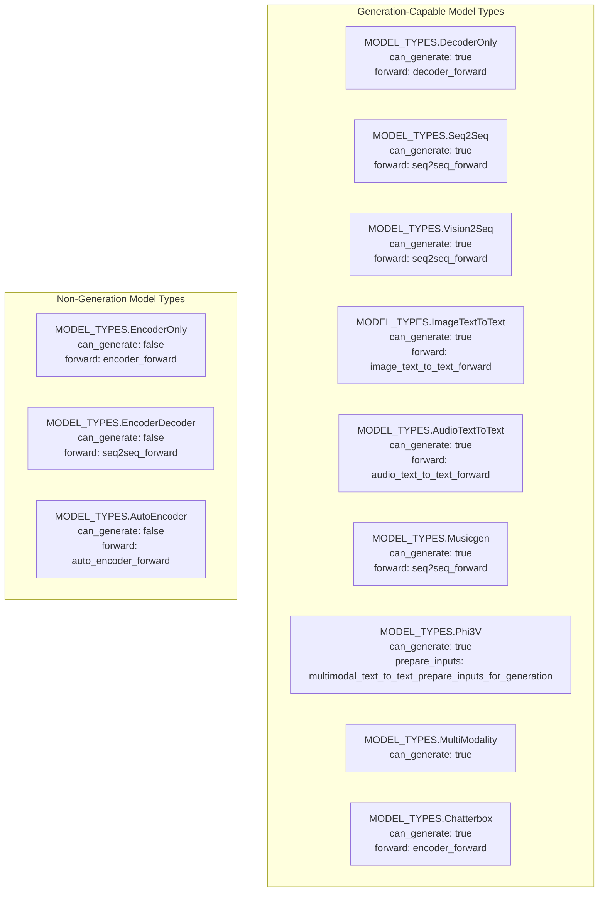
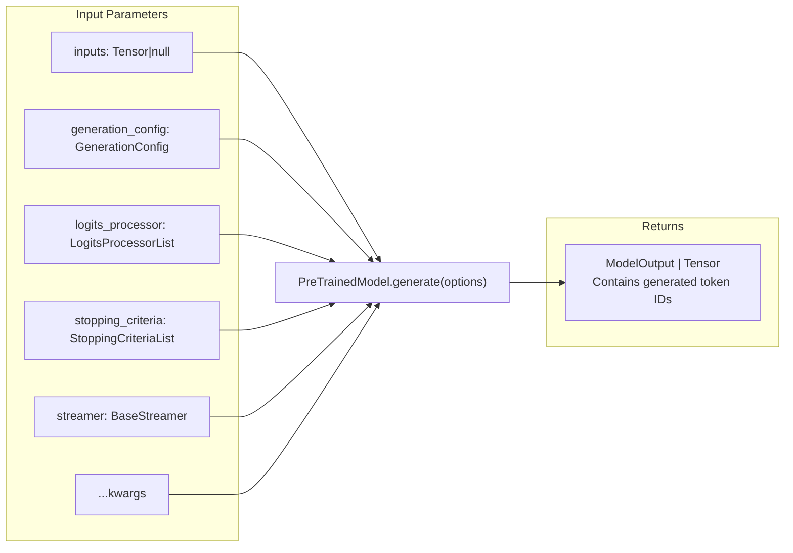
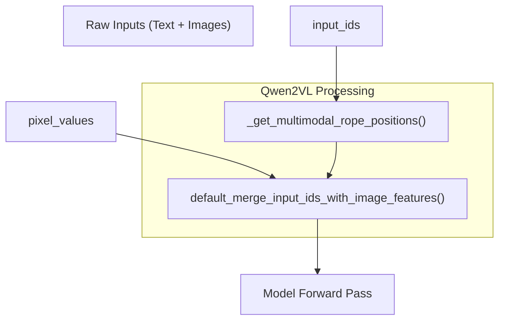

<!-- source: DeepWiki mcp.deepwiki.com · repo huggingface/transformers.js · page 10 Text Generation · fetched 2026-10-26 -->

# Text Generation

<details>
<summary>Relevant source files</summary>

The following files were used as context for generating this wiki page:

- [packages/transformers/src/generation/streamers.js](packages/transformers/src/generation/streamers.js)
- [packages/transformers/src/models/modeling_utils.js](packages/transformers/src/models/modeling_utils.js)
- [packages/transformers/src/models/qwen2_vl/modeling_qwen2_vl.js](packages/transformers/src/models/qwen2_vl/modeling_qwen2_vl.js)
- [packages/transformers/src/transformers.js](packages/transformers/src/transformers.js)
- [packages/transformers/tests/utils/generation.test.js](packages/transformers/tests/utils/generation.test.js)

</details>


This document provides a comprehensive guide to text generation capabilities in Transformers.js, including the `generate()` method and its associated configuration, processing, and sampling mechanisms. For information about the pipeline API that wraps text generation, see [Pipeline API](#2). For details about specific generation parameters and configuration options, see [Generation Configuration](#10.1).

## Purpose and Scope

Text generation in Transformers.js enables autoregressive generation of text sequences from language models. This functionality is implemented through the `PreTrainedModel.generate()` method and supports decoder-only models (e.g., GPT-2, LLaMA), encoder-decoder models (e.g., T5, BART), and multimodal models that generate text from images or audio. The generation system handles token sampling, applies constraints through logits processors, manages key-value caching, and provides streaming output capabilities.

## Generation-Capable Models

Not all model types support text generation. The system categorizes models by their architectural type and determines generation capability accordingly via the `MODEL_RUNTIME_CONFIG` mapping.



Sources: [packages/transformers/src/models/modeling_utils.js:96-162]()

### Model Architecture Mappings

The library uses mapping objects to associate model classes with their generation capabilities. For example, `Qwen2VLForConditionalGeneration` supports multimodal text generation, while standard causal LMs use the `DecoderOnly` runtime config.

| Model Category | Base Class / Mapping | Example Architectures |
|------------|------------|-------|
| **Causal LM** | `AutoModelForCausalLM` | `GPT2LMHeadModel`, `LlamaForCausalLM`, `Qwen2ForCausalLM` |
| **Seq2Seq** | `AutoModelForSeq2SeqLM` | `T5ForConditionalGeneration`, `BartForConditionalGeneration` |
| **Multimodal** | `AutoModelForVision2Seq` | `Qwen2VLForConditionalGeneration`, `Idefics3ForConditionalGeneration` |

Sources: [packages/transformers/src/models/modeling_utils.js:96-162](), [packages/transformers/src/models/qwen2_vl/modeling_qwen2_vl.js:24-28]()

## The generate() Method

The `generate()` method in `PreTrainedModel` is the primary interface for text generation. It orchestrates the entire generation process including initialization, iterative decoding, logits processing, sampling, and stopping criteria evaluation.

### Method Signature



Sources: [packages/transformers/src/models/modeling_utils.js:989-1069]()

### Generation Workflow

The generation process follows a multi-stage pipeline:

1.  **Validation**: `_validate_model_class()` ensures the model supports generation [packages/transformers/src/models/modeling_utils.js:776-803]().
2.  **Config Preparation**: `_prepare_generation_config()` merges user overrides with model defaults [packages/transformers/src/models/modeling_utils.js:715-744]().
3.  **Input Preparation**: `_prepare_model_inputs()` extracts necessary tensors for the forward pass [packages/transformers/src/models/modeling_utils.js:805-819]().
4.  **Logits & Stopping**: `_get_logits_processor()` and `_get_stopping_criteria()` initialize the constraints for the loop [packages/transformers/src/models/modeling_utils.js:548-706](), [packages/transformers/src/models/modeling_utils.js:751-770]().
5.  **Iteration Loop**: The model iteratively runs `forward()`, samples a token, and updates the `past_key_values` cache via `_update_model_kwargs_for_generation()` [packages/transformers/src/models/modeling_utils.js:821-842]().

## Key Generation Components

### Logits Processor Pipeline

Logits processors modify the raw logits before sampling to enforce constraints. These are collected in a `LogitsProcessorList`.

| Processor Class | Purpose |
|----------------|---------|
| `RepetitionPenaltyLogitsProcessor` | Penalize repeated tokens to avoid loops |
| `TemperatureLogitsWarper` | Scale logits to control randomness |
| `MinLengthLogitsProcessor` | Suppress EOS token until minimum length is reached |
| `NoRepeatNGramLogitsProcessor` | Prevent specific n-grams from appearing twice |

Sources: [packages/transformers/src/models/modeling_utils.js:20-33](), [packages/transformers/src/models/modeling_utils.js:548-706]()

### Streaming Output

Transformers.js provides `BaseStreamer` and `TextStreamer` classes to handle real-time output. The `TextStreamer` decodes tokens as they are produced and handles incomplete UTF-8 characters or CJK characters by caching tokens until a full word/character is formed.

```javascript
import { AutoModelForCausalLM, AutoTokenizer, TextStreamer } from '@huggingface/transformers';

const tokenizer = await AutoTokenizer.from_pretrained('Xenova/gpt2');
const model = await AutoModelForCausalLM.from_pretrained('Xenova/gpt2');

const streamer = new TextStreamer(tokenizer, {
    skip_prompt: true,
    callback_function: (text) => console.log(text)
});

const inputs = await tokenizer('Once upon a time');
await model.generate({ ...inputs, streamer });
```

Sources: [packages/transformers/src/generation/streamers.js:40-168](), [packages/transformers/tests/utils/generation.test.js:217-225]()

## Multimodal Generation

For models like `Qwen2VL`, the generation process involves complex input preparation to merge text and vision features. The `_get_multimodal_rope_positions` method calculates 3D Rotary Positional Embeddings (RoPE) for interleaved image and text data.



Sources: [packages/transformers/src/models/qwen2_vl/modeling_qwen2_vl.js:108-168](), [packages/transformers/src/models/qwen2_vl/modeling_qwen2_vl.js:1-6]()

## Related Documentation

- For details on generation parameters like `max_length`, `temperature`, `top_k`, see [Generation Configuration](#10.1)
- For information about logits processors and their effects, see [Logits Processing](#10.2)
- For sampling strategies (greedy, multinomial, beam search), see [Sampling Strategies](#10.3)
- For stopping criteria and early termination, see [Stopping Criteria](#10.4)
- For real-time output generation, see [Streaming Output](#10.5)

---

