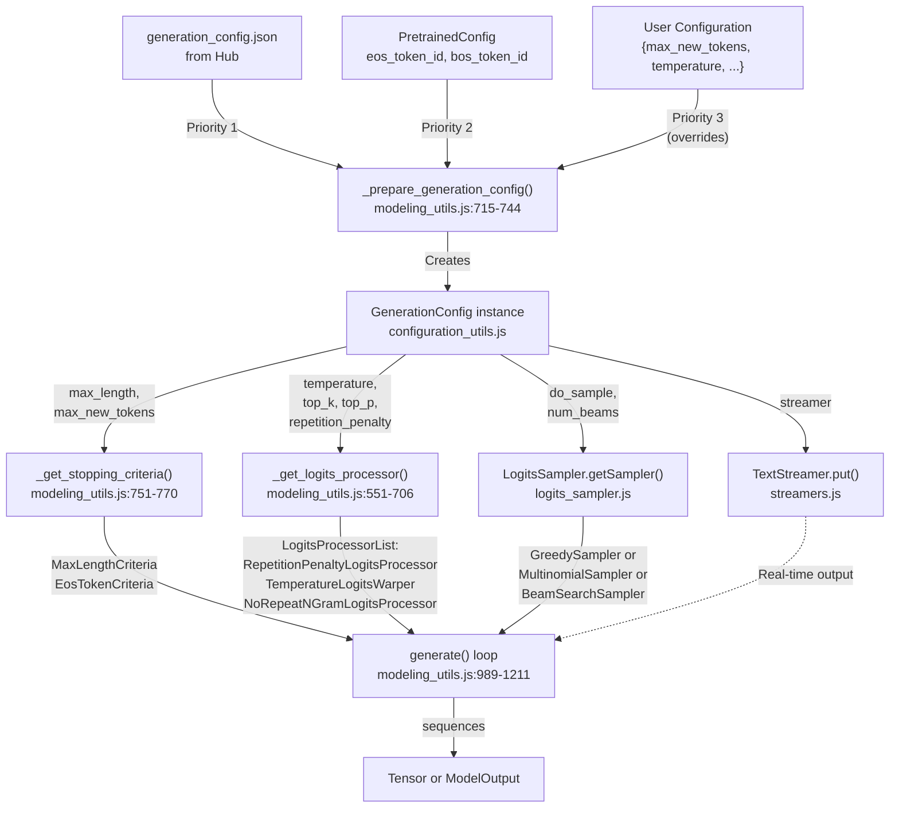
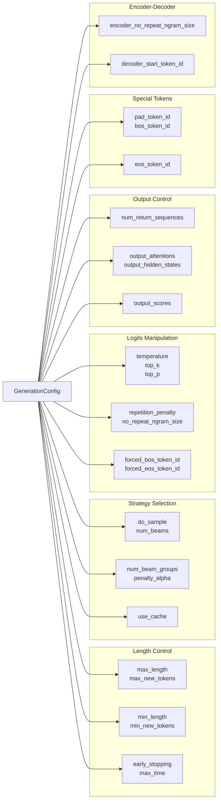
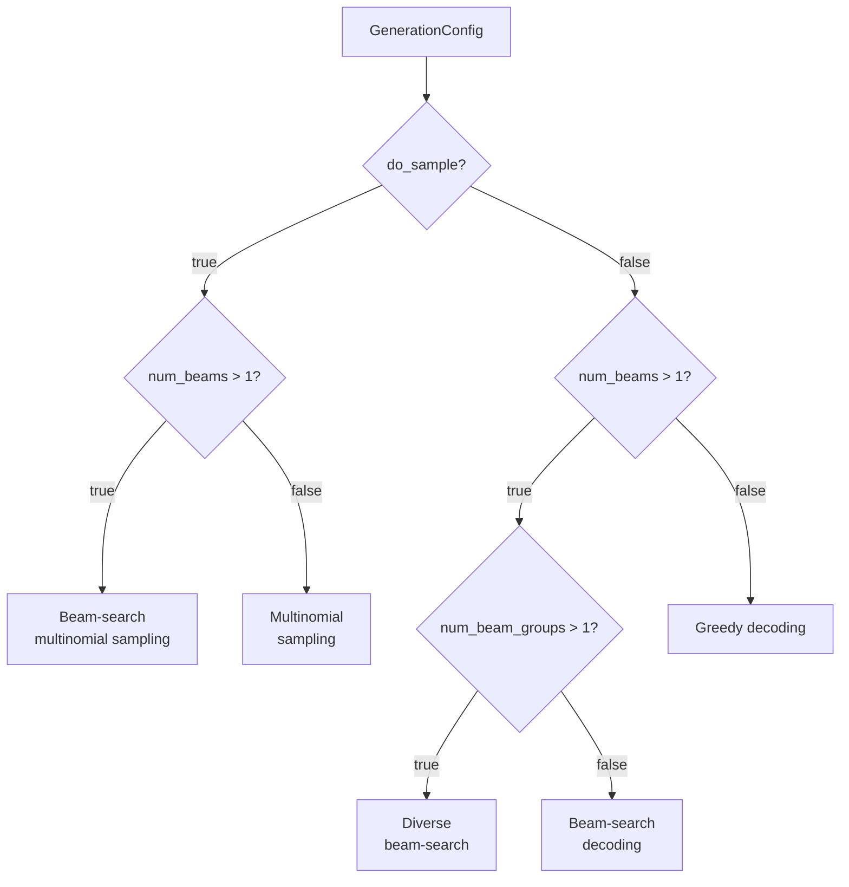

<!-- source: DeepWiki mcp.deepwiki.com · repo huggingface/transformers.js · page 10.1 Generation Configuration · fetched 2026-10-26 -->

# Generation Configuration

<details>
<summary>Relevant source files</summary>

The following files were used as context for generating this wiki page:

- [packages/transformers/jest.config.mjs](packages/transformers/jest.config.mjs)
- [packages/transformers/src/generation/parameters.js](packages/transformers/src/generation/parameters.js)
- [packages/transformers/src/models/auto/modeling_auto.js](packages/transformers/src/models/auto/modeling_auto.js)
- [packages/transformers/src/pipelines/index.js](packages/transformers/src/pipelines/index.js)
- [packages/transformers/tests/init.js](packages/transformers/tests/init.js)
- [packages/transformers/tests/pipelines/test_pipelines_text_generation.js](packages/transformers/tests/pipelines/test_pipelines_text_generation.js)
- [packages/transformers/tests/types/tokenizers.ts](packages/transformers/tests/types/tokenizers.ts)

</details>


The `GenerationConfig` class defines parameters that control text generation behavior in transformer models. This page documents the configuration options available for customizing generation output, including length constraints, sampling strategies, and output control. For details on how these configurations are applied during generation, see [Logits Processing](#10.2), [Sampling Strategies](#10.3), [Stopping Criteria](#10.4), and [Streaming Output](#10.5).

**Sources:** [packages/transformers/src/generation/configuration_utils.js](), [packages/transformers/src/generation/parameters.js]()

---

## Overview and Usage

The `GenerationConfig` class is defined in [packages/transformers/src/generation/configuration_utils.js]() and holds all parameters that influence text generation. The class is instantiated through three primary sources, merged in priority order:

1.  **Model defaults**: From `generation_config.json` loaded via `PreTrainedModel.from_pretrained()`
2.  **Config inheritance**: From `PretrainedConfig` properties (especially `eos_token_id`, `bos_token_id`)
3.  **User overrides**: Parameters passed directly to `model.generate()` or pipeline calls

The configuration is prepared in `PreTrainedModel._prepare_generation_config()` ([packages/transformers/src/models/modeling_utils.js:715-744]()) before being passed to the generation loop.

```javascript
// Example: Using GenerationConfig through pipeline
const generator = await pipeline('text-generation', 'model-id');
const result = await generator('Once upon a time', {
    max_new_tokens: 50,
    temperature: 0.7,
    top_k: 40,
    top_p: 0.9,
    repetition_penalty: 1.2,
    no_repeat_ngram_size: 3,
});
```

**Sources:** [packages/transformers/src/generation/configuration_utils.js](), [packages/transformers/src/models/modeling_utils.js:715-744](), [packages/transformers/tests/pipelines/test_pipelines_text_generation.js:45-46]()

---

## Configuration Architecture

The following diagram illustrates how `GenerationConfig` integrates with the generation pipeline:

**Generation Configuration Flow**



**Sources:** [packages/transformers/src/models/modeling_utils.js:551-770](), [packages/transformers/src/models/modeling_utils.js:989-1211](), [packages/transformers/src/generation/configuration_utils.js]()

---

## Parameter Categories

The `GenerationConfig` class organizes parameters into functional categories. The `GenerationFunctionParameters` typedef in [packages/transformers/src/generation/parameters.js:39-40]() combines these base parameters with dynamic keys.

**Parameter Category Mapping**



**Sources:** [packages/transformers/src/generation/configuration_utils.js](), [packages/transformers/src/generation/parameters.js:6-36]()

---

## Length Control Parameters

These parameters control the length of generated sequences:

| Parameter | Type | Default | Description |
| :--- | :--- | :--- | :--- |
| `max_length` | `number` | `20` | Maximum total length (prompt + generated tokens) |
| `max_new_tokens` | `number` | `null` | Maximum number of new tokens (excludes prompt). Overrides `max_length` if set |
| `min_length` | `number` | `0` | Minimum total length |
| `min_new_tokens` | `number` | `null` | Minimum number of new tokens. Overrides `min_length` if set |
| `early_stopping` | `boolean\|"never"` | `false` | Controls beam search stopping |
| `max_time` | `number` | `null` | Maximum time in seconds for generation |

**Usage Pattern:**

```javascript
// Generate exactly 3 new tokens (used in tiny-random model tests)
const output = await pipe(text_input, { max_new_tokens: 3 });
```

**Sources:** [packages/transformers/src/generation/configuration_utils.js](), [packages/transformers/src/models/modeling_utils.js:753-757](), [packages/transformers/tests/pipelines/test_pipelines_text_generation.js:45]()

---

## Generation Strategy Parameters

These parameters determine which generation algorithm is used:

| Parameter | Type | Default | Description |
| :--- | :--- | :--- | :--- |
| `do_sample` | `boolean` | `false` | Whether to use sampling (`true`) or greedy/beam search (`false`) |
| `num_beams` | `number` | `1` | Number of beams for beam search. `1` means no beam search |
| `num_beam_groups` | `number` | `1` | Number of groups for diverse beam search |
| `penalty_alpha` | `number` | `null` | Penalty for contrastive search decoding |
| `use_cache` | `boolean` | `true` | Whether to use past key/values (`DynamicCache`) to speed up decoding |

**Strategy Selection Logic:**



**Sources:** [packages/transformers/src/generation/configuration_utils.js](), [packages/transformers/src/generation/logits_sampler.js](), [packages/transformers/src/generation/parameters.js:33-35]()

---

## Logits Manipulation Parameters

These parameters modify the logits (pre-softmax scores) before sampling:

### Temperature and Probability Filtering

| Parameter | Type | Default | Description |
| :--- | :--- | :--- | :--- |
| `temperature` | `number` | `1.0` | Sampling temperature. < 1 decreases randomness |
| `top_k` | `number` | `50` | Number of highest probability tokens to keep |
| `top_p` | `number` | `1.0` | Cumulative probability threshold for nucleus sampling |
| `typical_p` | `number` | `1.0` | Local typicality threshold |
| `epsilon_cutoff` | `number` | `0.0` | Epsilon cutoff for truncation sampling |

**Sources:** [packages/transformers/src/generation/configuration_utils.js](), [packages/transformers/src/generation/logits_process.js](), [packages/transformers/src/models/modeling_utils.js:676-686]()

### Repetition Control

| Parameter | Type | Default | Description |
| :--- | :--- | :--- | :--- |
| `repetition_penalty` | `number` | `1.0` | Penalty for token repetition |
| `no_repeat_ngram_size` | `number` | `0` | Size of n-grams that can only occur once |
| `bad_words_ids` | `number[][]` | `null` | Sequences that should not be generated |

**Sources:** [packages/transformers/src/generation/configuration_utils.js](), [packages/transformers/src/generation/logits_process.js](), [packages/transformers/src/models/modeling_utils.js:575-598]()

---

## Output Control Parameters

These parameters define what the `generate()` method returns:

| Parameter | Type | Default | Description |
| :--- | :--- | :--- | :--- |
| `num_return_sequences` | `number` | `1` | Sequences to return per batch element |
| `output_attentions` | `boolean` | `false` | Return attention tensors |
| `output_hidden_states` | `boolean` | `false` | Return hidden states |
| `return_full_text` | `boolean` | `true` | If false, only returns generated text (excluding prompt) |

**Sources:** [packages/transformers/src/generation/configuration_utils.js](), [packages/transformers/tests/pipelines/test_pipelines_text_generation.js:62]()

---

## Special Token Parameters

| Parameter | Type | Default | Description |
| :--- | :--- | :--- | :--- |
| `pad_token_id` | `number` | `null` | ID of the padding token |
| `bos_token_id` | `number` | `null` | ID of the beginning-of-sequence token |
| `eos_token_id` | `number\|number[]` | `null` | ID(s) of the end-of-sequence token |

**Sources:** [packages/transformers/src/generation/configuration_utils.js](), [packages/transformers/src/generation/parameters.js:9]()

---

## Streaming Parameter

| Parameter | Type | Default | Description |
| :--- | :--- | :--- | :--- |
| `streamer` | `BaseStreamer` | `null` | Streamer object to stream generated tokens |

**Sources:** [packages/transformers/src/generation/parameters.js:28-30](), [packages/transformers/src/generation/configuration_utils.js]()

---

## Type Definitions and Function Parameters

The `GenerationFunctionParameters` type extends `GenerationConfig` for use in the `generate()` method:

**Key Properties ([packages/transformers/src/generation/parameters.js:6-36]()):**

*   `inputs`: Input tensor (e.g., `input_ids`, `pixel_values`).
*   `generation_config`: Base `GenerationConfig` to merge with overrides.
*   `logits_processor`: Custom `LogitsProcessorList` for advanced users.
*   `stopping_criteria`: Custom `StoppingCriteriaList` for advanced users.
*   `streamer`: `BaseStreamer` instance for real-time output.
*   `past_key_values`: A `DynamicCache` object for efficient sequential generation.

**Sources:** [packages/transformers/src/generation/parameters.js]()

---

