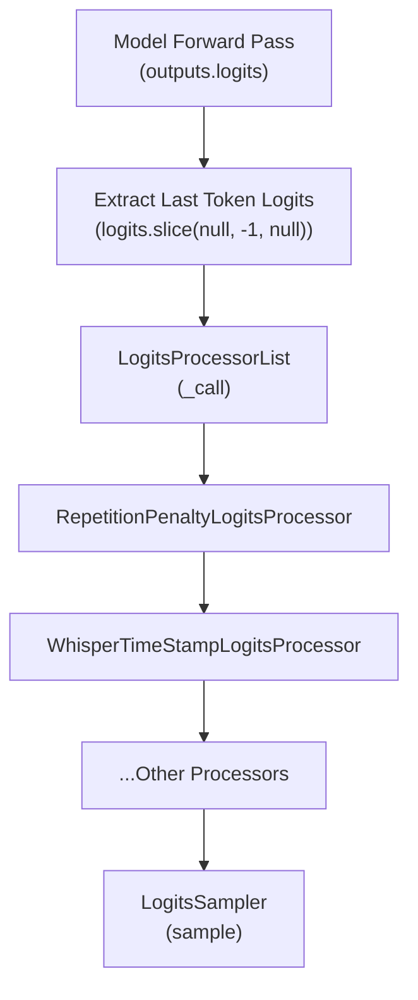
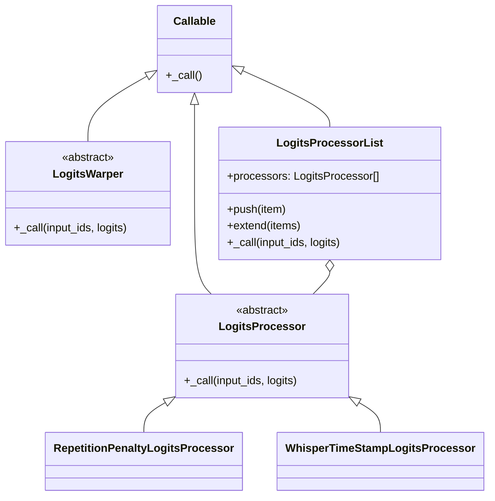
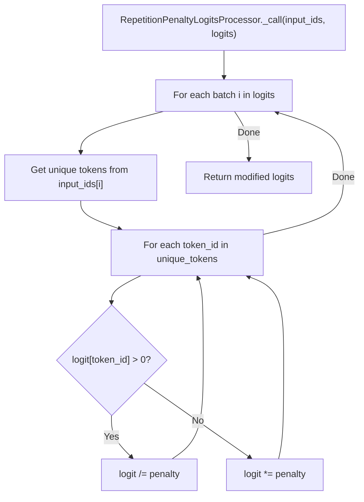

<!-- source: DeepWiki mcp.deepwiki.com · repo huggingface/transformers.js · page 10.2 Logits Processing · fetched 2026-10-26 -->

# Logits Processing

Relevant source files

The following files were used as context for generating this wiki page:

- [packages/transformers/src/generation/logits_process.js](packages/transformers/src/generation/logits_process.js)
- [packages/transformers/src/generation/logits_sampler.js](packages/transformers/src/generation/logits_sampler.js)
- [packages/transformers/src/models/clap/feature_extraction_clap.js](packages/transformers/src/models/clap/feature_extraction_clap.js)
- [packages/transformers/src/models/whisper/tokenization_whisper.js](packages/transformers/src/models/whisper/tokenization_whisper.js)
- [packages/transformers/src/utils/random.js](packages/transformers/src/utils/random.js)
- [packages/transformers/tests/asset_cache.js](packages/transformers/tests/asset_cache.js)
- [packages/transformers/tests/models/clap/test_feature_extraction_clap.js](packages/transformers/tests/models/clap/test_feature_extraction_clap.js)
- [packages/transformers/tests/models/whisper/test_modeling_whisper.js](packages/transformers/tests/models/whisper/test_modeling_whisper.js)
- [packages/transformers/tests/models/whisper/test_tokenization_whisper.js](packages/transformers/tests/models/whisper/test_tokenization_whisper.js)
- [packages/transformers/tests/utils/audio.test.js](packages/transformers/tests/utils/audio.test.js)
- [packages/transformers/tests/utils/random.test.js](packages/transformers/tests/utils/random.test.js)

## Purpose and Scope

Logits processing is the system that modifies raw model logits before token sampling occurs during text generation. This document covers the `LogitsProcessorList` container, built-in processor implementations like `RepetitionPenaltyLogitsProcessor` and `WhisperTimeStampLogitsProcessor`, and how these modifiers are integrated into the generation pipeline. For information about the sampling strategies that operate on processed logits, see [Sampling Strategies](#10.3). For generation configuration parameters, see [Generation Configuration](#10.1).

## Overview

During text generation, models output raw logits representing unnormalized probabilities for each token in the vocabulary. Logits processing transforms these raw outputs to enforce constraints, apply penalties, or adjust distributions before sampling. The system operates as a pipeline where each processor applies a specific transformation to the logits tensor.

The logits processing pipeline is invoked during the generation loop after the model's forward pass but before token sampling. Each processor modifies logits based on the previously generated `input_ids` and the current `logits` tensor [packages/transformers/src/generation/logits_process.js:82-89]().

**Logits Processing Data Flow**

Sources: [packages/transformers/src/generation/logits_process.js:82-89](), [packages/transformers/src/generation/logits_sampler.js:30-34]()

## LogitsProcessorList

The `LogitsProcessorList` class serves as a container for managing multiple logits processors and applying them sequentially [packages/transformers/src/generation/logits_process.js:49-56](). It extends `Callable` and maintains an internal array of processors.

**Key Methods:**
- `push(item)`: Adds a single `LogitsProcessor` to the list [packages/transformers/src/generation/logits_process.js:63-65]().
- `extend(items)`: Adds multiple processors to the list [packages/transformers/src/generation/logits_process.js:72-74]().
- `_call(input_ids, logits)`: Applies all processors in the list to the logits, typically modifying them in-place [packages/transformers/src/generation/logits_process.js:82-89]().

**Class Hierarchy**

Sources: [packages/transformers/src/generation/logits_process.js:13-94]()

## Built-in Logits Processors

The library provides several specialized processors to handle common generation tasks and model-specific constraints.

### RepetitionPenaltyLogitsProcessor
Penalizes tokens that have already appeared in the generated sequence to reduce repetition [packages/transformers/src/generation/logits_process.js:231-238]().
- **Parameter**: `penalty` (number). A value > 1.0 penalizes tokens, while < 1.0 encourages them.
- **Logic**: For each token already in `input_ids`, if the logit is positive, it is divided by the penalty; if negative, it is multiplied by the penalty [packages/transformers/src/generation/logits_process.js:255-263]().

### WhisperTimeStampLogitsProcessor
A specialized processor for OpenAI's Whisper model that handles timestamp token generation [packages/transformers/src/generation/logits_process.js:463-475]().
- **Logic**: 
    - Suppresses the `<|notimestamps|>` token if `return_timestamps` is true [packages/transformers/src/generation/logits_process.js:496-501]().
    - Enforces timestamp rules: timestamps must appear in pairs, and the second timestamp in a pair must be greater than the first [packages/transformers/src/generation/logits_process.js:512-550]().
    - Handles the transition between text tokens and timestamp tokens based on the `max_initial_timestamp_index` [packages/transformers/src/generation/logits_process.js:503-510]().

### ForcedBOSTokenLogitsProcessor
Forces a Beginning-of-Sequence (BOS) token at the very start of generation (when `input_ids.length === 1`) by setting all other logits to `-Infinity` [packages/transformers/src/generation/logits_process.js:137-163]().

### ForcedEOSTokenLogitsProcessor
Forces an End-of-Sequence (EOS) token when the `max_length` is reached by setting all other logits to `-Infinity` [packages/transformers/src/generation/logits_process.js:168-198]().

### SuppressTokensLogitsProcessor
Suppresses a specific list of tokens throughout the entire generation process by setting their log probabilities to `-Infinity` [packages/transformers/src/generation/logits_process.js:204-226]().

### LogitsWarper (e.g., TemperatureLogitsWarper)
`LogitsWarper` is a specialized base class for processors applied during multinomial sampling [packages/transformers/src/generation/logits_process.js:30-42]().
- **TemperatureLogitsWarper**: Divides logits by a `temperature` value. Lower temperatures (< 1.0) make the distribution sharper (more greedy), while higher temperatures (> 1.0) make it flatter (more random) [packages/transformers/src/generation/logits_process.js:358-378]().

| Processor | Primary Config Parameter | Effect on Logits |
| :--- | :--- | :--- |
| `RepetitionPenaltyLogitsProcessor` | `repetition_penalty` | Scales down logits of tokens already present in `input_ids`. |
| `WhisperTimeStampLogitsProcessor` | `return_timestamps` | Masks timestamps or text based on Whisper's grammar rules. |
| `ForcedBOSTokenLogitsProcessor` | `forced_bos_token_id` | Sets all but BOS to `-inf` at step 0. |
| `SuppressTokensLogitsProcessor` | `suppress_tokens` | Sets specified token IDs to `-inf` at every step. |
| `TemperatureLogitsWarper` | `temperature` | Divides all logits by `temperature`. |

Sources: [packages/transformers/src/generation/logits_process.js:137-550]()

## Implementation Details

### Data Flow within Processors
Most processors modify the `logits.data` (usually a `Float32Array`) in-place for performance. The `input_ids` are passed as `bigint[][]` representing the batch and sequence dimensions.

**Logic Flow in Repetition Penalty**

Sources: [packages/transformers/src/generation/logits_process.js:250-267]()

### Whisper Tokenizer Integration
The `WhisperTokenizer` provides the necessary metadata for the `WhisperTimeStampLogitsProcessor`, such as the `timestamp_begin` ID [packages/transformers/src/models/whisper/tokenization_whisper.js:19-21](). This ID is used to differentiate between text tokens and timestamp tokens (which start after `<|notimestamps|>`).

Sources: [packages/transformers/src/models/whisper/tokenization_whisper.js:19-21](), [packages/transformers/src/generation/logits_process.js:478-485]()

## Usage in Text Generation

Logits processors are typically not instantiated by the user directly. Instead, the `generate()` method in `modeling_utils.js` (referenced conceptually) uses the `GenerationConfig` to populate a `LogitsProcessorList`.

1.  **Configuration**: Parameters like `repetition_penalty` or `temperature` are read from the `GenerationConfig` [packages/transformers/src/generation/logits_sampler.js:80-102]().
2.  **Execution**: At each step of the autoregressive loop, the model produces logits for the entire sequence. The generator slices the last token's logits and passes them through the `LogitsProcessorList` [packages/transformers/src/generation/logits_process.js:82-89]().
3.  **Sampling**: The resulting "scores" (processed logits) are then passed to a `LogitsSampler` (Greedy, Multinomial, or BeamSearch) to select the next token [packages/transformers/src/generation/logits_sampler.js:30-34]().

Sources: [packages/transformers/src/generation/logits_process.js:82-89](), [packages/transformers/src/generation/logits_sampler.js:15-34]()

---

