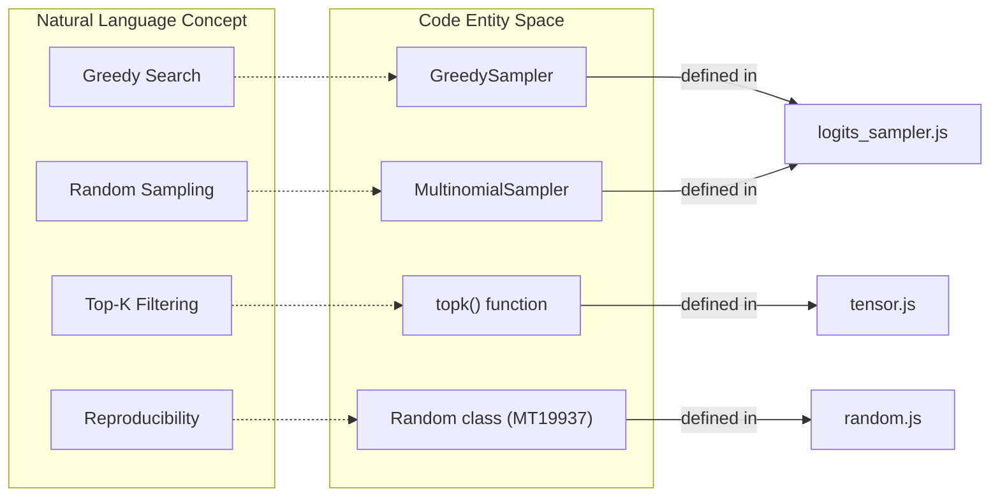
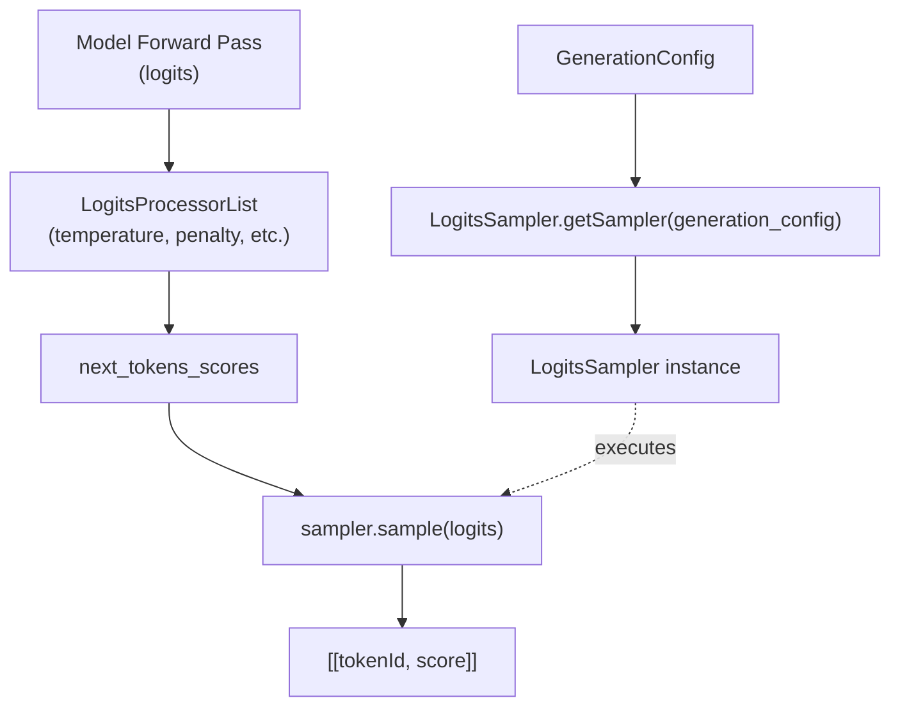

<!-- source: DeepWiki mcp.deepwiki.com · repo huggingface/transformers.js · page 10.3 Sampling Strategies · fetched 2026-10-26 -->

# Sampling Strategies

Relevant source files

The following files were used as context for generating this wiki page:

- [packages/transformers/src/generation/logits_sampler.js](packages/transformers/src/generation/logits_sampler.js)
- [packages/transformers/src/models/clap/feature_extraction_clap.js](packages/transformers/src/models/clap/feature_extraction_clap.js)
- [packages/transformers/src/utils/random.js](packages/transformers/src/utils/random.js)
- [packages/transformers/tests/models/clap/test_feature_extraction_clap.js](packages/transformers/tests/models/clap/test_feature_extraction_clap.js)
- [packages/transformers/tests/utils/random.test.js](packages/transformers/tests/utils/random.test.js)

This page documents the sampling strategies used during text generation to select the next token from the model's output probability distribution. Sampling strategies determine how the model chooses tokens during generation, ranging from deterministic greedy selection to stochastic multinomial sampling with various constraints.

For information about how logits are modified before sampling, see [Logits Processing](packages/transformers/src/generation/logits_process.js). For information about when generation should stop, see [Stopping Criteria](packages/transformers/src/generation/stopping_criteria.js). For the overall generation configuration, see [Generation Configuration](packages/transformers/src/generation/configuration_utils.js).

## Purpose and Scope

Sampling strategies control the token selection mechanism during autoregressive generation. After the model produces logits for each token in the vocabulary and logits processors modify these scores, a sampling strategy determines which token(s) to select as the next generated token. This page covers:

- The `LogitsSampler` class and its role in the generation pipeline.
- Different sampling methods: greedy search, multinomial sampling, and beam search.
- The use of the `Random` class for reproducible stochastic sampling.
- How generation configuration parameters control sampling behavior.

## Sampling in the Generation Pipeline

The sampling strategy is determined by the `GenerationConfig` and operates as a function that maps processed logits to selected token IDs. The sampler is created via a factory method and called at each decoding step.

### Natural Language Space to Code Entity Space

**Sources:** [packages/transformers/src/generation/logits_sampler.js:15-183](), [packages/transformers/src/utils/random.js:44-192](), [packages/transformers/src/utils/tensor.js]()

### Sampling Flow Diagram

**Sources:** [packages/transformers/src/generation/logits_sampler.js:80-102](), [packages/transformers/src/generation/logits_sampler.js:30-34]()

## LogitsSampler Class

The `LogitsSampler` class is a `Callable` base class for all sampling methods. It provides a static factory method `getSampler()` to instantiate the correct strategy based on `GenerationConfig`.

### Sampler Selection Logic

The library chooses a sampler based on the following priority:
1. **Multinomial Sampling**: If `do_sample` is `true` [packages/transformers/src/generation/logits_sampler.js:90-91]().
2. **Beam Search**: If `num_beams > 1` and `do_sample` is `false` [packages/transformers/src/generation/logits_sampler.js:92-93]().
3. **Greedy Search**: Default when `num_beams=1` and `do_sample=false` [packages/transformers/src/generation/logits_sampler.js:100]().

**Sources:** [packages/transformers/src/generation/logits_sampler.js:80-102]()

## Greedy Search

Implemented by the `GreedySampler` class, this strategy deterministically selects the token with the highest logit value.

- **Implementation**: Uses the `max` utility to find the argmax of the logits [packages/transformers/src/generation/logits_sampler.js:116]().
- **Score**: The returned score is `0` (log probability of 1) since the choice is deterministic [packages/transformers/src/generation/logits_sampler.js:120]().

**Sources:** [packages/transformers/src/generation/logits_sampler.js:108-122]()

## Multinomial Sampling

Implemented by the `MultinomialSampler` class, this strategy introduces randomness by sampling from the probability distribution.

### The Sampling Process
1. **Top-K Extraction**: If `top_k > 0`, the library uses the `topk` utility to restrict the vocabulary to the top `k` candidates [packages/transformers/src/generation/logits_sampler.js:135-140]().
2. **Probability Computation**: A `softmax` is applied to the top-k logits to produce a valid probability distribution [packages/transformers/src/generation/logits_sampler.js:143]().
3. **Weighted Selection**: The `randomSelect` method uses `_weightedIndex` from the random utility to pick a token based on the computed probabilities [packages/transformers/src/generation/logits_sampler.js:71-73](), [packages/transformers/src/generation/logits_sampler.js:146]().

**Sources:** [packages/transformers/src/generation/logits_sampler.js:127-153](), [packages/transformers/src/utils/random.js:195-207]()

## Reproducibility and the Random Class

To ensure generation is reproducible (matching Python's Hugging Face Transformers exactly), the library implements a custom Mersenne Twister 19937 PRNG in `packages/transformers/src/utils/random.js`.

### Key Features of the Random Class
- **Python Compatibility**: Matches Python's `random` module behavior, including `seed`, `random`, and `gauss` [packages/transformers/src/utils/random.js:4-10]().
- **Independent State**: Each `Random` instance maintains its own state buffer (`Uint32Array(624)`) [packages/transformers/src/utils/random.js:44-51]().
- **Entropy Seeding**: If no seed is provided, it uses `crypto.getRandomValues` if available, or falls back to `Date.now()` [packages/transformers/src/utils/random.js:63-71]().

### Use in Other Components
The `random` utility is also used in feature extraction, such as `ClapFeatureExtractor`, for random truncation of audio waveforms [packages/transformers/src/models/clap/feature_extraction_clap.js:62]().

**Sources:** [packages/transformers/src/utils/random.js:44-192](), [packages/transformers/src/models/clap/feature_extraction_clap.js:4-63]()

## Beam Search Sampling

The `BeamSearchSampler` is used when `num_beams > 1`.

- **Implementation**: Similar to multinomial sampling, it retrieves the top-k tokens and their probabilities [packages/transformers/src/generation/logits_sampler.js:166-174]().
- **Output**: Unlike the other samplers, it returns an array of `num_beams` candidates, where each candidate represents a path in the beam search [packages/transformers/src/generation/logits_sampler.js:176-182]().

**Sources:** [packages/transformers/src/generation/logits_sampler.js:158-183]()

## Summary of Sampler Properties

| Sampler | Class Name | `do_sample` | `num_beams` | Deterministic |
| :--- | :--- | :--- | :--- | :--- |
| **Greedy** | `GreedySampler` | `false` | `1` | Yes |
| **Multinomial** | `MultinomialSampler` | `true` | `1` | No |
| **Beam Search** | `BeamSearchSampler` | `false` | `> 1` | Yes |

**Sources:** [packages/transformers/src/generation/logits_sampler.js:80-102]()

---

