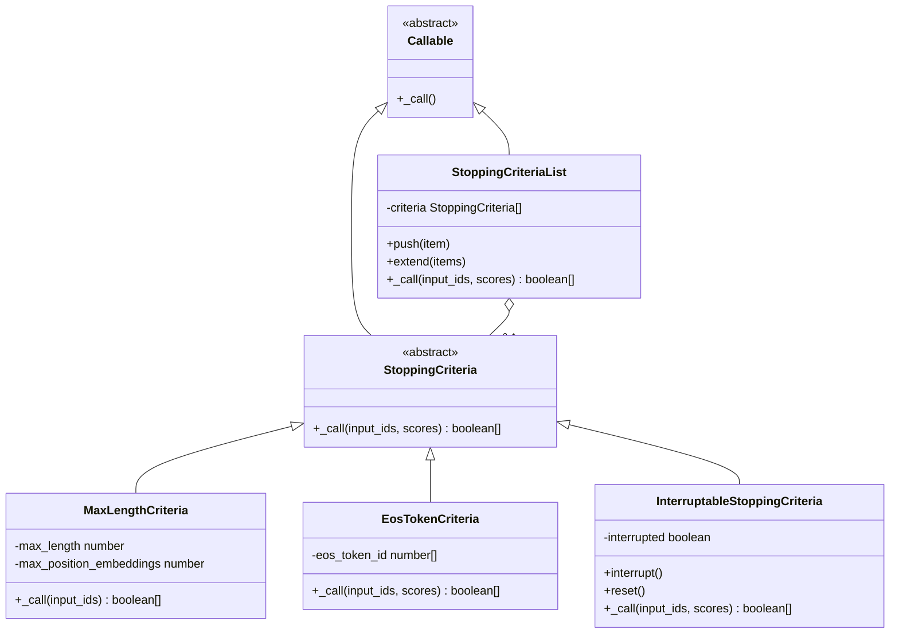
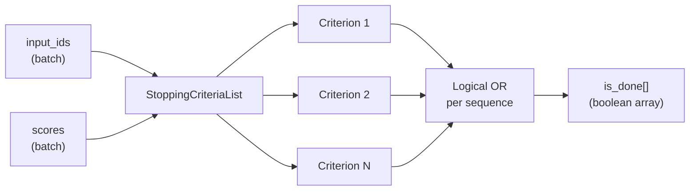
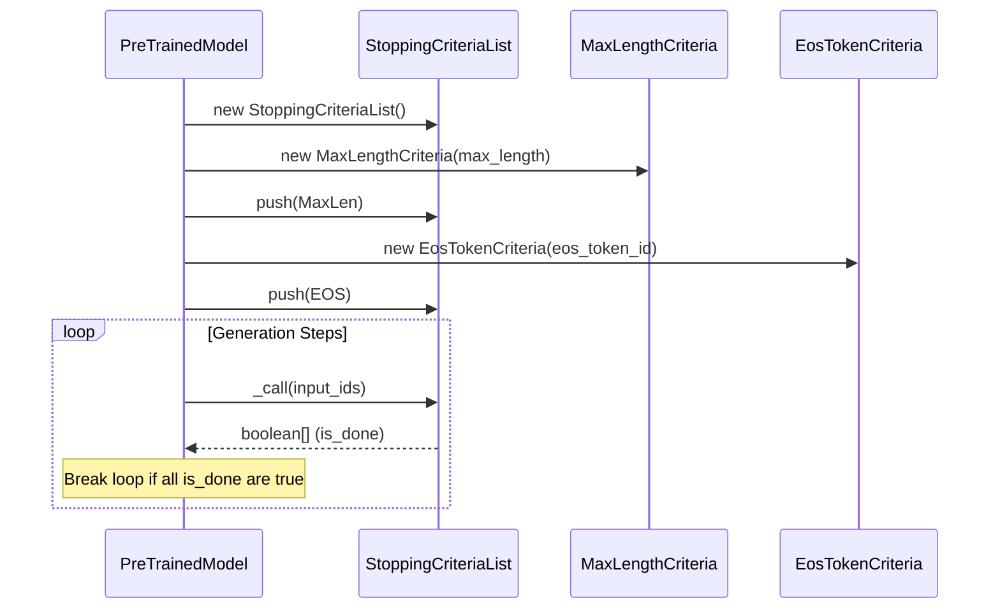

<!-- source: DeepWiki mcp.deepwiki.com · repo huggingface/transformers.js · page 10.4 Stopping Criteria · fetched 2026-10-26 -->

# Stopping Criteria

<details>
<summary>Relevant source files</summary>

The following files were used as context for generating this wiki page:

- [packages/transformers/src/generation/parameters.js](packages/transformers/src/generation/parameters.js)
- [packages/transformers/src/models/modeling_utils.js](packages/transformers/src/models/modeling_utils.js)
- [packages/transformers/src/models/qwen2_vl/modeling_qwen2_vl.js](packages/transformers/src/models/qwen2_vl/modeling_qwen2_vl.js)
- [packages/transformers/tests/types/tokenizers.ts](packages/transformers/tests/types/tokenizers.ts)

</details>


## Purpose and Scope

This document explains the stopping criteria system that controls when text generation terminates in `transformers.js`. Stopping criteria are predicates evaluated during each generation step to determine whether sequences in a batch should stop producing new tokens. The system provides extensible abstract base classes and several built-in implementations for common stopping conditions like maximum length and end-of-sequence tokens.

For information about generation configuration parameters, see [Generation Configuration](#10.1). For details on the generation process itself, see [Text Generation](#10).

**Sources:** [packages/transformers/src/generation/stopping_criteria.js:1-157](), [packages/transformers/src/generation/parameters.js:1-36]()

## System Architecture

The stopping criteria system follows a processor pattern similar to logits processors, with a base class for individual criteria and a list class for combining multiple criteria.



**Sources:** [packages/transformers/src/generation/stopping_criteria.js:8-76]()

## Base Classes

### StoppingCriteria

The abstract base class for all stopping criteria. Each criterion must implement the `_call` method which receives the current generation state and returns a boolean array indicating which sequences should stop.

| Parameter | Type | Description |
|-----------|------|-------------|
| `input_ids` | `number[][]` | Token IDs for each sequence in the batch, shape `(batch_size, sequence_length)` |
| `scores` | `number[][]` | Optional prediction scores, shape `(batch_size, vocab_size)` |
| **Returns** | `boolean[]` | Array of `batch_size` booleans indicating whether each sequence should stop |

**Sources:** [packages/transformers/src/generation/stopping_criteria.js:14-27]()

### StoppingCriteriaList

A container class that aggregates multiple `StoppingCriteria` instances and applies them sequentially. A sequence is marked for stopping if **any** criterion returns `true` for that sequence (logical OR).



The `_call` method implementation uses logical OR assignment (`||=`) to combine results:

```javascript
const is_done = new Array(input_ids.length).fill(false);
for (const criterion of this.criteria) {
    const criterion_done = criterion(input_ids, scores);
    for (let i = 0; i < is_done.length; ++i) {
        is_done[i] ||= criterion_done[i];
    }
}
```

Methods:
- `push(item)`: Adds a single `StoppingCriteria` to the list.
- `extend(items)`: Adds multiple criteria (accepts `StoppingCriteria`, `StoppingCriteriaList`, or array).

**Sources:** [packages/transformers/src/generation/stopping_criteria.js:30-76]()

## Built-in Stopping Criteria

### MaxLengthCriteria

Stops generation when sequences reach a specified maximum length. This is automatically instantiated during `generate()` based on `max_length` or `max_new_tokens`.

**Constructor Parameters:**

| Parameter | Type | Description |
|-----------|------|-------------|
| `max_length` | `number` | Maximum total sequence length (prompt + generated tokens) |
| `max_position_embeddings` | `number` (optional) | Model's maximum positional embedding length |

**Implementation:**

The criterion checks if each sequence has reached the maximum length:

```javascript
_call(input_ids) {
    return input_ids.map(ids => ids.length >= this.max_length);
}
```

**Sources:** [packages/transformers/src/generation/stopping_criteria.js:78-98]()

### EosTokenCriteria

Stops generation when an end-of-sequence token is produced. Supports multiple EOS tokens to handle models with different termination tokens.

**Constructor Parameters:**

| Parameter | Type | Description |
|-----------|------|-------------|
| `eos_token_id` | `number\|number[]` | Single EOS token ID or array of valid EOS token IDs |

**Implementation:**

The criterion checks if the last generated token matches any of the specified EOS tokens. It uses loose equality (`==`) to support comparisons between `bigint` (internal representation) and `number` (configuration representation).

```javascript
_call(input_ids, scores) {
    return input_ids.map(ids => {
        const last = ids.at(-1);
        return this.eos_token_id.some(eos_id => last == eos_id);
    });
}
```

**Sources:** [packages/transformers/src/generation/stopping_criteria.js:102-134]()

### InterruptableStoppingCriteria

Allows programmatic interruption of generation. This is useful for interactive applications where a user might want to cancel a long-running generation task.

**Methods:**

| Method | Description |
|--------|-------------|
| `interrupt()` | Sets the interrupted flag, causing all sequences to stop on the next check |
| `reset()` | Clears the interrupted flag, allowing the instance to be reused |

**Sources:** [packages/transformers/src/generation/stopping_criteria.js:136-156]()

## Integration with Generation Pipeline

Stopping criteria are integrated into the `generate()` method of `PreTrainedModel`. The `StoppingCriteriaList` is typically populated during the initialization phase of the generation loop.



**Sources:** [packages/transformers/src/models/modeling_utils.js:35](), [packages/transformers/src/generation/stopping_criteria.js:30-76]()

## Minimum Length Enforcement

While not technically "Stopping Criteria" (which return true to stop), the library uses `LogitsProcessor` implementations to prevent early stopping by masking EOS tokens until a minimum length is reached.

### MinLengthLogitsProcessor
Ensures the total sequence length reaches a minimum threshold.

### MinNewTokensLengthLogitsProcessor
Ensures a minimum number of *new* tokens are generated, accounting for the prompt length.

```javascript
// Internal logic for MinNewTokensLengthLogitsProcessor
const new_tokens_length = input_ids[i].length - this.prompt_length_to_skip;
if (new_tokens_length < this.min_new_tokens) {
    const batch_logits_data = logits[i].data;
    for (const eos_token of this.eos_token_id) {
        batch_logits_data[eos_token] = -Infinity;
    }
}
```

**Sources:** [packages/transformers/src/models/modeling_utils.js:29-30](), [packages/transformers/src/generation/logits_process.js:454-526]()

## Implementation Notes

- **BigInt Compatibility**: The `EosTokenCriteria` explicitly uses `==` instead of `===` to allow for comparison between `number` and `bigint` types, which is critical when handling token IDs in JavaScript environments where large integers may be represented as `bigint` [packages/transformers/src/generation/stopping_criteria.js:126]().
- **TODOs**: The codebase contains a placeholder for `MaxTimeCriteria`, which is not yet implemented [packages/transformers/src/generation/stopping_criteria.js:100]().
- **Parameters**: Custom stopping criteria can be passed to the `generate()` function via the `stopping_criteria` property in the parameters object [packages/transformers/src/generation/parameters.js:24-27]().

---

