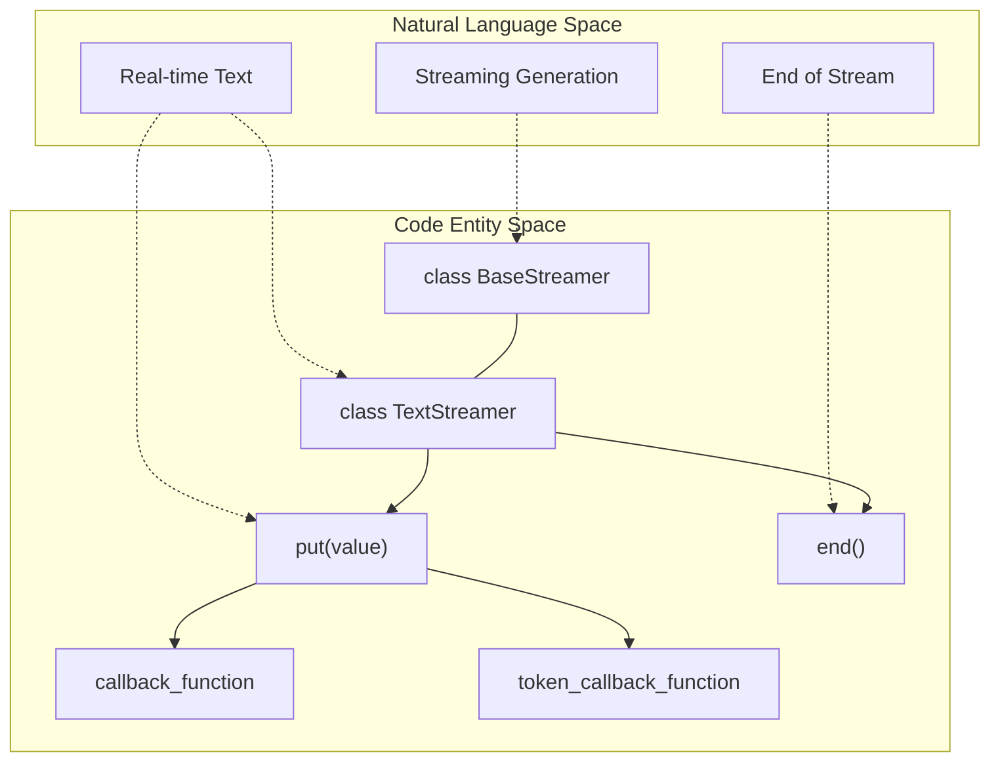
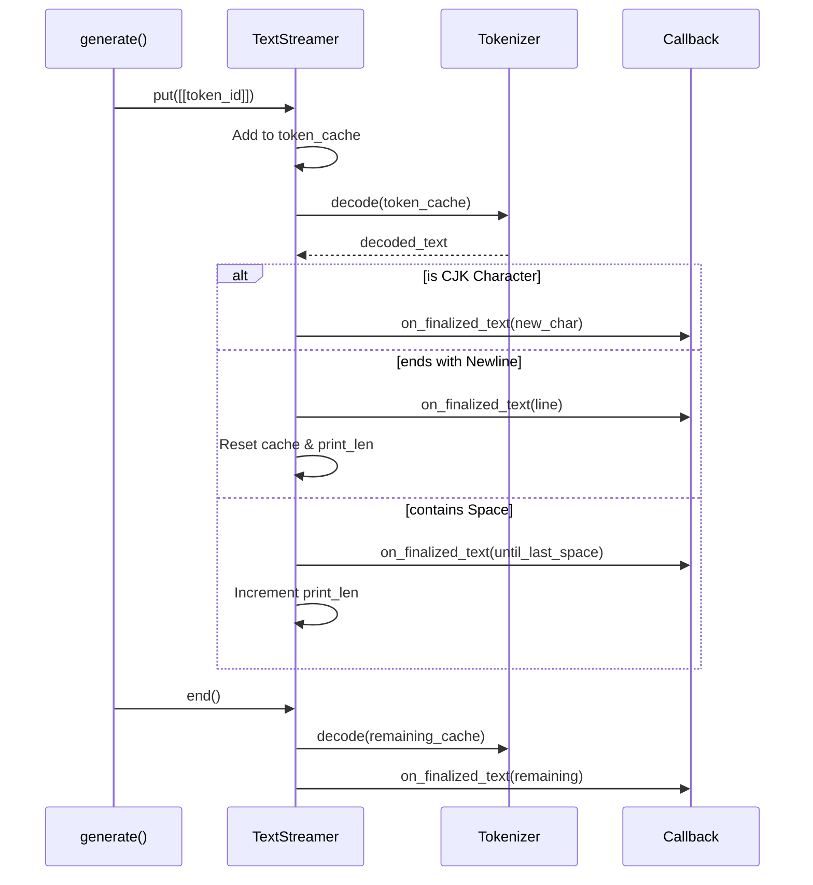

<!-- source: DeepWiki mcp.deepwiki.com · repo huggingface/transformers.js · page 10.5 Streaming Output · fetched 2026-10-26 -->

# Streaming Output

<details>
<summary>Relevant source files</summary>

The following files were used as context for generating this wiki page:

- [packages/transformers/jest.config.mjs](packages/transformers/jest.config.mjs)
- [packages/transformers/src/generation/streamers.js](packages/transformers/src/generation/streamers.js)
- [packages/transformers/src/models/auto/modeling_auto.js](packages/transformers/src/models/auto/modeling_auto.js)
- [packages/transformers/src/pipelines/index.js](packages/transformers/src/pipelines/index.js)
- [packages/transformers/src/transformers.js](packages/transformers/src/transformers.js)
- [packages/transformers/tests/init.js](packages/transformers/tests/init.js)
- [packages/transformers/tests/pipelines/test_pipelines_text_generation.js](packages/transformers/tests/pipelines/test_pipelines_text_generation.js)
- [packages/transformers/tests/utils/generation.test.js](packages/transformers/tests/utils/generation.test.js)

</details>


## Purpose and Scope

This document describes the streaming output capabilities in Transformers.js, which enable real-time token-by-token output during model inference. Streaming allows applications to display generated text progressively as it is produced, rather than waiting for the entire generation to complete. This is particularly critical for Large Language Models (LLMs) where total generation time can be several seconds.

The implementation relies on the `BaseStreamer` and `TextStreamer` classes located in `packages/transformers/src/generation/streamers.js`.

---

## Streaming Architecture

Streaming output is implemented through a callback mechanism integrated into the generation loop. The system invokes user-provided callbacks at specific points during generation, allowing real-time access to generated tokens without blocking the generation process.

### Natural Language to Code Entity Mapping

The following diagram bridges high-level streaming concepts to the specific classes and methods implemented in the codebase.



**Diagram: Streaming Entity Mapping**  
Associates streaming concepts with the `BaseStreamer` and `TextStreamer` classes and their operational methods.

Sources: [packages/transformers/src/generation/streamers.js:18-40]()

---

## The Streamer Classes

Transformers.js provides a base interface and specialized implementations for handling token streams.

### BaseStreamer
The `BaseStreamer` class defines the contract for all streamers. It requires implementation of two primary methods:
- `put(value)`: Called by `.generate()` to push new tokens into the streamer [packages/transformers/src/generation/streamers.js:23-25]().
- `end()`: Called by `.generate()` to signal that generation is complete [packages/transformers/src/generation/streamers.js:30-32]().

### TextStreamer
The `TextStreamer` is the standard implementation for text-based models. It handles the complexity of decoding token IDs into strings and managing a cache to ensure that multi-token characters (like UTF-8 sequences or CJK characters) are displayed correctly.

| Property | Description | Source |
|----------|-------------|--------|
| `tokenizer` | The tokenizer used to decode token IDs. | [packages/transformers/src/generation/streamers.js:63-63]() |
| `token_cache` | Temporary storage for tokens before they form a printable string. | [packages/transformers/src/generation/streamers.js:70-70]() |
| `print_len` | Tracks the length of text already sent to the callback to avoid re-printing. | [packages/transformers/src/generation/streamers.js:71-71]() |
| `callback_function` | Function called when a new piece of text is ready. Defaults to `stdout` in Node.js. | [packages/transformers/src/generation/streamers.js:65-65]() |

Sources: [packages/transformers/src/generation/streamers.js:40-76]()

---

## Data Flow and Decoding Logic

The `TextStreamer.put()` method implements sophisticated logic to determine when text is "safe" to print.



**Diagram: TextStreamer Data Flow**  
Illustrates how tokens are cached and conditionally decoded to prevent flickering or broken characters during streaming.

### Special Handling Logic
- **CJK Characters**: If the last decoded character is a CJK character (detected via `is_chinese_char`), it is printed immediately [packages/transformers/src/generation/streamers.js:124-127]().
- **Incomplete Words**: For Western languages, the streamer typically waits until a space character is found to print, ensuring incomplete words are not flickered [packages/transformers/src/generation/streamers.js:131-132]().
- **Special Tokens**: The streamer can be configured to skip special tokens via `skip_special_tokens`. If a special token is encountered and not skipped, the cache is flushed before printing the special token [packages/transformers/src/generation/streamers.js:97-112]().

Sources: [packages/transformers/src/generation/streamers.js:8-16](), [packages/transformers/src/generation/streamers.js:82-136]()

---

## Specialized Streamers

### WhisperTextStreamer
A specialized version of `TextStreamer` designed for Whisper speech-to-text models. It includes additional hooks for chunk management:
- `on_chunk_start`: Triggered when a new audio chunk begins.
- `on_chunk_end`: Triggered when a chunk is finished.
- `on_finalize`: Triggered when the entire transcription is done.

Sources: [packages/transformers/src/generation/streamers.js:178-185]()

---

## Implementation in Pipelines

Streaming is most commonly used via the `TextGenerationPipeline` (task: `text-generation`). When calling a pipeline, the `streamer` instance is passed within the options object.

### Integration with `generate()`
The `PreTrainedModel.generate()` method accepts the streamer and calls `streamer.put()` after each iteration of the generation loop.

```javascript
import { pipeline, TextStreamer, AutoTokenizer } from '@huggingface/transformers';

const tokenizer = await AutoTokenizer.from_pretrained('model_id');
const streamer = new TextStreamer(tokenizer, {
    callback_function: (text) => console.log(text)
});

const pipe = await pipeline('text-generation', 'model_id');
await pipe('Hello, how are you?', { streamer });
```

Sources: [packages/transformers/src/transformers.js:45-45](), [packages/transformers/tests/utils/generation.test.js:12-16](), [packages/transformers/src/pipelines/index.js:118-126]()

---

## Summary of Configuration Options

When instantiating a `TextStreamer`, the following options are available [packages/transformers/src/generation/streamers.js:51-61]():

| Option | Type | Default | Description |
|--------|------|---------|-------------|
| `skip_prompt` | `boolean` | `false` | If true, tokens belonging to the input prompt are not streamed. |
| `skip_special_tokens` | `boolean` | `true` | Whether to filter out tokens like `<|endoftext|>` from the stream. |
| `callback_function` | `function` | `stdout` | The primary callback for finalized text chunks. |
| `token_callback_function` | `function` | `null` | Optional callback triggered for every raw token ID. |
| `decode_kwargs` | `Object` | `{}` | Additional arguments passed to `tokenizer.decode()`. |

Sources: [packages/transformers/src/generation/streamers.js:51-67]()

---

