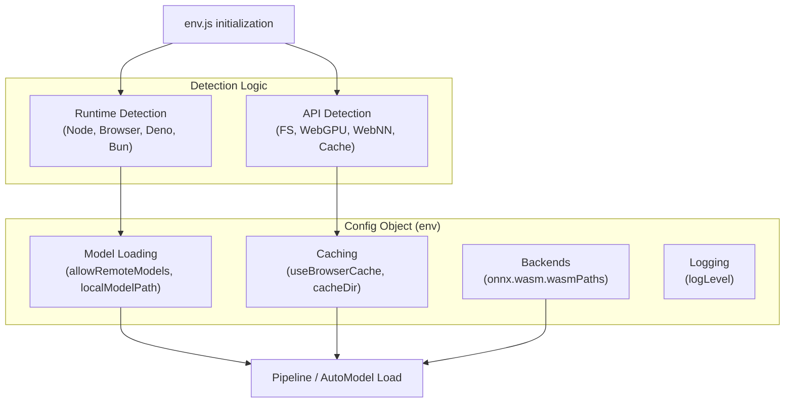

<!-- source: DeepWiki mcp.deepwiki.com · repo huggingface/transformers.js · page 11 Environment Configuration · fetched 2026-10-26 -->

# Environment Configuration

<details>
<summary>Relevant source files</summary>

The following files were used as context for generating this wiki page:

- [packages/transformers/docs/snippets/2_installation.snippet](packages/transformers/docs/snippets/2_installation.snippet)
- [packages/transformers/docs/snippets/3_custom-usage.snippet](packages/transformers/docs/snippets/3_custom-usage.snippet)
- [packages/transformers/package.json](packages/transformers/package.json)
- [packages/transformers/src/env.js](packages/transformers/src/env.js)
- [pnpm-lock.yaml](pnpm-lock.yaml)

</details>


The environment configuration system provides global runtime settings that control model loading, caching strategies, and backend execution in Transformers.js. The `env` object automatically detects the runtime environment (browser, web worker, Node.js, Deno, Bun) and sets sensible defaults, while allowing users to override any setting for custom deployments.

For details on runtime detection and capability flags, see [Environment Detection](#11.1). For documentation on specific properties like `allowRemoteModels` and `backends.onnx.wasm`, see [Runtime Configuration](#11.2).

## Overview

The environment system serves three primary functions:

1.  **Runtime Detection**: Identifies the execution environment and available APIs [packages/transformers/src/env.js:31-66]().
2.  **Default Configuration**: Sets appropriate defaults based on detected capabilities [packages/transformers/src/env.js:146-170]().
3.  **User Customization**: Provides a simple API for overriding defaults via the `env` object [packages/transformers/src/env.js:1-23]().

All configuration is centralized in the `env` object exported from [packages/transformers/src/env.js](), which is initialized at module load time and can be modified before loading models.

**Sources**: [packages/transformers/src/env.js:1-204]()

## Architecture Overview



**Diagram: Environment Configuration Flow**

**Sources**: [packages/transformers/src/env.js:31-204]()

## Runtime and API Detection

The library performs feature detection to determine available capabilities without relying solely on user-agent strings. It identifies environments such as:
*   **Node.js**: Detected via `process.release.name === 'node'` [packages/transformers/src/env.js:44]().
*   **Deno/Bun**: Detected via `globalThis.Deno` or `globalThis.Bun` [packages/transformers/src/env.js:38-39]().
*   **Web Workers**: Detected by checking `self.constructor.name` for worker global scopes [packages/transformers/src/env.js:48-52]().

It also identifies hardware acceleration capabilities like **WebGPU** [packages/transformers/src/env.js:55]() and **WebNN** [packages/transformers/src/env.js:56]().

For a full list of detection flags and their logic, see [Environment Detection](#11.1).

**Sources**: [packages/transformers/src/env.js:31-144]()

## Configuration Properties

The `env` object allows global control over how the library behaves. Key areas include:

### Model Loading and Fetching
Users can disable remote fetching to enforce local-only environments or inject a custom `fetch` implementation for proxy support or specialized headers [packages/transformers/src/env.js:174-181]().

### Caching Strategy
The library supports multiple caching layers:
*   **Browser Cache API**: Default for web environments [packages/transformers/src/env.js:183]().
*   **Filesystem Cache**: Default for Node.js environments [packages/transformers/src/env.js:184]().
*   **Custom Cache**: Allows providing a custom object that implements the `match` and `put` interface [packages/transformers/src/env.js:187-188]().

### Logging
The `logLevel` property controls the verbosity of the library's internal logging, using the `LogLevel` enum (DEBUG, INFO, WARN, ERROR, NONE) [packages/transformers/src/env.js:191-203]().

For detailed descriptions of every property and its default value, see [Runtime Configuration](#11.2).

**Sources**: [packages/transformers/src/env.js:138-204](), [packages/transformers/docs/snippets/3_custom-usage.snippet:7-18]()

## Usage Pattern

Configuration must be modified **before** calling high-level APIs like `pipeline()` or `AutoModel.from_pretrained()`.

```javascript
import { env, pipeline } from '@huggingface/transformers';

// 1. Configure the environment
env.allowRemoteModels = false;
env.localModelPath = './my_models/';
env.backends.onnx.wasm.wasmPaths = 'https://my-cdn.com/wasm/';

// 2. Use the library
const classifier = await pipeline('sentiment-analysis');
```

**Sources**: [packages/transformers/src/env.js:1-20](), [packages/transformers/docs/snippets/3_custom-usage.snippet:7-18]()

## Summary of Configuration Targets

| Feature | Child Page | Primary Symbols |
| :--- | :--- | :--- |
| **Detection** | [Environment Detection](#11.1) | `apis`, `IS_BROWSER_ENV`, `IS_WEBGPU_AVAILABLE` |
| **Configuration** | [Runtime Configuration](#11.2) | `env`, `allowRemoteModels`, `localModelPath`, `LogLevel` |

**Sources**: [packages/transformers/src/env.js:99-144](), [packages/transformers/src/env.js:138-204]()

---

