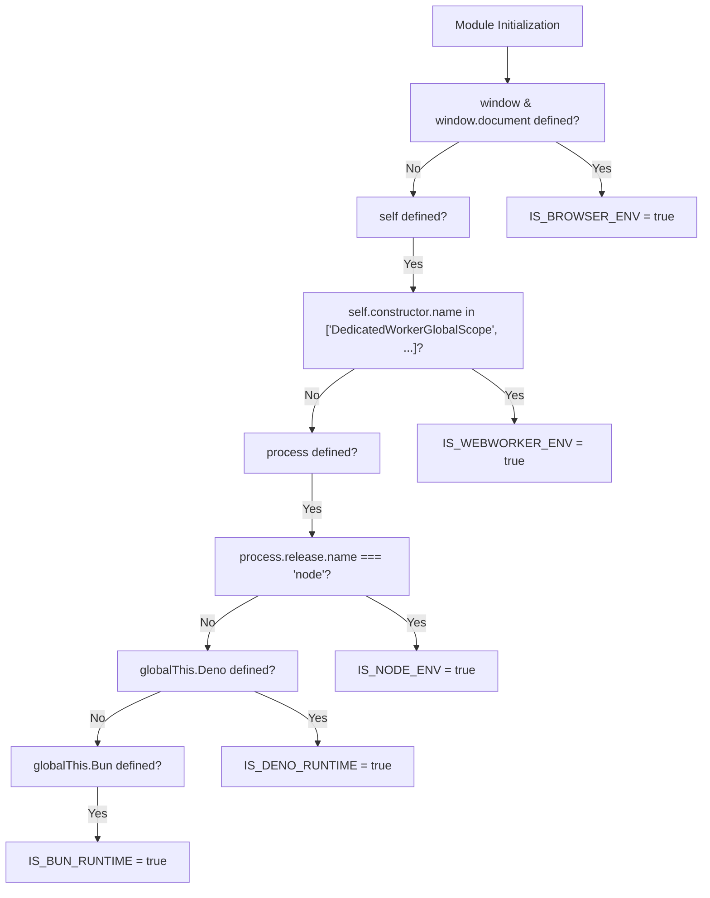
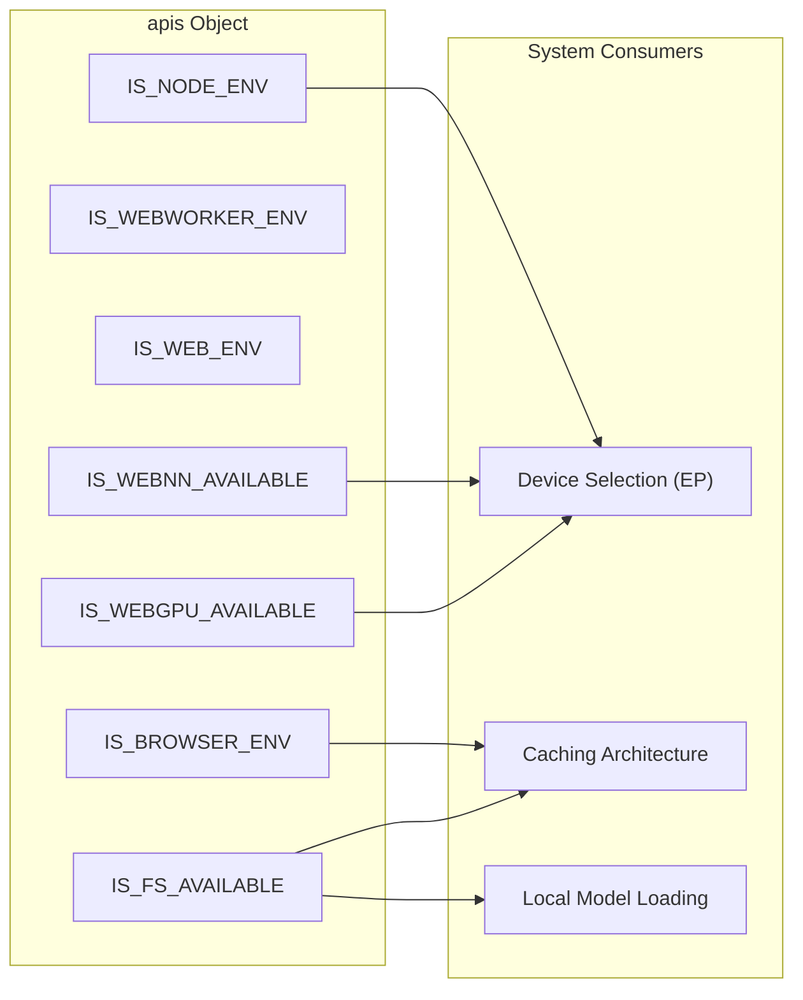

<!-- source: DeepWiki mcp.deepwiki.com · repo huggingface/transformers.js · page 11.1 Environment Detection · fetched 2026-10-26 -->

# Environment Detection

<details>
<summary>Relevant source files</summary>

The following files were used as context for generating this wiki page:

- [packages/transformers/docs/snippets/2_installation.snippet](packages/transformers/docs/snippets/2_installation.snippet)
- [packages/transformers/docs/snippets/3_custom-usage.snippet](packages/transformers/docs/snippets/3_custom-usage.snippet)
- [packages/transformers/package.json](packages/transformers/package.json)
- [packages/transformers/src/env.js](packages/transformers/src/env.js)
- [pnpm-lock.yaml](pnpm-lock.yaml)

</details>


This document describes how Transformers.js detects the JavaScript runtime environment and available hardware capabilities. Environment detection is essential for the library to automatically select the appropriate ONNX Runtime backend and configure device-specific execution providers.

For configuration of the detected environment after initialization, see [11.2 Runtime Configuration](). For backend selection and execution provider mapping, see [8.1 Device and Dtype Selection]().

## Purpose and Scope

Transformers.js runs in multiple JavaScript environments (browsers, Node.js, web workers, Deno, Bun) and must adapt its behavior based on the available APIs and hardware. The environment detection system:

1.  Identifies the execution context (browser, Node.js, web worker, service worker).
2.  Detects available Web APIs (Cache API, WebGPU, WebNN, Crypto).
3.  Identifies the JavaScript runtime (Node.js, Deno, Bun).
4.  Determining available filesystem and path APIs.
5.  Detects browser-specific limitations (e.g., Safari versions).

All detection logic executes during module initialization in `packages/transformers/src/env.js` and produces immutable flags that influence backend selection, caching strategies, and model loading behavior.

Sources: [packages/transformers/src/env.js:1-66]()

## Environment Type Detection

Transformers.js distinguishes between primary execution contexts using global object introspection and constructor name checks.

### Detection Logic

The following diagram illustrates the flow of environment identification within `env.js`.

**Runtime Detection Flow**


**Environment Detection Constants**

| Constant | Detection Logic | Purpose |
|----------|----------------|---------|
| `IS_BROWSER_ENV` | `window` and `window.document` exist | Identifies standard browser context with DOM access [packages/transformers/src/env.js:47-47]() |
| `IS_WEBWORKER_ENV` | `self` exists with worker constructor name | Identifies web worker, service worker, or shared worker contexts [packages/transformers/src/env.js:48-52]() |
| `IS_NODE_ENV` | `process.release.name === 'node'` | Identifies Node.js runtime environment [packages/transformers/src/env.js:44-44]() |
| `IS_SERVICE_WORKER_ENV`| `self instanceof ServiceWorkerGlobalScope` | Identifies Service Worker context [packages/transformers/src/env.js:63-65]() |
| `IS_DENO_WEB_RUNTIME` | `IS_DENO_RUNTIME && IS_WEB_CACHE_AVAILABLE && !IS_FS_AVAILABLE` | Identifies Deno running in a web-like restricted mode [packages/transformers/src/env.js:41-41]() |

Sources: [packages/transformers/src/env.js:31-66]()

## API Availability Detection

The environment detection system checks for specific Web APIs that influence caching and execution strategies.

### API Detection Table

| API | Detection Logic | Flag | Impact |
|-----|----------------|------|--------|
| Cache API | `HAS_SELF && 'caches' in self` | `IS_WEB_CACHE_AVAILABLE` | Enables browser-based model caching [packages/transformers/src/env.js:35-35]() |
| WebGPU | `IS_NODE_ENV \|\| 'gpu' in navigator` | `IS_WEBGPU_AVAILABLE` | Enables GPU acceleration [packages/transformers/src/env.js:55-55]() |
| WebNN | `'ml' in navigator` | `IS_WEBNN_AVAILABLE` | Enables Web Neural Network API [packages/transformers/src/env.js:56-56]() |
| FileSystem | `!isEmpty(fs)` | `IS_FS_AVAILABLE` | Enables filesystem-based caching [packages/transformers/src/env.js:33-33]() |
| Path | `!isEmpty(path)` | `IS_PATH_AVAILABLE` | Enables local path manipulation [packages/transformers/src/env.js:34-34]() |
| Crypto | `crypto.getRandomValues` available | `IS_CRYPTO_AVAILABLE` | Used for UUID generation/security [packages/transformers/src/env.js:57-57]() |
| Chrome | `chrome.runtime` available | `IS_CHROME_AVAILABLE` | Detects Chrome extension environments [packages/transformers/src/env.js:59-61]() |

Sources: [packages/transformers/src/env.js:33-61]()

## The `apis` Object

All detection flags are exposed through the frozen `apis` object, providing read-only access to environment capabilities.

**Capability Association Diagram**


**Usage Example:**
```javascript
import { apis } from '@huggingface/transformers';

if (apis.IS_WEBGPU_AVAILABLE) {
    // Enable WebGPU-specific features
}
```

Sources: [packages/transformers/src/env.js:99-144]()

## Path and Directory Resolution

When filesystem APIs are available (`IS_FS_AVAILABLE` and `IS_PATH_AVAILABLE`), the library resolves its own installation directory to establish default cache and model paths.

### Resolution Logic

1.  **ESM Resolution**: If `import.meta.url` is available, it uses `url.fileURLToPath` to find the directory [packages/transformers/src/env.js:153-157]().
2.  **CommonJS Resolution**: Falls back to `__dirname` if available [packages/transformers/src/env.js:157-159]().
3.  **Defaulting**: If no filesystem is available, paths default to standard web-style strings (e.g., `/models/`) [packages/transformers/src/env.js:166-167]().

**Computed Path Constants:**
*   `RUNNING_LOCALLY`: `true` if both `fs` and `path` are available [packages/transformers/src/env.js:146-146]().
*   `DEFAULT_CACHE_DIR`: Set to `<library_root>/.cache/` when running locally [packages/transformers/src/env.js:163-163]().
*   `DEFAULT_LOCAL_MODEL_PATH`: Set to `<library_root>/models/` when running locally [packages/transformers/src/env.js:167-167]().

Sources: [packages/transformers/src/env.js:146-167]()

## Safari Compatibility
The system includes a specific check for Safari versions below 26, as WebGPU support and behavior changed significantly in that version [packages/transformers/src/env.js:71-94](). This is exposed via `apis.IS_SAFARI_BELOW_26` [packages/transformers/src/env.js:125-125]().

Sources: [packages/transformers/src/env.js:71-94](), [packages/transformers/src/env.js:125-125]()

---

