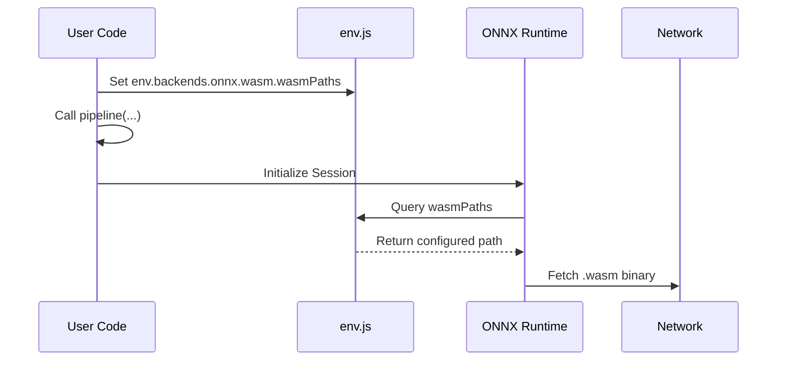

<!-- source: DeepWiki mcp.deepwiki.com · repo huggingface/transformers.js · page 11.2 Runtime Configuration · fetched 2026-10-26 -->

# Runtime Configuration

<details>
<summary>Relevant source files</summary>

The following files were used as context for generating this wiki page:

- [packages/transformers/docs/snippets/2_installation.snippet](packages/transformers/docs/snippets/2_installation.snippet)
- [packages/transformers/docs/snippets/3_custom-usage.snippet](packages/transformers/docs/snippets/3_custom-usage.snippet)
- [packages/transformers/package.json](packages/transformers/package.json)
- [packages/transformers/src/env.js](packages/transformers/src/env.js)
- [pnpm-lock.yaml](pnpm-lock.yaml)

</details>


## Purpose and Scope

This document describes the configurable properties of the `env` object that control the runtime behavior of Transformers.js. These settings allow users to customize model loading sources, caching strategies, backend configurations, logging verbosity, and network request handling.

The `env` object is the central configuration hub for the library, allowing developers to adapt the library's behavior to specific environments like browser extensions, server-side Node.js applications, or restricted network environments.

---

## Configuration Object Structure

The `env` object provides a centralized interface for controlling library behavior at runtime. All configuration properties can be modified after importing the library but before loading models.

**Configuration Object Hierarchy**

```mermaid
graph TB
    env["env Object<br/>(TransformersEnvironment)"]
    
    subgraph "Version and Logging"
        version["version: string<br/>'4.2.0'"]
        logLevel["logLevel: string<br/>'info' | 'debug' | ..."]
    end
    
    subgraph "Model Loading Settings"
        allowRemoteModels["allowRemoteModels: boolean"]
        remoteHost["remoteHost: string"]
        remotePathTemplate["remotePathTemplate: string"]
        allowLocalModels["allowLocalModels: boolean"]
        localModelPath["localModelPath: string"]
        useFS["useFS: boolean"]
        fetch["fetch: function (Custom Injection)"]
    end
    
    subgraph "Cache Settings"
        useBrowserCache["useBrowserCache: boolean"]
        useFSCache["useFSCache: boolean"]
        cacheDir["cacheDir: string | null"]
        useCustomCache["useCustomCache: boolean"]
        customCache["customCache: CacheInterface | null"]
    end
    
    subgraph "Backend Settings"
        backends["backends: object"]
        onnx["onnx: object"]
        wasm["wasm: object"]
    end
    
    env --> version
    env --> logLevel
    env --> allowRemoteModels
    env --> remoteHost
    env --> remotePathTemplate
    env --> allowLocalModels
    env --> localModelPath
    env --> useFS
    env --> fetch
    env --> useBrowserCache
    env --> useFSCache
    env --> cacheDir
    env --> useCustomCache
    env --> customCache
    env --> backends
    backends --> onnx
    onnx --> wasm
```



**Sources:** [packages/transformers/src/env.js:203-288](), [packages/transformers/src/env.js:29-29]()

---

## Model Loading and Network Configuration

These properties control where and how models are loaded, including the ability to intercept network requests.

### Configuration Properties Table

| Property | Type | Default | Description |
|----------|------|---------|-------------|
| `allowRemoteModels` | `boolean` | `true` | Whether to allow loading models from remote URLs (Hugging Face Hub). [packages/transformers/src/env.js:246-246]() |
| `remoteHost` | `string` | `'https://huggingface.co/'` | Base URL for loading remote models. [packages/transformers/src/env.js:252-252]() |
| `remotePathTemplate` | `string` | `'{model}/resolve/{revision}/'` | Path template for constructing model URLs. [packages/transformers/src/env.js:258-258]() |
| `allowLocalModels` | `boolean` | `false` (Web) / `true` (Node) | Whether to check for models in the local file system. [packages/transformers/src/env.js:240-240]() |
| `localModelPath` | `string` | `'/models/'` | Directory path to search for local models. [packages/transformers/src/env.js:234-234]() |
| `fetch` | `Function` | `globalThis.fetch` | Custom fetch implementation for injecting headers or proxies. [packages/transformers/src/env.js:295-295]() |

### Custom Fetch Injection

Users can inject a custom `fetch` function to handle authentication headers, proxies, or custom logging for every network request made by the library.

```javascript
import { env } from '@huggingface/transformers';

env.fetch = (url, options) => {
    return fetch(url, {
        ...options,
        headers: {
            ...options?.headers,
            'Authorization': 'Bearer YOUR_TOKEN',
        },
    });
};
```
**Sources:** [packages/transformers/src/env.js:170-170](), [packages/transformers/src/env.js:295-295]()

---

## Logging Configuration

The `logLevel` property controls the verbosity of the library's internal logging.

| Level | Value | Description |
|-------|-------|-------------|
| `LogLevel.DEBUG` | `10` | All messages including debug output. |
| `LogLevel.INFO` | `20` | Errors, warnings, and info messages. |
| `LogLevel.WARN` | `30` | Errors and warnings only. |
| `LogLevel.ERROR` | `40` | Errors only. |
| `LogLevel.NONE` | `50` | Disable all logging. |

**Sources:** [packages/transformers/src/env.js:191-201](), [packages/transformers/src/env.js:299-299]()

---

## Cache Configuration

Transformers.js supports multiple caching layers to minimize redundant downloads.

### Cache Strategy Properties

| Property | Type | Default | Description |
|----------|------|---------|-------------|
| `useBrowserCache` | `boolean` | `true` | Uses the Web Cache API (`caches.open`). [packages/transformers/src/env.js:264-264]() |
| `useFSCache` | `boolean` | `true` (Node) | Uses the local file system for caching. [packages/transformers/src/env.js:270-270]() |
| `cacheDir` | `string` | `'./.cache/'` | The directory where files are stored when `useFSCache` is true. [packages/transformers/src/env.js:276-276]() |
| `useCustomCache` | `boolean` | `false` | Enables the use of the `customCache` object. [packages/transformers/src/env.js:282-282]() |
| `customCache` | `Object` | `null` | A user-provided object implementing the Web Cache API. [packages/transformers/src/env.js:288-288]() |

**Sources:** [packages/transformers/src/env.js:115-117](), [packages/transformers/src/env.js:163-163]()

---

## Backend and WASM Configuration

The `backends` object configures the execution environments for ONNX Runtime.

### WASM Path Configuration

When running in a browser without a bundler, you may need to specify where the ONNX Runtime WASM binaries are located.

```javascript
import { env } from '@huggingface/transformers';

// Specify custom path for WASM binaries
env.backends.onnx.wasm.wasmPaths = 'https://cdn.jsdelivr.net/npm/onnxruntime-web@1.26.0-dev.20260416-b7804b056c/dist/';
```
**Sources:** [packages/transformers/src/env.js:220-220](), [packages/transformers/docs/snippets/3_custom-usage.snippet:17-17]()

### Implementation Flow: WASM Loading



**Sources:** [packages/transformers/src/env.js:215-223](), [packages/transformers/docs/snippets/3_custom-usage.snippet:16-18]()

---

## Default Environment Initialization

The library automatically detects the runtime environment (Node.js, Browser, Deno, Bun) and sets appropriate defaults.

| Variable | Source | Logic |
|----------|--------|-------|
| `IS_NODE_ENV` | [env.js:44]() | `process?.release?.name === 'node'` |
| `IS_WEB_ENV` | [env.js:53]() | Browser or WebWorker or Deno Web |
| `IS_FS_AVAILABLE` | [env.js:33]() | Checks if `node:fs` is not empty |
| `RUNNING_LOCALLY` | [env.js:146]() | `IS_FS_AVAILABLE && IS_PATH_AVAILABLE` |

### Path Resolution
In local environments (Node.js), `env` attempts to resolve `__dirname` or `import.meta.url` to set a default `localModelPath` relative to the library installation.

**Sources:** [packages/transformers/src/env.js:148-160](), [packages/transformers/src/env.js:167-167]()

---

## Complete Usage Example

```javascript
import { env, LogLevel } from '@huggingface/transformers';

// 1. Configure Logging
env.logLevel = LogLevel.DEBUG;

// 2. Configure Paths
env.localModelPath = './my_models/';
env.allowRemoteModels = false; // Air-gapped mode

// 3. Configure Cache
env.cacheDir = './custom_cache_folder/';

// 4. Configure Backend
env.backends.onnx.wasm.numThreads = 4;
env.backends.onnx.wasm.proxy = true;
```

**Sources:** [packages/transformers/src/env.js:4-20](), [packages/transformers/docs/snippets/3_custom-usage.snippet:7-18]()

---

