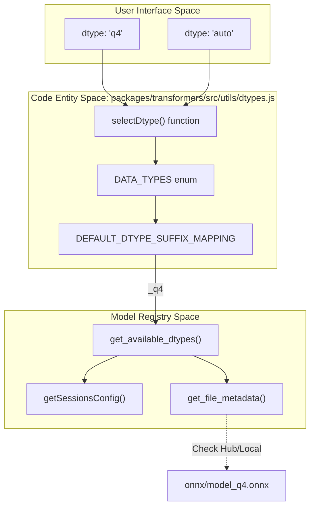
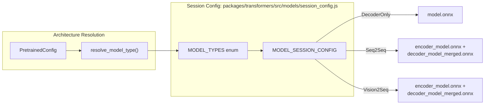

<!-- source: DeepWiki mcp.deepwiki.com · repo huggingface/transformers.js · page 12 Model Quantization · fetched 2026-10-26 -->

# Model Quantization

<details>
<summary>Relevant source files</summary>

The following files were used as context for generating this wiki page:

- [packages/transformers/src/models/session_config.js](packages/transformers/src/models/session_config.js)
- [packages/transformers/src/utils/dtypes.js](packages/transformers/src/utils/dtypes.js)
- [packages/transformers/src/utils/model_registry/get_available_dtypes.js](packages/transformers/src/utils/model_registry/get_available_dtypes.js)
- [packages/transformers/src/utils/model_registry/resolve_model_type.js](packages/transformers/src/utils/model_registry/resolve_model_type.js)
- [packages/transformers/tests/models/cohere_asr/test_feature_extraction_cohere_asr.js](packages/transformers/tests/models/cohere_asr/test_feature_extraction_cohere_asr.js)
- [packages/transformers/tests/pipelines/test_pipelines_automatic_speech_recognition.js](packages/transformers/tests/pipelines/test_pipelines_automatic_speech_recognition.js)

</details>


## Purpose and Scope

Model quantization is the process of reducing the numerical precision of model weights and activations to decrease model size and improve inference performance. In Transformers.js, quantization is essential for deploying large models in resource-constrained browser environments where bandwidth, memory, and computational resources are limited.

This document covers the quantization options available in Transformers.js and how to specify them when loading models. For information about the ONNX runtime backends that execute quantized models, see [ONNX Runtime Backend](#8). For details on converting PyTorch models to quantized ONNX format, see [Conversion Scripts](#12.2).

**Sources:** [packages/transformers/src/utils/dtypes.js:35-49](), [packages/transformers/src/utils/model_registry/get_available_dtypes.js:18-32]()

---

## Quantization Levels

Transformers.js supports a wide range of quantization levels, specified via the `dtype` parameter. The `DATA_TYPES` object defines these constants [packages/transformers/src/utils/dtypes.js:35-49]().

### Supported Data Types

| Data Type | Suffix | Description |
|-----------|--------|-------------|
| `fp32` | (none) | 32-bit floating point (Full precision) |
| `fp16` | `_fp16` | 16-bit floating point |
| `q8` | `_quantized` | 8-bit integer quantization (Default for WASM) |
| `q4` | `_q4` | 4-bit integer quantization |
| `q4f16` | `_q4f16` | 16-bit model with 4-bit block weight quantization |
| `bnb4` | `_bnb4` | BitsAndBytes 4-bit quantization |

The `selectDtype` function resolves the requested `dtype` string to a concrete type based on the selected device and model file [packages/transformers/src/utils/dtypes.js:85-126]().

**Sources:** [packages/transformers/src/utils/dtypes.js:35-72](), [packages/transformers/src/utils/dtypes.js:85-126]()

---

## Quantization Architecture

The following diagram bridges the high-level `dtype` selection to the internal `DEFAULT_DTYPE_SUFFIX_MAPPING` used by the model loading system.



**Quantization Discovery and Resolution**

The `get_available_dtypes` function probes for available quantizations by checking for files on the Hub or local cache using `DEFAULT_DTYPE_SUFFIX_MAPPING` [packages/transformers/src/utils/model_registry/get_available_dtypes.js:53-65](). For multi-file models (e.g., Seq2Seq), it ensures all required components (encoder and decoder) exist for a specific `dtype` before listing it as available [packages/transformers/src/utils/model_registry/get_available_dtypes.js:21-24]().

**Sources:** [packages/transformers/src/utils/model_registry/get_available_dtypes.js:34-68](), [packages/transformers/src/utils/dtypes.js:59-72]()

---

## Model Session Mapping

Different model architectures require different session configurations, which influences how quantization suffixes are applied. The `MODEL_SESSION_CONFIG` object in `session_config.js` defines which files constitute a model [packages/transformers/src/models/session_config.js:21-143]().



**Resolution Order**

The `resolve_model_type` function determines the model category (e.g., `EncoderOnly`, `Seq2Seq`) by checking `config.architectures` and `config.model_type` against `MODEL_TYPE_MAPPING` [packages/transformers/src/utils/model_registry/resolve_model_type.js:15-25](). This categorization is critical because it tells the loader whether to look for a single `model.onnx` or multiple files like `encoder_model.onnx` and `decoder_model_merged.onnx` [packages/transformers/src/models/session_config.js:30-34]().

**Sources:** [packages/transformers/src/utils/model_registry/resolve_model_type.js:26-67](), [packages/transformers/src/models/session_config.js:1-19](), [packages/transformers/src/models/session_config.js:21-143]()

---

## Specifying Quantization in Code

### Pipeline API

The `dtype` parameter is specified as an option to the `pipeline()` function:

```javascript
// Use 4-bit quantization for maximum compression
const pipe = await pipeline('sentiment-analysis', 'onnx-community/distilbert-base-uncased-finetuned-sst-2-english', {
  dtype: 'q4',
});
```

### Device and Dtype Interaction

The default `dtype` is determined by the `selectedDevice`. For example, `DEVICE_TYPES.wasm` (CPU) defaults to `DATA_TYPES.q8` [packages/transformers/src/utils/dtypes.js:53-56]().

```javascript
// GPU inference with 16-bit precision
const gpuPipe = await pipeline('sentiment-analysis', 'model-id', {
  device: 'webgpu',
  dtype: 'fp16',
});
```

WebGPU `fp16` support can be checked programmatically using `isWebGpuFp16Supported`, which probes the adapter for the `shader-f16` feature [packages/transformers/src/utils/dtypes.js:14-33]().

**Sources:** [packages/transformers/src/utils/dtypes.js:14-33](), [packages/transformers/src/utils/dtypes.js:53-56](), [packages/transformers/src/utils/dtypes.js:85-126]()

---

## Quantization Tradeoffs

For detailed information on the tradeoffs between memory, speed, and accuracy for each level, see [Quantization Methods](#12.1).

| Level | Size Reduction | Target Device | Tradeoff |
|-------|----------------|---------------|----------|
| `fp32` | 1x | WebGPU / CPU | Best accuracy, largest size |
| `fp16` | 2x | WebGPU | Excellent accuracy, requires `shader-f16` support |
| `q8` | 4x | WASM | Good balance, default for CPU |
| `q4` | 8x | WASM | Fastest download, higher accuracy drop |

**Sources:** [packages/transformers/src/utils/dtypes.js:35-49](), [packages/transformers/src/utils/dtypes.js:59-72]()

---

## Discovery API

Developers can programmatically discover which quantizations are available for a specific model using `get_available_dtypes`. This is useful for dynamic UI elements or fallback logic.

```javascript
import { get_available_dtypes } from '@huggingface/transformers';

const available = await get_available_dtypes('onnx-community/whisper-tiny');
console.log(available); // ['fp32', 'fp16', 'q8', 'q4']
```

This function performs parallel probing of the Hub to verify the existence of all required ONNX files for each concrete dtype [packages/transformers/src/utils/model_registry/get_available_dtypes.js:53-65]().

**Sources:** [packages/transformers/src/utils/model_registry/get_available_dtypes.js:34-68]()

---

