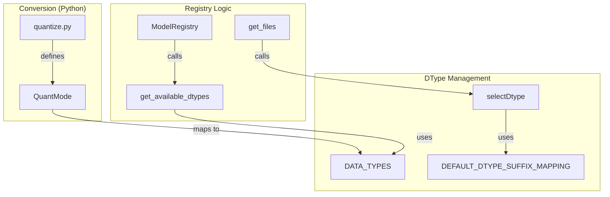
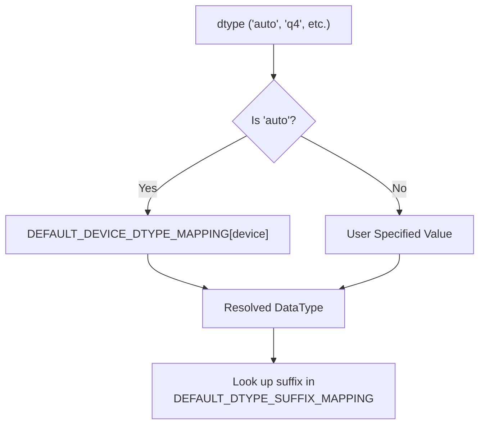
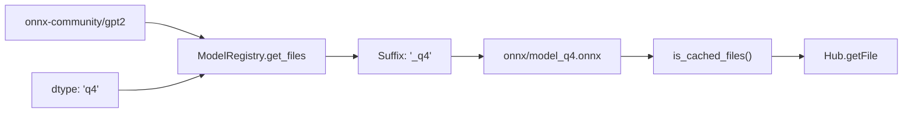

<!-- source: DeepWiki mcp.deepwiki.com · repo huggingface/transformers.js · page 12.1 Quantization Methods · fetched 2026-10-26 -->

# Quantization Methods

<details>
<summary>Relevant source files</summary>

The following files were used as context for generating this wiki page:

- [packages/transformers/docs/source/guides/dtypes.md](packages/transformers/docs/source/guides/dtypes.md)
- [packages/transformers/src/utils/dtypes.js](packages/transformers/src/utils/dtypes.js)
- [packages/transformers/src/utils/model_registry/ModelRegistry.js](packages/transformers/src/utils/model_registry/ModelRegistry.js)
- [packages/transformers/src/utils/model_registry/is_cached.js](packages/transformers/src/utils/model_registry/is_cached.js)
- [packages/transformers/tests/utils/cache.test.js](packages/transformers/tests/utils/cache.test.js)
- [packages/transformers/tests/utils/model_registry.test.js](packages/transformers/tests/utils/model_registry.test.js)

</details>


This page documents the quantization levels supported by Transformers.js, their implementation via the `quantize.py` script, and how the library handles these formats during inference. Quantization reduces model size and improves inference speed, which is critical for browser-based environments where memory and bandwidth are constrained.

## Overview

Transformers.js supports a wide range of quantization modes (dtypes), ranging from 16-bit floating point to 4-bit integer formats. The library uses the `dtype` parameter in the `pipeline` API or `from_pretrained` methods to select these variants.

### Quantization Modes and Tradeoffs

The `DATA_TYPES` object defines the supported precision levels:

| Mode | Enum Value | Suffix | Description | Tradeoffs |
|------|-----------|--------|-------------|-----------|
| **FP32** | `fp32` | (none) | Full precision 32-bit float | Highest accuracy, largest memory footprint. |
| **FP16** | `fp16` | `_fp16` | Half precision 16-bit float | 2x compression. Ideal for WebGPU; minimal accuracy loss. |
| **Q8** | `q8` | `_quantized` | 8-bit integer (dynamic) | 4x compression. Standard for WASM/CPU inference. |
| **INT8** | `int8` | `_int8` | Signed 8-bit integer | Explicit signed weights. |
| **UINT8** | `uint8` | `_uint8` | Unsigned 8-bit integer | Required for certain ops like Conv on some backends. |
| **Q4** | `q4` | `_q4` | 4-bit blocked integer | ~8x compression. Best for large LLMs in-browser. |
| **Q4F16** | `q4f16` | `_q4f16` | Mixed 4-bit/FP16 | 4-bit weights with FP16 activations. |
| **BNB4** | `bnb4` | `_bnb4` | BitsAndBytes 4-bit | NF4/FP4 formats for LLMs. |

Sources: [packages/transformers/src/utils/dtypes.js:35-49](), [packages/transformers/src/utils/dtypes.js:59-72](), [packages/transformers/docs/source/guides/dtypes.md:3-6]()

## Code Entity Space: Quantization Registry

The following diagram maps the high-level quantization concepts to the specific code entities in the library that manage them.



**Entity Mapping**: The `ModelRegistry` uses `get_available_dtypes` to probe the Hub for files matching the `DEFAULT_DTYPE_SUFFIX_MAPPING`. During session initialization, `selectDtype` resolves the user's requested `dtype` to a specific file suffix.

Sources: [packages/transformers/src/utils/dtypes.js:35-72](), [packages/transformers/src/utils/model_registry/ModelRegistry.js:112-118](), [packages/transformers/src/utils/model_registry/get_available_dtypes.js:13-15]()

## Detection and Selection

### Available DType Discovery
The `ModelRegistry.get_available_dtypes()` method allows developers to programmatically discover which quantization levels are available for a specific model on the Hugging Face Hub.

```javascript
import { ModelRegistry } from "@huggingface/transformers";

const dtypes = await ModelRegistry.get_available_dtypes("onnx-community/all-MiniLM-L6-v2-ONNX");
// Result: [ 'fp32', 'fp16', 'int8', 'uint8', 'q8', 'q4' ]
```

For multi-component models (e.g., Seq2Seq models with an encoder and decoder), a `dtype` is only considered "available" if all required session files exist for that precision level.

Sources: [packages/transformers/src/utils/model_registry/ModelRegistry.js:39-47](), [packages/transformers/tests/utils/model_registry.test.js:97-109]()

### Resolution Logic
The `selectDtype` function determines which file to load based on the environment and user input.



**DType Resolution Flow**: If `dtype` is set to `'auto'`, the library defaults to `q8` for WASM (CPU) and `fp32` for other devices.

Sources: [packages/transformers/src/utils/dtypes.js:53-56](), [packages/transformers/src/utils/dtypes.js:85-126]()

## Quantization Pipeline (quantize.py)

The `scripts/quantize.py` utility handles the conversion of FP32 ONNX models into these optimized formats using ONNX Runtime's quantization tools.

### 8-bit Quantization (Q8/INT8/UINT8)
8-bit quantization uses dynamic integer quantization. The `Q8` mode automatically selects between signed and unsigned weights based on the presence of specific operators like `Conv` or `Attention`, ensuring compatibility with `onnxruntime-web`.

Sources: [scripts/quantize.py:38-58](), [scripts/quantize.py:344-351]()

### 4-bit Quantization (Q4/Q4F16)
4-bit quantization targets `MatMul` weights using block-wise quantization.

| Parameter | Default | Role |
|-----------|---------|------|
| `block_size` | 32 | Size of blocks for quantization. |
| `is_symmetric` | True | Whether to center quantization at zero. |
| `accuracy_level` | None | Controls MatMulNBits accuracy (0-4). |

Sources: [scripts/quantize.py:103-122](), [scripts/quantize.py:226-246]()

### Mixed Precision (Q4F16)
`Q4F16` is a sequential process where `MatMul` weights are first quantized to 4-bit, and then all remaining floating-point tensors are converted to FP16.

Sources: [scripts/quantize.py:315-330]()

## Implementation: File Handling

When a quantized model is requested, the `ModelRegistry` builds the necessary file paths by appending the appropriate suffix to the base model name.



**File Retrieval Flow**: The registry combines the `modelId` and the resolved `dtype` suffix to locate the correct `.onnx` and `.onnx_data` files.

Sources: [packages/transformers/src/utils/model_registry/ModelRegistry.js:12-17](), [packages/transformers/src/utils/model_registry/is_cached.js:35-41]()

### Large Model Support (External Data)
For quantized models exceeding 2GB (common for 4-bit LLMs), the weights are stored in a separate `.onnx_data` file. The `ModelRegistry` automatically includes these data files in its file list when the `dtype` requires it.

Sources: [packages/transformers/src/utils/model_registry/ModelRegistry.js:31-37](), [scripts/utils.py:48-68]()

---

