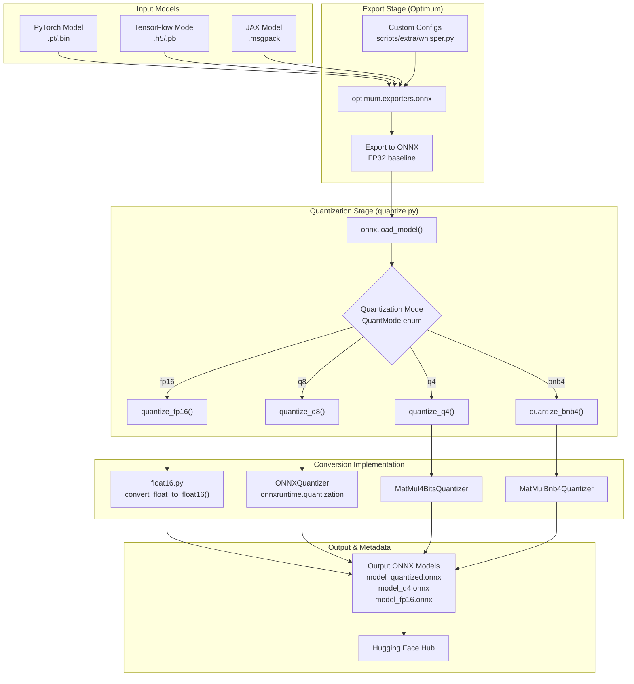
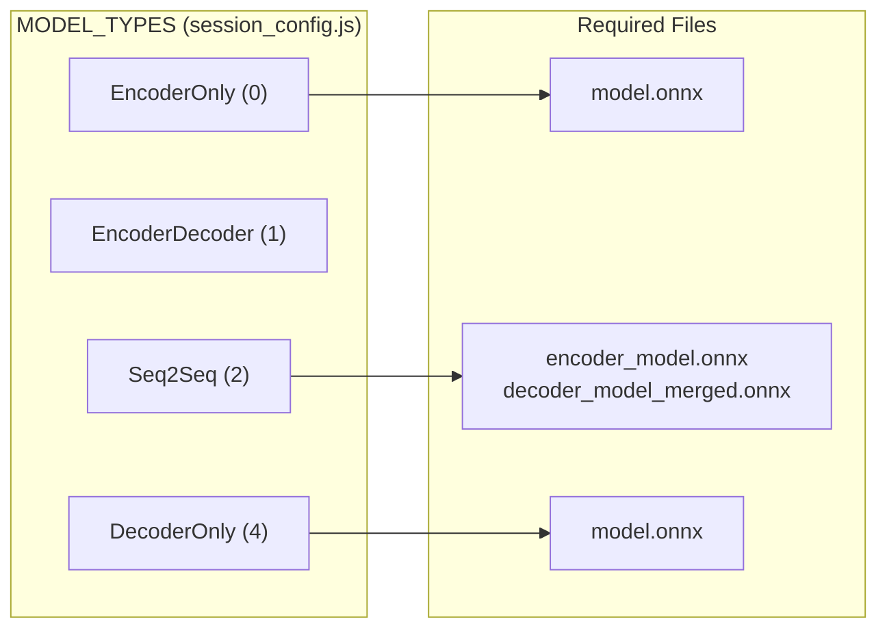

<!-- source: DeepWiki mcp.deepwiki.com · repo huggingface/transformers.js · page 12.2 Conversion Scripts · fetched 2026-10-26 -->

# Conversion Scripts

<details>
<summary>Relevant source files</summary>

The following files were used as context for generating this wiki page:

- [README.md](README.md)
- [package.json](package.json)
- [packages/transformers/src/models/session_config.js](packages/transformers/src/models/session_config.js)
- [packages/transformers/src/utils/model_registry/get_available_dtypes.js](packages/transformers/src/utils/model_registry/get_available_dtypes.js)
- [packages/transformers/src/utils/model_registry/resolve_model_type.js](packages/transformers/src/utils/model_registry/resolve_model_type.js)
- [packages/transformers/tests/models/cohere_asr/test_feature_extraction_cohere_asr.js](packages/transformers/tests/models/cohere_asr/test_feature_extraction_cohere_asr.js)
- [packages/transformers/tests/pipelines/test_pipelines_automatic_speech_recognition.js](packages/transformers/tests/pipelines/test_pipelines_automatic_speech_recognition.js)

</details>


This page documents the Python scripts used to convert and quantize models for use with Transformers.js. These scripts bridge the gap between Python-based training frameworks (PyTorch, TensorFlow, JAX) and the ONNX Runtime execution environment used in JavaScript.

## Purpose and Scope

The conversion workflow transforms pre-trained models into optimized ONNX formats. While the JavaScript library handles inference, these Python scripts are responsible for:

1.  **Framework Export**: Converting models from their native Python formats to ONNX FP32 baselines using `optimum.exporters.onnx`.
2.  **Quantization**: Applying various compression schemes (FP16, Q8, Q4, BNB4) to reduce model size and improve performance in resource-constrained environments like web browsers.
3.  **Discovery API**: Providing the `ModelRegistry.get_available_dtypes` JavaScript API to programmatically discover which of these formats are available for a given model.

**Sources**: [README.md:34-36](), [packages/transformers/src/utils/model_registry/get_available_dtypes.js:34-68]()

## Conversion Pipeline Architecture



**Sources**: [README.md:34-36](), [packages/transformers/src/utils/model_registry/get_available_dtypes.js:40-47]()

## Model Availability Discovery

The `ModelRegistry` provides the `get_available_dtypes` function to check which quantized versions of a model exist on the Hugging Face Hub or in a local cache.

### `get_available_dtypes` Implementation

This function probes for concrete dtypes by checking for the existence of required session files. For multi-file architectures (like Seq2Seq), a dtype is only considered "available" if all constituent files (e.g., encoder and decoder) exist with the corresponding suffix.

```javascript
// packages/transformers/src/utils/model_registry/get_available_dtypes.js:34-68

export async function get_available_dtypes(
    modelId,
    { config = null, model_file_name = null, revision = 'main', cache_dir = null, local_files_only = false } = {},
) {
    config = await get_config(modelId, { config, cache_dir, local_files_only, revision });
    const modelType = resolve_model_type(config);
    const { sessions } = getSessionsConfig(modelType, config, { model_file_name });
    const baseNames = Object.values(sessions);

    const probeResults = await Promise.all(
        CONCRETE_DTYPES.map(async (dtype) => {
            const suffix = DEFAULT_DTYPE_SUFFIX_MAPPING[dtype] ?? '';
            const allExist = await Promise.all(
                baseNames.map(async (baseName) => {
                    const filename = `onnx/${baseName}${suffix}.onnx`;
                    const metadata = await get_file_metadata(modelId, filename, metadataOptions);
                    return metadata.exists;
                }),
            );
            return { dtype, available: allExist.every(Boolean) };
        }),
    );

    return probeResults.filter((r) => r.available).map((r) => r.dtype);
}
```

**Sources**: [packages/transformers/src/utils/model_registry/get_available_dtypes.js:34-68](), [packages/transformers/src/utils/model_registry/resolve_model_type.js:26-67]()

## Model Resolution and Session Mapping

Before availability can be checked, the library must resolve the model's architecture to determine which files are required.

### Architecture Resolution Logic

The `resolve_model_type` function maps a model's configuration to a `MODEL_TYPES` enum value.

| Resolution Step | Logic | Code Pointer |
| :--- | :--- | :--- |
| **1. Architectures** | Check `config.architectures` against `MODEL_TYPE_MAPPING` | [resolve_model_type.js:31-36]() |
| **2. Model Type** | Check `config.model_type` against `MODEL_TYPE_MAPPING` | [resolve_model_type.js:39-43]() |
| **3. Mapping Names** | Check `MODEL_MAPPING_NAMES` for the model type | [resolve_model_type.js:46-53]() |
| **4. Fallback** | Default to `MODEL_TYPES.EncoderOnly` | [resolve_model_type.js:57-66]() |

**Sources**: [packages/transformers/src/utils/model_registry/resolve_model_type.js:1-67]()

### Session Configuration Mapping

The `MODEL_SESSION_CONFIG` object defines the file structure for each model type. The `get_available_dtypes` utility uses this to know which `.onnx` files to look for.



**Sources**: [packages/transformers/src/models/session_config.js:1-143]()

## Quantization Dtypes and Suffixes

The library uses a standardized mapping between `dtype` names and the file suffixes generated by the conversion scripts.

| Dtype | File Suffix | Description |
| :--- | :--- | :--- |
| `fp32` | (None) | Full precision baseline |
| `fp16` | `_fp16` | 16-bit floating point weights |
| `q8` | `_quantized` | 8-bit integer quantization |
| `q4` | `_q4` | 4-bit integer quantization |
| `int8` | `_int8` | Forced 8-bit integer weights |
| `uint8` | `_uint8` | Forced 8-bit unsigned integer weights |

**Sources**: [packages/transformers/src/utils/model_registry/get_available_dtypes.js:15-16](), [packages/transformers/src/utils/model_registry/get_available_dtypes.js:54-63]()

## Summary of Python Conversion Scripts

While the primary logic for discovering these models resides in the JavaScript `ModelRegistry`, the conversion itself is performed by the following Python modules in the repository root:

*   `scripts/quantize.py`: The main entry point for applying quantization to ONNX models.
*   `scripts/float16.py`: Custom graph rewrite logic for converting FP32 models to FP16 while preserving precision in sensitive layers.
*   `scripts/extra/whisper.py`: Specialized export configurations for Whisper models to support cross-attention and timestamp prediction.
*   `scripts/utils.py`: Utility functions for model validation and handling large models (>2GB) using external data format.

**Sources**: [README.md:34-36](), [packages/transformers/src/utils/model_registry/get_available_dtypes.js:3-5]()

---

