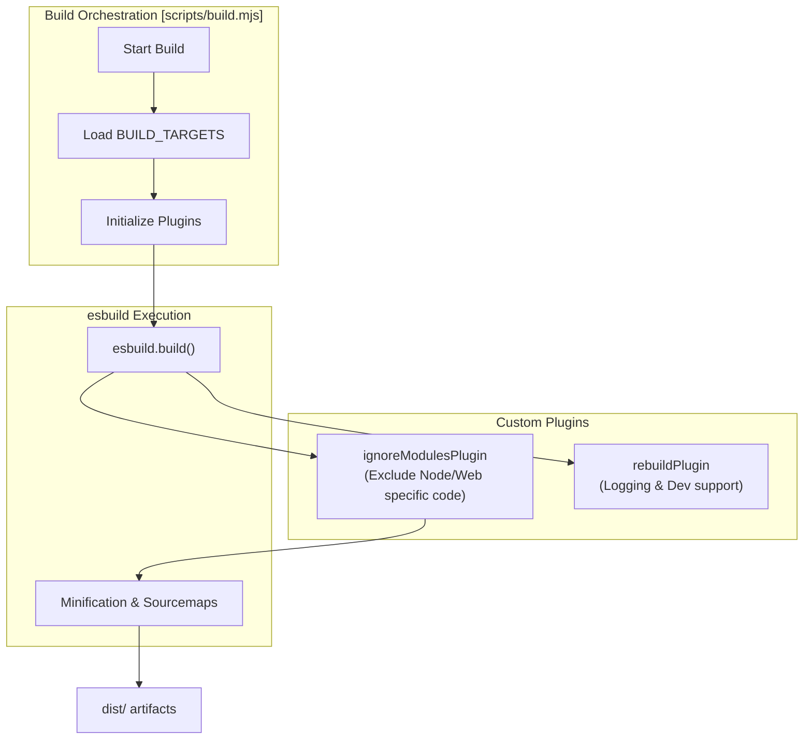
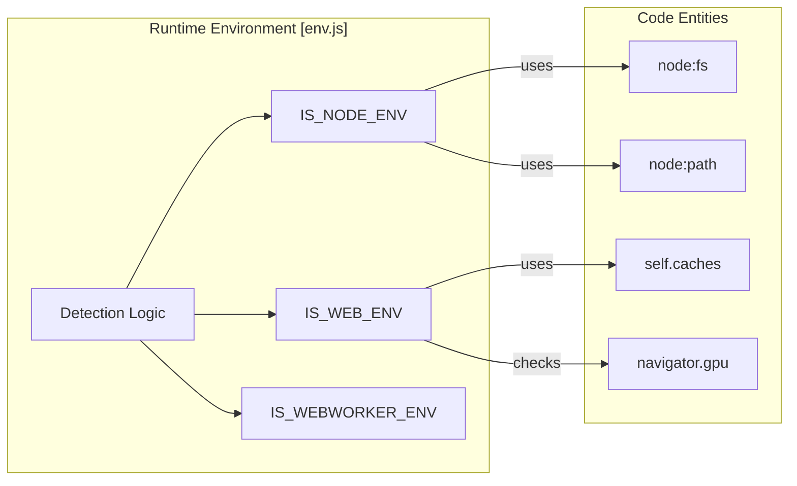

<!-- source: DeepWiki mcp.deepwiki.com · repo huggingface/transformers.js · page 13 Build and Distribution · fetched 2026-10-26 -->

# Build and Distribution

Relevant source files

The following files were used as context for generating this wiki page:

- [packages/transformers/docs/snippets/2_installation.snippet](packages/transformers/docs/snippets/2_installation.snippet)
- [packages/transformers/docs/snippets/3_custom-usage.snippet](packages/transformers/docs/snippets/3_custom-usage.snippet)
- [packages/transformers/package.json](packages/transformers/package.json)
- [packages/transformers/scripts/build/targets.mjs](packages/transformers/scripts/build/targets.mjs)
- [packages/transformers/src/env.js](packages/transformers/src/env.js)
- [pnpm-lock.yaml](pnpm-lock.yaml)

This document describes how Transformers.js is built, packaged, and distributed across different JavaScript environments. It covers the **esbuild-based** build system, multiple distribution targets, and packaging strategies for npm and CDNs.

## Purpose and Scope

The build system transforms source code into multiple output formats optimized for different environments (browser, Node.js, web workers). The system handles:

- **Multi-target compilation**: Producing separate bundles for web and Node.js environments [packages/transformers/scripts/build/targets.mjs:7-51]().
- **Module format support**: Generating both ESM and CommonJS outputs [packages/transformers/package.json:8-23]().
- **Dependency management**: Excluding or including backend-specific dependencies like `onnxruntime-web`, `onnxruntime-node`, and `sharp` [packages/transformers/package.json:57-63]().
- **Type generation**: Producing TypeScript declaration files using `tsc` [packages/transformers/package.json:27-29]().
- **Environment detection**: Providing runtime flags via the `env` module to adapt library behavior [packages/transformers/src/env.js:31-66]().

## Build Targets

Transformers.js defines four primary build targets to support the diverse JavaScript ecosystem. These targets differ in their module format (ESM vs CJS) and how they handle external dependencies.

| Target | Filename | Format | Environment | Bundled Deps |
|--------|----------|--------|-------------|--------------|
| **Bundle Build** | `transformers.js` | ESM | Web / CDN | `onnxruntime-web` |
| **Web Build** | `transformers.web.js` | ESM | Web / Bundlers | None (External) |
| **Node ESM** | `transformers.node.mjs` | ESM | Node.js | None (External) |
| **Node CJS** | `transformers.node.cjs` | CJS | Node.js | None (External) |

For details, see [Build Targets](#13.1).

**Sources:** [packages/transformers/scripts/build/targets.mjs:7-51](), [packages/transformers/package.json:5-23]()

## Build System and Plugins

The library uses **esbuild** for high-performance bundling. The build process is orchestrated via a script that applies custom logic for different environments.

For details, see [Build System and Plugins](#13.2).

**Sources:** [packages/transformers/scripts/build/targets.mjs:1-51](), [packages/transformers/package.json:29]()

## Package Distribution

Distribution is managed through `package.json` using conditional exports, allowing tools like Node.js, Vite, and Webpack to automatically select the correct build artifact.

- **NPM**: Published as `@huggingface/transformers` [packages/transformers/package.json:2]().
- **CDN**: Configured for `jsdelivr` and `unpkg` to point to the minified bundled build [packages/transformers/package.json:85-86]().
- **Conditional Exports**: Maps `node` and `default` conditions to their respective ESM/CJS files [packages/transformers/package.json:8-23]().

For details, see [Package Distribution](#13.3).

**Sources:** [packages/transformers/package.json:1-87](), [packages/transformers/docs/snippets/2_installation.snippet:7-12]()

## Code Quality and Formatting

The monorepo enforces consistent code style using **Prettier**. Formatting is checked during CI and can be applied locally via npm scripts.

- **Configuration**: Uses a root `.prettierignore` and package-level scripts [packages/transformers/package.json:25-26]().
- **TypeScript**: The `typegen` script ensures that type definitions are always in sync with the source code [packages/transformers/package.json:27]().

For details, see [Code Quality and Formatting](#13.4).

**Sources:** [packages/transformers/package.json:25-27](), [pnpm-lock.yaml:10-16]()

## Environment Detection Mapping

The library detects its environment at runtime to decide which APIs (like `fs` or `caches`) to use.

**Sources:** [packages/transformers/src/env.js:31-66](), [packages/transformers/src/env.js:99-144]()

---

