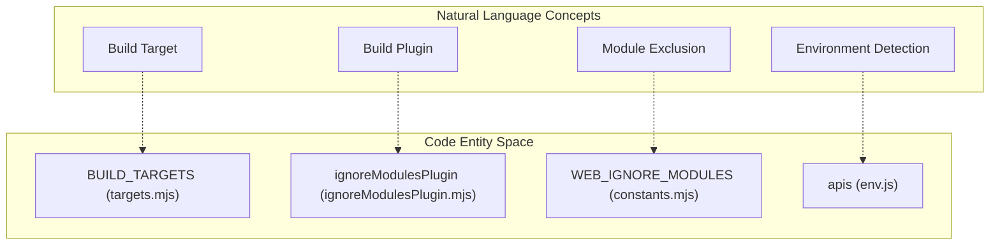
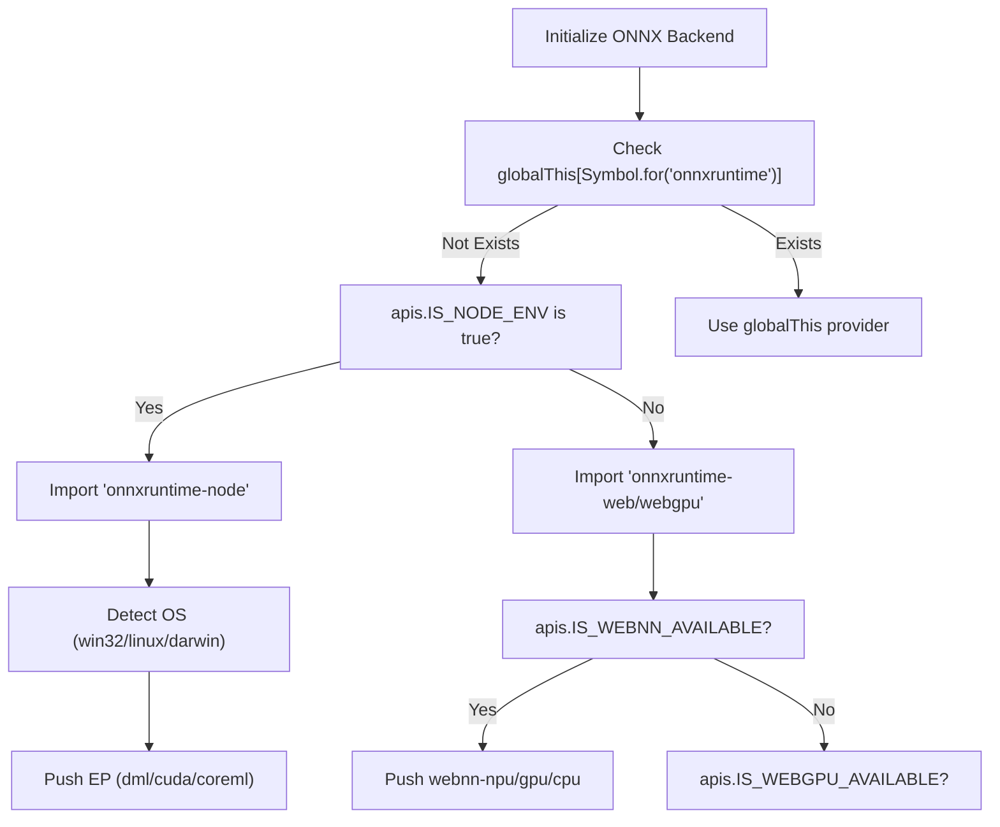

<!-- source: DeepWiki mcp.deepwiki.com · repo huggingface/transformers.js · page 13.2 Build System and Plugins · fetched 2026-10-26 -->

# Build System and Plugins

Relevant source files

The following files were used as context for generating this wiki page:

- [packages/transformers/scripts/build/plugins/ignoreModulesPlugin.mjs](packages/transformers/scripts/build/plugins/ignoreModulesPlugin.mjs)
- [packages/transformers/scripts/build/targets.mjs](packages/transformers/scripts/build/targets.mjs)
- [packages/transformers/src/backends/onnx.js](packages/transformers/src/backends/onnx.js)
- [packages/transformers/src/backends/utils/cacheWasm.js](packages/transformers/src/backends/utils/cacheWasm.js)
- [packages/transformers/src/utils/hub/utils.js](packages/transformers/src/utils/hub/utils.js)
- [packages/transformers/src/utils/image.js](packages/transformers/src/utils/image.js)

## Purpose and Scope

This document explains the build system that transforms the TypeScript and JavaScript source code of `@huggingface/transformers` into multiple distribution formats optimized for different JavaScript runtime environments. The build system uses **esbuild** as its primary bundler and includes custom plugins to handle environment-specific requirements, such as module exclusion and dynamic path patching.

The build process produces four main outputs defined in `BUILD_TARGETS` [packages/transformers/scripts/build/targets.mjs:7-51]():
- **Bundle Build (ESM)**: A standalone ES module bundle (`dist/transformers.js`).
- **Web Build (ESM)**: A browser-optimized ES module (`dist/transformers.web.js`).
- **Node Build (ESM)**: A Node.js optimized ES module (`dist/transformers.node.mjs`).
- **Node Build (CJS)**: A Node.js optimized CommonJS module (`dist/transformers.node.cjs`).

**Sources:** [packages/transformers/scripts/build/targets.mjs:7-51](), [package.json:1-64]()

---

## Build System Architecture

The build system is designed to handle the complexity of producing multiple distribution targets from a single source codebase while maintaining optimal bundle sizes and runtime performance.

### Build Entity Mapping

This diagram maps the high-level build concepts to the specific code entities that implement them.

**Sources:** [packages/transformers/scripts/build/targets.mjs:7](), [packages/transformers/scripts/build/plugins/ignoreModulesPlugin.mjs:5](), [packages/transformers/src/env.js:1-50]()

---

## Custom esbuild Plugins

The build system employs custom esbuild plugins to handle platform-specific requirements and optimize the final bundles. These plugins intercept the build process at specific points to modify behavior.

### ignoreModulesPlugin

The `ignoreModulesPlugin` is a critical component used to exclude Node.js-specific modules when building for the browser or to stub out heavy dependencies [packages/transformers/scripts/build/plugins/ignoreModulesPlugin.mjs:5-50]().

#### Implementation Details
- **Namespace**: It uses the `ignore-modules` namespace to intercept resolution [packages/transformers/scripts/build/plugins/ignoreModulesPlugin.mjs:17]().
- **Filter**: It dynamically creates a regex to match module names and their `node:` prefixed counterparts [packages/transformers/scripts/build/plugins/ignoreModulesPlugin.mjs:13-14]().
- **Stubbing**:
    - For `node:stream`, it provides a `noop` implementation and a `Readable.fromWeb` stub [packages/transformers/scripts/build/plugins/ignoreModulesPlugin.mjs:21-28]().
    - For `node:stream/promises`, it stubs the `pipeline` function [packages/transformers/scripts/build/plugins/ignoreModulesPlugin.mjs:29-36]().
    - For others like `node:fs`, `node:path`, `sharp`, and `onnxruntime-node`, it returns an empty default export [packages/transformers/scripts/build/plugins/ignoreModulesPlugin.mjs:37-45]().

### Build Configuration Flow

The build targets utilize different sets of ignored and external modules to ensure compatibility.

| Target | Format | Ignore Modules | External Modules |
|--------|--------|----------------|------------------|
| Bundle (ESM) | ESM | `WEB_IGNORE_MODULES` | None |
| Web (ESM) | ESM | `WEB_IGNORE_MODULES` | `WEB_EXTERNAL_MODULES` |
| Node (ESM) | ESM | `NODE_IGNORE_MODULES` | `NODE_EXTERNAL_MODULES` |
| Node (CJS) | CJS | `NODE_IGNORE_MODULES` | `NODE_EXTERNAL_MODULES` |

**Sources:** [packages/transformers/scripts/build/targets.mjs:7-51](), [packages/transformers/scripts/build/plugins/ignoreModulesPlugin.mjs:5-50]()

---

## Environment-Aware Backend Loading

The build system works in tandem with the `backends/onnx.js` handler to ensure the correct ONNX Runtime is used for the target environment.

### Backend Selection Logic

The library detects the environment at runtime and selects the appropriate ONNX provider [packages/transformers/src/backends/onnx.js:105-151]().

**Sources:** [packages/transformers/src/backends/onnx.js:105-151](), [packages/transformers/src/env.js:19]()

---

## WASM and Asset Handling

For browser environments, the build system must account for WASM loading. The `cacheWasm.js` utility manages the fetching and caching of these binaries [packages/transformers/src/backends/utils/cacheWasm.js:49-101]().

### WASM Factory Patching
A unique aspect of the build/load process is the `loadWasmFactory` function, which patches the ONNX Runtime WASM factory to work in environments like Deno [packages/transformers/src/backends/utils/cacheWasm.js:72-101]().

- **Dynamic Patching**: It replaces `globalThis.process?.versions?.node` with `false` in the factory code [packages/transformers/src/backends/utils/cacheWasm.js:94](). This prevents Deno from attempting to use Node.js-specific worker threads when using the bundled web version of the library.
- **Blob URLs**: The patched code is wrapped in a `Blob` and loaded via `URL.createObjectURL` [packages/transformers/src/backends/utils/cacheWasm.js:95-96]().

### URL Resolution
The `toAbsoluteURL` utility ensures that assets (like WASM files) are resolved correctly relative to the module location using `import.meta.url` or `location.href` [packages/transformers/src/utils/hub/utils.js:174-189]().

**Sources:** [packages/transformers/src/backends/utils/cacheWasm.js:72-101](), [packages/transformers/src/utils/hub/utils.js:174-189]()

---

## Image Processing Backends

The build system handles the split between browser-native `Canvas` APIs and the `sharp` library for Node.js [packages/transformers/src/utils/image.js:20-52]().

- **Web Environment**: Uses `self.OffscreenCanvas` and `self.createImageBitmap` [packages/transformers/src/utils/image.js:25-32]().
- **Node.js Environment**: Uses the `sharp` library, which is marked as an external module in Node build targets to prevent bundling [packages/transformers/src/utils/image.js:33-49](), [packages/transformers/scripts/build/targets.mjs:35]().

**Sources:** [packages/transformers/src/utils/image.js:20-52](), [packages/transformers/scripts/build/targets.mjs:35]()

---

## Code Quality and Formatting

The repository uses **Prettier** for consistent code formatting, with specific rules for different file types defined in the root `package.json` [package.json:29-62]().

### Formatting Profiles

| Profile | Indentation | Line Width | Target Files |
|---------|-------------|------------|--------------|
| **Source** | 4 spaces | 120 | `packages/*/src/**/*.{js,ts}` |
| **Scripts** | 2 spaces | 160 | `scripts/**/*.{js,ts}` |
| **Tests** | 2 spaces | Unlimited | `packages/*/tests/**/*.{js,ts}` |

The `.prettierignore` file ensures that build artifacts (`dist/`, `types/`), `node_modules`, and temporary caches are not modified by the formatter [ .prettierignore:1-17]().

**Sources:** [package.json:29-62](), [.prettierignore:1-17]()

---

