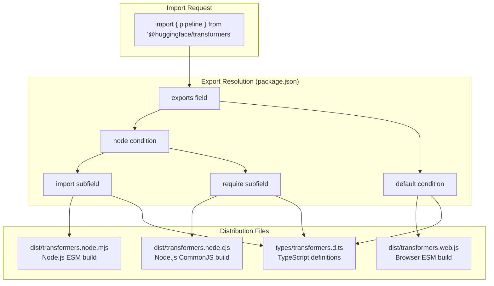
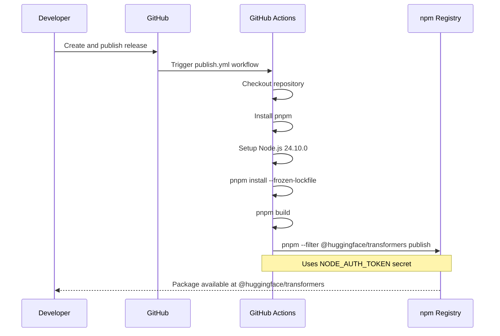

<!-- source: DeepWiki mcp.deepwiki.com · repo huggingface/transformers.js · page 13.3 Package Distribution · fetched 2026-10-26 -->

# Package Distribution

<details>
<summary>Relevant source files</summary>

The following files were used as context for generating this wiki page:

- [.github/workflows/documentation.yml](.github/workflows/documentation.yml)
- [.github/workflows/pr-documentation.yml](.github/workflows/pr-documentation.yml)
- [.github/workflows/publish.yml](.github/workflows/publish.yml)
- [.github/workflows/tests.yml](.github/workflows/tests.yml)
- [.github/workflows/upload-pr-documentation.yml](.github/workflows/upload-pr-documentation.yml)
- [packages/transformers/docs/snippets/2_installation.snippet](packages/transformers/docs/snippets/2_installation.snippet)
- [packages/transformers/docs/snippets/3_custom-usage.snippet](packages/transformers/docs/snippets/3_custom-usage.snippet)
- [packages/transformers/package.json](packages/transformers/package.json)
- [packages/transformers/src/env.js](packages/transformers/src/env.js)
- [pnpm-lock.yaml](pnpm-lock.yaml)

</details>


## Purpose and Scope

This document describes how the `@huggingface/transformers` package is distributed to end users through multiple channels. It covers the npm publishing process, CDN distribution configuration, package structure with conditional exports, and the automated publishing workflow. For information about the build process that creates distribution artifacts, see [Build Targets](13.1) and [Build System and Plugins](13.2).

---

## npm Registry Publishing

The library is published to the npm registry as `@huggingface/transformers`, enabling installation via package managers like npm, yarn, and pnpm.

### Package Metadata Configuration

The package metadata is defined in [packages/transformers/package.json:1-87]():

| Property | Value | Purpose |
|----------|-------|---------|
| `name` | `@huggingface/transformers` | Scoped package name under Hugging Face organization |
| `version` | `4.2.0` | Current stable version |
| `main` | `./dist/transformers.node.cjs` | Default CommonJS entry point |
| `types` | `./types/transformers.d.ts` | TypeScript type definitions |
| `type` | `module` | Declares package as ESM by default |

The `publishConfig` section [packages/transformers/package.json:82-84]() sets `access: public`, ensuring the scoped package is publicly accessible on npm.

### Published Files

The `files` array [packages/transformers/package.json:74-81]() specifies which directories are included in the published package:

```
src/        - Source code (for sourcemaps and debugging)
dist/       - Compiled distribution files
types/      - TypeScript type definitions
README.md   - Documentation
LICENSE     - Apache 2.0 license
```

Build artifacts like `*.tsbuildinfo` are explicitly excluded [packages/transformers/package.json:80]().

**Sources:** [packages/transformers/package.json:1-87]()

---

## Conditional Exports

The package uses conditional exports [packages/transformers/package.json:8-23]() to serve different builds based on the runtime environment. This allows Node.js and browser environments to receive optimized builds without manual configuration.

### Export Resolution Logic

The following diagram maps the `exports` configuration in `package.json` to the specific distribution files served to different environments.

**Package Export Mapping**


The exports structure in [packages/transformers/package.json:8-23]():

- **`node` condition**: Activated when running in Node.js.
  - `import`: Returns `./dist/transformers.node.mjs` (ESM) [packages/transformers/package.json:12]().
  - `require`: Returns `./dist/transformers.node.cjs` (CommonJS) [packages/transformers/package.json:16]().
  
- **`default` condition**: Activated in all other environments (browsers, Deno, etc.).
  - Returns `./dist/transformers.web.js` (browser-optimized ESM) [packages/transformers/package.json:21]().

**Sources:** [packages/transformers/package.json:8-23]()

---

## CDN Distribution

In addition to npm, the package is distributed via CDN networks for use in browsers without a build step.

### CDN Entry Points

Two CDN-specific fields are configured in [packages/transformers/package.json:85-86]():

```json
"jsdelivr": "./dist/transformers.min.js",
"unpkg": "./dist/transformers.min.js"
```

Both CDNs serve the minified browser build `transformers.min.js`, which is created during the build process.

### Usage from CDN

Users can import the library directly from CDN URLs using ES Modules [packages/transformers/docs/snippets/2_installation.snippet:7-12]():

```html
<script type="module">
    import { pipeline } from 'https://cdn.jsdelivr.net/npm/@huggingface/transformers@4.2.0';
</script>
```

### WASM Binary Distribution

The package references ONNX Runtime WASM binaries through CDN by default. The `env` configuration [packages/transformers/src/env.js:1-23]() allows for custom overrides:

```javascript
// Default: WASM files loaded from CDN
// Custom path can be set via:
env.backends.onnx.wasm.wasmPaths = '/path/to/files/';
```

As shown in [packages/transformers/docs/snippets/3_custom-usage.snippet:17](), this is useful for environments where external CDN access is restricted.

**Sources:** [packages/transformers/package.json:85-86](), [packages/transformers/docs/snippets/2_installation.snippet:7-12](), [packages/transformers/docs/snippets/3_custom-usage.snippet:16-18](), [packages/transformers/src/env.js:1-23]()

---

## Automated Publishing Workflow

Publishing to npm is automated via GitHub Actions when a new release is created.

### Publishing Workflow Execution

**Publishing Workflow Flow**


The workflow is defined in [.github/workflows/publish.yml:1-29]():

1. **Trigger:** The workflow runs when a GitHub release is published [.github/workflows/publish.yml:3-5]().
2. **Environment Variables:** `ONNXRUNTIME_NODE_INSTALL: skip` is set to avoid downloading native binaries during the build step [.github/workflows/publish.yml:8]().
3. **Setup:** Uses Node.js `24.10.0` [.github/workflows/publish.yml:20]().
4. **Build:** Executes `pnpm build` [.github/workflows/publish.yml:24](), which triggers `node scripts/build.mjs` and `pnpm typegen` as defined in [packages/transformers/package.json:29]().
5. **Publish:** Executes `pnpm --filter @huggingface/transformers publish --access public --no-git-checks` [.github/workflows/publish.yml:26]().

**Sources:** [.github/workflows/publish.yml:1-29](), [packages/transformers/package.json:29]()

---

## Version Management

### Current Version

The package version is defined in multiple locations that must be kept in sync:

1. **package.json** [packages/transformers/package.json:3](): `"version": "4.2.0"`
2. **env.js** [packages/transformers/src/env.js:29](): `const VERSION = '4.2.0';`

The version string in `env.js` is used for internal logging and environment detection.

**Sources:** [packages/transformers/package.json:3](), [packages/transformers/src/env.js:29]()

---

## Dependencies Distribution

The published package includes production dependencies that are automatically installed by the consumer's package manager.

### Production Dependencies

Runtime dependencies listed in [packages/transformers/package.json:57-63]():

| Dependency | Version | Purpose |
|------------|---------|---------|
| `@huggingface/jinja` | `^0.5.6` | Jinja2 template engine for Chat Templates |
| `@huggingface/tokenizers` | `^0.1.3` | Fast tokenization (Rust-backed WASM) |
| `onnxruntime-node` | `1.24.3` | ONNX Runtime for Node.js environments |
| `onnxruntime-web` | `1.26.0-dev...` | ONNX Runtime for Web (WebGPU/WASM) |
| `sharp` | `^0.34.5` | Image processing for Node.js |

### CI/CD Test Dependencies

The repository uses `jest` for unit tests [.github/workflows/tests.yml:45]() across Node.js versions 18, 20, and 22 [.github/workflows/tests.yml:27]().

**Sources:** [packages/transformers/package.json:57-63](), [.github/workflows/tests.yml:27-45]()

---

## Documentation Deployment

Documentation is automatically built and deployed when code is pushed to the `main` branch.

### Documentation Workflow

The workflow [.github/workflows/documentation.yml:1-20]() integrates with Hugging Face's documentation infrastructure:

1. **API Generation:** Runs `pnpm --filter @huggingface/transformers docs-api` [.github/workflows/documentation.yml:16](). This executes `node ./docs/scripts/generate.js` as defined in [packages/transformers/package.json:32]().
2. **Build:** Uses `doc-builder` to process source files in `transformers.js/packages/transformers/docs/source` [.github/workflows/documentation.yml:15]().
3. **PR Previews:** A separate workflow [.github/workflows/pr-documentation.yml:1-20]() generates documentation previews for Pull Requests.

**Sources:** [.github/workflows/documentation.yml:1-20](), [.github/workflows/pr-documentation.yml:1-20](), [packages/transformers/package.json:32-34]()

---

