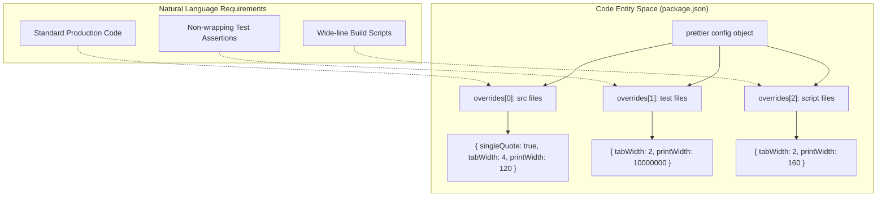
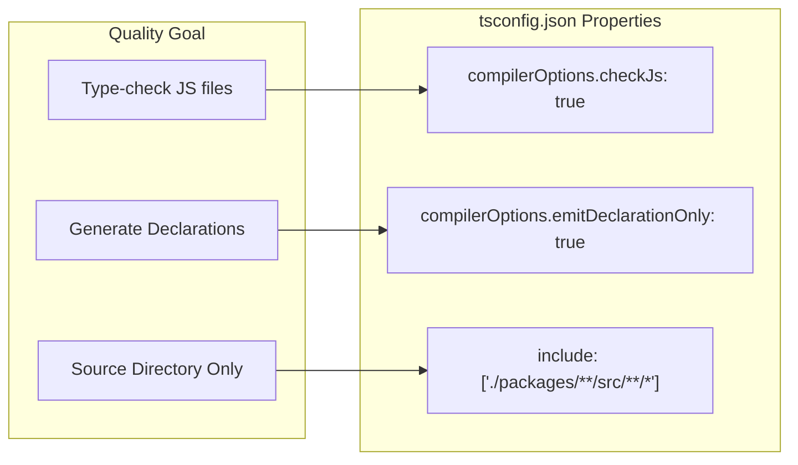

<!-- source: DeepWiki mcp.deepwiki.com · repo huggingface/transformers.js · page 13.4 Code Quality and Formatting · fetched 2026-10-26 -->

# Code Quality and Formatting

Relevant source files

The following files were used as context for generating this wiki page:

- [.prettierignore](.prettierignore)
- [tsconfig.json](tsconfig.json)

## Purpose and Scope

This document describes the code formatting standards and quality tooling used across the Transformers.js monorepo. It covers the Prettier configuration, formatting rules for different file types, and the commands used to enforce consistent code style. It also outlines the TypeScript configuration that ensures type safety and consistency across the monorepo packages.

For information about the build system that produces formatted outputs, see [Build System and Plugins](#13.2). For details on how formatting checks are enforced in CI/CD, see [CI/CD Integration](#14.3).

## Prettier as the Formatting Tool

Transformers.js uses **Prettier** as its primary code formatting tool to maintain consistent code style across the entire monorepo. Prettier is an opinionated code formatter that supports JavaScript, TypeScript, JSON, and other file types.

The Prettier configuration is defined directly in the root [package.json:29-62](), allowing for centralized management of formatting rules across all packages in the workspace.

**Sources:** [package.json:29-62]()

## Configuration Architecture

The Prettier configuration uses an **override-based system** that applies different formatting rules to different categories of files. This allows source code, tests, and scripts to have distinct formatting characteristics optimized for their specific purposes.

### Natural Language to Code Entity Space: Formatting Rules
The following diagram maps the logical formatting requirements to the specific glob patterns and rule definitions in the root configuration.

**Diagram: Mapping Formatting Requirements to Configuration Entities**

**Sources:** [package.json:29-62]()

## Formatting Rules by File Type

The monorepo uses three distinct formatting profiles:

| File Category | Glob Pattern | singleQuote | tabWidth | printWidth | Rationale |
|--------------|--------------|-------------|----------|------------|-----------|
| **Source Code** | `./packages/*/src/**/*.{js,mjs,cjs,ts}` | `true` | `4` | `120` | Production code benefits from 4-space indentation for readability of nested model architectures [package.json:30-40]() |
| **Test Files** | `./packages/*/tests/**/*.{js,mjs,cjs,ts}` | default (false) | `2` | `10000000` | Prevents Prettier from breaking long test assertions or expected output objects [package.json:41-49]() |
| **Scripts & Documentation** | `./scripts/**/*.{js,mjs,cjs,ts}` | default (false) | `2` | `160` | Build scripts and documentation code allow wider lines for file paths [package.json:50-60]() |

## TypeScript Configuration

The project uses a root `tsconfig.json` to define the base compiler options for all packages. This ensures that the code quality is maintained not just in formatting, but in structural integrity.

### Natural Language to Code Entity Space: TypeScript Compiler Options
This diagram associates high-level quality goals with specific `compilerOptions` flags.

**Diagram: Quality Goals to TypeScript Settings**

**Sources:** [tsconfig.json:3-22]()

Key configurations include:
- **Scope**: The compiler only includes files within `src` directories across the monorepo [tsconfig.json:3-3]().
- **JS Checking**: `checkJs: true` is enabled to ensure type safety even in JavaScript source files [tsconfig.json:6-6]().
- **Declaration Generation**: The project is configured to emit only `.d.ts` declaration files into the `types` directory, with source maps enabled for debugging [tsconfig.json:11-17]().
- **Module Resolution**: Uses `bundler` resolution and `esnext` targets to support modern environments [tsconfig.json:7-9]().

## Formatting Commands

Two npm scripts are available in the root [package.json]() for code formatting:

- **pnpm format**: Runs `prettier --write .` to automatically fix formatting in all supported files [package.json:11-11]().
- **pnpm format:check**: Runs `prettier --check .` to verify formatting without modifying files, primarily used in CI [package.json:12-12]().

## Excluded Files and Directories

The [.prettierignore]() file specifies which files and directories should be excluded from formatting checks to prevent accidental modification of artifacts or incompatible file types.

| Category | Patterns | Reason |
|----------|----------|--------|
| **Non-JS/TS Source** | `.github/`, `*.py`, `*.md` | Managed by other tools or specific formatting needs [.prettierignore:2-4]() |
| **Build Artifacts** | `**/dist`, `**/types`, `**/docs/build` | Generated output from build processes [.prettierignore:7-12]() |
| **Caches & Coverage** | `**/coverage`, `**/.cache`, `*.tsbuildinfo` | Temporary files generated during testing or compilation [.prettierignore:10-13]() |
| **Dependencies** | `**/node_modules`, `pnpm-lock.yaml` | Third-party code and package manager lock files [.prettierignore:9-16]() |

**Sources:** [.prettierignore:1-18]()

## Integration with Development Workflow

1.  **Local Development**: Developers run `pnpm format` before committing. The configuration in [package.json]() ensures that source code uses 4-space tabs while tests remain unwrapped for easier diffing.
2.  **CI Enforcement**: GitHub Actions run `pnpm format:check` [package.json:12-12](). If a developer forgets to format, the build fails.
3.  **Type Safety**: The root `tsconfig.json` ensures that even as Prettier manages the "look" of the code, the TypeScript compiler manages the "correctness" by checking all files in `./packages/**/src/**/*` [tsconfig.json:3-3]().

**Sources:** [package.json:11-12](), [tsconfig.json:1-26]()

---

