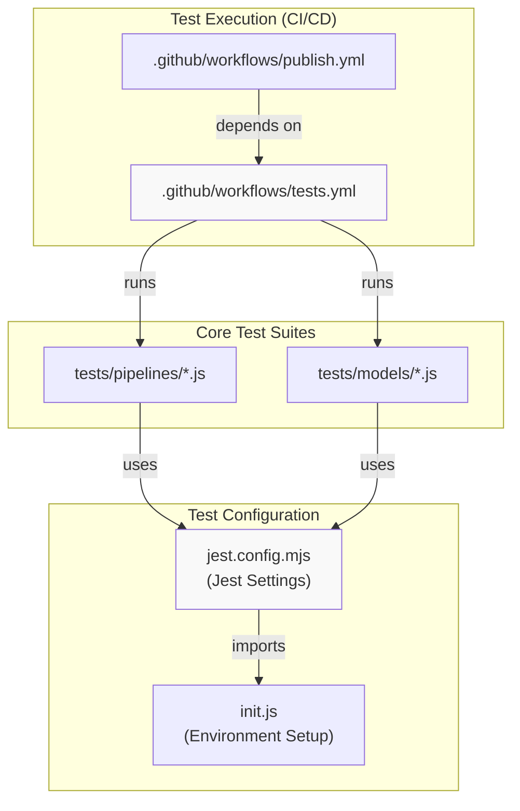
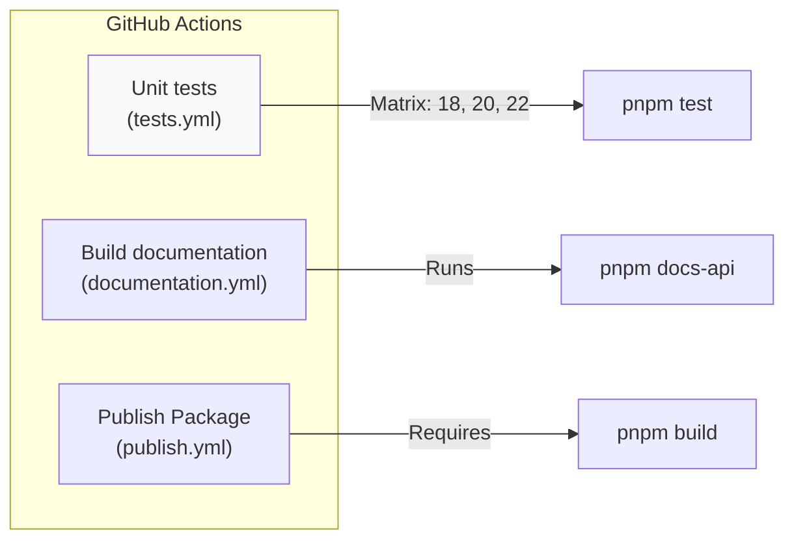

<!-- source: DeepWiki mcp.deepwiki.com · repo huggingface/transformers.js · page 14 Testing Framework · fetched 2026-10-26 -->

# Testing Framework

Relevant source files

The following files were used as context for generating this wiki page:

- [.github/workflows/documentation.yml](.github/workflows/documentation.yml)
- [.github/workflows/pr-documentation.yml](.github/workflows/pr-documentation.yml)
- [.github/workflows/publish.yml](.github/workflows/publish.yml)
- [.github/workflows/tests.yml](.github/workflows/tests.yml)
- [.github/workflows/upload-pr-documentation.yml](.github/workflows/upload-pr-documentation.yml)
- [packages/transformers/jest.config.mjs](packages/transformers/jest.config.mjs)
- [packages/transformers/src/models/auto/modeling_auto.js](packages/transformers/src/models/auto/modeling_auto.js)
- [packages/transformers/src/pipelines/index.js](packages/transformers/src/pipelines/index.js)
- [packages/transformers/tests/init.js](packages/transformers/tests/init.js)
- [packages/transformers/tests/pipelines/test_pipelines_text_generation.js](packages/transformers/tests/pipelines/test_pipelines_text_generation.js)

The testing framework ensures the reliability and correctness of the Transformers.js library across different runtime environments and Node.js versions. The system uses **Jest** as its primary test runner and is integrated into the CI/CD pipeline to automatically validate code changes before deployment.

For information about the CI/CD workflows that execute tests, see [CI/CD Integration](#14.3). For details on the build system that tests validate, see [Build and Distribution](#13).

## Purpose and Scope

The testing framework serves several critical functions:

- **Correctness Validation**: Ensures model loading, inference, preprocessing, and postprocessing produce expected results.
- **Cross-Environment Testing**: Validates functionality across Node.js versions 18, 20, and 22 [.github/workflows/tests.yml:27]().
- **Regression Prevention**: Catches breaking changes through automated test suites triggered on pull requests and pushes to the main branch [.github/workflows/tests.yml:3-14]().
- **Code Coverage**: Tracks test coverage using the `v8` provider to identify untested code paths [packages/transformers/jest.config.mjs:18-30]().

## Test Infrastructure Architecture

The following diagram maps the high-level testing concepts to specific code entities and workflows within the repository.

### Natural Language to Code Entity Space: Infrastructure

**Sources**: [.github/workflows/tests.yml:1-46](), [packages/transformers/jest.config.mjs:7-192](), [packages/transformers/tests/init.js:1-125]()

## Jest Configuration

The library uses a centralized Jest configuration for the `transformers` package. Key settings include:
- **Roots**: Tests are located in the `./tests/` directory [packages/transformers/jest.config.mjs:123]().
- **Coverage**: Coverage is collected from all source files, ignoring the `tests` and `node_modules` directories [packages/transformers/jest.config.mjs:27]().
- **Timeouts**: Default test timeout is set to 32,000ms to accommodate model loading and inference overhead [packages/transformers/jest.config.mjs:138]().

**Sources**: [packages/transformers/jest.config.mjs:7-192]()

## Test Organization

Tests are categorized by the functional area they validate, such as specific pipelines (e.g., `text-generation`) or model architectures. 

For details, see [Test Organization](#14.1).

### Pipeline Testing Example
A typical pipeline test (e.g., `test_pipelines_text_generation.js`) initializes a `pipeline` with a `tiny-random` model to ensure the logic works without requiring large downloads [packages/transformers/tests/pipelines/test_pipelines_text_generation.js:10-15](). It validates:
- Instance types (e.g., `TextGenerationPipeline`) [packages/transformers/tests/pipelines/test_pipelines_text_generation.js:18-20]().
- Output structure for single and list inputs [packages/transformers/tests/pipelines/test_pipelines_text_generation.js:42-57]().
- Specific generation parameters like `return_full_text` or `chat_input` [packages/transformers/tests/pipelines/test_pipelines_text_generation.js:60-91]().

**Sources**: [packages/transformers/tests/pipelines/test_pipelines_text_generation.js:1-124]()

## Test Utilities

The framework includes several utilities to handle the unique requirements of testing machine learning models in JavaScript, such as `onnxruntime` backend monkey-patching and custom matchers.

For details, see [Test Utilities](#14.2).

### Initialization and Global Matchers
The `init()` function in `tests/init.js` performs critical environment setup:
- **ONNX Backend Patching**: Fixes issues where `instanceof` checks fail in Jest for TypedArrays [packages/transformers/tests/init.js:15-55]().
- **Custom Matchers**: Provides `toBeCloseToNested` for comparing floating-point values in deeply nested objects/arrays [packages/transformers/tests/init.js:74-125]().
- **Constants**: Defines standard timeouts like `MAX_MODEL_LOAD_TIME` (15s) and `MAX_TEST_EXECUTION_TIME` (60s) [packages/transformers/tests/init.js:61-68]().

**Sources**: [packages/transformers/tests/init.js:1-125]()

## CI/CD Integration

Tests are automatically executed across multiple Node.js versions in GitHub Actions. The workflow also handles the cloning of internal testing models via Git LFS [.github/workflows/tests.yml:42]().

For details, see [CI/CD Integration](#14.3).

### Workflow Mapping

**Sources**: [.github/workflows/tests.yml:25-27](), [.github/workflows/documentation.yml:16](), [.github/workflows/publish.yml:24-26]()

## TypeScript Configuration

The framework uses TypeScript for type checking and generation, ensuring that the library's API remains consistent and well-documented.

For details, see [TypeScript Configuration](#14.4).

**Sources**: [tsconfig.json:1-26]()

---

