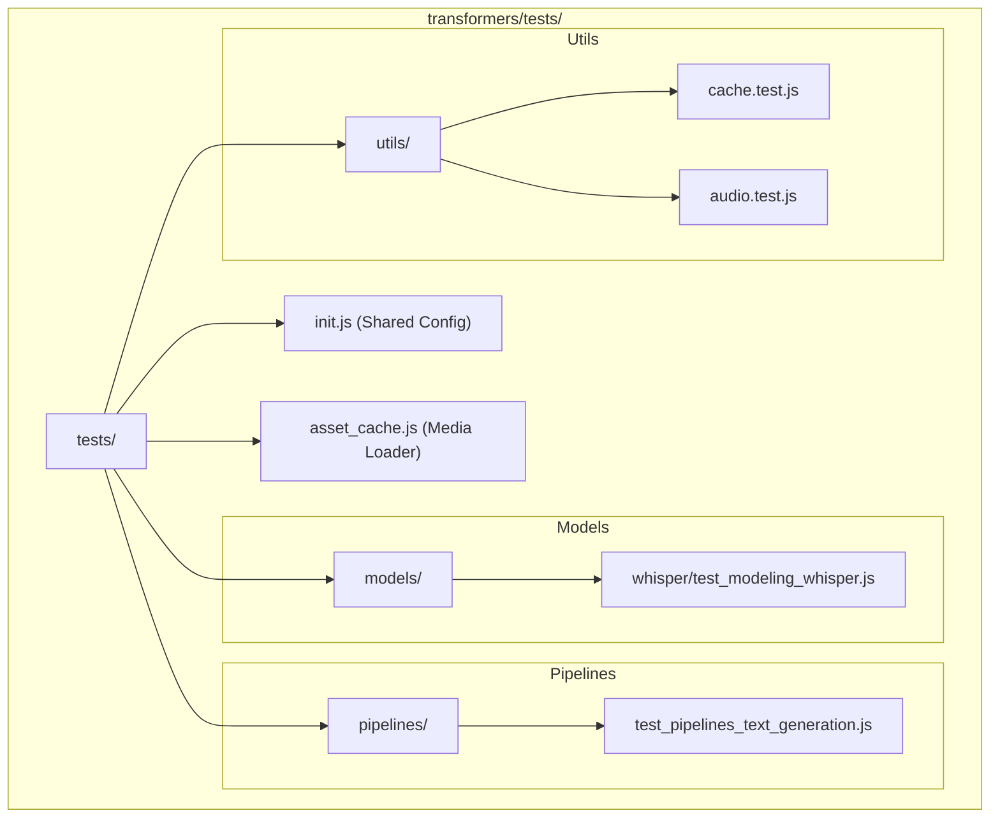
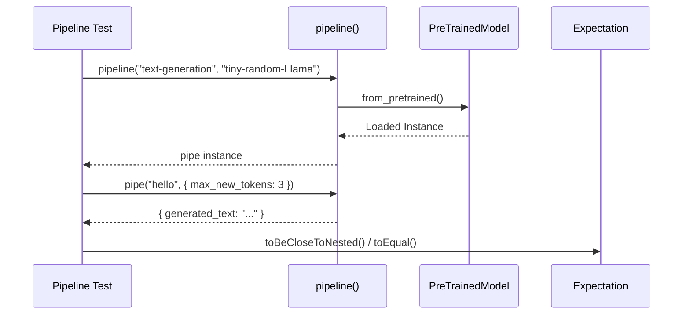

<!-- source: DeepWiki mcp.deepwiki.com · repo huggingface/transformers.js · page 14.1 Test Organization · fetched 2026-10-26 -->

# Test Organization

<details>
<summary>Relevant source files</summary>

The following files were used as context for generating this wiki page:

- [packages/transformers/docs/source/guides/dtypes.md](packages/transformers/docs/source/guides/dtypes.md)
- [packages/transformers/jest.config.mjs](packages/transformers/jest.config.mjs)
- [packages/transformers/src/generation/logits_process.js](packages/transformers/src/generation/logits_process.js)
- [packages/transformers/src/models/auto/modeling_auto.js](packages/transformers/src/models/auto/modeling_auto.js)
- [packages/transformers/src/models/whisper/tokenization_whisper.js](packages/transformers/src/models/whisper/tokenization_whisper.js)
- [packages/transformers/src/pipelines/index.js](packages/transformers/src/pipelines/index.js)
- [packages/transformers/src/utils/model_registry/ModelRegistry.js](packages/transformers/src/utils/model_registry/ModelRegistry.js)
- [packages/transformers/src/utils/model_registry/is_cached.js](packages/transformers/src/utils/model_registry/is_cached.js)
- [packages/transformers/tests/asset_cache.js](packages/transformers/tests/asset_cache.js)
- [packages/transformers/tests/init.js](packages/transformers/tests/init.js)
- [packages/transformers/tests/models/whisper/test_modeling_whisper.js](packages/transformers/tests/models/whisper/test_modeling_whisper.js)
- [packages/transformers/tests/models/whisper/test_tokenization_whisper.js](packages/transformers/tests/models/whisper/test_tokenization_whisper.js)
- [packages/transformers/tests/pipelines/test_pipelines_text_generation.js](packages/transformers/tests/pipelines/test_pipelines_text_generation.js)
- [packages/transformers/tests/utils/audio.test.js](packages/transformers/tests/utils/audio.test.js)
- [packages/transformers/tests/utils/cache.test.js](packages/transformers/tests/utils/cache.test.js)
- [packages/transformers/tests/utils/model_registry.test.js](packages/transformers/tests/utils/model_registry.test.js)

</details>


## Purpose and Scope

This document explains how tests are organized in the `transformers.js` repository, detailing the directory structure, file naming conventions, and testing patterns used to validate models, pipelines, and utilities. The test suite is designed to ensure cross-environment compatibility (Node.js, Browser) and architectural correctness across 50+ model implementations.

For information about specific test utilities and helper functions, see [Test Utilities](14.2). For CI/CD workflows and automated testing, see [CI/CD Integration](14.3).

**Sources:** [packages/transformers/jest.config.mjs:123-123](), [packages/transformers/tests/init.js:1-15]()

---

## Test Directory Structure

The test suite is located in the `packages/transformers/tests/` directory. It is organized into subdirectories that mirror the library's internal architecture, allowing for modular testing of models, tokenizers, and pipelines.

### Directory Layout



**Sources:** [packages/transformers/jest.config.mjs:123-123](), [packages/transformers/tests/pipelines/test_pipelines_text_generation.js:1-10]()

### Key Test Components

| Test Directory | Source Component | Purpose |
|---|---|---|
| `tests/models/` | `src/models/` | Architecture-specific tests (e.g., Whisper, Llama). |
| `tests/pipelines/` | `src/pipelines/` | Task-based integration tests (Text Generation, ASR). |
| `tests/utils/` | `src/utils/` | Tests for `ModelRegistry`, Hub integration, and math utilities. |
| `tests/init.js` | N/A | Global test setup, timeouts, and Jest extensions. |
| `tests/asset_cache.js` | N/A | Centralized loading for test images and audio files. |

**Sources:** [packages/transformers/tests/init.js:61-72](), [packages/transformers/tests/asset_cache.js:3-28]()

---

## Test Initialization and Environment

The testing environment uses a custom initialization script to handle cross-environment discrepancies, specifically for `onnxruntime` and TypedArrays.

### Runtime Workarounds
The `init()` function in `tests/init.js` performs several critical tasks:
1.  **WASM Threading**: Limits `ONNX_COMMON.env.wasm.numThreads` to `1` to prevent worker script path errors during concurrent CI runs [packages/transformers/tests/init.js:15-20]().
2.  **TypedArray Patching**: Monkey-patches `Symbol.hasInstance` for all TypedArrays (e.g., `Float32Array`, `Int32Array`) to ensure `instanceof` checks work correctly within the Jest VM context [packages/transformers/tests/init.js:25-55]().
3.  **Backend Registration**: Registers a high-priority "test" backend using `onnxruntime-node` [packages/transformers/tests/init.js:57-59]().

### Test Constants and Timeouts
Global timeouts are defined to accommodate model downloads and inference:
*   `MAX_MODEL_LOAD_TIME`: 15 seconds [packages/transformers/tests/init.js:64-64]().
*   `MAX_TEST_EXECUTION_TIME`: 60 seconds [packages/transformers/tests/init.js:65-65]().
*   `DEFAULT_MODEL_OPTIONS`: Sets default `dtype` to `"fp32"` [packages/transformers/tests/init.js:70-72]().

**Sources:** [packages/transformers/tests/init.js:15-72]()

---

## Testing Patterns

### Pipeline Integration Testing
Pipeline tests verify the high-level API by loading tiny random models from the Hub. They test various input formats (single strings, lists, chat messages) and configuration flags.



**Example (Text Generation):** Tests verify that `return_full_text: false` correctly strips the prompt and that chat templates are applied via a spy on `pipe.tokenizer.apply_chat_template` [packages/transformers/tests/pipelines/test_pipelines_text_generation.js:60-120]().

### Cache and Registry Testing
Tests for `ModelRegistry` ensure that the library correctly identifies required files for different model types (Encoder-only vs. Decoder-only) and quantization levels.

**Sources:** [packages/transformers/tests/utils/cache.test.js:16-46](), [packages/transformers/tests/utils/model_registry.test.js:53-109]()

### Asset Management
To avoid redundant network requests, `tests/asset_cache.js` provides a centralized `IMAGE_CACHE` and `AUDIO_CACHE`. Utilities like `load_cached_image` and `load_cached_audio` wrap `RawImage.fromURL` and `fetch` to provide reusable `Float32Array` or `RawImage` instances [packages/transformers/tests/asset_cache.js:37-74]().

---

## Custom Matchers

The test suite extends Jest's `expect` with `toBeCloseToNested`, a recursive matcher designed for comparing tensor-like structures (nested arrays of numbers) with a specified decimal tolerance.

```javascript
// Example usage in audio tests
const expected = [0.0, 0.0669, 0.9330, ...];
expect(Array.from(spec.data)).toBeCloseToNested(expected, 4);
```

**Implementation Logic:**
1.  If values are numbers, it checks absolute difference against $10^{-numDigits}$ [packages/transformers/tests/init.js:77-82]().
2.  If values are arrays, it recursively compares elements and lengths [packages/transformers/tests/init.js:83-93]().
3.  If values are objects, it verifies key symmetry and recursively compares values [packages/transformers/tests/init.js:94-112]().

**Sources:** [packages/transformers/tests/init.js:74-125](), [packages/transformers/tests/utils/audio.test.js:151-152]()

---

## Data-Driven Tokenization Tests
Tokenizer tests often use large configuration objects (e.g., `TEST_CONFIG`) mapping model IDs to specific test cases (e.g., `SIMPLE`, `NUMBERS`, `CHINES_ONLY`). Each case includes the raw `text`, expected `tokens`, expected `ids`, and the `decoded` string [packages/transformers/tests/models/whisper/test_tokenization_whisper.js:5-83]().

**Sources:** [packages/transformers/tests/models/whisper/test_tokenization_whisper.js:1-84]()

---

## Coverage and Configuration
The Jest configuration is defined in `jest.config.mjs`. It uses the `v8` coverage provider and ignores the `tests/` directory itself for coverage metrics [packages/transformers/jest.config.mjs:18-30]().

**Sources:** [packages/transformers/jest.config.mjs:7-30]()

---

