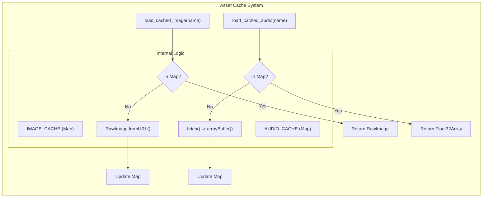
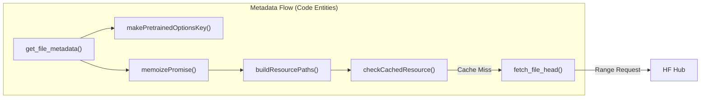
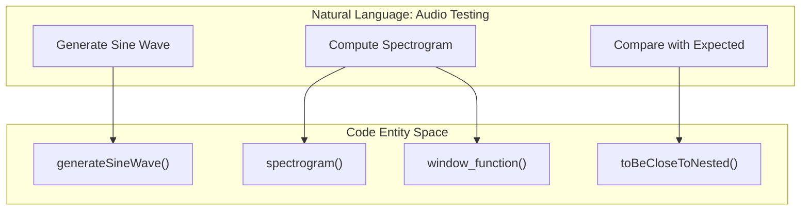

<!-- source: DeepWiki mcp.deepwiki.com · repo huggingface/transformers.js · page 14.2 Test Utilities · fetched 2026-10-26 -->

# Test Utilities

Relevant source files

The following files were used as context for generating this wiki page:

- [packages/transformers/src/generation/logits_process.js](packages/transformers/src/generation/logits_process.js)
- [packages/transformers/src/image_processors_utils.js](packages/transformers/src/image_processors_utils.js)
- [packages/transformers/src/models/session.js](packages/transformers/src/models/session.js)
- [packages/transformers/src/models/whisper/tokenization_whisper.js](packages/transformers/src/models/whisper/tokenization_whisper.js)
- [packages/transformers/src/utils/lru_cache.js](packages/transformers/src/utils/lru_cache.js)
- [packages/transformers/src/utils/memoize_promise.js](packages/transformers/src/utils/memoize_promise.js)
- [packages/transformers/src/utils/model_registry/get_file_metadata.js](packages/transformers/src/utils/model_registry/get_file_metadata.js)
- [packages/transformers/tests/asset_cache.js](packages/transformers/tests/asset_cache.js)
- [packages/transformers/tests/models/whisper/test_modeling_whisper.js](packages/transformers/tests/models/whisper/test_modeling_whisper.js)
- [packages/transformers/tests/models/whisper/test_tokenization_whisper.js](packages/transformers/tests/models/whisper/test_tokenization_whisper.js)
- [packages/transformers/tests/utils/audio.test.js](packages/transformers/tests/utils/audio.test.js)
- [packages/transformers/tests/utils/custom_cache.test.js](packages/transformers/tests/utils/custom_cache.test.js)
- [packages/transformers/tests/utils/lru_cache.test.js](packages/transformers/tests/utils/lru_cache.test.js)

## Purpose and Scope

This page documents the helper functions and test data utilities provided by Transformers.js to simplify test authoring and execution. These utilities handle common testing tasks such as loading audio/image assets, performing deep equality comparisons with floating-point tolerance, managing test string constants, and mocking cache interfaces.

For information about how tests are organized and structured, see [Test Organization](#14.1). For details on CI/CD workflows and GitHub Actions integration, see [CI/CD Integration](#14.3).

**Sources:** [packages/transformers/tests/asset_cache.js:1-75](), [packages/transformers/tests/utils/custom_cache.test.js:1-42]()

---

## Asset Caching and Loading

To avoid redundant network requests during test execution, the repository uses an asset caching system for images and audio files. These utilities are primarily defined in `packages/transformers/tests/asset_cache.js`.

### Image Loading (`load_cached_image`)

The `load_cached_image` utility [packages/transformers/tests/asset_cache.js:67]() uses an internal `Map` called `IMAGE_CACHE` [packages/transformers/tests/asset_cache.js:38]() to store `RawImage` objects.

1. **Check Cache:** If the URL exists in `IMAGE_CACHE`, it returns the cached `RawImage`.
2. **Fetch:** If not cached, it calls `RawImage.fromURL(url)` [packages/transformers/tests/asset_cache.js:44]().
3. **Store:** The result is stored in the map for subsequent tests.

### Audio Loading (`load_cached_audio`)

Similar to images, audio files are cached in `AUDIO_CACHE` [packages/transformers/tests/asset_cache.js:50]().

1. **NPY Handling:** If the URL ends in `.npy`, the data is loaded as a `Float64Array` and converted to `Float32Array` [packages/transformers/tests/asset_cache.js:57]().
2. **PCM Handling:** Otherwise, it is treated as raw PCM data and loaded directly into a `Float32Array`.

**Sources:** [packages/transformers/tests/asset_cache.js:37-75]()

---

## Cache Mocking and Testing

Transformers.js provides mechanisms to test custom cache implementations, ensuring compatibility with the library's internal file-loading logic.

### NaiveFetchCache

In `packages/transformers/tests/utils/custom_cache.test.js`, a `NaiveFetchCache` class is implemented to simulate a `CacheInterface` [packages/transformers/tests/utils/custom_cache.test.js:12-42](). This is used to verify that the library can interact with user-provided caching layers.

**Key Methods:**
- `match(request)`: Checks an internal `Map` for a cached `Response`. If missing, it performs a `fetch` and stores the result [packages/transformers/tests/utils/custom_cache.test.js:18-35]().
- `put(request, response)`: Manually adds a response to the internal map [packages/transformers/tests/utils/custom_cache.test.js:37-41]().

### Cache-Aware Metadata Utilities

The library includes utilities like `get_file_metadata` which are tested for their ability to distinguish between cached and remote resources [packages/transformers/src/utils/model_registry/get_file_metadata.js:53]().

**Sources:** [packages/transformers/src/utils/model_registry/get_file_metadata.js:53-156](), [packages/transformers/tests/utils/custom_cache.test.js:12-42]()

---

## Specialized Test Generators

For complex models like Whisper, the test suite uses data-driven testing patterns where tokenization and modeling behavior are validated against static configurations.

### Whisper Tokenization Testing

The Whisper tokenizer tests utilize a `TEST_CONFIG` object [packages/transformers/tests/models/whisper/test_tokenization_whisper.js:5]() that maps specific input strings to expected token IDs and decoded strings. This ensures that the state-machine logic in `_decode_asr` [packages/transformers/src/models/whisper/tokenization_whisper.js:29]() correctly handles:
- Language tokens
- Timestamp tokens (0.00s to 30.00s) [packages/transformers/src/models/whisper/tokenization_whisper.js:71]()
- Special tokens (BOS, EOS, Notimestamps)

### Audio Processing Testing

Audio utilities are tested using deterministic signal generation. Functions like `generateSineWave` [packages/transformers/tests/utils/audio.test.js:13]() and `generateDeterministicWaveform` [packages/transformers/tests/utils/audio.test.js:40]() provide stable inputs for testing:
- **Spectrogram computation:** Validating shapes and values against known impulses [packages/transformers/tests/utils/audio.test.js:133]().
- **Windowing functions:** Testing Hann windowing and zero-padding [packages/transformers/tests/utils/audio.test.js:155]().

**Sources:** [packages/transformers/tests/utils/audio.test.js:13-52](), [packages/transformers/tests/models/whisper/test_tokenization_whisper.js:1-129]()

---

## Memoization and LRU Cache Utilities

The testing of internal performance utilities ensures that the `memoizePromise` and `LRUCache` classes function correctly under load.

### LRU Cache Implementation

The `LRUCache` [packages/transformers/src/utils/lru_cache.js:6]() is a simple Least Recently Used cache that evicts items when capacity is exceeded. It is used by `memoizePromise` to bound the number of cached async operations.

- **`get(key)`**: Moves the accessed key to the "most recent" position in the internal `Map` [packages/transformers/src/utils/lru_cache.js:27]().
- **`put(key, value)`**: Inserts the value and deletes the oldest entry if `size > capacity` [packages/transformers/src/utils/lru_cache.js:42]().

### Memoization Utility

The `memoizePromise` function [packages/transformers/src/utils/memoize_promise.js:31]() ensures that an async operation (like fetching a model file) is only initiated once per key.
- **Success:** The promise is stored in the LRU cache.
- **Failure:** The promise is evicted from the cache to allow for retries [packages/transformers/src/utils/memoize_promise.js:39]().

**Sources:** [packages/transformers/src/utils/lru_cache.js:6-67](), [packages/transformers/src/utils/memoize_promise.js:1-45]()

---

