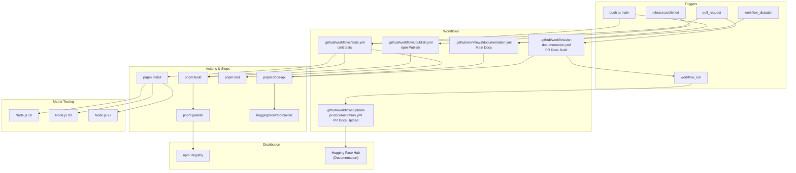
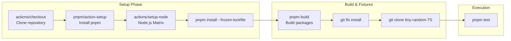

<!-- source: DeepWiki mcp.deepwiki.com · repo huggingface/transformers.js · page 14.3 CI/CD Integration · fetched 2026-10-26 -->

# CI/CD Integration

Relevant source files

The following files were used as context for generating this wiki page:

- [.github/workflows/documentation.yml](.github/workflows/documentation.yml)
- [.github/workflows/pr-documentation.yml](.github/workflows/pr-documentation.yml)
- [.github/workflows/publish.yml](.github/workflows/publish.yml)
- [.github/workflows/tests.yml](.github/workflows/tests.yml)
- [.github/workflows/upload-pr-documentation.yml](.github/workflows/upload-pr-documentation.yml)

This page documents the Continuous Integration and Continuous Deployment (CI/CD) infrastructure for Transformers.js. It covers the GitHub Actions workflows that automate testing, documentation generation, and npm publishing.

## Workflow Architecture

The CI/CD system consists of multiple GitHub Actions workflows that handle different aspects of the development lifecycle:

**Sources:** [.github/workflows/tests.yml:1-14](), [.github/workflows/documentation.yml:1-8](), [.github/workflows/publish.yml:1-5](), [.github/workflows/upload-pr-documentation.yml:1-7]()

## Test Workflow

The primary CI workflow is defined in `.github/workflows/tests.yml` and runs on every push to `main` and on pull requests (opened, reopened, synchronized, or ready for review).

### Workflow Configuration

| Property | Value | Purpose |
|----------|-------|---------|
| Name | `Unit tests` | Displayed in GitHub Actions UI |
| Draft Check | `github.event.pull_request.draft == false` | Skips draft PRs to save resources [.github/workflows/tests.yml:22]() |
| Runner | `aws-general-8-plus` | High-performance runner group [.github/workflows/tests.yml:24]() |
| Matrix | Node.js 18, 20, 22 | Tests across current LTS versions [.github/workflows/tests.yml:27]() |

### Test Execution Flow

The workflow uses `pnpm` for fast dependency resolution and workspace management.

**Sources:** [.github/workflows/tests.yml:30-46]()

### Environment Variables
The test workflow sets specific environment variables to optimize CI execution:
- `TESTING_REMOTELY: true`: Signals the library it is running in a CI context [.github/workflows/tests.yml:17]().
- `ONNXRUNTIME_NODE_INSTALL: skip`: Prevents the post-install script of `onnxruntime-node` from running, as CI builds use the bundled versions or specific binaries [.github/workflows/tests.yml:18]().

## Documentation Workflows

Transformers.js uses the Hugging Face `doc-builder` tool to generate and host documentation.

### Main Documentation
The `.github/workflows/documentation.yml` workflow builds the production documentation when changes are pushed to `main` [.github/workflows/documentation.yml:5-7]().

1.  **API Generation**: Runs `pnpm --filter @huggingface/transformers docs-api` to generate API references from JSDoc/TypeScript [.github/workflows/documentation.yml:16]().
2.  **Doc-Builder**: Invokes the `build_main_documentation.yml` reusable workflow from the `huggingface/doc-builder` repository [.github/workflows/documentation.yml:11]().
3.  **Pathing**: Documentation source is located at `packages/transformers/docs/source` [.github/workflows/documentation.yml:15]().

### PR Documentation Previews
To allow reviewers to see documentation changes before merging, two workflows coordinate:
1.  **Build PR Documentation**: Triggers on every PR to build the documentation and upload artifacts [.github/workflows/pr-documentation.yml:4]().
2.  **Upload PR Documentation**: Triggers after the build completes (`workflow_run`) to securely upload the preview to the Hugging Face Hub and post a comment on the PR [.github/workflows/upload-pr-documentation.yml:4-7]().

**Sources:** [.github/workflows/pr-documentation.yml:1-20](), [.github/workflows/upload-pr-documentation.yml:1-17]()

## Publish Workflow

The `.github/workflows/publish.yml` workflow automates the release process to npmjs.org.

### Publishing Logic
- **Trigger**: Runs when a new release is published in the GitHub repository [.github/workflows/publish.yml:4-5]().
- **Registry**: Configured to use `https://registry.npmjs.org` [.github/workflows/publish.yml:21]().
- **Node Version**: Uses a specific version (`24.10.0`) for publishing consistency [.github/workflows/publish.yml:20]().
- **Execution**: 
    1.  `pnpm install --frozen-lockfile` [.github/workflows/publish.yml:23]()
    2.  `pnpm build` [.github/workflows/publish.yml:24]()
    3.  `pnpm --filter @huggingface/transformers publish --access public` [.github/workflows/publish.yml:26]()

The `NODE_AUTH_TOKEN` secret is used for authentication against the npm registry [.github/workflows/publish.yml:28]().

## Summary of CI Commands

| Command | Workflow | Purpose |
|---------|----------|---------|
| `pnpm install --frozen-lockfile` | All | Installs exact dependency versions from lockfile |
| `pnpm build` | Tests, Publish | Compiles the library and generates bundles |
| `pnpm test` | Tests | Executes Jest unit and integration tests |
| `pnpm --filter @huggingface/transformers docs-api` | Documentation | Generates API markdown from source code |
| `pnpm publish --access public` | Publish | Uploads the `@huggingface/transformers` package to npm |

**Sources:** [.github/workflows/tests.yml:38-45](), [.github/workflows/documentation.yml:16](), [.github/workflows/publish.yml:23-26]()

---

