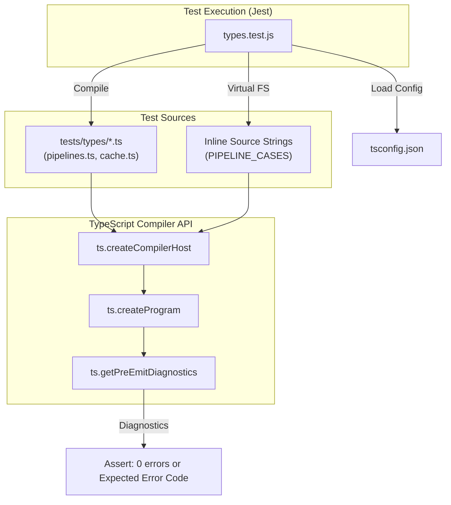
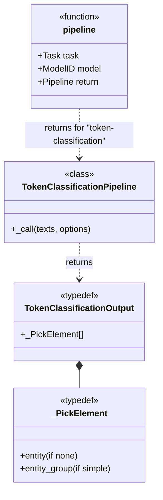

<!-- source: DeepWiki mcp.deepwiki.com · repo huggingface/transformers.js · page 14.4 TypeScript Configuration · fetched 2026-10-26 -->

# TypeScript Configuration

<details>
<summary>Relevant source files</summary>

The following files were used as context for generating this wiki page:

- [packages/transformers/src/models/openai_privacy_filter/modeling_openai_privacy_filter.js](packages/transformers/src/models/openai_privacy_filter/modeling_openai_privacy_filter.js)
- [packages/transformers/src/pipelines/token-classification.js](packages/transformers/src/pipelines/token-classification.js)
- [packages/transformers/tests/pipelines/test_pipelines_token_classification.js](packages/transformers/tests/pipelines/test_pipelines_token_classification.js)
- [packages/transformers/tests/types.test.js](packages/transformers/tests/types.test.js)
- [packages/transformers/tests/types/pipelines.ts](packages/transformers/tests/types/pipelines.ts)
- [packages/transformers/tsconfig.json](packages/transformers/tsconfig.json)
- [tsconfig.json](tsconfig.json)

</details>


## Purpose and Scope

This document covers the TypeScript configuration used in the `transformers.js` repository for type generation and automated type testing. Although the library is implemented in JavaScript, TypeScript is utilized as a static analysis tool to generate type definitions (`.d.ts` files) from JSDoc and to verify the correctness of the public API surface through specialized type tests.

**Sources:** [tsconfig.json:1-27](), [packages/transformers/tsconfig.json:1-25](), [packages/transformers/tests/types.test.js:1-72]()

---

## Configuration Architecture

The repository employs a two-tier TypeScript configuration strategy. A root `tsconfig.json` manages global workspace settings, while package-specific configurations (e.g., in `packages/transformers/`) handle localized emission settings.

### Root Configuration (`tsconfig.json`)
The root configuration is primarily used for editor integration and global type acquisition. It includes all source files across the monorepo workspace. [tsconfig.json:3]()

| Option | Value | Purpose |
|:---|:---|:---|
| `checkJs` | `true` | Enables type checking on `.js` files via JSDoc. [tsconfig.json:6]() |
| `moduleResolution` | `"bundler"` | Optimized for modern bundlers like esbuild. [tsconfig.json:9]() |
| `emitDeclarationOnly` | `true` | Prevents JS emission; only produces `.d.ts` files. [tsconfig.json:17]() |
| `lib` | `["ES2020", "DOM"]` | Provides types for both Node.js and Browser environments. [tsconfig.json:10]() |

### Package Configuration (`packages/transformers/tsconfig.json`)
The package-level configuration overrides the root to specify the output directory for generated types.

*   **`outDir`**: Set to `"types"`. [packages/transformers/tsconfig.json:10]()
*   **`rootDir`**: Set to `"src"`. [packages/transformers/tsconfig.json:11]()
*   **`composite`**: Enabled for incremental builds. [packages/transformers/tsconfig.json:19]()

**Sources:** [tsconfig.json:1-27](), [packages/transformers/tsconfig.json:1-25]()

---

## Type Testing Infrastructure

The library uses a custom test runner, `packages/transformers/tests/types.test.js`, to verify that the TypeScript compiler correctly handles library usage and catches invalid code. Unlike standard unit tests, these tests are not executed; they are compiled by the TypeScript API to check for diagnostics. [packages/transformers/tests/types.test.js:64-71]()

### Data Flow for Type Tests



**Diagram: Type Testing Data Flow**

**Sources:** [packages/transformers/tests/types.test.js:9-33](), [packages/transformers/tests/types.test.js:48-59]()

### Compiler Option Overrides for Testing
The test runner dynamically modifies compiler options to ensure strictness during testing, even if the main library uses looser settings. It forces `strict: true` and `noEmit: true`. [packages/transformers/tests/types.test.js:16-23]()

---

## Pipeline Type Inference

A significant portion of the TypeScript configuration is dedicated to ensuring the `pipeline()` function correctly infers return types based on the task name and input format (single vs. batched).

### Pipeline Test Cases
The `tests/types/pipelines.ts` file contains static tests that use `Expect<Equal<...>>` utilities to verify inference. [packages/transformers/tests/types/pipelines.ts:45-48]()

| Task | Input Type | Expected Output Type |
|:---|:---|:---|
| `audio-classification` | `string` (URL) | `AudioClassificationOutput` [packages/transformers/tests/types/pipelines.ts:61-62]() |
| `audio-classification` | `string[]` | `AudioClassificationOutput[]` [packages/transformers/tests/types/pipelines.ts:69-70]() |
| `background-removal` | `string` | `RawImage` [packages/transformers/tests/types/pipelines.ts:103-104]() |
| `text-generation` | `string` | `TextGenerationStringOutput` [packages/transformers/tests/types/pipelines.ts:35]() |

### Complex Output Types
For tasks like `token-classification`, the output type is parameterized by the options passed to the pipeline. If `aggregation_strategy` is set to `"simple"`, the type system switches the output from raw tokens to grouped entities.

**Sources:** [packages/transformers/src/pipelines/token-classification.js:37-52](), [packages/transformers/tests/types/pipelines.ts:1-150]()

---

## Negative Type Testing

The library validates that TypeScript correctly rejects invalid parameters using the `PIPELINE_CASES` registry in the test runner.

```javascript
const PIPELINE_CASES = {
  "text-generation": [
    {
      name: "past_key_values rejects string",
      code: src("text-generation", `"hi", { past_key_values: "bad" }`),
      errors: [{ code: 2322, underline: "past_key_values", messageIncludes: "DynamicCache" }],
    }
  ]
};
```
**Sources:** [packages/transformers/tests/types.test.js:103-114]()

### System Mapping: Pipeline Types

The following diagram maps high-level pipeline tasks to their corresponding TypeScript definitions and validation logic.



**Diagram: Token Classification Type Hierarchy**

**Sources:** [packages/transformers/src/pipelines/token-classification.js:37-63](), [packages/transformers/tests/types/pipelines.ts:38]()

---

## Summary of Type Definitions

The following table summarizes key TypeScript entities and their source locations:

| Entity | Definition Source | Usage |
|:---|:---|:---|
| `TokenClassificationOutput` | `token-classification.js:37-39` | Result of NER tasks |
| `DynamicCache` | Referenced in `types.test.js:88` | KV-cache for generation |
| `RawImage` | `utils/image.js` | Image processing output |
| `InterruptableStoppingCriteria` | `transformers.js` | Generation control |

**Sources:** [packages/transformers/src/pipelines/token-classification.js:37-63](), [packages/transformers/tests/types/pipelines.ts:11-44](), [packages/transformers/tests/types.test.js:88]()

---

