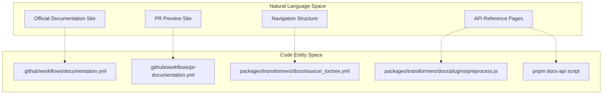
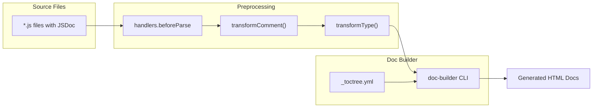

<!-- source: DeepWiki mcp.deepwiki.com · repo huggingface/transformers.js · page 15 Documentation System · fetched 2026-10-26 -->

# Documentation System

<details>
<summary>Relevant source files</summary>

The following files were used as context for generating this wiki page:

- [.github/workflows/documentation.yml](.github/workflows/documentation.yml)
- [.github/workflows/pr-documentation.yml](.github/workflows/pr-documentation.yml)
- [.github/workflows/publish.yml](.github/workflows/publish.yml)
- [.github/workflows/tests.yml](.github/workflows/tests.yml)
- [.github/workflows/upload-pr-documentation.yml](.github/workflows/upload-pr-documentation.yml)
- [packages/transformers/docs/plugins/preprocess.js](packages/transformers/docs/plugins/preprocess.js)
- [packages/transformers/docs/source/_toctree.yml](packages/transformers/docs/source/_toctree.yml)
- [packages/transformers/docs/source/index.md](packages/transformers/docs/source/index.md)
- [packages/transformers/docs/source/integrations/vercel-ai-sdk.md](packages/transformers/docs/source/integrations/vercel-ai-sdk.md)
- [packages/transformers/docs/source/tutorials/next-ai-sdk.md](packages/transformers/docs/source/tutorials/next-ai-sdk.md)
- [packages/transformers/src/models/whisper/modeling_whisper.js](packages/transformers/src/models/whisper/modeling_whisper.js)
- [packages/transformers/src/pipelines/text-generation.js](packages/transformers/src/pipelines/text-generation.js)
- [packages/transformers/src/tokenization_utils.js](packages/transformers/src/tokenization_utils.js)

</details>


## Purpose and Scope

This document describes the automated documentation generation and publishing system for the Transformers.js library. It covers the GitHub Actions workflows that build and deploy documentation to the Hugging Face documentation site, the integration with Hugging Face's `doc-builder` tool, the `_toctree.yml` structure, and the JSDoc preprocessing plugin.

For details on how the `doc-builder` tool consumes source files, see [Doc-Builder Integration](#15.1).
For details on the JSDoc preprocessing plugin and type generation, see [API Reference Generation](#15.2).

---

## System Overview

The documentation system consists of three main components:

1.  **API Documentation Generator**: A build process that generates API reference documentation from source code using JSDoc comments.
2.  **Main Documentation Pipeline**: Automated workflow that builds and publishes documentation for the `main` branch.
3.  **PR Documentation Pipeline**: Automated workflow that builds preview documentation for pull requests.

The system leverages Hugging Face's `doc-builder` tool. All documentation source files are located in `packages/transformers/docs/source/` [ .github/workflows/documentation.yml:15 ](), and the generated documentation is published to `huggingface.co/docs/transformers.js`.

### Architecture: Natural Language to Code Entity Mapping

The following diagram maps high-level documentation concepts to the specific code entities and scripts that implement them.

**Documentation System Entity Mapping**

**Sources:** [.github/workflows/documentation.yml:1-20](), [.github/workflows/pr-documentation.yml:1-20](), [packages/transformers/docs/source/_toctree.yml:1-97](), [packages/transformers/docs/plugins/preprocess.js:1-130]()

---

## Workflow Integration

### Main Documentation Workflow
The main documentation workflow is defined in [.github/workflows/documentation.yml:1-20](). It is triggered on pushes to `main` [ .github/workflows/documentation.yml:5-7 ]() and delegates to the `huggingface/doc-builder` reusable workflow.

### PR Documentation Workflow
The PR system uses two workflows:
1.  **Build**: [.github/workflows/pr-documentation.yml:1-20]() triggers on `pull_request` events.
2.  **Upload**: [.github/workflows/upload-pr-documentation.yml:1-17]() triggers after the build completes to post a comment on the PR with a link to the preview.

### Pre-command Execution
Both workflows execute a `pre_command` that prepares the environment and generates the API docs:
```bash
cd transformers.js && corepack enable && ONNXRUNTIME_NODE_INSTALL=skip pnpm install --frozen-lockfile && pnpm --filter @huggingface/transformers docs-api
```
**Sources:** [.github/workflows/documentation.yml:16](), [.github/workflows/pr-documentation.yml:18]()

---

## Content Structure and Navigation

The navigation hierarchy of the documentation is defined in `packages/transformers/docs/source/_toctree.yml` [ packages/transformers/docs/source/_toctree.yml:1-97 ](). This file organizes the site into sections:

| Section | Content Description |
| :--- | :--- |
| **Get started** | Installation, Pipeline API, and Custom Usage [ packages/transformers/docs/source/_toctree.yml:3-10 ]() |
| **Tutorials** | Framework-specific guides (React, Next.js, Node.js, etc.) [ packages/transformers/docs/source/_toctree.yml:11-26 ]() |
| **Developer Guides** | Advanced topics like WebGPU, Quantization, and Private models [ packages/transformers/docs/source/_toctree.yml:27-36 ]() |
| **API Reference** | Detailed documentation for Pipelines, Models, Tokenizers, and Utilities [ packages/transformers/docs/source/_toctree.yml:41-97 ]() |

---

## API Documentation Preprocessing

To ensure compatibility between TypeScript-heavy source code and the `doc-builder` tool, the system uses a custom JSDoc plugin: `packages/transformers/docs/plugins/preprocess.js` [ packages/transformers/docs/plugins/preprocess.js:1-130 ]().

This plugin includes a `transformType` function [ packages/transformers/docs/plugins/preprocess.js:52 ]() that converts TypeScript syntax (like `Promise<T>`, `import()`, and conditional types) into JSDoc-compatible formats.

**Data Flow: Source Code to Documentation**

**Sources:** [packages/transformers/docs/plugins/preprocess.js:123-129](), [packages/transformers/docs/plugins/preprocess.js:102-121](), [packages/transformers/docs/plugins/preprocess.js:52-100]()

---

## Child Pages
- [Doc-Builder Integration](#15.1) — Detailed explanation of how the `doc-builder` tool consumes source files and generates the site.
- [API Reference Generation](#15.2) — Technical documentation of the JSDoc preprocessing plugin and the `docs-api` script.

---

