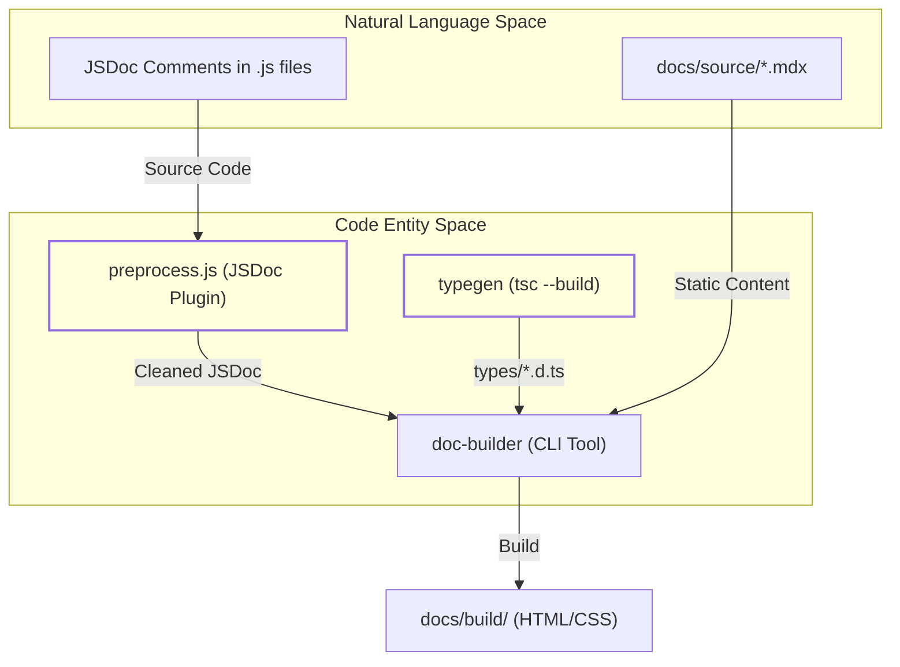
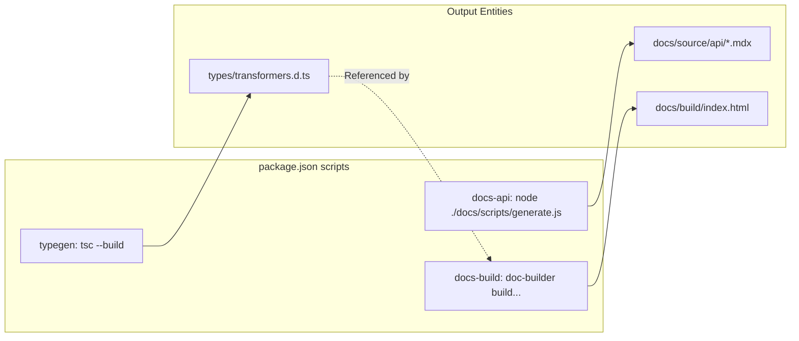

<!-- source: DeepWiki mcp.deepwiki.com · repo huggingface/transformers.js · page 15.2 API Reference Generation · fetched 2026-10-26 -->

# API Reference Generation

Relevant source files

The following files were used as context for generating this wiki page:

- [packages/transformers/docs/plugins/preprocess.js](packages/transformers/docs/plugins/preprocess.js)
- [packages/transformers/docs/snippets/2_installation.snippet](packages/transformers/docs/snippets/2_installation.snippet)
- [packages/transformers/docs/snippets/3_custom-usage.snippet](packages/transformers/docs/snippets/3_custom-usage.snippet)
- [packages/transformers/package.json](packages/transformers/package.json)
- [packages/transformers/src/env.js](packages/transformers/src/env.js)
- [packages/transformers/src/models/whisper/modeling_whisper.js](packages/transformers/src/models/whisper/modeling_whisper.js)
- [packages/transformers/src/pipelines/text-generation.js](packages/transformers/src/pipelines/text-generation.js)
- [packages/transformers/src/tokenization_utils.js](packages/transformers/src/tokenization_utils.js)
- [pnpm-lock.yaml](pnpm-lock.yaml)

The documentation system for Transformers.js utilizes a sophisticated pipeline to transform source code JSDoc comments into a format compatible with the Hugging Face `doc-builder` tool. This process involves a custom JSDoc preprocessing plugin and a type generation script to ensure that TypeScript-heavy syntax is correctly rendered in the final API reference.

## Documentation Workflow

The generation process follows a structured data flow from the source JavaScript files to the final rendered HTML documentation.

### Documentation Generation Flow

"Doc-Builder Pipeline"

Sources: [packages/transformers/package.json:27-34](), [packages/transformers/docs/plugins/preprocess.js:1-3]()

## JSDoc Preprocessing Plugin

The library uses a custom JSDoc plugin located at `packages/transformers/docs/plugins/preprocess.js` to handle the mismatch between complex TypeScript type expressions used in JSDoc and the simpler syntax expected by standard JSDoc parsers and `doc-builder`.

### Key Transformation Logic

The plugin operates on the `beforeParse` event, intercepting the source code before the JSDoc parser processes it. The primary function `transformType` implements several regex-based rules to simplify TypeScript types:

| Transformation Target | Implementation | Result Example |
| :--- | :--- | :--- |
| **Generic Params** | `stripLeadingGenericParams` | `<T extends X>(...)` $\rightarrow$ `(...)` |
| **Imports** | `replace(/import\([^)]+\)((?:\.\w+)*)/g, ...)` | `import('./base').Type` $\rightarrow$ `Type` |
| **Conditionals** | `hasTopLevelConditional` | `T extends string ? A : B` $\rightarrow$ `any` |
| **Mapped Types** | `replace(/\{\s*\[\w+\s+in\s+[^\]]+\][^}]*\}/g, "Object")` | `{[K in T]: V}` $\rightarrow$ `Object` |
| **Arrays** | `replace(/(\w+)\[\]/g, "Array")` | `string[]` $\rightarrow$ `Array` |
| **Intersections** | `replace(/\s*&\s*/g, "\|")` | `A & B` $\rightarrow$ `A\|B` |

### Core Functions

*   **`transformType(expr)`**: The main engine for type simplification. It iteratively applies transformations until the string stabilizes `[packages/transformers/docs/plugins/preprocess.js:52-100]()`.
*   **`transformComment(comment)`**: Locates JSDoc tags (like `@param`, `@type`, `@returns`) and extracts the content within curly braces for transformation `[packages/transformers/docs/plugins/preprocess.js:102-121]()`.
*   **`extractBalancedBraces(text, start)`**: A utility to correctly identify the boundaries of type definitions, handling nested objects and arrays `[packages/transformers/docs/plugins/preprocess.js:5-15]()`.

Sources: [packages/transformers/docs/plugins/preprocess.js:5-129]()

## Type Generation and Build Scripts

The `package.json` defines the entry points for generating the documentation and the supporting type definitions.

"Build Scripts Mapping"

Sources: [packages/transformers/package.json:24-35]()

### Execution Commands

1.  **Type Generation**: `pnpm typegen` runs the TypeScript compiler to generate `.d.ts` files in the `types/` directory `[packages/transformers/package.json:27]()`. These types are the source of truth for the library's public API surface `[packages/transformers/package.json:6]()`.
2.  **API Reference Generation**: `pnpm docs-api` triggers the internal generation script `[packages/transformers/package.json:32]()`.
3.  **Doc-Builder Build**: The command `doc-builder build transformers.js ./docs/source/ --not_python_module --build_dir ./docs/build/` compiles the Markdown/MDX files and JSDoc into the final static site `[packages/transformers/package.json:33]()`.

## Environment and Module Documentation

The documentation system specifically handles module-level documentation for global configurations like the `env` object. JSDoc comments in `src/env.js` provide examples for disabling remote models or setting local paths, which are then processed by the plugin to ensure the code snippets and type hints are correctly formatted for the web reference `[packages/transformers/src/env.js:1-23]()`.

Similarly, complex pipeline types, such as those in `text-generation.js`, utilize `@typedef` and `@template` extensively. The `preprocess.js` plugin ensures that complex definitions like `TextGenerationResult` (a conditional type) are simplified to `any` or base types so that `doc-builder` does not crash during the parsing phase `[packages/transformers/src/pipelines/text-generation.js:42-44]()`, `[packages/transformers/docs/plugins/preprocess.js:66-69]()`.

Sources: [packages/transformers/src/env.js:1-23](), [packages/transformers/src/pipelines/text-generation.js:42-48](), [packages/transformers/docs/plugins/preprocess.js:66-69]()

---

