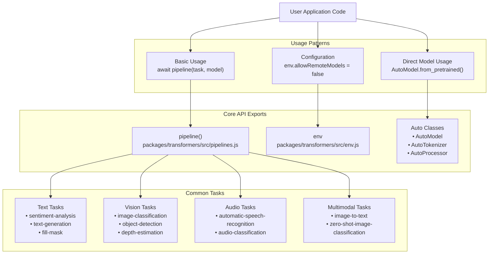
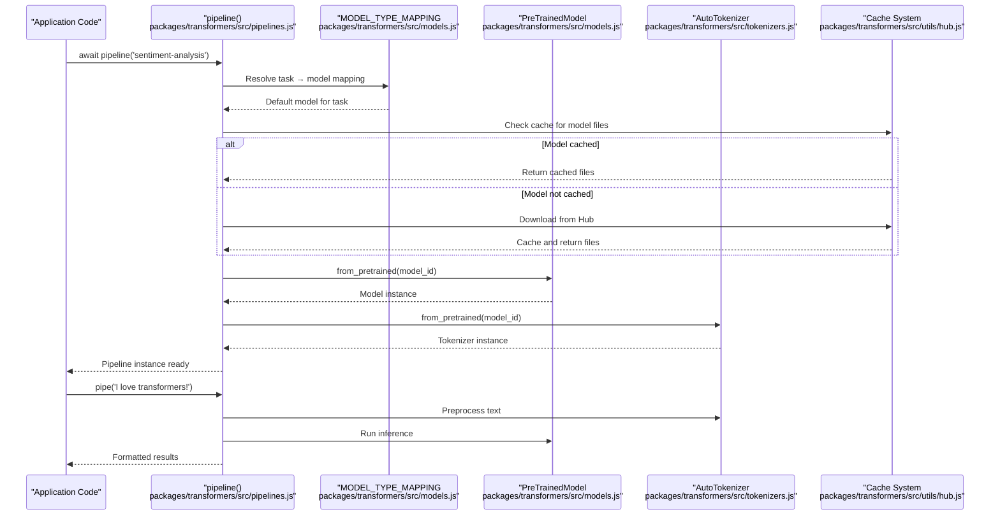
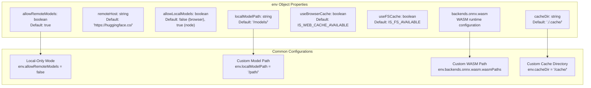
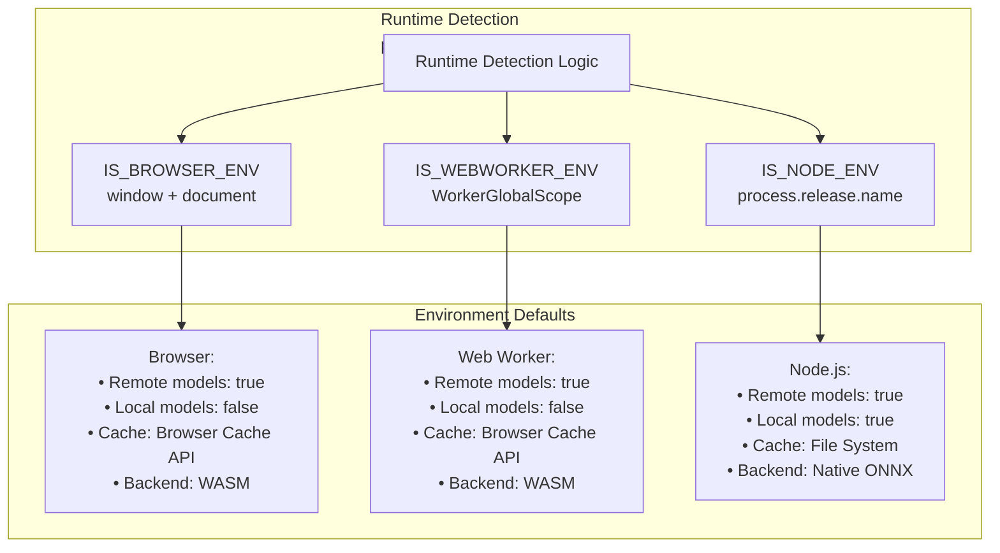

<!-- source: DeepWiki mcp.deepwiki.com · repo huggingface/transformers.js · page 16 Examples and Use Cases · fetched 2026-10-26 -->

# Examples and Use Cases

<details>
<summary>Relevant source files</summary>

The following files were used as context for generating this wiki page:

- [README.md](README.md)
- [package.json](package.json)
- [packages/transformers/docs/source/tutorials/browser-extension.md](packages/transformers/docs/source/tutorials/browser-extension.md)
- [packages/transformers/docs/source/tutorials/electron.md](packages/transformers/docs/source/tutorials/electron.md)
- [packages/transformers/docs/source/tutorials/react.md](packages/transformers/docs/source/tutorials/react.md)
- [packages/transformers/docs/source/tutorials/vanilla-js.md](packages/transformers/docs/source/tutorials/vanilla-js.md)

</details>


This document provides an overview of common usage patterns and practical examples for Transformers.js. It demonstrates how to use the library's Pipeline API, configure the environment, and integrate models into applications across different JavaScript runtimes.

For basic getting-started examples, see [Quick Start Examples](#16.1). For environment-specific integration patterns (vanilla JS, Node.js, React, web workers), see [Environment-Specific Examples](#16.2). For advanced techniques like custom caching, quantization, and streaming, see [Advanced Usage Patterns](#16.3).

For detailed API documentation, see [Public API Surface](#1.3). For installation instructions, see [Installation and Setup](#1.2).

## Usage Pattern Overview

All examples in Transformers.js follow a common pattern centered around the `pipeline` function. The diagram below shows how user code interacts with the core API components:



**Sources:** [README.md:55-93](), [packages/transformers/src/env.js:137-195]()

## Basic Pipeline Usage Pattern

The `pipeline` function provides the simplest interface for running inference. This example demonstrates the canonical usage pattern:

```javascript
import { pipeline } from '@huggingface/transformers';

// Allocate a pipeline for sentiment-analysis
const pipe = await pipeline('sentiment-analysis');

const out = await pipe('I love transformers!');
// [{'label': 'POSITIVE', 'score': 0.999817686}]
```

### Pipeline Instantiation Flow



**Sources:** [README.md:81-89](), [packages/transformers/src/env.js:174-180]()

## Model Specification Patterns

The library supports multiple ways to specify which model to use:

### Default Task Models

```javascript
// Uses default model for the task
const pipe = await pipeline('sentiment-analysis');
```

### Explicit Model ID

```javascript
// Use a specific model from Hugging Face Hub
const pipe = await pipeline(
    'sentiment-analysis',
    'Xenova/bert-base-multilingual-uncased-sentiment'
);
```

### Custom Options

```javascript
// Configure device and quantization
const pipe = await pipeline(
    'sentiment-analysis',
    'Xenova/distilbert-base-uncased-finetuned-sst-2-english',
    {
        device: 'webgpu',  // Use GPU acceleration
        dtype: 'q4',        // 4-bit quantization
    }
);
```

**Sources:** [README.md:96-127]()

## Environment Configuration Patterns

The `env` object provides global configuration for model loading, caching, and backend settings:

### Environment Configuration Flow



**Sources:** [packages/transformers/src/env.js:137-195]()

### Configuration Examples

```javascript
import { env } from '@huggingface/transformers';

// Disable remote model loading
env.allowRemoteModels = false;

// Set custom local model path
env.localModelPath = '/path/to/models/';

// Set custom cache directory
env.cacheDir = '/path/to/cache/';

// Configure WASM paths
env.backends.onnx.wasm.wasmPaths = '/path/to/wasm/files/';
```

**Sources:** [packages/transformers/src/env.js:142-160]()

## Supported Tasks and Examples

The library supports 30+ tasks across different modalities. Below is a mapping of tasks to their corresponding pipeline types:

| Modality | Task ID | Example Use Case |
|----------|---------|------------------|
| **NLP** | `sentiment-analysis` | Analyze sentiment of reviews |
| | `text-generation` | Generate text completions |
| | `fill-mask` | Fill masked words in text |
| | `question-answering` | Answer questions from context |
| | `summarization` | Summarize long documents |
| | `translation` | Translate between languages |
| | `token-classification` | Named entity recognition |
| **Vision** | `image-classification` | Classify images into categories |
| | `object-detection` | Detect objects in images |
| | `image-segmentation` | Segment images by regions |
| | `depth-estimation` | Estimate depth maps |
| **Audio** | `automatic-speech-recognition` | Transcribe audio to text |
| | `audio-classification` | Classify audio clips |
| | `text-to-speech` | Generate speech from text |
| **Multimodal** | `image-to-text` | Generate captions for images |
| | `zero-shot-image-classification` | Classify images without training |

**Sources:** [README.md:28-32](), [packages/transformers/src/pipelines.js:77-105]()

## Runtime Environment Patterns

The library automatically detects the runtime environment and configures appropriate defaults:



**Sources:** [packages/transformers/src/env.js:31-112](), [packages/transformers/src/env.js:179-186]()

## Installation Methods

The library supports multiple installation and import patterns:

### NPM Installation

```bash
npm i @huggingface/transformers
```

**Sources:** [README.md:44-45]()

### CDN Import

```html
<script type="module">
    import { pipeline } from 'https://cdn.jsdelivr.net/npm/@huggingface/transformers@4.2.0';
    
    const pipe = await pipeline('sentiment-analysis');
    const result = await pipe('I love transformers!');
    console.log(result);
</script>
```

**Sources:** [README.md:49-52]()

## Key Example Categories

Examples in the child pages are organized by complexity and use case:

### Quick Start Examples ([Quick Start Examples](#16.1))
For details, see [Quick Start Examples](#16.1). Covers basic sentiment analysis, text generation, and image classification using the pipeline API.

### Environment-Specific Examples ([Environment-Specific Examples](#16.2))
For details, see [Environment-Specific Examples](#16.2). Covers tutorials for Vanilla JS, React (using Web Workers), Electron, and Browser Extensions.
- **Vanilla JS**: Uses `FileReader` and `pipeline` in a single thread [packages/transformers/docs/source/tutorials/vanilla-js.md:148-185]().
- **React**: Implements a Singleton pattern for the pipeline within a Web Worker to avoid UI freezing [packages/transformers/docs/source/tutorials/react.md:58-73]().

### Advanced Usage Patterns ([Advanced Usage Patterns](#16.3))
For details, see [Advanced Usage Patterns](#16.3). Covers custom caching, quantization (`dtype: 'q4'`), streaming generation (`TextStreamer`), and WebGPU acceleration.

**Sources:** [README.md:106-127](), [packages/transformers/docs/source/tutorials/react.md:58-73]()

## Example Discovery Resources

Additional example resources are available in the ecosystem:

| Resource | Description | Link Reference |
|----------|-------------|----------------|
| Demo Applications | Wide variety of demo apps and templates | [README.md:129]() |
| Hugging Face Spaces | Official Transformers.js template | [README.md:129]() |
| GitHub Examples Repo | Community examples repository | [README.md:129]() |

**Sources:** [README.md:129-129]()

---

