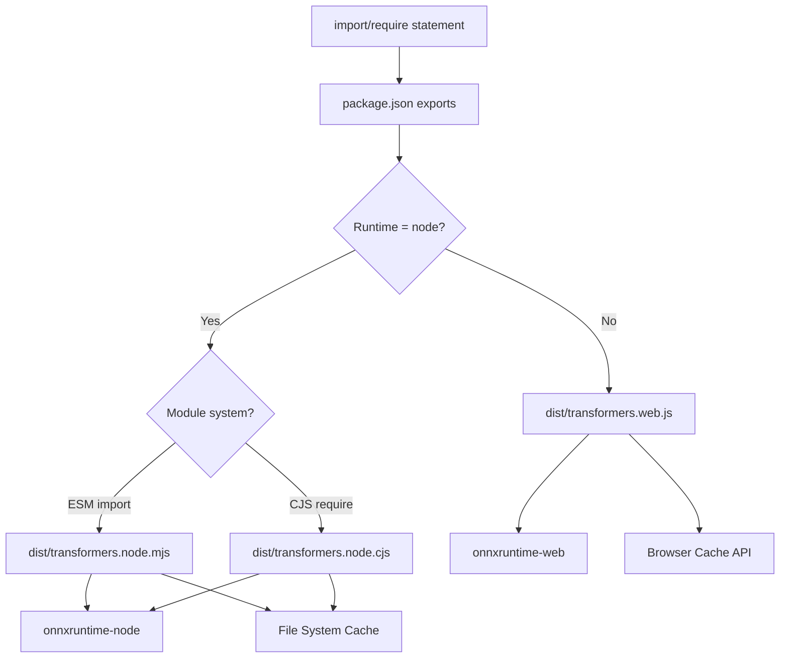
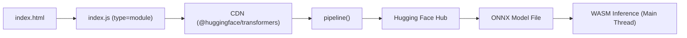
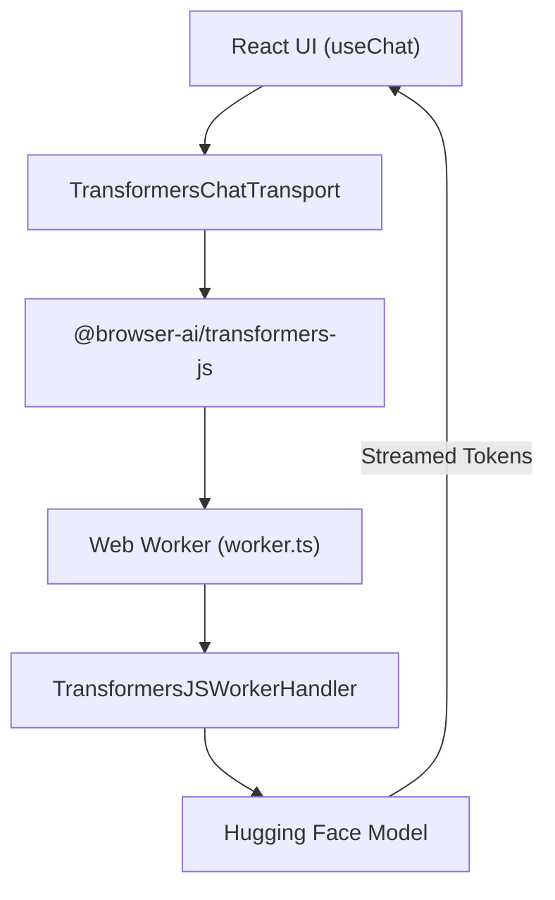

<!-- source: DeepWiki mcp.deepwiki.com · repo huggingface/transformers.js · page 16.2 Environment-Specific Examples · fetched 2026-10-26 -->

# Environment-Specific Examples

<details>
<summary>Relevant source files</summary>

The following files were used as context for generating this wiki page:

- [packages/transformers/docs/source/_toctree.yml](packages/transformers/docs/source/_toctree.yml)
- [packages/transformers/docs/source/index.md](packages/transformers/docs/source/index.md)
- [packages/transformers/docs/source/integrations/vercel-ai-sdk.md](packages/transformers/docs/source/integrations/vercel-ai-sdk.md)
- [packages/transformers/docs/source/tutorials/browser-extension.md](packages/transformers/docs/source/tutorials/browser-extension.md)
- [packages/transformers/docs/source/tutorials/electron.md](packages/transformers/docs/source/tutorials/electron.md)
- [packages/transformers/docs/source/tutorials/next-ai-sdk.md](packages/transformers/docs/source/tutorials/next-ai-sdk.md)
- [packages/transformers/docs/source/tutorials/react.md](packages/transformers/docs/source/tutorials/react.md)
- [packages/transformers/docs/source/tutorials/vanilla-js.md](packages/transformers/docs/source/tutorials/vanilla-js.md)

</details>


This page provides practical examples for using Transformers.js in different JavaScript runtime environments. It demonstrates how the library's multi-target build system ([packages/transformers/package.json:8-23]()) adapts to various execution contexts including browsers, Node.js, web workers, React, Next.js, and the Vercel AI SDK.

---

## Build Target Selection by Environment

The library provides different build targets optimized for each runtime environment through conditional exports in the `package.json`:

| Environment | Build Target | Module System | Entry Point |
|------------|--------------|---------------|-------------|
| Node.js (ESM) | `transformers.node.mjs` | ES Module | `dist/transformers.node.mjs` |
| Node.js (CommonJS) | `transformers.node.cjs` | CommonJS | `dist/transformers.node.cjs` |
| Browser (Bundler) | `transformers.web.js` | ES Module | `dist/transformers.web.js` |
| Browser (CDN) | `transformers.min.js` | ES Module | `dist/transformers.min.js` |

**Build Target Resolution Diagram**



Sources: [packages/transformers/package.json:8-23]()

---

## Vanilla JavaScript (Browser via CDN)

The simplest way to use Transformers.js in a browser without a build system is via CDN. The library loads the minified web bundle which uses WASM-based ONNX Runtime.

### Implementation Example
In a vanilla JS setup, you can import `pipeline` directly from a CDN like `jsdelivr` [packages/transformers/docs/source/tutorials/vanilla-js.md:109-113]().

```html
<script type="module">
    import { pipeline, env } from 'https://cdn.jsdelivr.net/npm/@huggingface/transformers';
    
    // Skip local check when using CDN
    env.allowLocalModels = false;
    
    const detector = await pipeline("object-detection", "Xenova/detr-resnet-50");
    const output = await detector('https://huggingface.co/datasets/Xenova/transformers.js-docs/resolve/main/cats.jpg');
    console.log(output);
</script>
```

**Vanilla JS Inference Flow**



Sources: [packages/transformers/docs/source/tutorials/vanilla-js.md:97-120](), [packages/transformers/docs/source/tutorials/vanilla-js.md:148-155]()

---

## Node.js Examples

### ES Module (MJS) Import
Modern Node.js applications import from the Node.js-specific build which includes native ONNX Runtime bindings [packages/transformers/package.json:9-17]().

```javascript
import { pipeline } from '@huggingface/transformers';

// Uses native onnxruntime-node
const classifier = await pipeline('sentiment-analysis');
const result = await classifier('Node.js native inference is fast!');
```

### Server-side Audio Processing
Node.js environments often require specific handling for audio buffers or local files [packages/transformers/docs/source/_toctree.yml:34-35]().

Sources: [packages/transformers/package.json:9-17](), [packages/transformers/docs/source/_toctree.yml:22-23]()

---

## React and Web Workers

For React applications, it is recommended to run inference in a **Web Worker** to avoid blocking the UI thread [packages/transformers/docs/source/tutorials/react.md:51-56]().

### Web Worker Implementation
The worker uses a singleton pattern to ensure the model is loaded only once [packages/transformers/docs/source/tutorials/react.md:58-73]().

```javascript
// worker.js
import { pipeline } from "@huggingface/transformers";

class MyTranslationPipeline {
    static task = "translation";
    static model = "Xenova/nllb-200-distilled-600M";
    static instance = null;

    static async getInstance(progress_callback = null) {
        this.instance ??= pipeline(this.task, this.model, { progress_callback });
        return this.instance;
    }
}

self.onmessage = async (event) => {
    const translator = await MyTranslationPipeline.getInstance();
    const output = await translator(event.data.text);
    self.postMessage(output);
};
```

### React Component Integration
The `useRef` hook stores the worker instance, and `useEffect` manages its lifecycle [packages/transformers/docs/source/tutorials/react.md:75-103]().

```jsx
import { useEffect, useRef } from 'react';

function App() {
    const worker = useRef(null);

    useEffect(() => {
        worker.current ??= new Worker(new URL('./worker.js', import.meta.url), {
            type: 'module'
        });
        
        const onMessage = (e) => console.log('Result:', e.data);
        worker.current.addEventListener('message', onMessage);
        return () => worker.current.removeEventListener('message', onMessage);
    }, []);
}
```

Sources: [packages/transformers/docs/source/tutorials/react.md:58-73](), [packages/transformers/docs/source/tutorials/react.md:83-103]()

---

## Next.js with Vercel AI SDK

The Vercel AI SDK allows using Transformers.js as a model provider for in-browser inference with streaming support [packages/transformers/docs/source/integrations/vercel-ai-sdk.md:1-9]().

### Configuration for Next.js
In `next.config.ts`, Node.js-specific packages like `onnxruntime-node` must be excluded from the browser bundle [packages/transformers/docs/source/tutorials/next-ai-sdk.md:33-52]().

```typescript
const nextConfig = {
  webpack: (config) => {
    config.resolve.alias = {
      ...config.resolve.alias,
      sharp$: false,
      "onnxruntime-node$": false,
    };
    return config;
  },
};
```

### Vercel AI SDK Provider
The `@browser-ai/transformers-js` package provides a `TransformersJSWorkerHandler` that simplifies worker communication [packages/transformers/docs/source/tutorials/next-ai-sdk.md:56-69]().

```typescript
// worker.ts
import { TransformersJSWorkerHandler } from "@browser-ai/transformers-js";
const handler = new TransformersJSWorkerHandler();
self.onmessage = (msg) => handler.onmessage(msg);
```

**Next.js AI SDK Architecture**



Sources: [packages/transformers/docs/source/tutorials/next-ai-sdk.md:41-48](), [packages/transformers/docs/source/tutorials/next-ai-sdk.md:61-67](), [packages/transformers/docs/source/integrations/vercel-ai-sdk.md:120-127]()

---

## Browser Extensions and Electron

### Browser Extensions
Transformers.js can be used in content scripts or background service workers to perform on-device processing [packages/transformers/docs/source/tutorials/browser-extension.md:1-4]().

### Electron
In Electron, models can be run in the renderer process (using WASM/WebGPU) or the main process (using Node.js native bindings) [packages/transformers/docs/source/tutorials/electron.md:1-4]().

Sources: [packages/transformers/docs/source/tutorials/browser-extension.md:1-4](), [packages/transformers/docs/source/tutorials/electron.md:1-4]()

---

