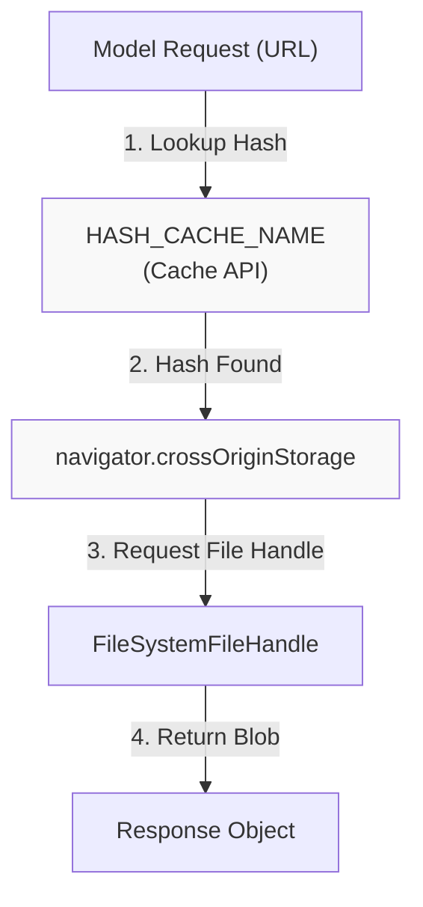
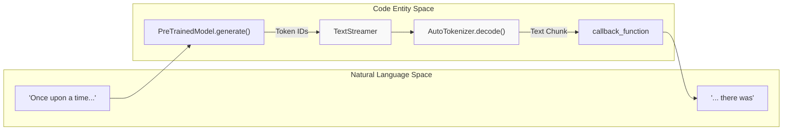

<!-- source: DeepWiki mcp.deepwiki.com · repo huggingface/transformers.js · page 16.3 Advanced Usage Patterns · fetched 2026-10-26 -->

# Advanced Usage Patterns

<details>
<summary>Relevant source files</summary>

The following files were used as context for generating this wiki page:

- [packages/transformers/docs/snippets/2_installation.snippet](packages/transformers/docs/snippets/2_installation.snippet)
- [packages/transformers/docs/snippets/3_custom-usage.snippet](packages/transformers/docs/snippets/3_custom-usage.snippet)
- [packages/transformers/docs/source/guides/webgpu.md](packages/transformers/docs/source/guides/webgpu.md)
- [packages/transformers/package.json](packages/transformers/package.json)
- [packages/transformers/src/env.js](packages/transformers/src/env.js)
- [packages/transformers/src/utils/cache.js](packages/transformers/src/utils/cache.js)
- [packages/transformers/src/utils/cache/CrossOriginStorageCache.js](packages/transformers/src/utils/cache/CrossOriginStorageCache.js)
- [packages/transformers/src/utils/cache/cross-origin-storage.d.ts](packages/transformers/src/utils/cache/cross-origin-storage.d.ts)
- [pnpm-lock.yaml](pnpm-lock.yaml)

</details>


This page covers advanced usage patterns for `transformers.js`, including custom caching strategies, model quantization, streaming generation, WebGPU acceleration, and private model access. For basic usage with the pipeline API, see [Quick Start Examples](#16.1). For environment-specific setup, see [Environment-Specific Examples](#16.2).

## Environment Configuration

The `env` object is the primary mechanism for configuring global library behavior, such as model loading locations and backend settings.

```javascript
import { env } from '@huggingface/transformers';

// Specify a custom location for models (defaults to '/models/').
env.localModelPath = '/path/to/models/';

// Disable the loading of remote models from the Hugging Face Hub:
env.allowRemoteModels = false;

// Set location of .wasm files. Defaults to use a CDN.
env.backends.onnx.wasm.wasmPaths = '/path/to/files/';
```

**Sources**: [packages/transformers/src/env.js:1-23](), [packages/transformers/docs/snippets/3_custom-usage.snippet:5-18]()

### Runtime Detection and Capabilities
The library automatically detects the environment (Browser, Node.js, Deno, Bun) and exposes capability flags through `apis`.

| Flag | Description |
|------|-------------|
| `IS_WEBGPU_AVAILABLE` | Whether the environment supports WebGPU acceleration. |
| `IS_NODE_ENV` | True if running in Node.js, Deno, or Bun. |
| `IS_WEB_CACHE_AVAILABLE` | Whether the browser's Cache API is accessible. |

**Sources**: [packages/transformers/src/env.js:99-144]()

## Advanced Caching Strategies

Transformers.js provides multiple caching layers to optimize model loading. By default, it uses the Browser Cache API in browsers and a file system cache in Node.js.

### Custom Cache Implementation
You can provide a custom cache implementation by setting `env.customCache`. The object must implement the `match` and `put` methods of the Web Cache API.

```javascript
import { env } from '@huggingface/transformers';

env.useCustomCache = true;
env.customCache = {
    match: async (request) => { /* ... */ },
    put: async (request, response) => { /* ... */ }
};
```

**Sources**: [packages/transformers/src/utils/cache.js:26-40]()

### Cross-Origin Storage (Experimental)
The library includes an experimental `CrossOriginStorage` cache that uses the `navigator.crossOriginStorage` API to share cached model files across different origins using SHA-256 content hashes.



**Sources**: [packages/transformers/src/utils/cache/CrossOriginStorageCache.js:26-70](), [packages/transformers/src/utils/cache.js:42-44]()

## WebGPU Acceleration

WebGPU provides high-performance general-purpose GPU compute in the browser. Enabling it is as simple as setting the `device` parameter to `'webgpu'`.

```javascript
import { pipeline } from "@huggingface/transformers";

const extractor = await pipeline(
  "feature-extraction",
  "mixedbread-ai/mxbai-embed-xsmall-v1",
  { device: "webgpu" },
);
```

**Sources**: [packages/transformers/docs/source/guides/webgpu.md:14-29]()

### Device and Dtype Mapping
When a device is selected, the library maps it to the appropriate ONNX Runtime execution provider and default data type.

| Device | Backend Provider | Default Dtype |
|--------|------------------|---------------|
| `webgpu` | `webgpu` | `fp32` |
| `wasm` | `wasm` | `q8` |
| `cpu` | `cpu` | `fp32` |

**Sources**: [packages/transformers/src/env.js:55-56](), [packages/transformers/docs/source/guides/webgpu.md:5-13]()

## Model Quantization

Quantization reduces model size and improves inference speed by using lower-precision weights (e.g., 8-bit or 4-bit integers instead of 32-bit floats).

### Supported Quantization Levels
- **fp32**: Full precision.
- **fp16**: Half precision (optimized for WebGPU).
- **q8**: 8-bit quantization (standard for CPU/WASM).
- **q4**: 4-bit quantization (maximum compression).

### Model Conversion
It is recommended to use [Hugging Face Optimum](https://huggingface.co/docs/optimum-onnx/onnx/overview) to convert and quantize models.

**Sources**: [packages/transformers/docs/snippets/3_custom-usage.snippet:22-25]()

## Streaming Generation

For text generation, streaming allows tokens to be processed and displayed as they are generated, improving perceived latency.

### Code-to-System Mapping: Streaming Architecture



**Sources**: [packages/transformers/package.json:58-61]()

## Private Model Access

To access private models or models requiring authentication on the Hugging Face Hub, you can inject a custom fetch function into the environment that includes authorization headers.

```javascript
import { env } from '@huggingface/transformers';

env.fetch = (url, options) => {
    return fetch(url, {
        ...options,
        headers: {
            ...options?.headers,
            Authorization: `Bearer ${YOUR_HF_TOKEN}`,
        },
    });
};
```

**Sources**: [packages/transformers/src/env.js:170-171]()

---

