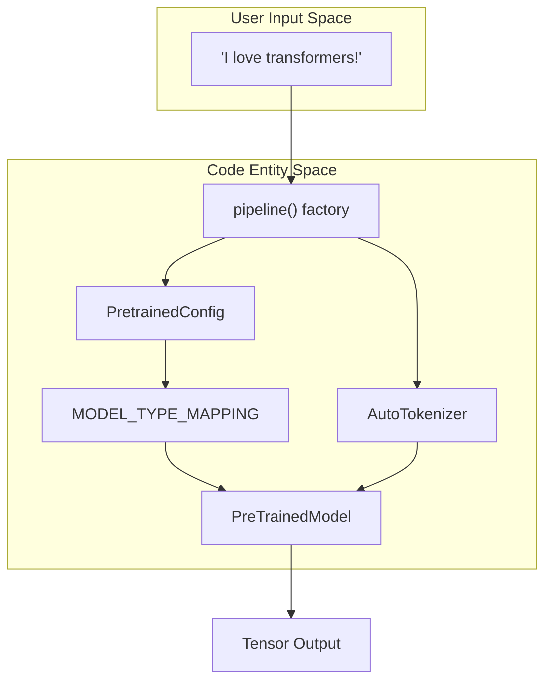
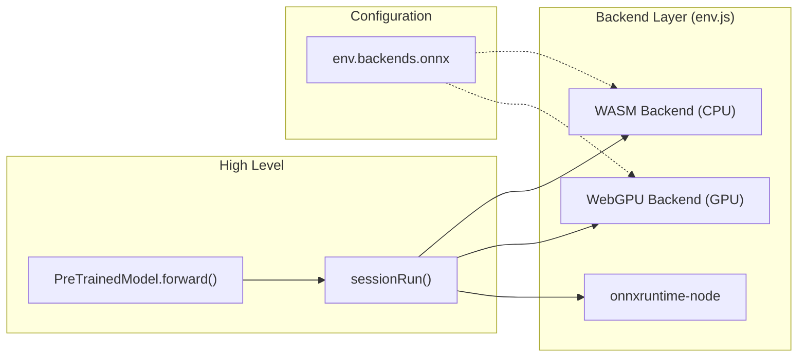

<!-- source: DeepWiki mcp.deepwiki.com · repo huggingface/transformers.js · page 17 Glossary · fetched 2026-10-26 -->

# Glossary

Relevant source files

The following files were used as context for generating this wiki page:

- [README.md](README.md)
- [package.json](package.json)
- [packages/transformers/docs/snippets/2_installation.snippet](packages/transformers/docs/snippets/2_installation.snippet)
- [packages/transformers/docs/snippets/3_custom-usage.snippet](packages/transformers/docs/snippets/3_custom-usage.snippet)
- [packages/transformers/package.json](packages/transformers/package.json)
- [packages/transformers/scripts/build/plugins/ignoreModulesPlugin.mjs](packages/transformers/scripts/build/plugins/ignoreModulesPlugin.mjs)
- [packages/transformers/src/backends/onnx.js](packages/transformers/src/backends/onnx.js)
- [packages/transformers/src/backends/utils/cacheWasm.js](packages/transformers/src/backends/utils/cacheWasm.js)
- [packages/transformers/src/configs.js](packages/transformers/src/configs.js)
- [packages/transformers/src/env.js](packages/transformers/src/env.js)
- [packages/transformers/src/models/chatterbox/modeling_chatterbox.js](packages/transformers/src/models/chatterbox/modeling_chatterbox.js)
- [packages/transformers/src/models/florence2/modeling_florence2.js](packages/transformers/src/models/florence2/modeling_florence2.js)
- [packages/transformers/src/models/modeling_utils.js](packages/transformers/src/models/modeling_utils.js)
- [packages/transformers/src/models/models.js](packages/transformers/src/models/models.js)
- [packages/transformers/src/models/multi_modality/modeling_multi_modality.js](packages/transformers/src/models/multi_modality/modeling_multi_modality.js)
- [packages/transformers/src/models/phi3_v/modeling_phi3_v.js](packages/transformers/src/models/phi3_v/modeling_phi3_v.js)
- [packages/transformers/src/models/qwen2_vl/modeling_qwen2_vl.js](packages/transformers/src/models/qwen2_vl/modeling_qwen2_vl.js)
- [packages/transformers/src/models/registry.js](packages/transformers/src/models/registry.js)
- [packages/transformers/src/utils/core.js](packages/transformers/src/utils/core.js)
- [packages/transformers/src/utils/dtypes.js](packages/transformers/src/utils/dtypes.js)
- [packages/transformers/src/utils/hub.js](packages/transformers/src/utils/hub.js)
- [packages/transformers/src/utils/hub/utils.js](packages/transformers/src/utils/hub/utils.js)
- [packages/transformers/src/utils/image.js](packages/transformers/src/utils/image.js)
- [packages/transformers/src/utils/tensor.js](packages/transformers/src/utils/tensor.js)
- [packages/transformers/tests/utils/tensor.test.js](packages/transformers/tests/utils/tensor.test.js)
- [pnpm-lock.yaml](pnpm-lock.yaml)

This glossary defines codebase-specific terms, jargon, and domain concepts used throughout Transformers.js. It serves as a technical reference for engineers onboarding to the repository.

## Core Architectural Terms

### Pipeline
The highest-level API in the library. A `pipeline` encapsulates the entire lifecycle of a machine learning task: from raw input (text, image, audio), through preprocessing (tokenization, feature extraction), model inference, and finally post-processing (decoding, label mapping).

*   **Implementation**: Defined in the main entry point as a factory function that instantiates task-specific classes.
*   **Execution Flow**: `Input` -> `Processor/Tokenizer` -> `PreTrainedModel` -> `Post-processor` -> `Output`.

**Sources**: [README.md:55-100](), [packages/transformers/src/models/modeling_utils.js:14-16]()

### Auto Classes
Classes designed to automatically infer the correct architecture or configuration based on a model's name or path. They mimic the Hugging Face Python API for seamless transitions.
*   `AutoConfig`: Loads and normalizes `config.json` [packages/transformers/src/configs.js:8-24]().
*   `AutoModel`: Resolves the model architecture and loads the underlying ONNX sessions [packages/transformers/src/models/registry.js:1-8]().
*   `AutoTokenizer`: Loads the appropriate tokenizer based on the model type.

### Model Registry
A centralized mapping system that links `model_type` strings (found in `config.json`) to specific JavaScript class implementations. It allows the library to support 50+ architectures by routing them to the correct logic.

*   **Mappings**: `MODEL_TYPE_MAPPING` maps class names to internal types [packages/transformers/src/models/registry.js:3-8]().
*   **Architecture Categories**: Models are categorized into `EncoderOnly`, `DecoderOnly`, `Seq2Seq`, etc., which determines their `forward` pass behavior [packages/transformers/src/models/modeling_utils.js:96-162]().

**Sources**: [packages/transformers/src/models/registry.js:1-186](), [packages/transformers/src/models/modeling_utils.js:96-162]()

---

## Domain & Code Mapping Diagrams

### Diagram 1: Natural Language to Code Entity Mapping
This diagram bridges user-facing concepts to the specific internal classes and functions that handle them.

"Natural Language Concept to Code Mapping"

**Sources**: [packages/transformers/src/configs.js:5-24](), [packages/transformers/src/models/registry.js:1-8](), [packages/transformers/src/models/modeling_utils.js:170-190]()

### Diagram 2: Inference Backend Architecture
This diagram shows how high-level model calls translate into hardware-specific execution through ONNX Runtime.

"Inference Execution Flow"

**Sources**: [packages/transformers/src/env.js:118-131](), [packages/transformers/src/models/modeling_utils.js:2-4](), [packages/transformers/src/models/session.js:1-10]()

---

## Technical Jargon & Abbreviations

| Term | Definition | Code Pointers |
| :--- | :--- | :--- |
| **Dtype** | Data type of the model weights (e.g., `fp32`, `fp16`, `q8`, `q4`). Affects memory and speed. | [packages/transformers/src/utils/dtypes.js:1-10](), [README.md:117-127]() |
| **External Data** | A format for ONNX models > 2GB where weights are stored in separate `.data` files. | [packages/transformers/src/utils/hub.js:25-31]() |
| **Logits** | The raw, unnormalized output scores from the model's last layer before softmax. | [packages/transformers/src/generation/logits_process.js:21-33]() |
| **KV Cache** | Key-Value cache used in decoder models to store past activations, speeding up generation. | [packages/transformers/src/cache_utils.js:40-40](), [packages/transformers/src/configs.js:59-100]() |
| **Revision** | A specific git branch, tag, or commit hash for a model on the Hugging Face Hub. | [packages/transformers/src/utils/hub.js:41-44]() |
| **WASM Path** | The URL or local path where `.wasm` binaries for ONNX Runtime are located. | [packages/transformers/src/env.js:17-20](), [packages/transformers/docs/snippets/3_custom-usage.snippet:16-18]() |

---

## Environment & Runtime Concepts

### `env` Object
A global configuration object used to control library behavior across different environments (Browser, Node.js, Deno, Bun).

*   **Detection**: Uses `apis` to check for `IS_BROWSER_ENV`, `IS_NODE_ENV`, etc. [packages/transformers/src/env.js:99-144]().
*   **Local vs Remote**: `env.allowRemoteModels` determines if the library can fetch from Hugging Face Hub [packages/transformers/src/env.js:5-8]().
*   **Caching**: `env.cacheDir` (Node.js) or `env.useBrowserCache` (Browser) controls where models are stored [packages/transformers/src/env.js:16-20]().

**Sources**: [packages/transformers/src/env.js:1-190]()

### Quantization
The process of reducing the precision of model weights to decrease file size and improve inference latency.
*   **q8/q4**: 8-bit and 4-bit quantization, typically the default for WASM environments to ensure performance on consumer hardware.
*   **fp16**: Half-precision floating point, often used with WebGPU for a balance of speed and accuracy.

**Sources**: [README.md:117-127](), [packages/transformers/src/utils/hub.js:52-53]()

---

## Model Types Reference

The library classifies models into several functional types in `modeling_utils.js` to determine the correct execution logic:

1.  **DecoderOnly**: Causal language models (e.g., GPT-2, Llama). Uses `decoder_forward` and `decoder_prepare_inputs_for_generation` [packages/transformers/src/models/modeling_utils.js:97-101]().
2.  **Seq2Seq**: Encoder-decoder models (e.g., T5, BART, Whisper). Uses `seq2seq_forward` [packages/transformers/src/models/modeling_utils.js:107-111]().
3.  **Vision2Seq**: Multimodal models that take images and produce text (e.g., ViT-GPT2) [packages/transformers/src/models/modeling_utils.js:112-116]().
4.  **EncoderOnly**: Models that produce embeddings or classifications (e.g., BERT, RoBERTa). Uses `encoder_forward` [packages/transformers/src/models/modeling_utils.js:158-161]().

**Sources**: [packages/transformers/src/models/modeling_utils.js:96-162](), [packages/transformers/src/models/registry.js:12-186]()