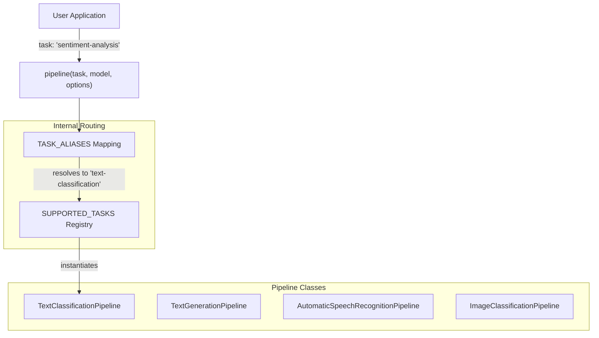
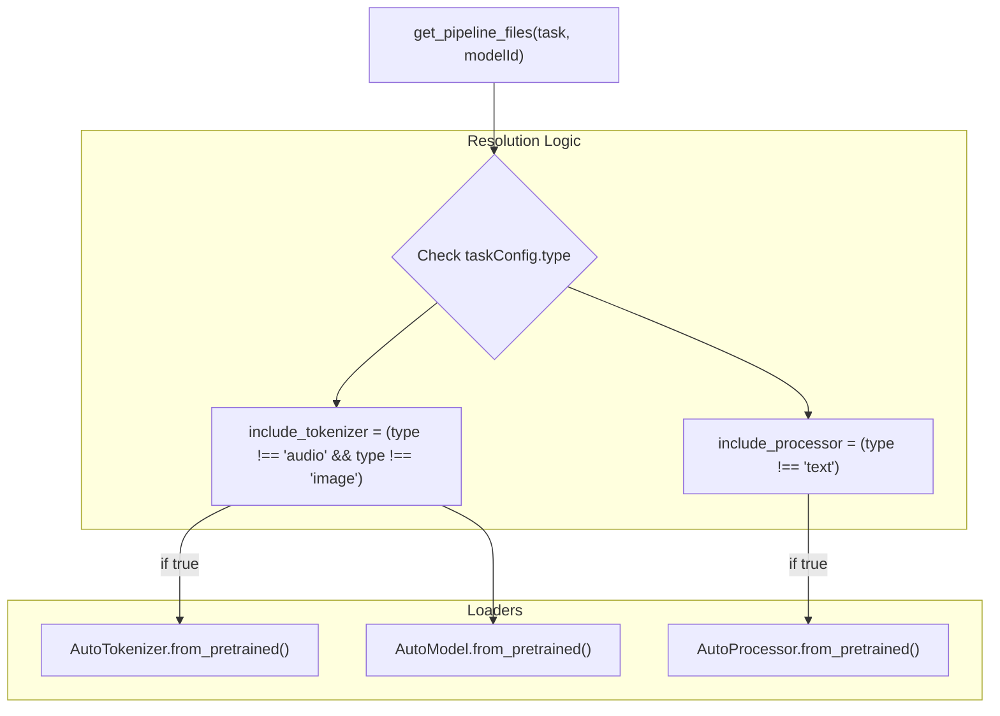

<!-- source: DeepWiki mcp.deepwiki.com · repo huggingface/transformers.js · page 2 Pipeline API · fetched 2026-10-26 -->

# Pipeline API

<details>
<summary>Relevant source files</summary>

The following files were used as context for generating this wiki page:

- [README.md](README.md)
- [package.json](package.json)
- [packages/transformers/src/pipelines.js](packages/transformers/src/pipelines.js)
- [packages/transformers/src/utils/model_registry/get_pipeline_files.js](packages/transformers/src/utils/model_registry/get_pipeline_files.js)

</details>


## Purpose and Scope

The Pipeline API is the primary high-level interface for running machine learning models in Transformers.js. It provides a simple, unified way to perform inference across 30+ tasks spanning Natural Language Processing, Computer Vision, Audio, and Multimodal domains. The `pipeline()` function abstracts away the complexity of model loading, preprocessing, inference, and postprocessing, making it the easiest way to use the library.

This document covers the pipeline function itself, its instantiation patterns, and high-level architecture. For details on specific tasks, see [Supported Tasks](#2.1). For advanced configuration options, see [Pipeline Configuration](#2.2). For internal execution flow, see [Pipeline Execution Flow](#2.3).

**Sources:** [README.md:55-129](), [packages/transformers/src/pipelines.js:1-14]()

---

## Overview

The Pipeline API serves as a task-oriented abstraction layer that automatically:
- Routes tasks to appropriate model architectures using `SUPPORTED_TASKS` [packages/transformers/src/pipelines.js:24-51]()
- Loads and initializes models from the Hugging Face Hub or local storage via `AutoModel` classes [packages/transformers/src/pipelines.js:154-180]()
- Applies task-specific preprocessing to inputs using `AutoTokenizer` or `AutoProcessor` [packages/transformers/src/pipelines.js:19-20]()
- Executes model inference using ONNX Runtime [README.md:34]()
- Postprocesses outputs into human-readable formats [README.md:58-93]()

This design mirrors the Python transformers library's pipeline API, enabling straightforward code translation between JavaScript and Python implementations.

**Sources:** [README.md:58-93](), [packages/transformers/src/pipelines.js:118-131]()

---

## Basic Usage

### Simple Task Invocation

```javascript
import { pipeline } from '@huggingface/transformers';

// Instantiate a pipeline for sentiment analysis
const classifier = await pipeline('sentiment-analysis');

// Run inference
const result = await classifier('I love transformers!');
// [{ label: 'POSITIVE', score: 0.999817686 }]
```

### Specifying a Model

```javascript
// Use a specific model by providing model ID
const classifier = await pipeline(
  'sentiment-analysis',
  'Xenova/bert-base-multilingual-uncased-sentiment'
);
```

### Device Selection

```javascript
// Run on WebGPU for GPU acceleration
const classifier = await pipeline(
  'sentiment-analysis',
  'Xenova/distilbert-base-uncased-finetuned-sst-2-english',
  { device: 'webgpu' }
);
```

### Quantization

```javascript
// Use 4-bit quantization for reduced model size
const classifier = await pipeline(
  'sentiment-analysis',
  'Xenova/distilbert-base-uncased-finetuned-sst-2-english',
  { dtype: 'q4' }
);
```

**Sources:** [README.md:81-127](), [packages/transformers/src/pipelines.js:4-11]()

---

## Pipeline Function Signature

The `pipeline` function is the main entry point defined in `packages/transformers/src/pipelines.js`.

```typescript
async function pipeline(
    task: PipelineType,
    model?: string,
    options?: PipelineOptions
): Promise<Pipeline>
```

### Parameters

| Parameter | Type | Description |
|-----------|------|-------------|
| `task` | `string` | Task identifier (e.g., `'sentiment-analysis'`, `'text-generation'`). Supports aliases via `TASK_ALIASES` [packages/transformers/src/pipelines.js:116](). |
| `model` | `string` (optional) | Model ID from Hub or local path. Defaults to task-specific model in `SUPPORTED_TASKS` [packages/transformers/src/pipelines.js:125-131](). |
| `options` | `Object` (optional) | Configuration object for device, dtype, and session options [packages/transformers/src/pipelines.js:100-112](). |

### Common Options

| Option | Type | Default | Description |
|--------|------|---------|-------------|
| `device` | `DeviceType` | `null` | Target device (e.g., `'cpu'`, `'webgpu'`, `'cuda'`) [packages/transformers/src/pipelines.js:106](). |
| `dtype` | `DataType` | `null` | Data type/quantization level (e.g., `'fp32'`, `'q8'`, `'q4'`) [packages/transformers/src/pipelines.js:107](). |
| `progress_callback` | `function` | `null` | Callback for tracking download progress [packages/transformers/src/pipelines.js:101](). |
| `session_options` | `Object` | `{}` | Direct configuration for the ONNX Runtime session [packages/transformers/src/pipelines.js:111](). |

**Sources:** [packages/transformers/src/pipelines.js:97-113](), [README.md:96-127]()

---

## Task-Based Architecture

### Task Routing System

The pipeline function uses a task identifier to determine which pipeline class to instantiate. Each task has a corresponding pipeline implementation in `packages/transformers/src/pipelines/index.js`.

**Task Routing Logic (Natural Language to Code):**


**Sources:** [packages/transformers/src/pipelines.js:114-122](), [packages/transformers/src/pipelines.js:23-51]()

### Component Initialization

The pipeline initialization process involves resolving the necessary files and components (Tokenizer vs. Processor) based on the task type.

**Component Resolution (Natural Language to Code):**


**Sources:** [packages/transformers/src/utils/model_registry/get_pipeline_files.js:34-46](), [packages/transformers/src/pipelines.js:171-180]()

---

## Pipeline Lifecycle

### Initialization Sequence

1.  **Task Resolution**: The input task is mapped to a canonical task name using `TASK_ALIASES` [packages/transformers/src/pipelines.js:116]().
2.  **File Discovery**: `get_pipeline_files` determines which ONNX, tokenizer, and processor files are required [packages/transformers/src/utils/model_registry/get_pipeline_files.js:22-62]().
3.  **Metadata Retrieval**: File sizes are fetched via `get_file_metadata` to initialize progress tracking [packages/transformers/src/pipelines.js:141-152]().
4.  **Component Loading**: `AutoTokenizer`, `AutoProcessor`, and `AutoModel` (or task-specific variants) load their respective configurations and binaries [packages/transformers/src/pipelines.js:171-205]().
5.  **Instantiation**: The specific pipeline class (e.g., `TextGenerationPipeline`) is instantiated with the loaded components [packages/transformers/src/pipelines.js:208]().

**Sources:** [packages/transformers/src/pipelines.js:114-209](), [packages/transformers/src/utils/model_registry/get_pipeline_files.js:8-21]()

### Model Selection Logic

If the `model` parameter is `null`, the library selects a default model and `dtype` defined in the `SUPPORTED_TASKS` registry [packages/transformers/src/pipelines.js:125-131]().

**Sources:** [packages/transformers/src/pipelines.js:124-131]()

---

## Return Values and Output Formats

The `pipeline()` function returns a Promise resolving to a task-specific instance of a `Pipeline` subclass. These instances are callable (via their `_call` method implementation).

| Task Category | Example Output Format |
|---------------|----------------------|
| **Text Classification** | Array of `{label: string, score: number}` [README.md:88]() |
| **Text Generation** | Array of `{generated_text: string}` [README.md:29]() |
| **Object Detection** | Array of `{score: number, label: string, box: {xmin, ymin, xmax, ymax}}` [README.md:30]() |

**Sources:** [README.md:28-32](), [packages/transformers/src/pipelines.js:55-62]()

---

## Relationship to Other Systems

- **Environment Configuration**: Pipelines respect global settings in the `env` object for local paths and remote model access [README.md:139-152]().
- **Auto Classes**: Pipelines use `AutoTokenizer`, `AutoProcessor`, and `AutoConfig` to dynamically load the correct classes for a given model ID [packages/transformers/src/pipelines.js:19-21]().
- **Model Registry**: The `get_pipeline_files` utility interacts with the model registry to identify required assets for different backends and quantizations [packages/transformers/src/utils/model_registry/get_pipeline_files.js:1-6]().

**Sources:** [packages/transformers/src/pipelines.js:19-21](), [packages/transformers/src/utils/model_registry/get_pipeline_files.js:8-21]()

---

