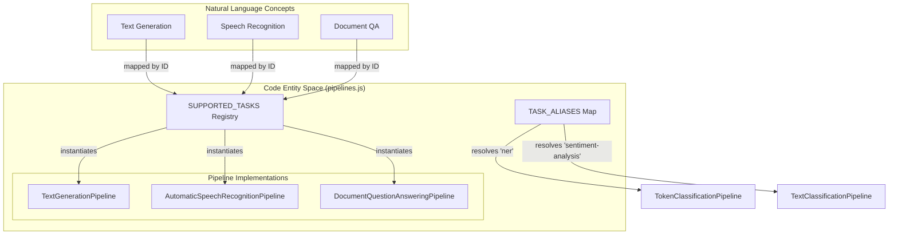
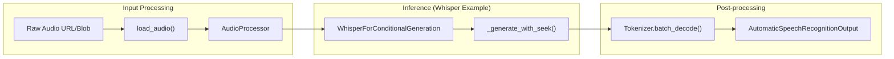

<!-- source: DeepWiki mcp.deepwiki.com · repo huggingface/transformers.js · page 2.1 Supported Tasks · fetched 2026-10-26 -->

# Supported Tasks

<details>
<summary>Relevant source files</summary>

The following files were used as context for generating this wiki page:

- [packages/transformers/docs/plugins/preprocess.js](packages/transformers/docs/plugins/preprocess.js)
- [packages/transformers/src/models/speecht5/modeling_speecht5.js](packages/transformers/src/models/speecht5/modeling_speecht5.js)
- [packages/transformers/src/models/whisper/modeling_whisper.js](packages/transformers/src/models/whisper/modeling_whisper.js)
- [packages/transformers/src/pipelines.js](packages/transformers/src/pipelines.js)
- [packages/transformers/src/pipelines/audio-classification.js](packages/transformers/src/pipelines/audio-classification.js)
- [packages/transformers/src/pipelines/automatic-speech-recognition.js](packages/transformers/src/pipelines/automatic-speech-recognition.js)
- [packages/transformers/src/pipelines/background-removal.js](packages/transformers/src/pipelines/background-removal.js)
- [packages/transformers/src/pipelines/depth-estimation.js](packages/transformers/src/pipelines/depth-estimation.js)
- [packages/transformers/src/pipelines/document-question-answering.js](packages/transformers/src/pipelines/document-question-answering.js)
- [packages/transformers/src/pipelines/fill-mask.js](packages/transformers/src/pipelines/fill-mask.js)
- [packages/transformers/src/pipelines/image-classification.js](packages/transformers/src/pipelines/image-classification.js)
- [packages/transformers/src/pipelines/image-to-image.js](packages/transformers/src/pipelines/image-to-image.js)
- [packages/transformers/src/pipelines/image-to-text.js](packages/transformers/src/pipelines/image-to-text.js)
- [packages/transformers/src/pipelines/object-detection.js](packages/transformers/src/pipelines/object-detection.js)
- [packages/transformers/src/pipelines/question-answering.js](packages/transformers/src/pipelines/question-answering.js)
- [packages/transformers/src/pipelines/summarization.js](packages/transformers/src/pipelines/summarization.js)
- [packages/transformers/src/pipelines/text-classification.js](packages/transformers/src/pipelines/text-classification.js)
- [packages/transformers/src/pipelines/text-generation.js](packages/transformers/src/pipelines/text-generation.js)
- [packages/transformers/src/pipelines/text-to-audio.js](packages/transformers/src/pipelines/text-to-audio.js)
- [packages/transformers/src/pipelines/text2text-generation.js](packages/transformers/src/pipelines/text2text-generation.js)
- [packages/transformers/src/pipelines/translation.js](packages/transformers/src/pipelines/translation.js)
- [packages/transformers/src/pipelines/zero-shot-audio-classification.js](packages/transformers/src/pipelines/zero-shot-audio-classification.js)
- [packages/transformers/src/pipelines/zero-shot-classification.js](packages/transformers/src/pipelines/zero-shot-classification.js)
- [packages/transformers/src/pipelines/zero-shot-image-classification.js](packages/transformers/src/pipelines/zero-shot-image-classification.js)
- [packages/transformers/src/pipelines/zero-shot-object-detection.js](packages/transformers/src/pipelines/zero-shot-object-detection.js)
- [packages/transformers/src/tokenization_utils.js](packages/transformers/src/tokenization_utils.js)
- [packages/transformers/src/utils/audio.js](packages/transformers/src/utils/audio.js)
- [packages/transformers/src/utils/model_registry/get_pipeline_files.js](packages/transformers/src/utils/model_registry/get_pipeline_files.js)
- [packages/transformers/src/utils/video.js](packages/transformers/src/utils/video.js)
- [packages/transformers/tests/pipelines/test_pipelines_document_question_answering.js](packages/transformers/tests/pipelines/test_pipelines_document_question_answering.js)

</details>


This page catalogs the 30+ machine learning tasks supported by Transformers.js through the pipeline API. Each task represents a specific type of problem that can be solved using pre-trained models, such as text classification, image recognition, or speech transcription.

**Scope**: This document focuses on the available task types, their identifiers, and how they map to pipeline classes. For detailed information about the pipeline API itself and how to configure pipelines, see [Pipeline API](#2). For information on which model architectures support which tasks, see [Supported Model Architectures](#3.4).

## Task System Overview

In Transformers.js, a **task** is a high-level abstraction that defines a specific machine learning problem. Each task is identified by a unique string (task ID) that you pass to the `pipeline()` function. The task ID determines which pipeline class will be instantiated and how inputs and outputs will be processed [packages/transformers/src/pipelines.js:68-91]().

```javascript
// Task ID determines the pipeline class and processing logic
const classifier = await pipeline('text-classification', 'onnx-community/bert-base-uncased');
const generator = await pipeline('text-generation', 'onnx-community/Qwen2.5-0.5B-Instruct');
```

The `pipeline()` factory function resolves the task string using `TASK_ALIASES` and `SUPPORTED_TASKS` maps [packages/transformers/src/pipelines.js:114-122](). It then determines the necessary components (tokenizer, processor, or both) based on the task category [packages/transformers/src/utils/model_registry/get_pipeline_files.js:34-40]().

### Natural Language Space to Code Entity Mapping

The following diagram bridges the high-level task concepts to the specific JavaScript classes and registry keys used in the implementation.



**Sources**: [packages/transformers/src/pipelines.js:23-51](), [packages/transformers/src/pipelines.js:114-122](), [packages/transformers/src/utils/model_registry/get_pipeline_files.js:23-32]()

## Natural Language Processing Tasks

NLP tasks operate on text inputs and produce text or structured outputs. These tasks leverage encoder-only, decoder-only, or encoder-decoder models.

| Task | Task ID | Description | Pipeline Class |
|------|---------|-------------|----------------|
| Fill-Mask | `fill-mask` | Predict masked words in a sentence | `FillMaskPipeline` |
| Question Answering | `question-answering` | Extract answers from context text | `QuestionAnsweringPipeline` |
| Summarization | `summarization` | Generate shorter versions of documents | `SummarizationPipeline` |
| Text Classification | `text-classification` | Assign labels to text (e.g., sentiment) | `TextClassificationPipeline` |
| Text Generation | `text-generation` | Predict following words/tokens | `TextGenerationPipeline` |
| Text-to-Text Generation | `text2text-generation` | General sequence-to-sequence mapping | `Text2TextGenerationPipeline` |
| Token Classification | `token-classification` | Label individual tokens (e.g., NER) | `TokenClassificationPipeline` |
| Translation | `translation` | Translate between languages | `TranslationPipeline` |
| Zero-Shot Classification | `zero-shot-classification` | Classify into unseen classes | `ZeroShotClassificationPipeline` |

### Deep Dive: Text Generation
The `TextGenerationPipeline` supports both standard string prompts and Chat-based inputs [packages/transformers/src/pipelines/text-generation.js:101-140](). If the input is a `Chat` (array of message objects), the pipeline automatically applies the model's chat template [packages/transformers/src/pipelines/text-generation.js:142-161]().

```javascript
import { pipeline } from '@huggingface/transformers';
const generator = await pipeline('text-generation', 'onnx-community/SmolLM2-135M-ONNX');
const output = await generator('Once upon a time,', { max_new_tokens: 8 });
// [{ generated_text: 'Once upon a time, there was a little girl named Lily.' }]
```

**Sources**: [packages/transformers/src/pipelines/text-generation.js:91-161](), [packages/transformers/src/pipelines/summarization.js:43-50](), [packages/transformers/src/pipelines/translation.js:72-79]()

## Computer Vision Tasks

Vision tasks process images using `AutoProcessor` to handle resizing and normalization before passing tensors to models like ViT or DETR.

| Task | Task ID | Description | Pipeline Class |
|------|---------|-------------|----------------|
| Background Removal | `background-removal` | Isolate foreground from background | `BackgroundRemovalPipeline` |
| Depth Estimation | `depth-estimation` | Predict depth from 2D images | `DepthEstimationPipeline` |
| Image Classification | `image-classification` | Categorize entire images | `ImageClassificationPipeline` |
| Image Segmentation | `image-segmentation` | Segment images into regions | `ImageSegmentationPipeline` |
| Object Detection | `object-detection` | Detect and locate objects | `ObjectDetectionPipeline` |
| Image-to-Image | `image-to-image` | Transform images (e.g., upscaling) | `ImageToImagePipeline` |

**Sources**: [packages/transformers/src/pipelines.js:39-50](), [packages/transformers/src/utils/model_registry/get_pipeline_files.js:39-40]()

## Audio Tasks

Audio tasks process waveforms. The `AutomaticSpeechRecognitionPipeline` is the primary entry point for speech processing, supporting models like Whisper and Wav2Vec2 [packages/transformers/src/pipelines/automatic-speech-recognition.js:127-152]().

### Audio Processing Flow
Audio pipelines typically require a `processor` to convert raw audio into features (like mel-spectrograms) [packages/transformers/src/utils/audio.js:176-181]().



**Sources**: [packages/transformers/src/utils/audio.js:23-75](), [packages/transformers/src/pipelines/automatic-speech-recognition.js:142-165](), [packages/transformers/src/models/whisper/modeling_whisper.js:157-165]()

## Multimodal Tasks

Multimodal tasks combine multiple input types. A prominent example is `DocumentQuestionAnsweringPipeline`, which processes both an image of a document and a text question [packages/transformers/src/pipelines/document-question-answering.js:41-49]().

```javascript
const qa = await pipeline('document-question-answering', 'Xenova/donut-base-finetuned-docvqa');
const result = await qa(image, 'What is the invoice number?');
// [{ answer: 'us-001' }]
```

The pipeline prepares the image, constructs a task-specific prompt (e.g., `<s_docvqa><s_question>...`), and uses the model's `generate` method to produce an answer [packages/transformers/src/pipelines/document-question-answering.js:58-78]().

| Task | Task ID | Pipeline Class |
|------|---------|----------------|
| Image-to-Text | `image-to-text` | `ImageToTextPipeline` |
| Zero-Shot Image Classification | `zero-shot-image-classification` | `ZeroShotImageClassificationPipeline` |
| Zero-Shot Object Detection | `zero-shot-object-detection` | `ZeroShotObjectDetectionPipeline` |
| Document QA | `document-question-answering` | `DocumentQuestionAnsweringPipeline` |

**Sources**: [packages/transformers/src/pipelines/document-question-answering.js:41-91](), [packages/transformers/src/pipelines.js:43-46]()

## Summary of Task Aliases

To improve developer experience, common task names are aliased to their formal pipeline identifiers [packages/transformers/src/pipelines.js:116]().

| Alias | Resolved Task ID |
|-------|------------------|
| `sentiment-analysis` | `text-classification` |
| `ner` | `token-classification` |
| `vqa` | `visual-question-answering` |
| `text-to-speech` | `text-to-audio` |

**Sources**: [packages/transformers/src/pipelines.js:24-25](), [packages/transformers/src/pipelines.js:83-89]()

---

