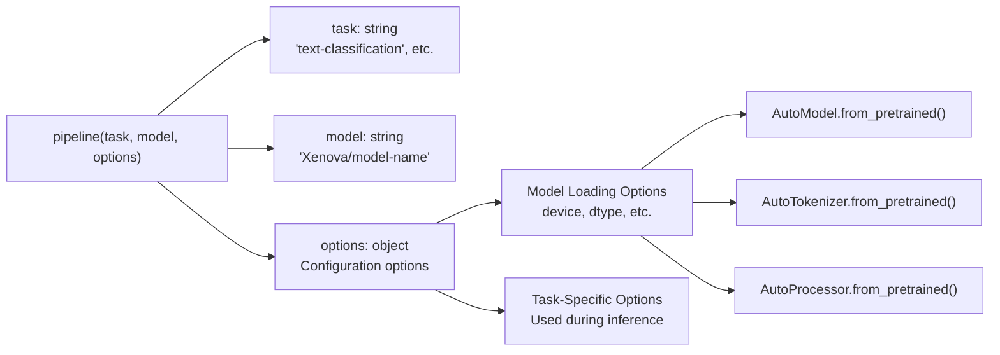
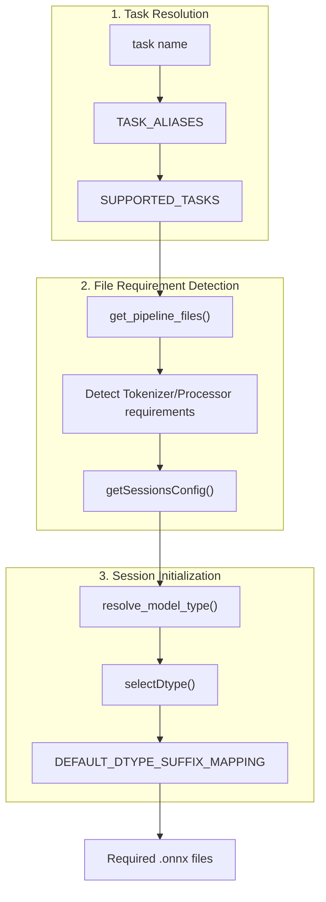
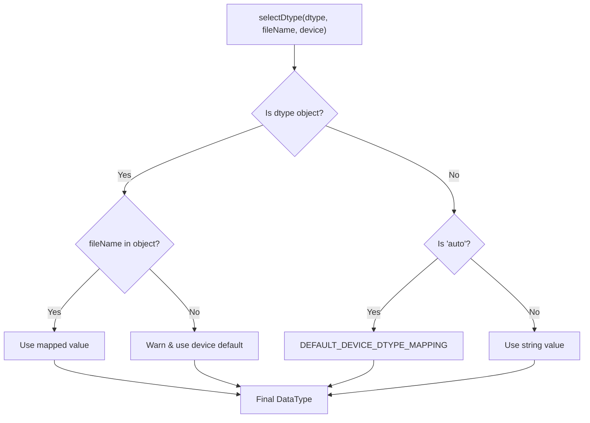

<!-- source: DeepWiki mcp.deepwiki.com · repo huggingface/transformers.js · page 2.2 Pipeline Configuration · fetched 2026-10-26 -->

# Pipeline Configuration

<details>
<summary>Relevant source files</summary>

The following files were used as context for generating this wiki page:

- [packages/transformers/src/models/session_config.js](packages/transformers/src/models/session_config.js)
- [packages/transformers/src/pipelines.js](packages/transformers/src/pipelines.js)
- [packages/transformers/src/utils/dtypes.js](packages/transformers/src/utils/dtypes.js)
- [packages/transformers/src/utils/model_registry/get_available_dtypes.js](packages/transformers/src/utils/model_registry/get_available_dtypes.js)
- [packages/transformers/src/utils/model_registry/get_pipeline_files.js](packages/transformers/src/utils/model_registry/get_pipeline_files.js)
- [packages/transformers/src/utils/model_registry/resolve_model_type.js](packages/transformers/src/utils/model_registry/resolve_model_type.js)
- [packages/transformers/tests/models/cohere_asr/test_feature_extraction_cohere_asr.js](packages/transformers/tests/models/cohere_asr/test_feature_extraction_cohere_asr.js)
- [packages/transformers/tests/pipelines/test_pipelines_automatic_speech_recognition.js](packages/transformers/tests/pipelines/test_pipelines_automatic_speech_recognition.js)

</details>


This page details the configuration options available when creating and using pipelines in Transformers.js. Pipeline configuration controls execution behavior including device selection, data type precision, quantization, and task-specific parameters.

## Pipeline Function and Options

The `pipeline()` function is the primary entry point for creating pipelines. It accepts a task name, model identifier, and an options object [packages/transformers/src/pipelines.js:97-113]().

```javascript
const pipe = await pipeline(task, model, options);
```

**Pipeline Function Signature**


**Sources:** [packages/transformers/src/pipelines.js:1-113]()

## Configuration Hierarchy

Pipeline configuration occurs at three levels: environment defaults, pipeline instantiation options, and runtime task-specific parameters. During initialization, the library determines which files to fetch based on the task type and requested precision [packages/transformers/src/utils/model_registry/get_pipeline_files.js:22-62]().

**Configuration Resolution Flow**


**Sources:** [packages/transformers/src/pipelines.js:114-137](), [packages/transformers/src/utils/model_registry/get_pipeline_files.js:7-62](), [packages/transformers/src/utils/model_registry/resolve_model_type.js:26-67]()

## Model Loading Configuration

### Device Selection

The `device` option controls which execution provider ONNX Runtime uses. It can be a single string or a mapping for multi-session models [packages/transformers/src/pipelines.js:106]().

**Available device types:**
- `'wasm'`: WebAssembly (CPU, default in browser).
- `'cpu'`: CPU execution (default in Node.js).
- `'webgpu'`: WebGPU acceleration (requires `shader-f16` for fp16) [packages/transformers/src/utils/dtypes.js:14-33]().
- `'cuda'`: NVIDIA GPU (Node.js).
- `'dml'`: DirectML (Windows).

**Sources:** [packages/transformers/src/utils/devices.js](), [packages/transformers/src/utils/dtypes.js:5-9]()

### Data Type and Quantization

The `dtype` option determines which quantized version of the model is loaded. If not specified, the library probes for available versions or uses device defaults [packages/transformers/src/utils/model_registry/get_available_dtypes.js:34-68]().

| dtype | Description | File Suffix |
|-------|-------------|-------------|
| `'fp32'` | 32-bit floating point | `` (none) |
| `'fp16'` | 16-bit floating point | `_fp16` |
| `'q8'` | 8-bit quantization | `_quantized` |
| `'q4'` | 4-bit quantization | `_q4` |
| `'q4f16'` | 4-bit weights, 16-bit acts | `_q4f16` |

**Sources:** [packages/transformers/src/utils/dtypes.js:35-72](), [packages/transformers/src/utils/model_registry/get_available_dtypes.js:15]()

### Quantization Selection Logic

The `selectDtype` function resolves the concrete data type based on the requested `dtype`, the specific file name, and the selected device [packages/transformers/src/utils/dtypes.js:85-126]().



**Sources:** [packages/transformers/src/utils/dtypes.js:85-126]()

## Session Configuration

For complex models, the library maps the model architecture to a set of required ONNX sessions. This is governed by `MODEL_SESSION_CONFIG` [packages/transformers/src/models/session_config.js:21-143]().

### Model Type Mappings
The system resolves the architectural category (e.g., `Seq2Seq`, `DecoderOnly`) using `resolve_model_type` to determine which ONNX files are mandatory [packages/transformers/src/utils/model_registry/resolve_model_type.js:26-67]().

| Model Type Enum | Category | Required Sessions (Examples) |
|-----------------|----------|-----------------------------|
| `0` | `EncoderOnly` | `model` |
| `2` | `Seq2Seq` | `encoder_model`, `decoder_model_merged` |
| `4` | `DecoderOnly` | `model` |
| `7` | `ImageTextToText` | `vision_encoder`, `decoder_model_merged` |

**Sources:** [packages/transformers/src/models/session_config.js:1-19](), [packages/transformers/src/models/session_config.js:30-34](), [packages/transformers/src/models/session_config.js:56-66]()

### Text-Only Execution
For multimodal models (like Llava or Whisper), the pipeline can be optimized to load only text-generation components if visual/audio inputs are not required for the specific task [packages/transformers/src/utils/model_registry/get_pipeline_files.js:48-61]().

**Sources:** [packages/transformers/src/utils/model_registry/get_pipeline_files.js:50-60](), [packages/transformers/src/models/session_config.js:151-154]()

## Advanced Options Reference

| Option | Type | Default | Description |
|--------|------|---------|-------------|
| `session_options` | `object` | `{}` | Direct configuration for the ONNX Runtime session. |
| `local_files_only` | `boolean` | `false` | If true, prevents fetching from the Hugging Face Hub. |
| `use_external_data_format` | `boolean` | `null` | Required for models > 2GB where weights are in separate files. |
| `model_file_name` | `string` | `null` | Overrides the default `model.onnx` base name. |
| `revision` | `string` | `'main'` | Specific git branch/commit on the Hub. |

**Sources:** [packages/transformers/src/pipelines.js:100-112](), [packages/transformers/src/utils/model_registry/get_available_dtypes.js:34-37]()

---

