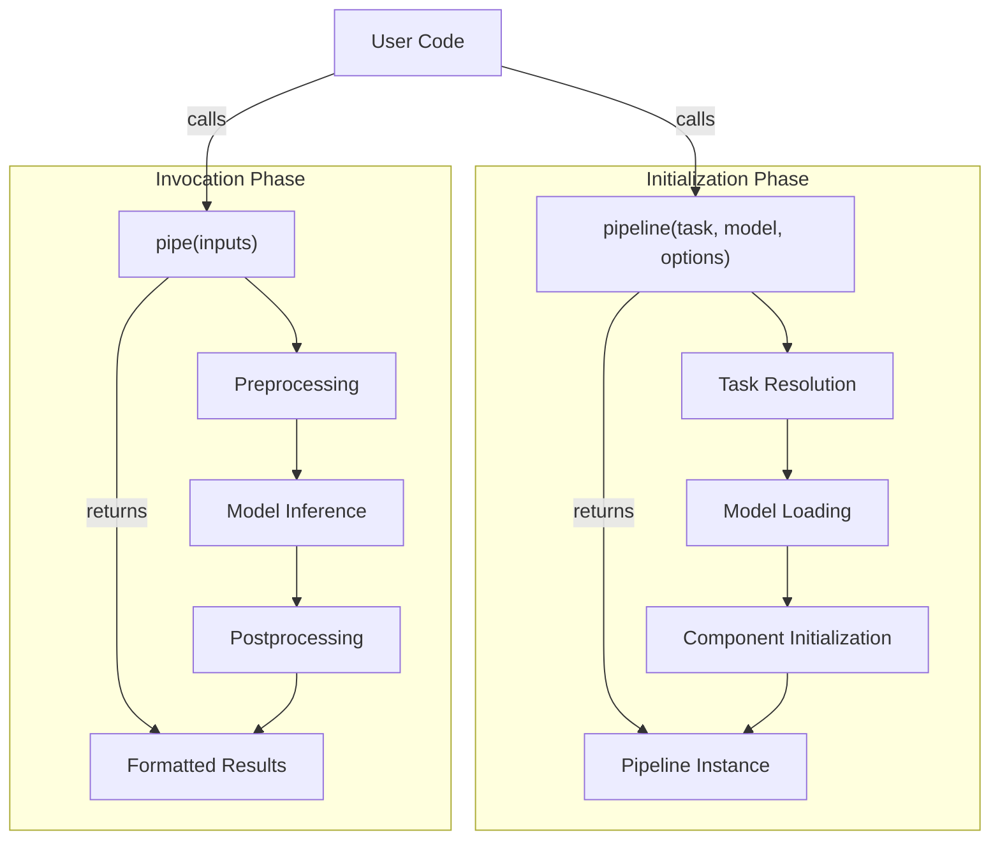
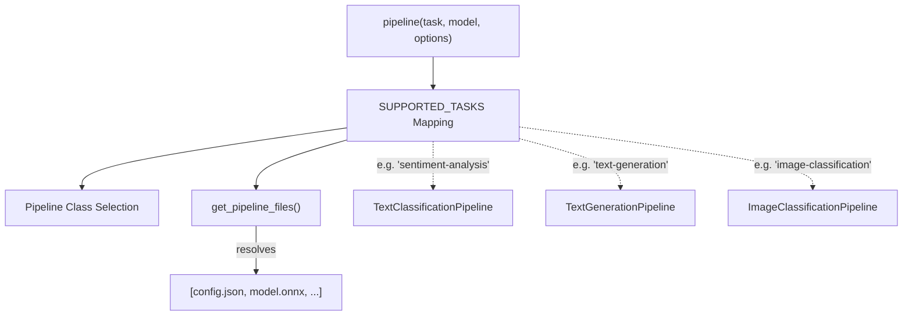
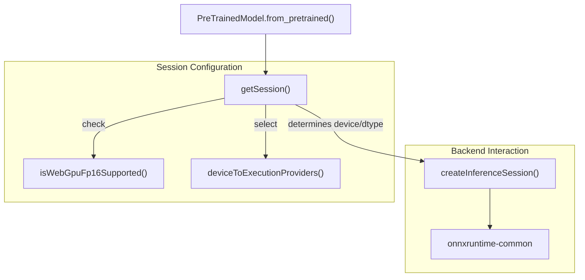
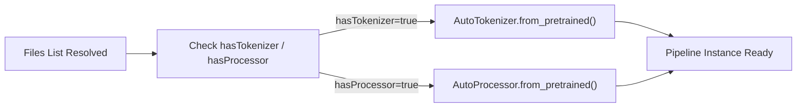
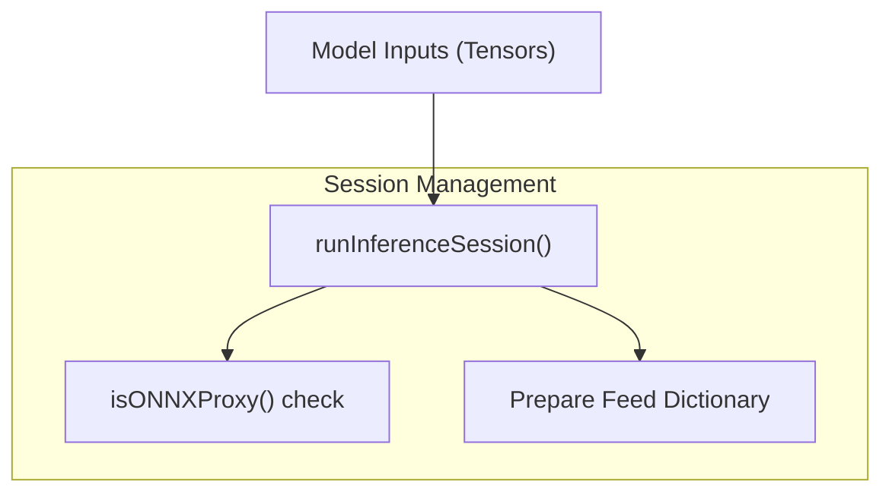
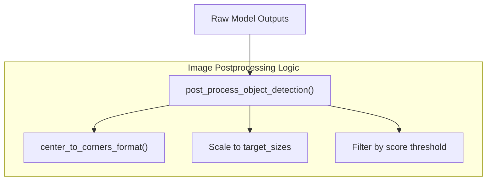

<!-- source: DeepWiki mcp.deepwiki.com · repo huggingface/transformers.js · page 2.3 Pipeline Execution Flow · fetched 2026-10-26 -->

# Pipeline Execution Flow

Relevant source files

The following files were used as context for generating this wiki page:

- [packages/transformers/src/image_processors_utils.js](packages/transformers/src/image_processors_utils.js)
- [packages/transformers/src/models/session.js](packages/transformers/src/models/session.js)
- [packages/transformers/src/pipelines.js](packages/transformers/src/pipelines.js)
- [packages/transformers/src/utils/model_registry/get_pipeline_files.js](packages/transformers/src/utils/model_registry/get_pipeline_files.js)
- [packages/transformers/tests/utils/custom_cache.test.js](packages/transformers/tests/utils/custom_cache.test.js)

## Purpose and Scope

This page details the internal execution workflow of pipelines from initialization through inference. It covers the complete lifecycle: how `pipeline()` instantiates components, how pipeline invocations are processed through preprocessing → inference → postprocessing stages, and the execution paths for different model architectures.

For information about supported tasks and pipeline configuration options, see [Supported Tasks](#2.1) and [Pipeline Configuration](#2.2). For details on model loading and the registry system, see [Model Registry and Auto Classes](#3).

---

## Overview of Pipeline Execution

The pipeline execution flow consists of two major phases: **initialization** (when `pipeline()` is called) and **invocation** (when the pipeline instance is called with inputs).

**Pipeline Initialization Phase**

Sources: [packages/transformers/src/pipelines.js:97-113](), [packages/transformers/src/pipelines.js:116-176]()

---

## Pipeline Initialization Phase

### Task and Model Resolution

When `pipeline()` is called, the system must resolve the task type and determine which model class to instantiate. This involves mapping task names to model mappings and selecting appropriate preprocessing/postprocessing components.

**Task Resolution Process**

The task name is used to select from `SUPPORTED_TASKS` defined in the pipeline index. The system then calls `get_pipeline_files` to determine which model components (tokenizer, processor, or both) are required based on the task type (text, audio, image, or multimodal).

Sources: [packages/transformers/src/pipelines.js:116-137](), [packages/transformers/src/utils/model_registry/get_pipeline_files.js:22-62]()

### Model Loading and Session Construction

The model loading process varies by model architecture type. The system determines the model type from the configuration and constructs the appropriate ONNX sessions using `getSession` and `constructSessions`.

**Session Construction by Model Type**

The model type determines which ONNX sessions are loaded. The `getSession` function handles device selection, dtype selection (e.g., fp16 for WebGPU), and external data format handling.

| Model Component | Session Utility | Example Models |
|------------|----------------|----------------|
| DecoderOnly | `model` | GPT-2, LLaMA |
| Seq2Seq | `encoder_model`, `decoder_model_merged` | T5, Whisper |
| Multimodal | `vision_encoder`, `decoder_model_merged` | LLaVA, Florence2 |

Sources: [packages/transformers/src/models/session.js:26-132](), [packages/transformers/src/models/session.js:145-162](), [packages/transformers/src/utils/model_registry/get_pipeline_files.js:48-61]()

### Component Initialization

After determining the required files, the pipeline initializes tokenizers and processors.

Sources: [packages/transformers/src/pipelines.js:170-200]()

---

## Pipeline Invocation Phase

### Preprocessing Stage

The preprocessing stage transforms raw inputs into model-compatible tensors.

**Preprocessing Outputs by Modality**

| Modality | Preprocessor | Output Keys |
|----------|-------------|-------------|
| Text | `AutoTokenizer` | `input_ids`, `attention_mask` |
| Image | `AutoProcessor` | `pixel_values` |
| Audio | `AutoProcessor` | `input_features` |

Sources: [packages/transformers/src/image_processors_utils.js:17-21](), [packages/transformers/src/pipelines.js:202-235]()

### Model Inference Stage

The inference stage executes the model's forward pass through ONNX Runtime sessions.

Sources: [packages/transformers/src/models/session.js:1-7](), [packages/transformers/src/models/session.js:110-124]()

### Postprocessing Stage

The postprocessing stage transforms raw model outputs into user-friendly results. For vision tasks, this often involves coordinate transformation or mask interpolation.

Sources: [packages/transformers/src/image_processors_utils.js:79-147](), [packages/transformers/src/image_processors_utils.js:156-180]()

---

## Key-Value Cache Management

For autoregressive models, efficient key-value (KV) cache management is critical. The system uses `getCacheNames` to identify GPU-pinned outputs.

**Cache Initialization**
If `cache_config` is enabled and the device is `webgpu`, the pipeline attempts to pin KV cache outputs to the GPU to avoid CPU-GPU synchronization overhead.

Sources: [packages/transformers/src/models/session.js:110-124](), [packages/transformers/src/models/session.js:149-156]()

---

## Summary

The pipeline execution flow consists of two distinct phases:

**Initialization Phase**
1. Task resolution to a specific Pipeline class (e.g., `TextClassificationPipeline`).
2. File resolution via `get_pipeline_files`.
3. ONNX session construction via `getSession`, handling device-specific logic like WebGPU FP16 support.
4. Auto-loading of Tokenizers or Processors.

**Invocation Phase**
1. Preprocessing raw data into `Tensor` objects.
2. Inference execution via `runInferenceSession`.
3. Postprocessing (e.g., `post_process_object_detection`) to convert logits/boxes into final user results.

Sources: [packages/transformers/src/pipelines.js:97-240](), [packages/transformers/src/models/session.js:26-132]()

---

