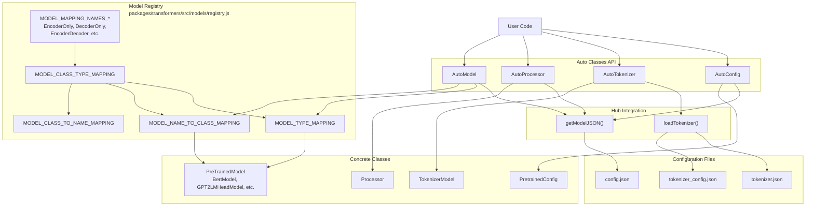

<!-- source: DeepWiki mcp.deepwiki.com · repo huggingface/transformers.js · page 3 Model Registry and Auto Classes · fetched 2026-10-26 -->

# Model Registry and Auto Classes

Relevant source files

The following files were used as context for generating this wiki page:

- [packages/transformers/src/models/modeling_utils.js](packages/transformers/src/models/modeling_utils.js)
- [packages/transformers/src/models/models.js](packages/transformers/src/models/models.js)
- [packages/transformers/src/models/qwen2_vl/modeling_qwen2_vl.js](packages/transformers/src/models/qwen2_vl/modeling_qwen2_vl.js)
- [packages/transformers/src/models/registry.js](packages/transformers/src/models/registry.js)

The Model Registry and Auto Classes system enables automatic loading of models, tokenizers, processors, and configurations without requiring users to know the specific model architecture in advance. The system consists of two main components:

1.  **Model Registry** ([packages/transformers/src/models/registry.js]()): Central registration system that maps model types to their implementations.
2.  **Auto Classes** ([packages/transformers/src/models.js](), [packages/transformers/src/configs.js]()): Factory interfaces that use the registry to instantiate appropriate classes.

The system works by maintaining internal mappings populated at module initialization time. When a user calls `AutoModel.from_pretrained('model-name')`, the library downloads and parses the model's `config.json`, identifies the `model_type` field (e.g., `'bert'`, `'gpt2'`, `'t5'`), looks up the model type in the registry mappings, and instantiates the appropriate concrete class.

## Overview

**Architecture: Auto Classes and Registry System**

**Sources:** [packages/transformers/src/models/registry.js:1-631](), [packages/transformers/src/models/modeling_utils.js:1-169](), [packages/transformers/src/configs.js:1-514]()

## Model Type System

The `MODEL_TYPES` enum defines architectural categories for models, such as `EncoderOnly`, `DecoderOnly`, and `Seq2Seq` [packages/transformers/src/models/session_config.js:1-25](). These categories determine the internal execution logic, including which forward function is used and whether the model supports text generation [packages/transformers/src/models/modeling_utils.js:96-162]().

For details, see [Model Type System](#3.1).

**Sources:** [packages/transformers/src/models/session_config.js:1-25](), [packages/transformers/src/models/modeling_utils.js:96-162]()

## Model Registry Mappings

The registry ([packages/transformers/src/models/registry.js]()) maintains extensive maps linking model identifiers (e.g., `'bert'`) to their corresponding class names (e.g., `'BertModel'`). These mappings are categorized by architecture:
*   **Encoder Only**: `MODEL_MAPPING_NAMES_ENCODER_ONLY` [packages/transformers/src/models/registry.js:12-101]()
*   **Decoder Only**: `MODEL_MAPPING_NAMES_DECODER_ONLY` [packages/transformers/src/models/registry.js:123-186]()
*   **Encoder-Decoder**: `MODEL_MAPPING_NAMES_ENCODER_DECODER` [packages/transformers/src/models/registry.js:103-115]()

It also handles task-specific mappings, such as `MODEL_FOR_CAUSAL_LM_MAPPING_NAMES` [packages/transformers/src/models/registry.js:255-329](), which allow `AutoModelForCausalLM` to select the correct class for a given model type.

For details, see [Model Registry Mappings](#3.2).

**Sources:** [packages/transformers/src/models/registry.js:12-329]()

## Model Loading Process

The `PreTrainedModel.from_pretrained()` method is the core engine for loading models. It resolves the model type from the configuration, fetches the necessary ONNX files from the Hub or local cache, and initializes the inference sessions [packages/transformers/src/models/modeling_utils.js:237-515](). The process includes handling external data formats and resolving specific execution configurations based on the `MODEL_TYPES` resolved from the registry [packages/transformers/src/models/modeling_utils.js:170-210]().

For details, see [Model Loading Process](#3.3).

**Sources:** [packages/transformers/src/models/modeling_utils.js:237-515](), [packages/transformers/src/models/modeling_utils.js:170-210]()

## Supported Model Architectures

Transformers.js supports over 100 model architectures across multiple domains. The registry exports a massive list of implementations via `ALL_MODEL_FILES` [packages/transformers/src/models/registry.js:10](), which aggregates exports from individual modeling files [packages/transformers/src/models/models.js:1-160](). This includes popular architectures like Llama, BERT, Whisper, and ViT, as well as specialized multimodal models like Qwen2-VL [packages/transformers/src/models/qwen2_vl/modeling_qwen2_vl.js:11-24]().

For details, see [Supported Model Architectures](#3.4).

**Sources:** [packages/transformers/src/models/registry.js:10](), [packages/transformers/src/models/models.js:1-160](), [packages/transformers/src/models/qwen2_vl/modeling_qwen2_vl.js:11-24]()

---

