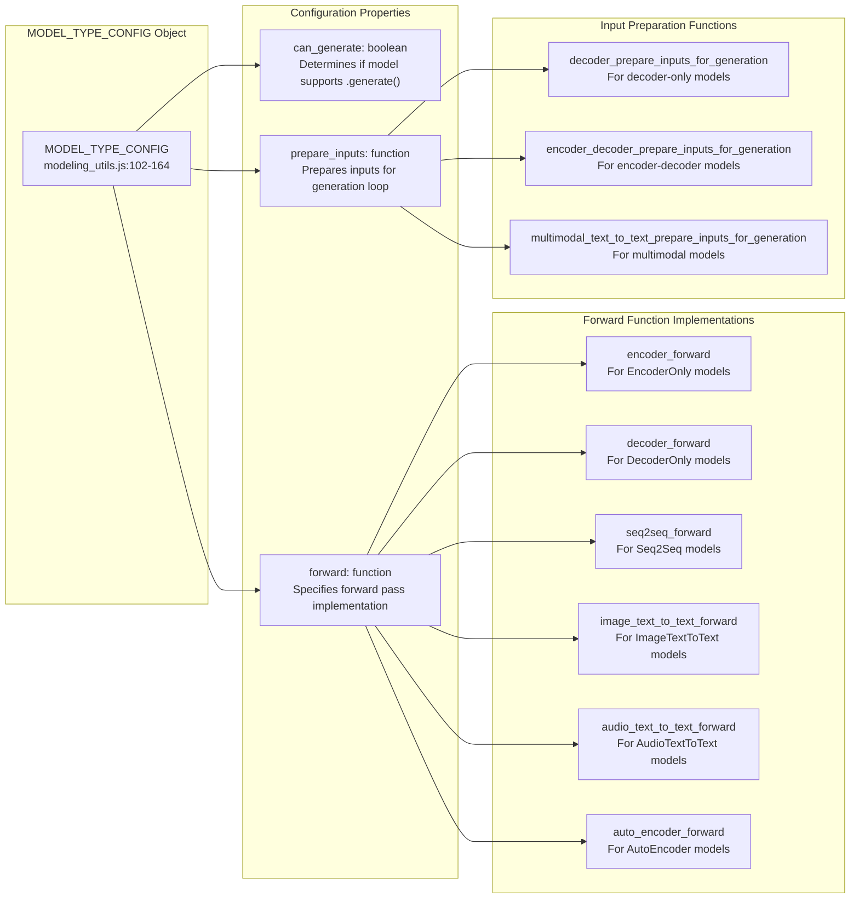
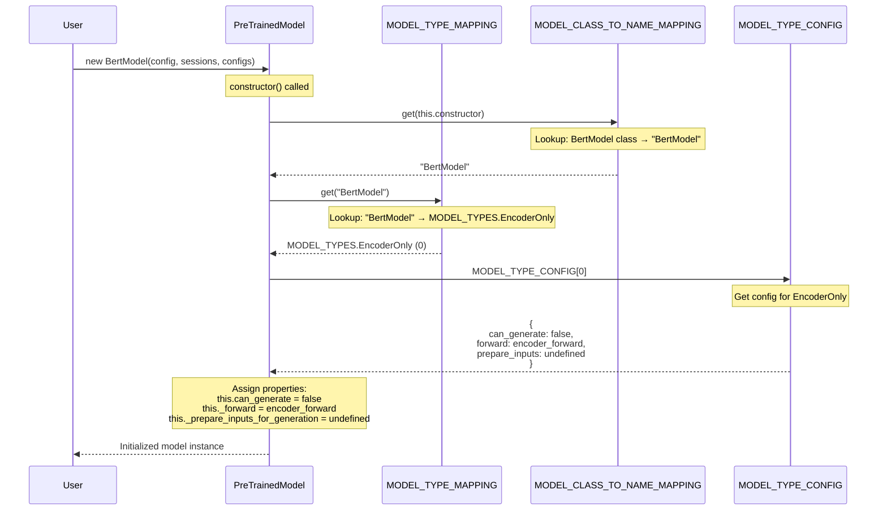
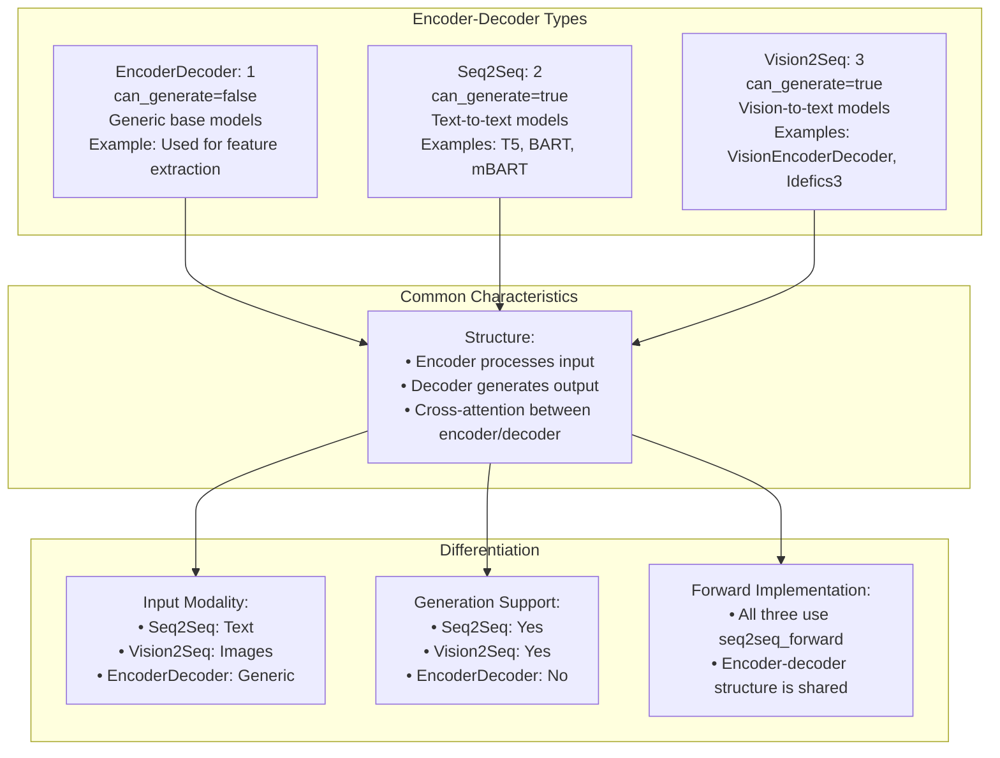
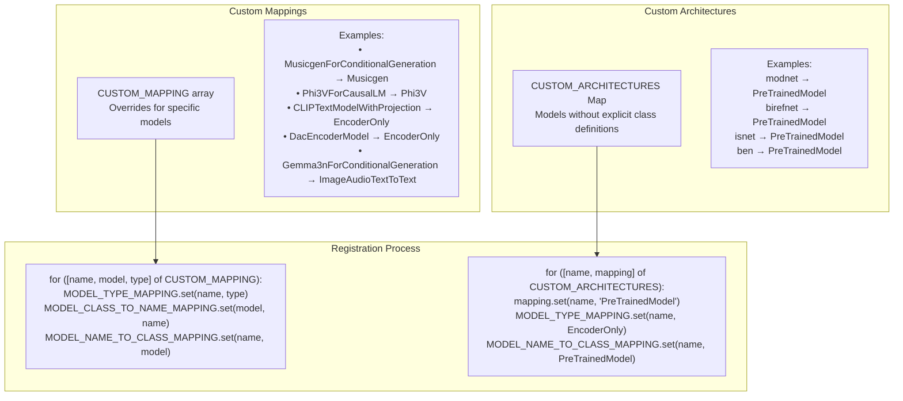

<!-- source: DeepWiki mcp.deepwiki.com · repo huggingface/transformers.js · page 3.1 Model Type System · fetched 2026-10-26 -->

# Model Type System

Relevant source files

The following files were used as context for generating this wiki page:

- [packages/transformers/src/models/models.js](packages/transformers/src/models/models.js)
- [packages/transformers/src/models/registry.js](packages/transformers/src/models/registry.js)

The model type system provides a taxonomy of neural network architectures based on their structural characteristics and input/output patterns. This system enables the library to handle 50+ different model architectures through a unified interface by categorizing them into architectural types and associating each type with appropriate execution strategies.

For information about how models are registered and mapped to their types, see [Model Registry Mappings](#3.2). For details on the actual model loading process, see [Model Loading Process](#3.3).

## MODEL_TYPES Enum

The `MODEL_TYPES` enum defines all supported architectural categories as integer constants. This enumeration is the foundation of the type system, providing a closed set of architectural patterns that the library can handle.

Title: MODEL_TYPES Architecture Hierarchy

```mermaid
graph TB
    subgraph "MODEL_TYPES Enum Definition"
        EnumDef["MODEL_TYPES<br/>packages/transformers/src/models/modeling_utils.js:83-100"]
    end
    
    subgraph "Core Text Architectures"
        EncoderOnly["EncoderOnly: 0<br/>BERT, RoBERTa, DistilBERT"]
        DecoderOnly["DecoderOnly: 4<br/>GPT-2, LLaMA, Mistral<br/>can_generate=true"]
        DecoderOnlyNoHead["DecoderOnlyWithoutHead: 5<br/>Base models without LM head<br/>can_generate=false"]
        EncoderDecoder["EncoderDecoder: 1<br/>Generic encoder-decoder<br/>can_generate=false"]
        Seq2Seq["Seq2Seq: 2<br/>T5, BART, mBART<br/>can_generate=true"]
    end
    
    subgraph "Multimodal Architectures"
        Vision2Seq["Vision2Seq: 3<br/>VisionEncoderDecoder, Idefics3<br/>can_generate=true"]
        ImageTextToText["ImageTextToText: 7<br/>LLaVA, Florence2, Qwen2-VL<br/>can_generate=true"]
        AudioTextToText["AudioTextToText: 11<br/>Ultravox, Voxtral<br/>can_generate=true"]
        ImageAudioTextToText["ImageAudioTextToText: 13<br/>Gemma3n<br/>can_generate=true"]
        Phi3V["Phi3V: 10<br/>Phi3-Vision<br/>can_generate=true"]
    end
    
    subgraph "Specialized Architectures"
        MaskGeneration["MaskGeneration: 6<br/>SAM, SAM2, EdgeTAM<br/>can_generate=false"]
        AutoEncoder["AutoEncoder: 12<br/>Mimi, DAC, SNAC<br/>can_generate=false"]
        Musicgen["Musicgen: 8<br/>MusicGen<br/>can_generate=true"]
        MultiModality["MultiModality: 9<br/>Multi-modality models<br/>can_generate=true"]
        Supertonic["Supertonic: 14<br/>Supertonic TTS<br/>can_generate=false"]
        Chatterbox["Chatterbox: 15<br/>Chatterbox speech<br/>can_generate=true"]
    end
    
    EnumDef --> EncoderOnly
    EnumDef --> DecoderOnly
    EnumDef --> DecoderOnlyNoHead
    EnumDef --> EncoderDecoder
    EnumDef --> Seq2Seq
    EnumDef --> Vision2Seq
    EnumDef --> ImageTextToText
    EnumDef --> AudioTextToText
    EnumDef --> ImageAudioTextToText
    EnumDef --> Phi3V
    EnumDef --> MaskGeneration
    EnumDef --> AutoEncoder
    EnumDef --> Musicgen
    EnumDef --> MultiModality
    EnumDef --> Supertonic
    EnumDef --> Chatterbox
```

**Sources:** [packages/transformers/src/models/modeling_utils.js:83-100]()

## Architecture Categories

The type system groups models into five primary categories based on their fundamental architectural patterns:

| Category | Types | Characteristics | Example Models |
|----------|-------|-----------------|----------------|
| **Text-only** | `EncoderOnly`, `DecoderOnly`, `DecoderOnlyWithoutHead`, `EncoderDecoder`, `Seq2Seq` | Process text inputs, output text or embeddings | BERT, GPT-2, T5, BART |
| **Vision-to-Text** | `Vision2Seq` | Encode images, decode to text | VisionEncoderDecoder, Idefics3 |
| **Multimodal-to-Text** | `ImageTextToText`, `AudioTextToText`, `ImageAudioTextToText`, `Phi3V` | Process multiple modalities, generate text | LLaVA, Ultravox, Gemma3n, Phi3-Vision |
| **Vision Tasks** | `MaskGeneration` | Generate segmentation masks | SAM, SAM2, EdgeTAM |
| **Audio/Special** | `AutoEncoder`, `Musicgen`, `Supertonic`, `Chatterbox`, `MultiModality` | Audio encoding/decoding, music generation, TTS | Mimi, DAC, MusicGen, Supertonic |

**Sources:** [packages/transformers/src/models/modeling_utils.js:83-100](), [packages/transformers/src/models/registry.js:497-537]()

## Model Type Configuration System

Each model type has an associated configuration in `MODEL_TYPE_CONFIG` that determines its runtime behavior. This configuration specifies three critical properties:

Title: Model Type Behavior Configuration

**Sources:** [packages/transformers/src/models/modeling_utils.js:102-164](), [packages/transformers/src/models/modeling_utils.js:173-207]()

### Generation Capability

The `can_generate` property determines whether a model class can invoke the `.generate()` method for autoregressive text generation:

| Type | can_generate | Reason |
|------|--------------|--------|
| `DecoderOnly` | `true` | Has language model head for token prediction |
| `DecoderOnlyWithoutHead` | `false` | Base model without prediction head |
| `Seq2Seq` | `true` | Decoder can generate tokens autoregressively |
| `Vision2Seq` | `true` | Decoder generates text from vision encodings |
| `ImageTextToText` | `true` | Multimodal decoder generates text |
| `EncoderOnly` | `false` | No autoregressive decoding capability |
| `EncoderDecoder` | `false` | Generic base without generation support |
| `MaskGeneration` | `false` | Outputs masks, not tokens |

**Sources:** [packages/transformers/src/models/modeling_utils.js:103-163]()

## Registration System Architecture

The registration system establishes the mapping between model class names and their types through three interconnected global maps. This system is initialized during module load by `packages/transformers/src/models/registry.js`.

Title: Model Registration Mapping Flow

```mermaid
graph TB
    subgraph "Architecture Mappings<br/>registry.js:12-186"
        EncoderOnlyMap["MODEL_MAPPING_NAMES_ENCODER_ONLY<br/>Map: model_type → class_name<br/>bert → BertModel<br/>roberta → RobertaModel<br/>vit → ViTModel<br/>...90+ entries"]
        
        DecoderOnlyMap["MODEL_MAPPING_NAMES_DECODER_ONLY<br/>Map: model_type → class_name<br/>gpt2 → GPT2Model<br/>llama → LlamaModel<br/>mistral → MistralModel<br/>...50+ entries"]
        
        EncoderDecoderMap["MODEL_MAPPING_NAMES_ENCODER_DECODER<br/>Map: model_type → class_name<br/>t5 → T5Model<br/>bart → BartModel<br/>whisper → WhisperModel<br/>...10+ entries"]
        
        AutoEncoderMap["MODEL_MAPPING_NAMES_AUTO_ENCODER<br/>Map: model_type → class_name<br/>mimi → MimiModel<br/>dac → DacModel<br/>snac → SnacModel"]
    end
    
    subgraph "Task Mappings<br/>registry.js:188-2400"
        CausalLM["MODEL_FOR_CAUSAL_LM_MAPPING_NAMES<br/>For text generation tasks"]
        Seq2SeqLM["MODEL_FOR_SEQ_TO_SEQ_CAUSAL_LM_MAPPING_NAMES<br/>For translation/summarization"]
        SequenceClass["MODEL_FOR_SEQUENCE_CLASSIFICATION_MAPPING_NAMES<br/>For classification tasks"]
        ImageClass["MODEL_FOR_IMAGE_CLASSIFICATION_MAPPING_NAMES<br/>For vision classification"]
        ImageTextToText["MODEL_FOR_IMAGE_TEXT_TO_TEXT_MAPPING_NAMES<br/>For VLMs"]
        More["...25+ additional task mappings"]
    end
    
    subgraph "Type Association<br/>registry.js:2400-2450"
        ClassTypeMapping["MODEL_CLASS_TYPE_MAPPING<br/>Array of [mapping, MODEL_TYPE] pairs<br/>Associates each task mapping with its type"]
    end
    
    subgraph "Global Registries<br/>modeling_utils.js:166-168"
        TypeMapping["MODEL_TYPE_MAPPING<br/>Map: class_name → MODEL_TYPE<br/>BertModel → EncoderOnly<br/>GPT2LMHeadModel → DecoderOnly"]
        
        NameToClass["MODEL_NAME_TO_CLASS_MAPPING<br/>Map: class_name → constructor<br/>BertModel → BertModel class"]
        
        ClassToName["MODEL_CLASS_TO_NAME_MAPPING<br/>Map: constructor → class_name<br/>BertModel class → BertModel"]
    end
    
    EncoderOnlyMap --> ClassTypeMapping
    DecoderOnlyMap --> ClassTypeMapping
    EncoderDecoderMap --> ClassTypeMapping
    AutoEncoderMap --> ClassTypeMapping
    
    CausalLM --> ClassTypeMapping
    Seq2SeqLM --> ClassTypeMapping
    SequenceClass --> ClassTypeMapping
    ImageClass --> ClassTypeMapping
    ImageTextToText --> ClassTypeMapping
    More --> ClassTypeMapping
    
    ClassTypeMapping --> TypeMapping
    ClassTypeMapping --> NameToClass
    ClassTypeMapping --> ClassToName
```

**Sources:** [packages/transformers/src/models/registry.js:12-186](), [packages/transformers/src/models/registry.js:188-2400](), [packages/transformers/src/models/modeling_utils.js:166-168]()

## Type Resolution Process

When a model is instantiated, the system resolves its type through a deterministic lookup chain:

Title: Model Type Resolution Sequence

**Sources:** [packages/transformers/src/models/modeling_utils.js:184-207]()

The lookup chain:
1. **Class → Name**: `MODEL_CLASS_TO_NAME_MAPPING.get(this.constructor)` retrieves the string name (e.g., `"BertModel"`) [packages/transformers/src/models/modeling_utils.js:191-191]()
2. **Name → Type**: `MODEL_TYPE_MAPPING.get(modelName)` retrieves the numeric type constant (e.g., `MODEL_TYPES.EncoderOnly`) [packages/transformers/src/models/modeling_utils.js:192-192]()
3. **Type → Config**: `MODEL_TYPE_CONFIG[modelType]` retrieves the type configuration object [packages/transformers/src/models/modeling_utils.js:194-194]()
4. **Config → Behavior**: Properties from the config are assigned to the model instance [packages/transformers/src/models/modeling_utils.js:196-199]()

## Encoder-Decoder Type Distinction

The system distinguishes between three encoder-decoder variants based on their capabilities:

Title: Encoder-Decoder Variants

**Sources:** [packages/transformers/src/models/modeling_utils.js:113-130]()

## Decoder-Only Type Distinction

The `DecoderOnly` and `DecoderOnlyWithoutHead` types differ only in their generation capability:

| Property | DecoderOnly | DecoderOnlyWithoutHead |
|----------|-------------|------------------------|
| Type constant | `4` | `5` |
| `can_generate` | `true` | `false` |
| `forward` | `decoder_forward` | `decoder_forward` |
| `prepare_inputs` | `decoder_prepare_inputs_for_generation` | `decoder_prepare_inputs_for_generation` |
| Example models | `GPT2LMHeadModel`, `LlamaForCausalLM` | `GPT2Model`, `LlamaModel` |
| Use case | Text generation | Embedding extraction, feature extraction |

The distinction exists because base models (e.g., `GPT2Model`) lack a language modeling head and cannot perform token prediction, while their `ForCausalLM` variants (e.g., `GPT2LMHeadModel`) include this head.

**Sources:** [packages/transformers/src/models/modeling_utils.js:103-112](), [packages/transformers/src/models/registry.js:123-186](), [packages/transformers/src/models/registry.js:239-294]()

## Type-Specific ONNX Session Structure

Different model types load different sets of ONNX sessions. The session structure is determined in `PreTrainedModel.from_pretrained()` based on the model type:

Title: Session Structure by Model Type

```mermaid
graph TB
    subgraph "DecoderOnly (Type 4)"
        DO_Sessions["Sessions:<br/>• model"]
        DO_Config["Optional Configs:<br/>• generation_config.json"]
    end
    
    subgraph "Seq2Seq / Vision2Seq (Types 2, 3)"
        S2S_Sessions["Sessions:<br/>• model (encoder_model)<br/>• decoder_model_merged"]
        S2S_Config["Optional Configs:<br/>• generation_config.json"]
    end
    
    subgraph "ImageTextToText (Type 7)"
        ITT_Sessions["Sessions:<br/>• embed_tokens<br/>• vision_encoder<br/>• decoder_model_merged<br/>• model (encoder_model, if is_encoder_decoder)"]
        ITT_Config["Optional Configs:<br/>• generation_config.json"]
    end
    
    subgraph "AudioTextToText (Type 11)"
        ATT_Sessions["Sessions:<br/>• embed_tokens<br/>• audio_encoder<br/>• decoder_model_merged"]
        ATT_Config["Optional Configs:<br/>• generation_config.json"]
    end
    
    subgraph "MaskGeneration (Type 6)"
        MG_Sessions["Sessions:<br/>• model (vision_encoder)<br/>• prompt_encoder_mask_decoder"]
    end
    
    subgraph "AutoEncoder (Type 12)"
        AE_Sessions["Sessions:<br/>• encoder_model<br/>• decoder_model"]
    end
    
    subgraph "Musicgen (Type 8)"
        MUS_Sessions["Sessions:<br/>• model (text_encoder)<br/>• decoder_model_merged<br/>• encodec_decode"]
        MUS_Config["Optional Configs:<br/>• generation_config.json"]
    end
    
    subgraph "MultiModality (Type 9)"
        MM_Sessions["Sessions:<br/>• prepare_inputs_embeds<br/>• model (language_model)<br/>• lm_head<br/>• gen_head<br/>• gen_img_embeds<br/>• image_decode"]
        MM_Config["Optional Configs:<br/>• generation_config.json"]
    end
```

**Sources:** [packages/transformers/src/models/modeling_utils.js:273-511]()

## Custom Model Type Handling

Some models require special handling beyond the standard type mappings defined in `MODEL_CLASS_TYPE_MAPPING` [packages/transformers/src/models/registry.js:2400-2450]():

Title: Custom Registration Overrides

**Sources:** [packages/transformers/src/models/registry.js:2452-2500]()

Custom mappings exist for:
1. **Modality-specific components**: `CLIPTextModelWithProjection`, `CLIPVisionModelWithProjection`, `SiglipTextModel` - Separated text/vision encoders from multimodal models.
2. **Codec models**: `DacEncoderModel`, `DacDecoderModel`, `MimiEncoderModel`, etc. - Separate encoder/decoder for audio codecs.
3. **Special architectures**: `MusicgenForConditionalGeneration`, `Phi3VForCausalLM`, `Gemma3nForConditionalGeneration` - Unique generation patterns.
4. **Generic fallback models**: `modnet`, `birefnet`, `isnet`, `ben` - Use base `PreTrainedModel` class directly.

**Sources:** [packages/transformers/src/models/registry.js:2452-2500]()

---

