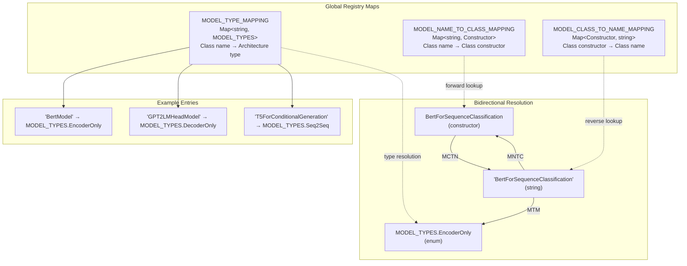
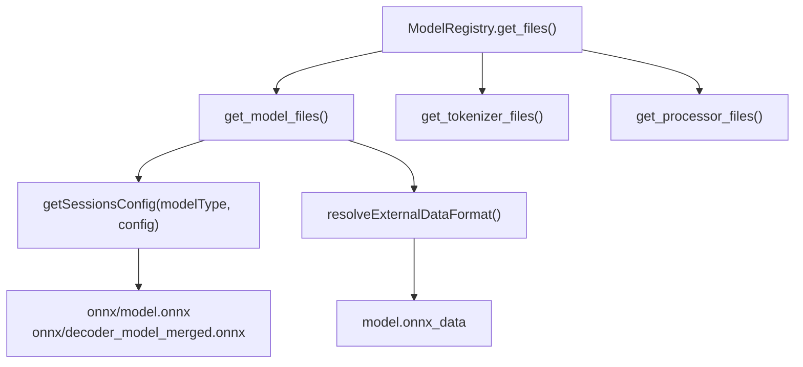

<!-- source: DeepWiki mcp.deepwiki.com · repo huggingface/transformers.js · page 3.2 Model Registry Mappings · fetched 2026-10-26 -->

# Model Registry Mappings

<details>
<summary>Relevant source files</summary>

The following files were used as context for generating this wiki page:

- [packages/transformers/docs/source/guides/dtypes.md](packages/transformers/docs/source/guides/dtypes.md)
- [packages/transformers/src/models/models.js](packages/transformers/src/models/models.js)
- [packages/transformers/src/models/registry.js](packages/transformers/src/models/registry.js)
- [packages/transformers/src/utils/model_registry/ModelRegistry.js](packages/transformers/src/utils/model_registry/ModelRegistry.js)
- [packages/transformers/src/utils/model_registry/get_model_files.js](packages/transformers/src/utils/model_registry/get_model_files.js)
- [packages/transformers/src/utils/model_registry/is_cached.js](packages/transformers/src/utils/model_registry/is_cached.js)
- [packages/transformers/tests/progress_callbacks.test.js](packages/transformers/tests/progress_callbacks.test.js)
- [packages/transformers/tests/utils/cache.test.js](packages/transformers/tests/utils/cache.test.js)
- [packages/transformers/tests/utils/model_registry.test.js](packages/transformers/tests/utils/model_registry.test.js)

</details>


This document explains the registry mapping system that connects model architecture identifiers to their implementation classes and categorizes them by architectural patterns and task capabilities. It also documents the `ModelRegistry` utility class, which provides the public API for file discovery, cache management, and quantization detection.

## Overview

The model registry maintains three interconnected mapping systems that enable automatic model class resolution:

1.  **Core Registry Maps**: Bidirectional mappings between model class names, constructor classes, and architectural types.
2.  **Architecture Category Mappings**: Collections of models grouped by architectural pattern (encoder-only, decoder-only, etc.).
3.  **Task-Specific Mappings**: Collections of models grouped by task capability (sequence classification, causal LM, etc.).

These mappings are defined in `packages/transformers/src/models/registry.js` and are used by Auto classes to automatically instantiate the correct model class based on configuration metadata.

**Sources**: [packages/transformers/src/models/registry.js:1-631]()

## Core Registry Maps



### MODEL_TYPE_MAPPING
Maps model class name strings to `MODEL_TYPES` enum values, enabling architecture type resolution based on class names extracted from model configurations.

**Sources**: [packages/transformers/src/models/modeling_utils.js:166](), [packages/transformers/src/models/registry.js:497-547]()

### MODEL_NAME_TO_CLASS_MAPPING
Maps model class name strings to their actual constructor classes, enabling dynamic instantiation from string identifiers.

**Sources**: [packages/transformers/src/models/modeling_utils.js:167](), [packages/transformers/src/models/registry.js:539-547]()

### MODEL_CLASS_TO_NAME_MAPPING
Maps model constructor classes to their string names, enabling reverse lookups during model configuration and validation.

**Sources**: [packages/transformers/src/models/modeling_utils.js:168](), [packages/transformers/src/models/registry.js:539-547]()

## Architecture Category Mappings

Architecture category mappings are `Map` objects where keys are model type identifiers (matching `model_type` in `config.json`) and values are model class names.

### MODEL_MAPPING_NAMES_ENCODER_ONLY
Contains models that process inputs without autoregressive generation. Includes text encoders (BERT), vision models (ViT), and multimodal encoders (CLIP).

| Model Type | Class Name | Primary Use Case |
|------------|------------|------------------|
| `bert` | `BertModel` | Text encoding |
| `vit` | `ViTModel` | Image encoding |
| `clip` | `CLIPModel` | Vision-language encoding |
| `detr` | `DetrModel` | Object detection |

**Sources**: [packages/transformers/src/models/registry.js:12-101]()

### MODEL_MAPPING_NAMES_DECODER_ONLY
Contains models designed for autoregressive text generation.

| Model Type | Class Name | Architecture Family |
|------------|------------|---------------------|
| `gpt2` | `GPT2Model` | GPT family |
| `llama` | `LlamaModel` | LLaMA family |
| `mistral` | `MistralModel` | Mistral family |
| `qwen2` | `Qwen2Model` | Qwen family |

**Sources**: [packages/transformers/src/models/registry.js:123-186]()

### MODEL_MAPPING_NAMES_ENCODER_DECODER
Contains models for sequence-to-sequence tasks like translation and summarization.

| Model Type | Class Name | Primary Use Case |
|------------|------------|------------------|
| `t5` | `T5Model` | Text-to-text |
| `whisper` | `WhisperModel` | Speech recognition |

**Sources**: [packages/transformers/src/models/registry.js:103-115]()

## ModelRegistry Utility Class

The `ModelRegistry` class provides a high-level static API for interacting with the model system without necessarily loading a full model into memory. It is primarily used for cache management and pre-flight file checks.

### Key Methods

| Method | Purpose |
|--------|---------|
| `get_files(modelId, options)` | Returns all files (model, tokenizer, processor) needed for a model. |
| `get_model_files(modelId, options)` | Returns only the model-specific files (e.g., `.onnx`, `config.json`). |
| `get_pipeline_files(task, modelId, options)` | Resolves files needed for a specific pipeline task. |
| `get_available_dtypes(modelId, options)` | Probes the Hub to detect which quantization levels (e.g., `q4`, `fp16`) are available. |
| `is_cached(modelId, options)` | Checks if all required files for a model are in the local cache. |
| `clear_cache(modelId, options)` | Deletes cached files for a specific model and dtype. |

**Sources**: [packages/transformers/src/utils/model_registry/ModelRegistry.js:118-270]()

### File Discovery Logic

The registry uses `get_model_files` to determine which ONNX sessions are required based on the model's architecture. It relies on `getSessionsConfig` to map architectural types to specific file names (e.g., `encoder_model.onnx` vs `model.onnx`).



**Sources**: [packages/transformers/src/utils/model_registry/get_model_files.js:60-115](), [packages/transformers/src/utils/model_registry/ModelRegistry.js:136-138]()

### Quantization Detection

`ModelRegistry.get_available_dtypes` performs HEAD requests to the Hugging Face Hub to verify the existence of specific ONNX files. For multi-session models (like Whisper), a `dtype` is only considered available if **all** required session files (encoder and decoder) exist for that quantization level.

```javascript
// Example: Detecting available quantizations
const dtypes = await ModelRegistry.get_available_dtypes("onnx-community/all-MiniLM-L6-v2-ONNX");
// Result: [ 'fp32', 'fp16', 'int8', 'uint8', 'q8', 'q4' ]
```

**Sources**: [packages/transformers/tests/utils/model_registry.test.js:58-109](), [packages/transformers/src/utils/model_registry/ModelRegistry.js:256-258]()

### Cache Operations

The registry interacts with the `getCache` utility to manage the Browser Cache API or File System cache. `is_cached` performs a fast early-exit by checking `config.json` before verifying the larger ONNX weights.

**Sources**: [packages/transformers/src/utils/model_registry/is_cached.js:75-88](), [packages/transformers/tests/utils/cache.test.js:16-113]()

## Task-Specific Mappings

These mappings connect model type identifiers to specialized subclasses.

| Mapping Constant | Example Entries |
|------------------|-----------------|
| `MODEL_FOR_SEQUENCE_CLASSIFICATION_MAPPING_NAMES` | `bert → BertForSequenceClassification` |
| `MODEL_FOR_CAUSAL_LM_MAPPING_NAMES` | `llama → LlamaForCausalLM` |
| `MODEL_FOR_IMAGE_CLASSIFICATION_MAPPING_NAMES` | `vit → ViTForImageClassification` |
| `MODEL_FOR_SPEECH_SEQ_2_SEQ_MAPPING_NAMES` | `whisper → WhisperForConditionalGeneration` |

**Sources**: [packages/transformers/src/models/registry.js:188-483]()

---

