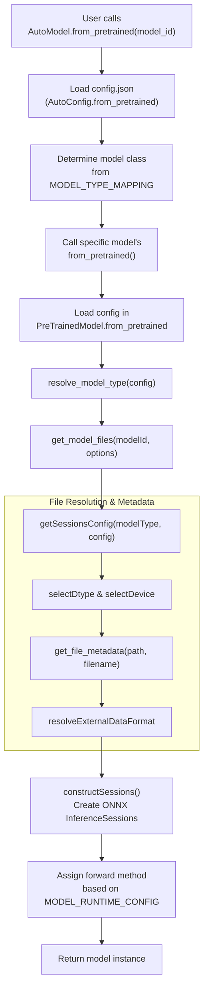
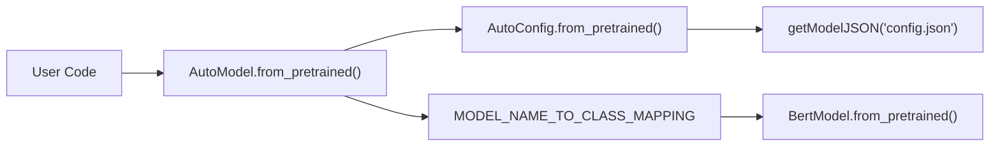
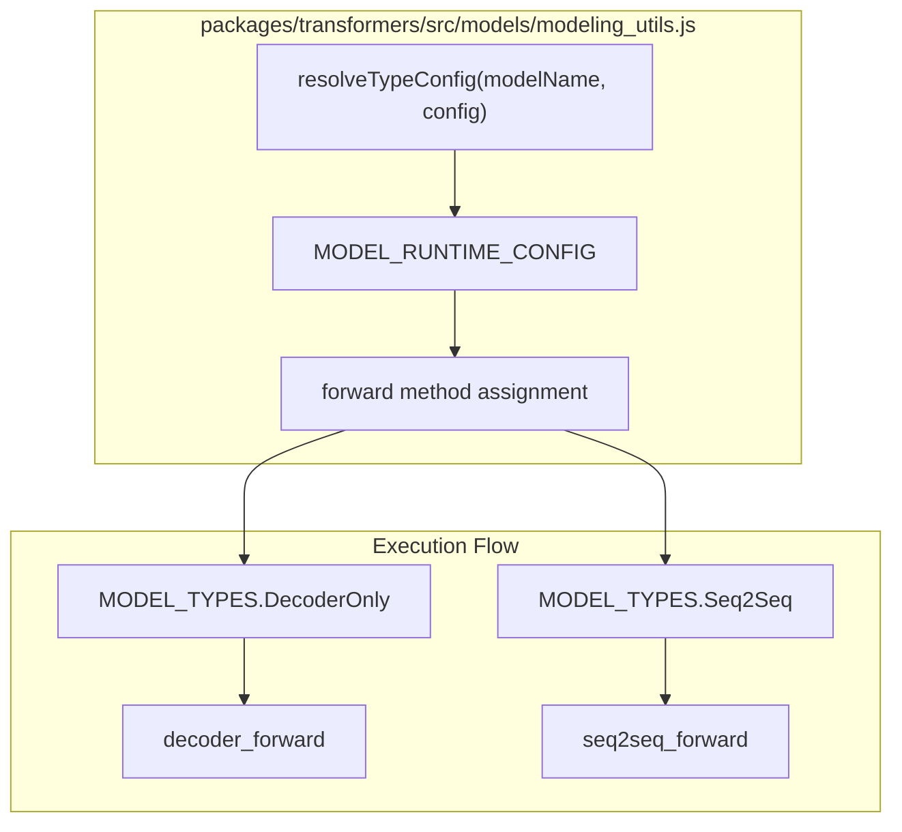

<!-- source: DeepWiki mcp.deepwiki.com · repo huggingface/transformers.js · page 3.3 Model Loading Process · fetched 2026-10-26 -->

# Model Loading Process

Relevant source files

The following files were used as context for generating this wiki page:

- [packages/transformers/src/models/modeling_utils.js](packages/transformers/src/models/modeling_utils.js)
- [packages/transformers/src/models/qwen2_vl/modeling_qwen2_vl.js](packages/transformers/src/models/qwen2_vl/modeling_qwen2_vl.js)
- [packages/transformers/src/utils/lru_cache.js](packages/transformers/src/utils/lru_cache.js)
- [packages/transformers/src/utils/memoize_promise.js](packages/transformers/src/utils/memoize_promise.js)
- [packages/transformers/src/utils/model_registry/get_file_metadata.js](packages/transformers/src/utils/model_registry/get_file_metadata.js)
- [packages/transformers/src/utils/model_registry/get_model_files.js](packages/transformers/src/utils/model_registry/get_model_files.js)
- [packages/transformers/tests/progress_callbacks.test.js](packages/transformers/tests/progress_callbacks.test.js)
- [packages/transformers/tests/utils/lru_cache.test.js](packages/transformers/tests/utils/lru_cache.test.js)

## Purpose and Scope

This document details the technical process by which pretrained models are resolved, loaded, and initialized in Transformers.js. It covers the complete flow from calling `PreTrainedModel.from_pretrained()` through configuration loading, file resolution via the model registry, ONNX session creation, and device/dtype selection. For details about the Hub integration and file caching mechanisms, see [Hub Integration and Caching](#7).

## Loading Flow Overview

The model loading process transforms a model identifier (e.g., `onnx-community/gpt2`) or local path into a ready-to-use model instance with configured ONNX inference sessions.

**Sources:** [packages/transformers/src/models/modeling_utils.js:1450-1700](), [packages/transformers/src/utils/model_registry/get_model_files.js:60-115]()

## Entry Point: from_pretrained

The primary entry point is the `from_pretrained` static method. `AutoModel.from_pretrained()` first loads the `config.json` to identify the architecture before delegating to the specific class implementation.

The system uses `memoizePromise` to ensure that `config.json` is only fetched once, even if multiple components (like a tokenizer and a model) request it simultaneously [packages/transformers/src/utils/model_registry/get_model_files.js:30-43]().

**Sources:** [packages/transformers/src/models/modeling_utils.js:1600-1650](), [packages/transformers/src/utils/memoize_promise.js:31-45]()

## Model File Resolution

The function `get_model_files` is the core utility for determining which `.onnx` and data files are required for a specific model configuration.

| Component | Function / Entity | Role |
|-----------|-------------------|------|
| **Model Type** | `resolve_model_type(config)` | Maps architecture strings to internal `MODEL_TYPES` enum [packages/transformers/src/utils/model_registry/get_model_files.js:79]() |
| **Sessions** | `getSessionsConfig(...)` | Returns the required ONNX sessions (e.g., `encoder_model`, `decoder_model_merged`) based on model type [packages/transformers/src/utils/model_registry/get_model_files.js:100]() |
| **Dtype** | `selectDtype(...)` | Determines the file suffix (e.g., `_q4`, `_quantized`) based on device and user preference [packages/transformers/src/utils/model_registry/get_model_files.js:84]() |
| **External Data** | `resolveExternalDataFormat` | Detects if weights are stored in separate `_data` chunks for models >2GB [packages/transformers/src/utils/model_registry/get_model_files.js:92]() |

**Sources:** [packages/transformers/src/utils/model_registry/get_model_files.js:60-115](), [packages/transformers/src/models/session_config.js:1-100]()

## Metadata and Range Requests

To optimize loading, `get_file_metadata` performs lightweight checks to see if files exist and to determine their uncompressed size for progress tracking.

For remote files, the library uses a **Range Request** (`bytes=0-0`) rather than a `HEAD` request. This is because `HEAD` requests often return the compressed size (if gzip/brotli is active), whereas the library needs the uncompressed size to provide accurate progress bars as the Fetch API decompresses data transparently [packages/transformers/src/utils/model_registry/get_file_metadata.js:19-24]().

**Sources:** [packages/transformers/src/utils/model_registry/get_file_metadata.js:30-39](), [packages/transformers/src/utils/model_registry/get_file_metadata.js:108-120]()

## Session Construction and Runtime Configuration

Once files are resolved, `constructSessions` creates the actual ONNX `InferenceSession` instances. The library then assigns runtime behavior via `MODEL_RUNTIME_CONFIG`.

The `MODEL_RUNTIME_CONFIG` maps model types to their specific execution logic:
- **DecoderOnly**: Uses `decoder_forward` and `decoder_prepare_inputs_for_generation` [packages/transformers/src/models/modeling_utils.js:97-101]().
- **Seq2Seq**: Uses `seq2seq_forward` and `encoder_decoder_prepare_inputs_for_generation` [packages/transformers/src/models/modeling_utils.js:107-111]().
- **Vision2Seq**: Shared logic with Seq2Seq but specialized for vision inputs [packages/transformers/src/models/modeling_utils.js:112-116]().

**Sources:** [packages/transformers/src/models/modeling_utils.js:96-162](), [packages/transformers/src/models/modeling_utils.js:170-200]()

## External Data Handling

For large models (e.g., LLMs over 2GB), weights are split into chunks. The library uses `getExternalDataChunkNames` to generate the sequence of required files:
1. `model.onnx_data` (first chunk)
2. `model.onnx_data_1`
3. `model.onnx_data_2` ... and so on.

These chunks are resolved and added to the file list in `get_model_files` [packages/transformers/src/utils/model_registry/get_model_files.js:91-97]().

**Sources:** [packages/transformers/src/utils/model_registry/get_model_files.js:91-97](), [packages/transformers/src/utils/model-loader.js:1-50]()

## Caching and Memoization

Loading is backed by a simple LRU (Least Recently Used) cache to manage memory and avoid redundant processing. The `LRUCache` implementation manages a bounded set of entries, evicting the oldest items when capacity is reached [packages/transformers/src/utils/lru_cache.js:6-50]().

`memoizePromise` wraps this cache to ensure that async operations (like fetching a model config) are deduplicated. If a promise is currently pending for a specific key, all subsequent callers receive the same promise [packages/transformers/src/utils/memoize_promise.js:31-45]().

**Sources:** [packages/transformers/src/utils/lru_cache.js:1-68](), [packages/transformers/src/utils/memoize_promise.js:1-45]()

---

