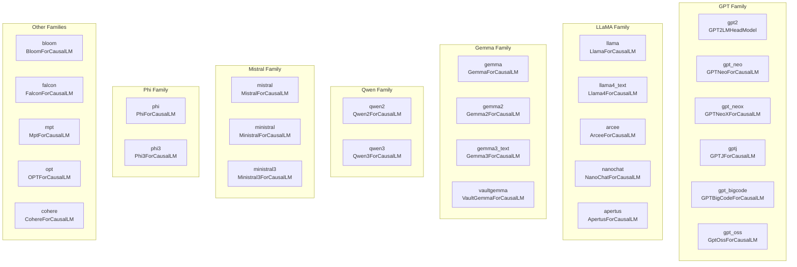
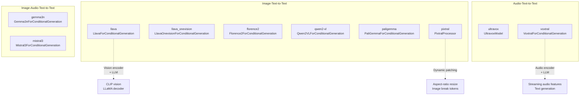
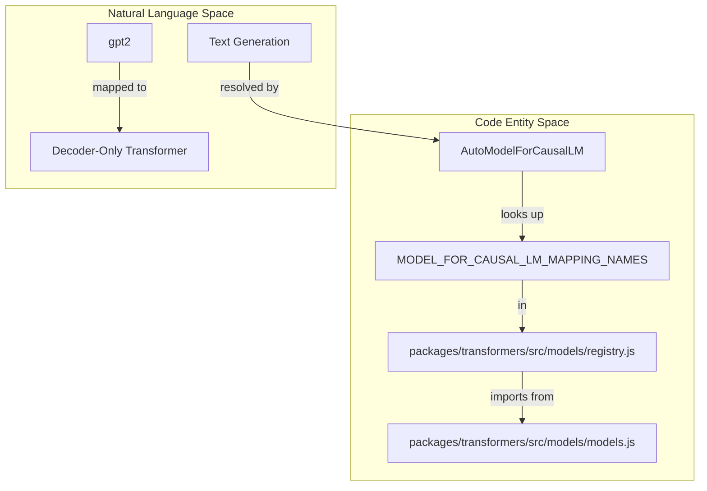

<!-- source: DeepWiki mcp.deepwiki.com · repo huggingface/transformers.js · page 3.4 Supported Model Architectures · fetched 2026-10-26 -->

# Supported Model Architectures

Relevant source files

The following files were used as context for generating this wiki page:

- [packages/transformers/docs/snippets/5_supported-models.snippet](packages/transformers/docs/snippets/5_supported-models.snippet)
- [packages/transformers/src/models/deepseek_v4/modeling_deepseek_v4.js](packages/transformers/src/models/deepseek_v4/modeling_deepseek_v4.js)
- [packages/transformers/src/models/gemma3/image_processing_gemma3.js](packages/transformers/src/models/gemma3/image_processing_gemma3.js)
- [packages/transformers/src/models/gemma3/modeling_gemma3.js](packages/transformers/src/models/gemma3/modeling_gemma3.js)
- [packages/transformers/src/models/gemma3/processing_gemma3.js](packages/transformers/src/models/gemma3/processing_gemma3.js)
- [packages/transformers/src/models/gemma4/feature_extraction_gemma4.js](packages/transformers/src/models/gemma4/feature_extraction_gemma4.js)
- [packages/transformers/src/models/gemma4/image_processing_gemma4.js](packages/transformers/src/models/gemma4/image_processing_gemma4.js)
- [packages/transformers/src/models/gemma4/modeling_gemma4.js](packages/transformers/src/models/gemma4/modeling_gemma4.js)
- [packages/transformers/src/models/gemma4/processing_gemma4.js](packages/transformers/src/models/gemma4/processing_gemma4.js)
- [packages/transformers/src/models/ministral/modeling_ministral.js](packages/transformers/src/models/ministral/modeling_ministral.js)
- [packages/transformers/src/models/ministral3/modeling_ministral3.js](packages/transformers/src/models/ministral3/modeling_ministral3.js)
- [packages/transformers/src/models/mistral3/modeling_mistral3.js](packages/transformers/src/models/mistral3/modeling_mistral3.js)
- [packages/transformers/src/models/models.js](packages/transformers/src/models/models.js)
- [packages/transformers/src/models/olmo_hybrid/modeling_olmo_hybrid.js](packages/transformers/src/models/olmo_hybrid/modeling_olmo_hybrid.js)
- [packages/transformers/src/models/pixtral/image_processing_pixtral.js](packages/transformers/src/models/pixtral/image_processing_pixtral.js)
- [packages/transformers/src/models/pixtral/processing_pixtral.js](packages/transformers/src/models/pixtral/processing_pixtral.js)
- [packages/transformers/src/models/qwen2_moe/modeling_qwen2_moe.js](packages/transformers/src/models/qwen2_moe/modeling_qwen2_moe.js)
- [packages/transformers/src/models/qwen3_moe/modeling_qwen3_moe.js](packages/transformers/src/models/qwen3_moe/modeling_qwen3_moe.js)
- [packages/transformers/src/models/qwen3_next/modeling_qwen3_next.js](packages/transformers/src/models/qwen3_next/modeling_qwen3_next.js)
- [packages/transformers/src/models/qwen3_vl_moe/modeling_qwen3_vl_moe.js](packages/transformers/src/models/qwen3_vl_moe/modeling_qwen3_vl_moe.js)
- [packages/transformers/src/models/registry.js](packages/transformers/src/models/registry.js)
- [packages/transformers/src/models/voxtral_realtime/modeling_voxtral_realtime.js](packages/transformers/src/models/voxtral_realtime/modeling_voxtral_realtime.js)
- [packages/transformers/tests/models/deepseek_v4/test_modeling_deepseek_v4.js](packages/transformers/tests/models/deepseek_v4/test_modeling_deepseek_v4.js)
- [packages/transformers/tests/models/gemma3/test_modeling_gemma3.js](packages/transformers/tests/models/gemma3/test_modeling_gemma3.js)

This page catalogs all 150+ model architectures supported by Transformers.js, organized by architectural type and capability. Each model architecture is mapped to its implementation class and supported tasks. For information about how these architectures are registered and instantiated, see [Model Registry Mappings](#3.2). For details on the model type system and architectural categories, see [Model Type System](#3.1).

## Architecture Classification System

Transformers.js classifies model architectures into distinct types based on their structural characteristics and generation capabilities. This classification determines how models process inputs, manage key-value caches, and perform inference.

**Model Type Taxonomy**

```mermaid
graph TB
    subgraph "Base Types"
        EncoderOnly["EncoderOnly<br/>(TYPE 0)<br/>BERT-style"]
        DecoderOnly["DecoderOnly<br/>(TYPE 4)<br/>GPT-style"]
        EncoderDecoder["EncoderDecoder<br/>(TYPE 1)<br/>Basic seq2seq"]
    end
    
    subgraph "Specialized Encoder-Decoder Types"
        Seq2Seq["Seq2Seq<br/>(TYPE 2)<br/>T5, BART"]
        Vision2Seq["Vision2Seq<br/>(TYPE 3)<br/>Donut, TrOCR"]
    end
    
    subgraph "Multimodal Types"
        ImageTextToText["ImageTextToText<br/>(TYPE 7)<br/>LLaVA, Florence2"]
        AudioTextToText["AudioTextToText<br/>(TYPE 11)<br/>Ultravox, Voxtral"]
        ImageAudioTextToText["ImageAudioTextToText<br/>(TYPE 13)<br/>Gemma3n"]
        MultiModality["MultiModality<br/>(TYPE 9)<br/>Janus-style"]
        Phi3V["Phi3V<br/>(TYPE 10)<br/>Phi3-Vision"]
    end
    
    subgraph "Specialized Types"
        MaskGeneration["MaskGeneration<br/>(TYPE 6)<br/>SAM, SAM2"]
        Musicgen["Musicgen<br/>(TYPE 8)<br/>Audio generation"]
        AutoEncoder["AutoEncoder<br/>(TYPE 12)<br/>DAC, Mimi, SNAC"]
        Supertonic["Supertonic<br/>(TYPE 14)<br/>Text-to-speech"]
        Chatterbox["Chatterbox<br/>(TYPE 15)<br/>Speech dialogue"]
    end
    
    EncoderOnly -.->|"can_generate=false"| Tasks1["Text classification<br/>Token classification<br/>Question answering"]
    DecoderOnly -.->|"can_generate=true"| Tasks2["Text generation<br/>Causal LM"]
    Seq2Seq -.->|"can_generate=true"| Tasks3["Translation<br/>Summarization<br/>Seq2seq LM"]
    Vision2Seq -.->|"can_generate=true"| Tasks4["Image captioning<br/>OCR<br/>Document QA"]
    ImageTextToText -.->|"can_generate=true"| Tasks5["Visual question answering<br/>Image-text generation"]
    MaskGeneration -.->|"can_generate=false"| Tasks6["Segmentation<br/>Object masks"]
```

Sources: [packages/transformers/src/models/modeling_utils.js:83-100](), [packages/transformers/src/models/modeling_utils.js:102-164]()

**Type Configuration and Capabilities**

The `MODEL_TYPE_CONFIG` mapping defines behavior for each type:

| Model Type | Can Generate | Forward Function | Prepare Inputs Function |
|------------|--------------|------------------|------------------------|
| `EncoderOnly` | ❌ | `encoder_forward` | N/A |
| `DecoderOnly` | ✅ | `decoder_forward` | `decoder_prepare_inputs_for_generation` |
| `DecoderOnlyWithoutHead` | ❌ | `decoder_forward` | `decoder_prepare_inputs_for_generation` |
| `Seq2Seq` | ✅ | `seq2seq_forward` | `encoder_decoder_prepare_inputs_for_generation` |
| `Vision2Seq` | ✅ | `seq2seq_forward` | `encoder_decoder_prepare_inputs_for_generation` |
| `ImageTextToText` | ✅ | `image_text_to_text_forward` | `multimodal_text_to_text_prepare_inputs_for_generation` |
| `AudioTextToText` | ✅ | `audio_text_to_text_forward` | `multimodal_text_to_text_prepare_inputs_for_generation` |
| `MaskGeneration` | ❌ | Default | N/A |
| `AutoEncoder` | ❌ | `auto_encoder_forward` | N/A |

Sources: [packages/transformers/src/models/modeling_utils.js:102-164]()

## Encoder-Only Architectures

Encoder-only models process inputs bidirectionally and produce contextualized representations. They do not support text generation but excel at classification and feature extraction tasks.

**Architecture Mapping to Implementation Classes**

```mermaid
graph LR
    subgraph "Text Encoders"
        bert["bert"]
        roberta["roberta"]
        distilbert["distilbert"]
        albert["albert"]
        electra["electra"]
        deberta["deberta"]
        deberta_v2["deberta-v2"]
        camembert["camembert"]
        xlm["xlm"]
        xlm_roberta["xlm-roberta"]
        mpnet["mpnet"]
        convbert["convbert"]
        squeezebert["squeezebert"]
        mobilebert["mobilebert"]
        neobert["neobert"]
        modernbert["modernbert"]
        nomic_bert["nomic_bert"]
        roformer["roformer"]
    end
    
    subgraph "Vision Encoders"
        vit["vit"]
        deit["deit"]
        beit["beit"]
        convnext["convnext"]
        convnextv2["convnextv2"]
        resnet["resnet"]
        swin["swin"]
        dinov2["dinov2"]
        dinov3_vit["dinov3_vit"]
        dinov3_convnext["dinov3_convnext"]
        efficientnet["efficientnet"]
        mobilevit["mobilevit"]
        mobilenet_v4["mobilenet_v4"]
        hiera["hiera"]
        fastvit["fastvit"]
    end
    
    subgraph "Audio Encoders"
        wav2vec2["wav2vec2"]
        wav2vec2_bert["wav2vec2-bert"]
        hubert["hubert"]
        wavlm["wavlm"]
        unispeech["unispeech"]
        ast["audio-spectrogram-transformer"]
    end
    
    subgraph "Multimodal Encoders"
        clip["clip"]
        clipseg["clipseg"]
        siglip["siglip"]
        chinese_clip["chinese_clip"]
        jina_clip["jina_clip"]
        clap["clap"]
        groupvit["groupvit"]
    end
    
    bert --> BertModel["BertModel"]
    roberta --> RobertaModel["RobertaModel"]
    vit --> ViTModel["ViTModel"]
    clip --> CLIPModel["CLIPModel"]
    wav2vec2 --> Wav2Vec2Model["Wav2Vec2Model"]
```

Sources: [packages/transformers/src/models/registry.js:12-99]()

### Text Encoder Models

| Model Type | Implementation Class | Primary Use Cases | Notable Features |
|------------|---------------------|-------------------|------------------|
| `bert` | `BertModel` | Text classification, NER, QA | Bidirectional encoding, masked LM |
| `roberta` | `RobertaModel` | Robust text understanding | Improved BERT pre-training |
| `distilbert` | `DistilBertModel` | Lightweight inference | 40% smaller, 60% faster than BERT |
| `albert` | `AlbertModel` | Parameter-efficient encoding | Factorized embeddings, cross-layer sharing |
| `electra` | `ElectraModel` | Sample-efficient training | Discriminator-based pre-training |
| `deberta` | `DebertaModel` | Enhanced understanding | Disentangled attention mechanism |
| `deberta-v2` | `DebertaV2Model` | Improved DeBERTa | Enhanced position encoding |
| `camembert` | `CamembertModel` | French language tasks | French RoBERTa variant |
| `xlm` | `XLMModel` | Cross-lingual tasks | Multilingual pre-training |
| `xlm-roberta` | `XLMRobertaModel` | Multilingual understanding | 100 languages |
| `mpnet` | `MPNetModel` | Masked + permuted training | Combines BERT and XLNet |
| `convbert` | `ConvBertModel` | Span-based convolution | Efficient local context modeling |
| `squeezebert` | `SqueezeBertModel` | Mobile deployment | Grouped convolutions |
| `mobilebert` | `MobileBertModel` | Resource-constrained devices | Inverted bottleneck structure |
| `esm` | `EsmModel` | Protein sequence analysis | Biological structure prediction |
| `neobert` | `NeoBertModel` | Modern BERT architecture | Recent improvements |
| `modernbert` | `ModernBertModel` | State-of-the-art encoding | Latest architectural innovations |
| `nomic_bert` | `NomicBertModel` | Nomic AI variant | Specialized pre-training |
| `roformer` | `RoFormerModel` | Rotary position embedding | Enhanced position encoding |

Sources: [packages/transformers/src/models/registry.js:12-47](), [packages/transformers/docs/snippets/5_supported-models.snippet:5-26]()

### Vision Encoder Models

| Model Type | Implementation Class | Primary Use Cases | Notable Features |
|------------|---------------------|-------------------|------------------|
| `vit` | `ViTModel` | Image classification | Pure transformer for vision |
| `deit` | `DeiTModel` | Data-efficient training | Distillation token |
| `beit` | `BeitModel` | Self-supervised vision | Masked image modeling |
| `convnext` | `ConvNextModel` | Modern CNN architecture | Competitive with transformers |
| `convnextv2` | `ConvNextV2Model` | Improved ConvNeXT | Masked autoencoders |
| `resnet` | `ResNetModel` | Classic vision backbone | Residual connections |
| `swin` | `SwinModel` | Hierarchical vision | Shifted windows attention |
| `swin2sr` | `Swin2SRModel` | Image super-resolution | Swin for SR tasks |
| `dinov2` | `Dinov2Model` | Self-supervised features | No supervision needed |
| `dinov2_with_registers` | `Dinov2WithRegistersModel` | Enhanced DINOv2 | Register tokens |
| `dinov3_vit` | `DINOv3ViTModel` | Latest DINO variant | ViT backbone |
| `dinov3_convnext` | `DINOv3ConvNextModel` | Latest DINO variant | ConvNeXT backbone |
| `efficientnet` | `EfficientNetModel` | Efficient scaling | Compound scaling method |
| `mobilevit` | `MobileViTModel` | Mobile-friendly vision | Light-weight transformers |
| `mobilevitv2` | `MobileViTV2Model` | Improved MobileViT | Separable self-attention |
| `mobilenet_v1` | `MobileNetV1Model` | Mobile vision | Depthwise separable convolutions |
| `mobilenet_v2` | `MobileNetV2Model` | Inverted residuals | Linear bottlenecks |
| `mobilenet_v3` | `MobileNetV3Model` | Neural architecture search | Optimized for mobile |
| `mobilenet_v4` | `MobileNetV4Model` | Latest MobileNet | Hybrid architecture |
| `hiera` | `HieraModel` | Hierarchical vision | Without bells and whistles |
| `fastvit` | `FastViTModel` | Fast hybrid vision | Structural reparameterization |
| `pvt` | `PvtModel` | Pyramid vision transformer | Multi-scale features |
| `ijepa` | `IJepaModel` | Joint-embedding prediction | Self-supervised learning |
| `vit_msn` | `ViTMSNModel` | Masked Siamese Networks | Self-supervised ViT |
| `vit_mae` | `ViTMAEModel` | Masked autoencoders | Pre-training for ViT |

Sources: [packages/transformers/src/models/registry.js:54-81](), [packages/transformers/docs/snippets/5_supported-models.snippet:9-15]()

### Audio Encoder Models

| Model Type | Implementation Class | Primary Use Cases | Notable Features |
|------------|---------------------|-------------------|------------------|
| `wav2vec2` | `Wav2Vec2Model` | Speech recognition | Self-supervised audio pre-training |
| `wav2vec2-bert` | `Wav2Vec2BertModel` | Enhanced speech recognition | BERT-style architecture |
| `hubert` | `HubertModel` | Speech representation | Hidden unit BERT |
| `wavlm` | `WavLMModel` | Large-scale speech modeling | Multi-task learning |
| `unispeech` | `UniSpeechModel` | Unified speech representation | Cross-lingual speech |
| `unispeech-sat` | `UniSpeechSatModel` | Speaker-aware training | Speaker adaptation |
| `audio-spectrogram-transformer` | `ASTModel` | Audio classification | Transformer on spectrograms |
| `pyannote` | `PyAnnoteModel` | Speaker diarization | Audio frame classification |
| `wespeaker-resnet` | `WeSpeakerResNetModel` | Speaker verification | ResNet for speaker tasks |

Sources: [packages/transformers/src/models/registry.js:38-47](), [packages/transformers/docs/snippets/5_supported-models.snippet:7-18]()

### Multimodal Encoder Models

| Model Type | Implementation Class | Primary Use Cases | Notable Features |
|------------|---------------------|-------------------|------------------|
| `clip` | `CLIPModel` | Vision-language alignment | Contrastive learning |
| `clipseg` | `CLIPSegModel` | Text-prompted segmentation | CLIP for segmentation |
| `siglip` | `SiglipModel` | Sigmoid loss CLIP | Improved training |
| `chinese_clip` | `ChineseCLIPModel` | Chinese vision-language | CLIP for Chinese |
| `jina_clip` | `JinaCLIPModel` | Text retrieval | CLIP as text retriever |
| `clap` | `ClapModel` | Audio-language alignment | Contrastive audio-text |
| `groupvit` | `GroupViTModel` | Semantic segmentation | Grouping from text supervision |
| `owlvit` | `OwlViTModel` | Zero-shot object detection | Open-vocabulary detection |
| `owlv2` | `Owlv2Model` | Improved OWL-ViT | Enhanced detection |
| `grounding-dino` | `GroundingDinoModel` | Grounded object detection | DINO with grounding |

Sources: [packages/transformers/src/models/registry.js:30-37](), [packages/transformers/src/models/registry.js:64-65](), [packages/transformers/src/models/registry.js:402-406]()

## Decoder-Only Architectures

Decoder-only models generate text autoregressively and support causal language modeling.

**Decoder Architecture Families**

Sources: [packages/transformers/src/models/registry.js:120-169](), [packages/transformers/src/models/registry.js:239-294]()

### Large Language Models

| Model Type | Implementation Class | Primary Use Cases | Notable Features |
|------------|---------------------|-------------------|------------------|
| `llama` | `LlamaForCausalLM` | General LLM tasks | RoPE, SwiGLU |
| `llama4_text` | `Llama4ForCausalLM` | Latest LLaMA | Version 4 updates |
| `deepseek_v3` | `DeepseekV3Model` | Large-scale MoE | DeepSeek architecture |
| `deepseek_v4` | `DeepseekV4ForCausalLM` | Multi-head latent attention | Past compressor/indexer cache |
| `gemma3_text` | `Gemma3Model` | Google Gemini tech | Multi-modal text variant |
| `qwen3` | `Qwen3Model` | Alibaba Cloud LLM | Latest Qwen series |
| `smollm3` | `SmolLM3Model` | Small language models | Efficient small-scale |
| `afmoe` | `AfmoeModel` | Mixture of experts | Arcee Trinity architecture |
| `olmo_hybrid` | `OlmoHybridModel` | Hybrid attention | Multi-scale OLMo |

Sources: [packages/transformers/src/models/registry.js:123-186](), [packages/transformers/src/models/deepseek_v4/modeling_deepseek_v4.js:3-5](), [packages/transformers/tests/models/deepseek_v4/test_modeling_deepseek_v4.js:61-64]()

## Multimodal Architectures

Multimodal models process and generate across multiple modalities (vision, audio, text).

**Multimodal Architecture Types**

Sources: [packages/transformers/src/models/registry.js:344-361](), [packages/transformers/src/models/voxtral_realtime/modeling_voxtral_realtime.js:30-81](), [packages/transformers/src/models/pixtral/processing_pixtral.js:15-45]()

### Real-time Multimodal Support

The library includes specialized support for streaming multimodal inference, notably in the `Voxtral` architecture which utilizes a `WeakMap` to manage encoder streaming states.

| Class | Key Functions | Role |
|-------|---------------|------|
| `VoxtralRealtimeForConditionalGeneration` | `createEncoderState` | Initializes encoder KV cache and padding buffers |
| `VoxtralRealtimeForConditionalGeneration` | `encodeChunk` | Processes Mel spectrogram chunks into audio embeddings |
| `AudioExhaustedCriteria` | `_call` | Stopping criterion for exhausted audio streams |

Sources: [packages/transformers/src/models/voxtral_realtime/modeling_voxtral_realtime.js:19-81](), [packages/transformers/src/models/voxtral_realtime/modeling_voxtral_realtime.js:190-194]()

### Multimodal Processing Logic

Architectures like `Pixtral` and `Gemma4` implement sophisticated image preprocessing:
- **Pixtral**: Uses `PixtralImageProcessor` to calculate `num_width_tokens` and `num_height_tokens` based on `longest_edge` and `spatial_merge_size`.
- **Gemma4**: Implements `patchify` to convert HWC image data into patches and position IDs with zero-padding for the transformer.

Sources: [packages/transformers/src/models/pixtral/image_processing_pixtral.js:5-34](), [packages/transformers/src/models/gemma4/image_processing_gemma4.js:60-98]()

## Task-to-Architecture Mapping

The `ModelRegistry` maintains extensive mappings between high-level tasks and specific architectural implementations.

**Registry Entity Mapping**

Sources: [packages/transformers/src/models/registry.js:1-10](), [packages/transformers/src/models/modeling_utils.js:166-168]()

### Task Mappings (Extended)

| Task | Mapping Variable | Supported Architectures (Recent) |
|------|------------------|-----------------------------------|
| Causal LM | `MODEL_FOR_CAUSAL_LM_MAPPING_NAMES` | `deepseek_v4`, `llama4`, `qwen3`, `smollm3` |
| Image-Text-to-Text | `MODEL_FOR_IMAGE_TEXT_TO_TEXT_MAPPING_NAMES` | `llava_onevision`, `gemma3n`, `mistral3` |
| Audio-Text-to-Text | `MODEL_FOR_AUDIO_TEXT_TO_TEXT_MAPPING_NAMES` | `ultravox`, `voxtral` |
| Auto-Encoder | `MODEL_MAPPING_NAMES_AUTO_ENCODER` | `mimi`, `dac`, `snac` |

Sources: [packages/transformers/src/models/registry.js:117-121](), [packages/transformers/src/models/registry.js:239-294](), [packages/transformers/src/models/registry.js:344-361]()

## Model Implementation Files

All model implementations are exported from [packages/transformers/src/models/models.js:1-171]().

**Implementation Structure**

- **Base Utilities**: `PreTrainedModel` provides the standard interface for `from_pretrained`.
- **Modality-Specific**: 
    - `ImageProcessor` in [packages/transformers/src/models/pixtral/image_processing_pixtral.js:3]()
    - `Processor` in [packages/transformers/src/models/pixtral/processing_pixtral.js:5]()
- **Caching**: `DynamicCache` and `resolveCacheShape` are used for efficient autoregressive generation in models like `Voxtral`.

Sources: [packages/transformers/src/models/modeling_utils.js:6](), [packages/transformers/src/models/voxtral_realtime/modeling_voxtral_realtime.js:1-7]()

---

