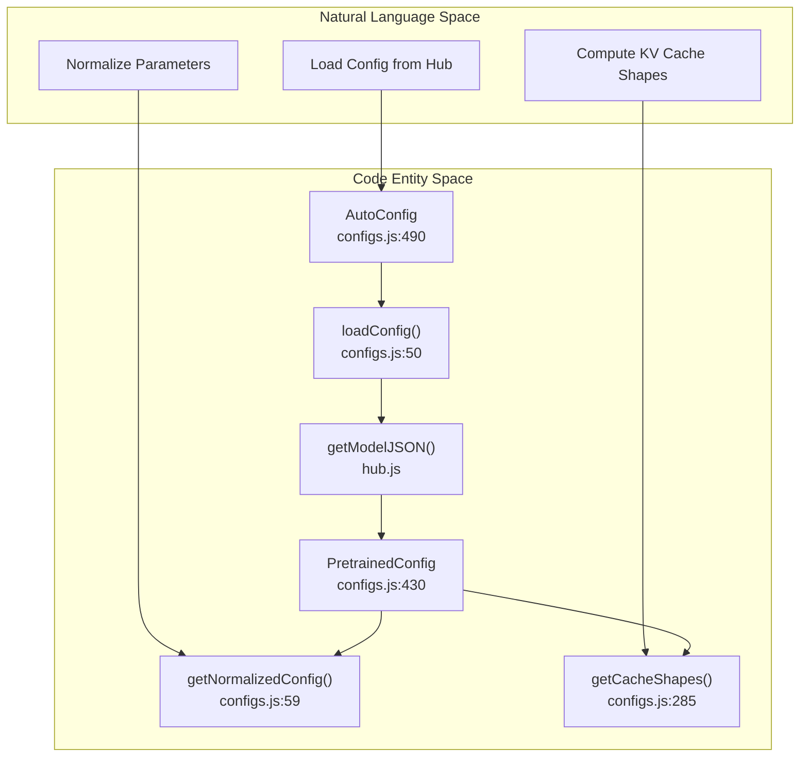
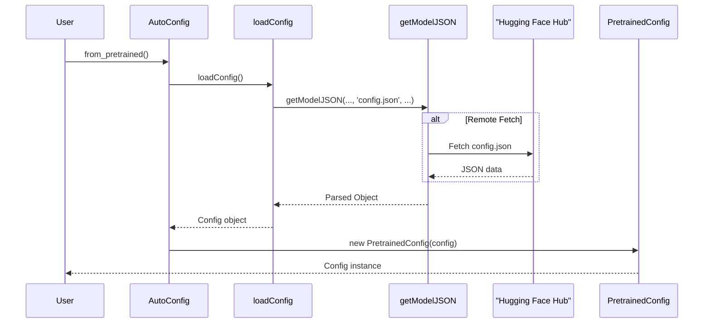

<!-- source: DeepWiki mcp.deepwiki.com · repo huggingface/transformers.js · page 4 Configuration System · fetched 2026-10-26 -->

# Configuration System

Relevant source files

The following files were used as context for generating this wiki page:

- [packages/transformers/src/configs.js](packages/transformers/src/configs.js)

The Configuration System provides a unified interface for loading, normalizing, and managing model configurations across the 50+ supported architectures in transformers.js. It handles the diversity of model architectures by extracting and normalizing architectural parameters into a consistent format, enabling the rest of the codebase to work with models uniformly.

For information about how configurations are used during model instantiation, see [Model Loading Process](#3.3). For details on model type classifications, see [Model Type System](#3.1).

---

## Overview

The configuration system serves three primary functions:

1. **Configuration Loading**: Fetching and parsing `config.json` files from the Hugging Face Hub or local paths via `loadConfig` [packages/transformers/src/configs.js:50-52]().
2. **Configuration Normalization**: Extracting architectural parameters (layer counts, attention heads, hidden sizes) into a consistent schema via `getNormalizedConfig` [packages/transformers/src/configs.js:59-278]().
3. **Cache Shape Computation**: Calculating tensor dimensions for key-value caches used during text generation via `getCacheShapes` [packages/transformers/src/configs.js:285-348]().

### Natural Language to Code Entity Mapping

**Configuration Workflow: System Names to Code Entities**

Sources: [packages/transformers/src/configs.js:50-495]()

---

## PretrainedConfig Class

The `PretrainedConfig` class is the base configuration class that all model-specific configurations inherit from. It stores the raw configuration JSON and creates a normalized version for consistent access to architectural parameters [packages/transformers/src/configs.js:430-482]().

### Class Structure

| Property | Type | Description |
|----------|------|-------------|
| `model_type` | `string\|null` | Model architecture identifier (e.g., "bert", "gpt2", "llama") |
| `is_encoder_decoder` | `boolean` | Whether the model uses encoder-decoder architecture |
| `max_position_embeddings` | `number` | Maximum sequence length the model supports |
| `normalized_config` | `Object` | Normalized architectural parameters created during construction |
| `transformers.js_config` | `TransformersJSConfig` | Custom transformers.js-specific configuration [packages/transformers/src/configs.js:498-513]() |

### Static Method: from_pretrained()

The primary way to instantiate a configuration is through the static `from_pretrained()` method [packages/transformers/src/configs.js:463-481](), which loads a configuration from a model identifier or local path.

Sources: [packages/transformers/src/configs.js:430-482]()

---

## AutoConfig

`AutoConfig` is a helper class that delegates to `PretrainedConfig.from_pretrained()`. It provides a consistent API pattern matching other Auto classes in the library (AutoModel, AutoTokenizer, etc.) [packages/transformers/src/configs.js:490-495]().

Sources: [packages/transformers/src/configs.js:490-495]()

---

## Configuration Loading Process

The configuration loading process follows a multi-step workflow to retrieve and parse configuration files from remote or local sources using `getModelJSON` [packages/transformers/src/configs.js:51]().

**Configuration Loading Sequence**

Sources: [packages/transformers/src/configs.js:45-52](), [packages/transformers/src/configs.js:463-481]()

---

## Config Normalization

Configuration normalization is the process of extracting architectural parameters from diverse model configurations into a unified schema. Different model families use different parameter names for the same concepts (e.g., `n_head` vs `num_attention_heads` vs `num_heads`), making it difficult to write generic code that works across all models.

The `getNormalizedConfig` function implements a large switch statement that maps model-type-specific parameter names to normalized keys [packages/transformers/src/configs.js:59-278]().

For details, see [Config Normalization](#4.1).

Sources: [packages/transformers/src/configs.js:59-278]()

---

## Cache Shape Computation

The cache shape computation system calculates the exact tensor dimensions needed for storing past key-values during autoregressive text generation. This is critical for performance, as it pre-allocates the correct tensor sizes before inference begins.

The `getCacheShapes` function handles special cases for models with hybrid architectures (combining attention and convolution layers), then delegates to `getKeyValueShapes` for standard attention-only models [packages/transformers/src/configs.js:285-425]().

For details, see [Cache Shape Computation](#4.2).

Sources: [packages/transformers/src/configs.js:285-425]()

---

## TransformersJS-Specific Configuration

The `transformers.js_config` field allows users to specify runtime behavior and optimizations specific to the transformers.js library. This configuration is optional and stored under the `"transformers.js_config"` key in `config.json` [packages/transformers/src/configs.js:498-513]().

### Configuration Options

| Option | Type | Description |
|--------|------|-------------|
| `kv_cache_dtype` | `DataType \| Record \| boolean` | Data type for key-value cache tensors (e.g., "float16") |
| `use_external_data_format` | `boolean \| Record<string, boolean>` | Whether to use external data format for large models (>2GB) |

Sources: [packages/transformers/src/configs.js:498-513]()

---

