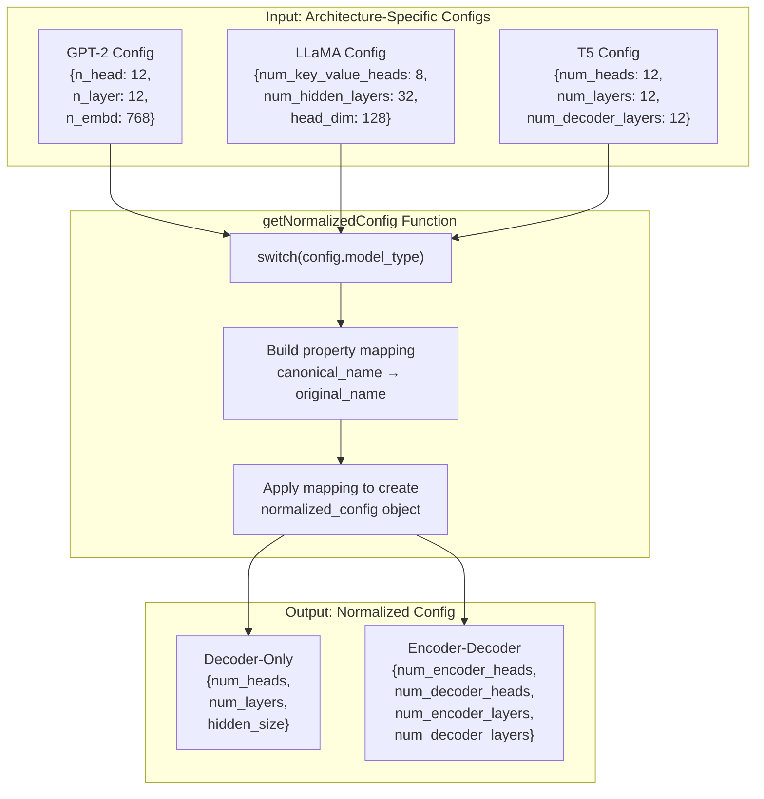
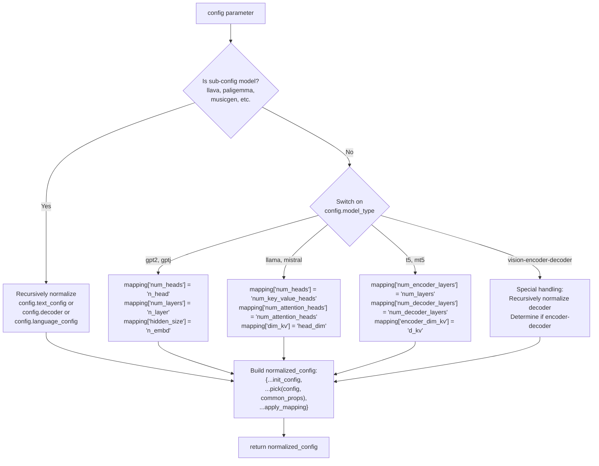
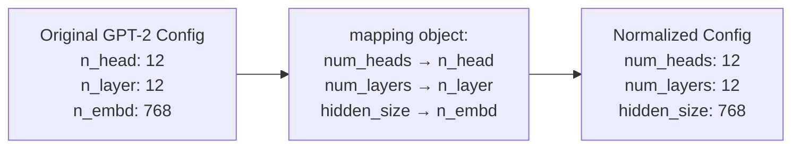
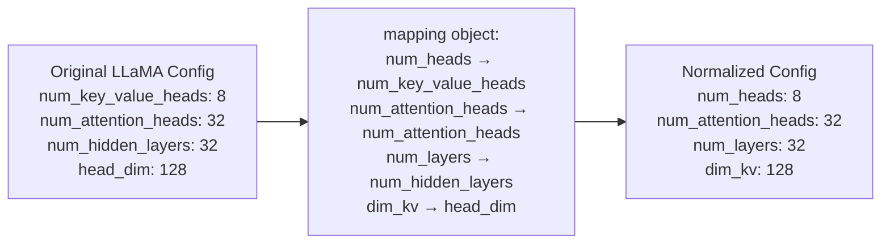
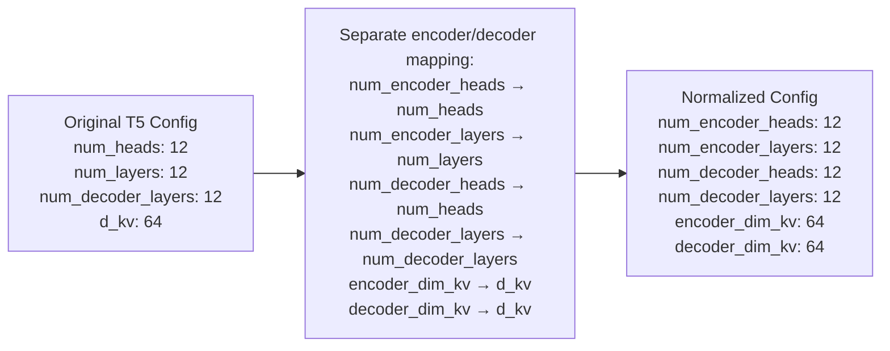
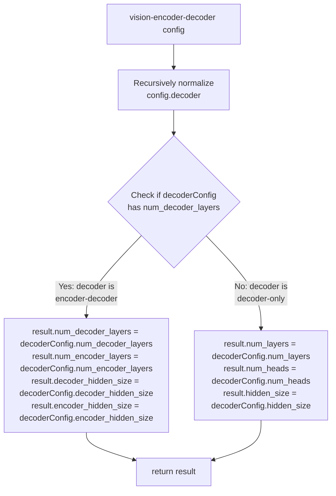
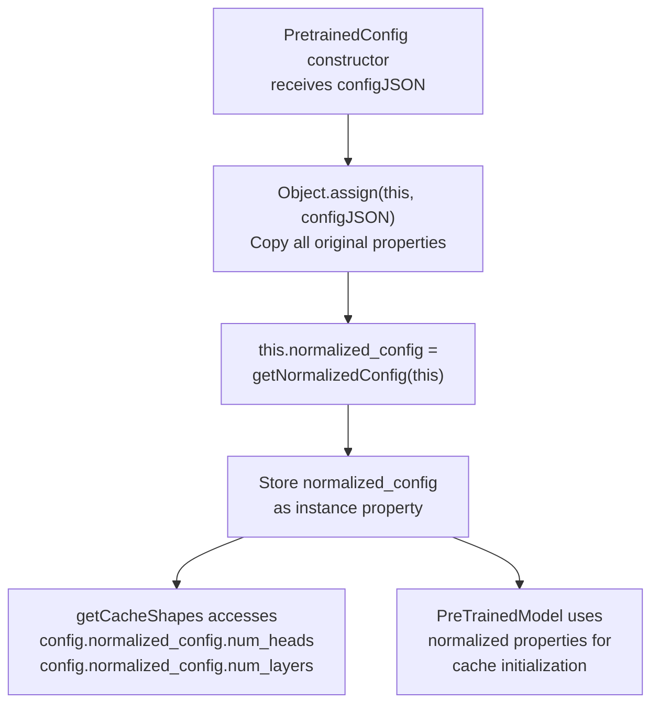
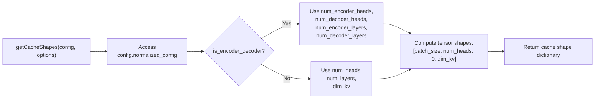
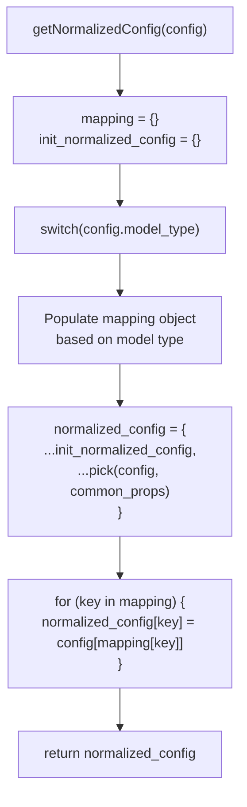

<!-- source: DeepWiki mcp.deepwiki.com · repo huggingface/transformers.js · page 4.1 Config Normalization · fetched 2026-10-26 -->

# Config Normalization

<details>
<summary>Relevant source files</summary>

The following files were used as context for generating this wiki page:

- [packages/transformers/src/configs.js](packages/transformers/src/configs.js)

</details>


## Purpose and Scope

This document explains the configuration normalization system in Transformers.js, specifically the `getNormalizedConfig` function and how it standardizes model configuration properties across diverse architectures. Config normalization ensures that different model architectures expose their parameters through a consistent interface, enabling generic code to work across 50+ model types without architecture-specific conditionals.

For information about loading and using model configurations, see [Configuration System](#4). For details on cache shape computation that depends on normalized configs, see [Cache Shape Computation](#4.2).

Sources: [packages/transformers/src/configs.js:1-27](), [packages/transformers/src/configs.js:59-278]()

## Overview

Different model architectures use different property names for similar parameters. For example, GPT-2 uses `n_head` for the number of attention heads, while BERT uses `num_attention_heads`, and LLaMA uses `num_key_value_heads`. The normalization system maps these architecture-specific names to a consistent set of canonical names.

The normalization occurs in the `PretrainedConfig` constructor, where `this.normalized_config` is assigned by calling `getNormalizedConfig(this)`. This normalized configuration is then available to all model execution code that needs to access architectural parameters in a uniform way.

Sources: [packages/transformers/src/configs.js:449-451]()

## Canonical Property Names

The normalized config exposes standardized properties grouped by model type:

### Decoder-Only Models

| Canonical Name | Description |
|----------------|-------------|
| `num_heads` | Number of key-value heads for attention |
| `num_layers` | Number of transformer layers |
| `hidden_size` | Hidden state dimensionality |
| `num_attention_heads` | Total number of query attention heads (may differ from `num_heads` for grouped query attention) |
| `dim_kv` | Dimension of each key/value head |

### Encoder-Decoder Models

| Canonical Name | Description |
|----------------|-------------|
| `num_encoder_layers` | Number of encoder layers |
| `num_encoder_heads` | Number of encoder attention heads |
| `encoder_hidden_size` | Encoder hidden state size |
| `encoder_dim_kv` | Encoder key/value head dimension |
| `num_decoder_layers` | Number of decoder layers |
| `num_decoder_heads` | Number of decoder attention heads |
| `decoder_hidden_size` | Decoder hidden state size |
| `decoder_dim_kv` | Decoder key/value head dimension |

### Common Properties

All normalized configs include:
- `model_type`: The original model type string
- `is_encoder_decoder`: Whether the model has encoder-decoder architecture
- `multi_query`: Whether the model uses multi-query attention (optional)

Sources: [packages/transformers/src/configs.js:59-278]()

## Normalization Flow



**Diagram: Configuration Normalization Flow**

Sources: [packages/transformers/src/configs.js:59-278]()

## The getNormalizedConfig Function



**Diagram: getNormalizedConfig Implementation Logic**

Sources: [packages/transformers/src/configs.js:59-278]()

## Sub-Configuration Handling

Some multimodal models have nested configurations where the text/language component defines the generation architecture. The normalization system handles these by recursively normalizing the relevant sub-config:

| Model Type | Sub-Config Property | Line Reference |
|------------|---------------------|----------------|
| `llava`, `paligemma`, `gemma3`, `florence2`, `llava_onevision`, `idefics3`, `granite_speech`, `ultravox`, `voxtral`, `voxtral_realtime`, `smolvlm`, `gemma3n`, `gemma4`, `lfm2_vl`, `chatterbox`, `lighton_ocr`, `glm_ocr`, `mistral3`, `qwen2_5_vl`, `qwen3_vl`, `qwen3_vl_moe` | `text_config` | [packages/transformers/src/configs.js:65-88]() |
| `moondream1` | `phi_config` | [packages/transformers/src/configs.js:89-92]() |
| `musicgen` | `decoder` | [packages/transformers/src/configs.js:93-96]() |
| `multi_modality` | `language_config` | [packages/transformers/src/configs.js:97-100]() |

For example, when normalizing a LLaVa config:
1. `getNormalizedConfig` detects `model_type === 'llava'`
2. Recursively calls `getNormalizedConfig(config.text_config)` at [packages/transformers/src/configs.js:87]()
3. Returns the normalized text model's configuration.

Sources: [packages/transformers/src/configs.js:65-100]()

## Model Family Examples

### GPT-2 Family (Simple Property Renaming)



**Diagram: GPT-2 Family Normalization**

The GPT-2 family (`gpt2`, `gptj`, `jais`, `codegen`, `gpt_bigcode`) uses simple property renaming at [packages/transformers/src/configs.js:103-111]():

```javascript
mapping['num_heads'] = 'n_head';
mapping['num_layers'] = 'n_layer';
mapping['hidden_size'] = 'n_embd';
```

Sources: [packages/transformers/src/configs.js:103-111]()

### LLaMA Family (Grouped Query Attention)



**Diagram: LLaMA Family Normalization (GQA Models)**

Models with grouped query attention (`llama`, `mistral`, `qwen2`, `phi3`, etc.) distinguish between query heads and key-value heads at [packages/transformers/src/configs.js:122-160]():

```javascript
mapping['num_heads'] = 'num_key_value_heads';
mapping['num_layers'] = 'num_hidden_layers';
mapping['hidden_size'] = 'hidden_size';
mapping['num_attention_heads'] = 'num_attention_heads';
mapping['dim_kv'] = 'head_dim';
```

Sources: [packages/transformers/src/configs.js:122-160]()

### T5 Family (Encoder-Decoder)



**Diagram: T5 Family Normalization (Encoder-Decoder)**

T5 models (`t5`, `mt5`, `longt5`) use the same property names (`num_heads`, `d_kv`) for both encoder and decoder in the original config. The normalization at [packages/transformers/src/configs.js:228-237]() separates them:

```javascript
mapping['num_decoder_layers'] = 'num_decoder_layers';
mapping['num_decoder_heads'] = 'num_heads';
mapping['decoder_dim_kv'] = 'd_kv';
mapping['num_encoder_layers'] = 'num_layers';
mapping['num_encoder_heads'] = 'num_heads';
mapping['encoder_dim_kv'] = 'd_kv';
```

Sources: [packages/transformers/src/configs.js:228-237]()

### BART Family (Alternative Encoder-Decoder)

BART-style models (`bart`, `mbart`, `marian`, `whisper`, `m2m_100`) use different property names but normalize to the same canonical form as T5 at [packages/transformers/src/configs.js:238-253]():

```javascript
mapping['num_decoder_layers'] = 'decoder_layers';
mapping['num_decoder_heads'] = 'decoder_attention_heads';
mapping['decoder_hidden_size'] = 'd_model';
mapping['num_encoder_layers'] = 'encoder_layers';
mapping['num_encoder_heads'] = 'encoder_attention_heads';
mapping['encoder_hidden_size'] = 'd_model';
```

Sources: [packages/transformers/src/configs.js:238-253]()

## Vision-Encoder-Decoder Special Case



**Diagram: Vision-Encoder-Decoder Adaptive Normalization**

The `vision-encoder-decoder` model type requires special handling at [packages/transformers/src/configs.js:279-300]() because its decoder can be:
1. An encoder-decoder model (e.g., BART) → produces `num_decoder_layers`, `num_encoder_layers`
2. A decoder-only model (e.g., GPT-2) → produces `num_layers`, `num_heads`

Sources: [packages/transformers/src/configs.js:279-300]()

## Integration with PretrainedConfig



**Diagram: PretrainedConfig Integration Flow**

The `PretrainedConfig` constructor integrates normalization at [packages/transformers/src/configs.js:483-485](). All original properties are preserved, and the normalized config is added as `this.normalized_config`.

Sources: [packages/transformers/src/configs.js:483-485]()

## Usage in Cache Shape Computation

The primary consumer of normalized configs is the `getCacheShapes` function, which needs to know the number of layers, heads, and dimensions to allocate past key value tensors:



**Diagram: Normalized Config Usage in Cache Computation**

At [packages/transformers/src/configs.js:388](), `getCacheShapes` accesses `config.normalized_config` to get standardized property names. For example, at lines 412-416:

```javascript
const num_heads = normalized_config.num_heads;
const num_layers = normalized_config.num_layers;
const dim_kv =
    normalized_config.dim_kv ??
    normalized_config.hidden_size / (normalized_config.num_attention_heads ?? num_heads);
```

Sources: [packages/transformers/src/configs.js:319-459](), [packages/transformers/src/configs.js:384-459]()

## Handling Missing Dimensions

The normalization system handles optional dimension values gracefully through fallback computation. In `getCacheShapes` at [packages/transformers/src/configs.js:414-416](), the code computes `dim_kv` from other parameters if not explicitly mapped:

```javascript
const dim_kv =
    normalized_config.dim_kv ??
    normalized_config.hidden_size / (normalized_config.num_attention_heads ?? num_heads);
```

Similarly for encoder-decoder models at [packages/transformers/src/configs.js:395-400]():

```javascript
const encoder_dim_kv =
    normalized_config.encoder_dim_kv ??
    normalized_config.encoder_hidden_size / normalized_config.num_encoder_heads;
const decoder_dim_kv =
    normalized_config.decoder_dim_kv ??
    normalized_config.decoder_hidden_size / normalized_config.num_decoder_heads;
```

Sources: [packages/transformers/src/configs.js:395-400](), [packages/transformers/src/configs.js:414-416]()

## Final Normalization Algorithm



**Diagram: Final Normalization Algorithm**

The normalization algorithm at [packages/transformers/src/configs.js:304-311]() constructs the final object:

1. Start with `init_normalized_config` (from sub-config recursion, if applicable).
2. Add common properties (`model_type`, `multi_query`, `is_encoder_decoder`) via `pick()`.
3. Apply the mapping to add architecture-specific canonical properties.
4. Return the complete normalized config.

Sources: [packages/transformers/src/configs.js:304-311]()

---

