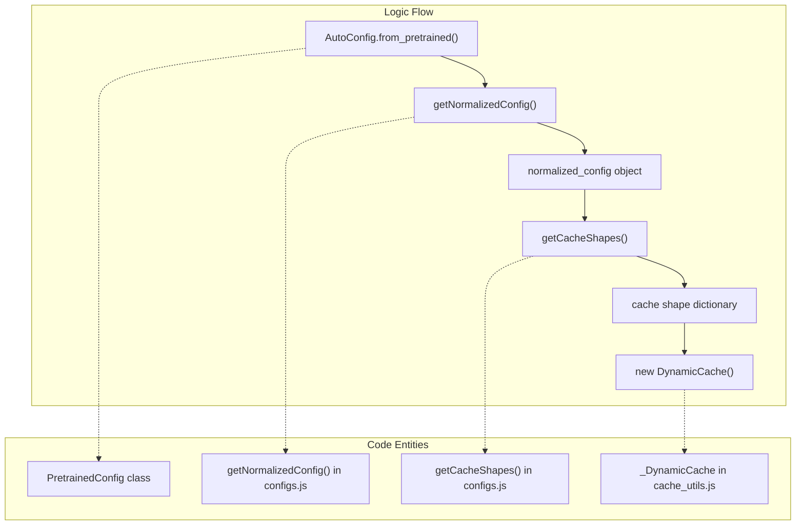
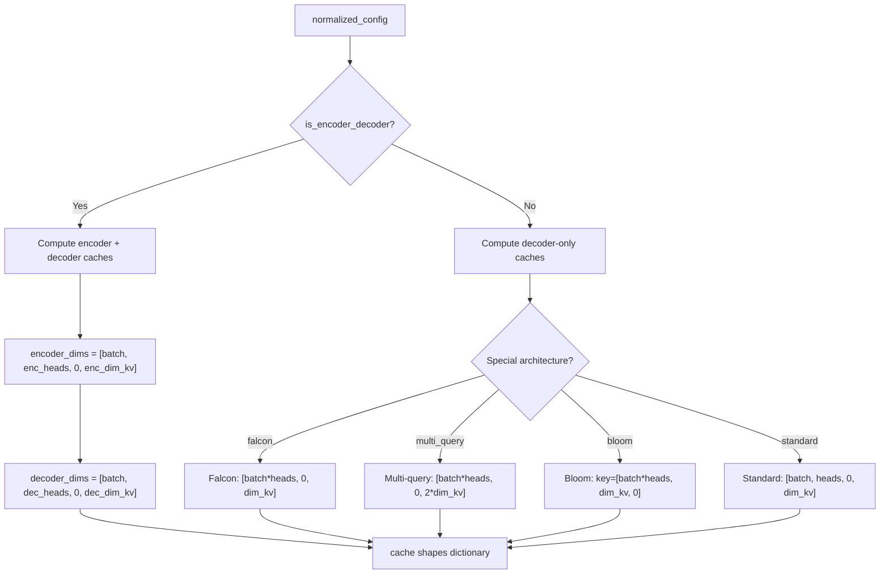
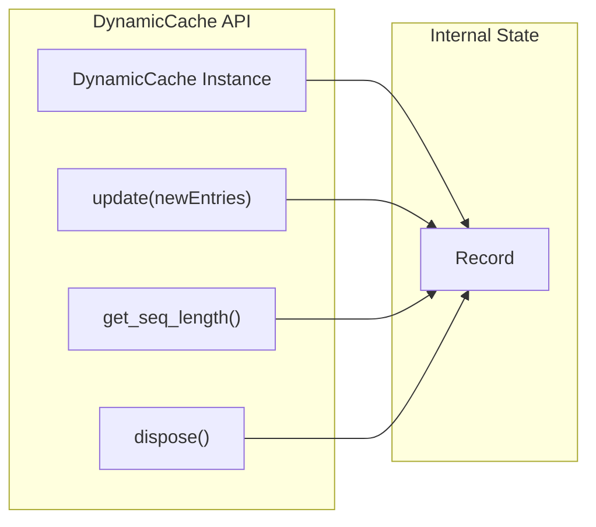

<!-- source: DeepWiki mcp.deepwiki.com · repo huggingface/transformers.js · page 4.2 Cache Shape Computation · fetched 2026-10-26 -->

# Cache Shape Computation

Relevant source files

The following files were used as context for generating this wiki page:

- [packages/transformers/src/cache_utils.js](packages/transformers/src/cache_utils.js)
- [packages/transformers/src/configs.js](packages/transformers/src/configs.js)
- [packages/transformers/tests/types/_base.ts](packages/transformers/tests/types/_base.ts)
- [packages/transformers/tests/types/cache.ts](packages/transformers/tests/types/cache.ts)

## Purpose and Scope

This document describes how Transformers.js computes cache shapes for key-value (KV) caching during model inference, particularly for autoregressive text generation. Cache shape computation determines the tensor dimensions needed to store past attention states, which vary significantly across model architectures. This is essential for memory allocation, ONNX session configuration, and efficient GPU buffer management via the `DynamicCache` class.

For information about the broader configuration system that provides the model parameters used in cache shape computation, see [Configuration System](4). For details on how normalized configurations are created from raw model configs, see [Config Normalization](4.1).

## Cache Shape Role in Model Execution

Cache shapes define the dimensions of tensors that store past key-value attention states. When a model generates text token-by-token, it needs to remember previous attention computations to avoid redundant calculations. The `DynamicCache` class acts as the primary container for these named tensors [packages/transformers/src/cache_utils.js:6-74]().

The computation must account for:
- **Model architecture type**: Encoder-decoder models require separate encoder and decoder caches, while decoder-only models need a single cache structure.
- **Attention mechanism**: Multi-query attention (MQA), grouped-query attention (GQA), and standard multi-head attention (MHA) each require different cache dimensions.
- **Hybrid Architectures**: Models like LFM2 mix attention layers with convolutional layers, requiring heterogeneous cache entries [packages/transformers/src/configs.js:277-300]().

**Sources:** [packages/transformers/src/configs.js:59-302](), [packages/transformers/src/cache_utils.js:6-23]()

## Core Functions

### getCacheShapes

The `getCacheShapes` function is the entry point for cache shape computation. It handles special cases like hybrid models and delegates to architecture-specific implementations.

**Function signature:**
`getCacheShapes(config, options)` [packages/transformers/src/configs.js:276]()

**Parameters:**
- `config`: `PretrainedConfig` object.
- `options.prefix`: String prefix for cache tensor names (default: `"past_key_values"`, can be `"present"` for outputs).
- `options.batch_size`: Batch size for cache dimensions (default: `1`).

**Returns:** A dictionary mapping cache tensor names to shape arrays.

**Sources:** [packages/transformers/src/configs.js:276-302]()

### getKeyValueShapes

The `getKeyValueShapes` function implements the standard cache shape computation. It examines the `normalized_config` to determine the dimensions based on whether the model is encoder-decoder or decoder-only [packages/transformers/src/configs.js:304-378]().

**Sources:** [packages/transformers/src/configs.js:304-378]()

## Architecture-Specific Cache Patterns

Different model architectures require different cache tensor layouts. The following table summarizes the major patterns identified in `getKeyValueShapes`:

| Architecture Type | Cache Tensor Pattern | Dimensions | Example Models |
|------------------|---------------------|------------|----------------|
| **Standard Decoder** | Separate key/value per layer | `[batch, num_heads, 0, dim_kv]` | LLaMA, Mistral, Qwen2 |
| **Encoder-Decoder** | Separate encoder/decoder caches | Encoder: `[batch, enc_heads, 0, enc_dim_kv]` Decoder: `[batch, dec_heads, 0, dec_dim_kv]` | T5, BART, Whisper |
| **Multi-Query** | Combined key-value tensor | `[batch * num_heads, 0, 2 * dim_kv]` | GPT-BigCode |
| **Falcon** | Reshaped dimensions | `[batch * num_heads, 0, dim_kv]` | Falcon |
| **Bloom** | Transposed key cache | Key: `[batch * num_heads, dim_kv, 0]` | BLOOM |
| **OpenELM** | Variable heads per layer | `[batch, num_heads[i], 0, dim_kv]` | OpenELM |

**Sources:** [packages/transformers/src/configs.js:304-378]()

## Special Case: LFM2 Hybrid Caching

The LFM2 architecture uses a hybrid caching mechanism that combines attention layers and convolutional layers. The `getCacheShapes` function contains specific logic to handle this [packages/transformers/src/configs.js:277-300]().

- **Attention Layers**: Use standard KV cache naming (`past_key_values.i.key`).
- **Convolutional Layers**: Use specific convolution cache naming (`past_conv.i` or `present_conv.i`) with dimensions `[batch, hidden_size, conv_L_cache]` [packages/transformers/src/configs.js:292-294]().

**Sources:** [packages/transformers/src/configs.js:277-300]()

## DynamicCache Management

The `DynamicCache` class [packages/transformers/src/cache_utils.js:6-83]() manages these computed shapes during inference. It provides several critical utilities:

1.  **Sequence Length Tracking**: `get_seq_length()` determines the current progress by looking at the second-to-last dimension of the stored tensors [packages/transformers/src/cache_utils.js:29-43]().
2.  **In-place Updates**: The `update()` method replaces old tensors with new ones, automatically disposing of GPU buffers if the data resides in `gpu-buffer` location [packages/transformers/src/cache_utils.js:49-58]().
3.  **Memory Cleanup**: The `dispose()` method asynchronously clears all GPU-resident tensors to prevent memory leaks [packages/transformers/src/cache_utils.js:65-73]().

**Sources:** [packages/transformers/src/cache_utils.js:6-74](), [packages/transformers/tests/types/cache.ts:10-22]()

## Configuration Mapping for Cache Computation

The `getNormalizedConfig` function maps architectural parameters from various model types to a standard set of keys used for shape computation [packages/transformers/src/configs.js:59-269]().

| Model Type | `num_heads` Mapping | `num_layers` Mapping | `hidden_size` Mapping |
|------------|---------------------|----------------------|-----------------------|
| **GPT-2** | `n_head` | `n_layer` | `n_embd` |
| **LLaMA** | `num_key_value_heads` | `num_hidden_layers` | `hidden_size` |
| **OpenELM** | `num_kv_heads` | `num_transformer_layers` | N/A |
| **MPT** | `n_heads` | `n_layers` | `d_model` |

**Sources:** [packages/transformers/src/configs.js:103-212]()

---

