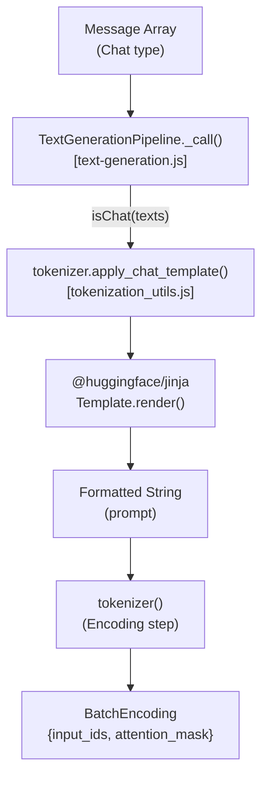
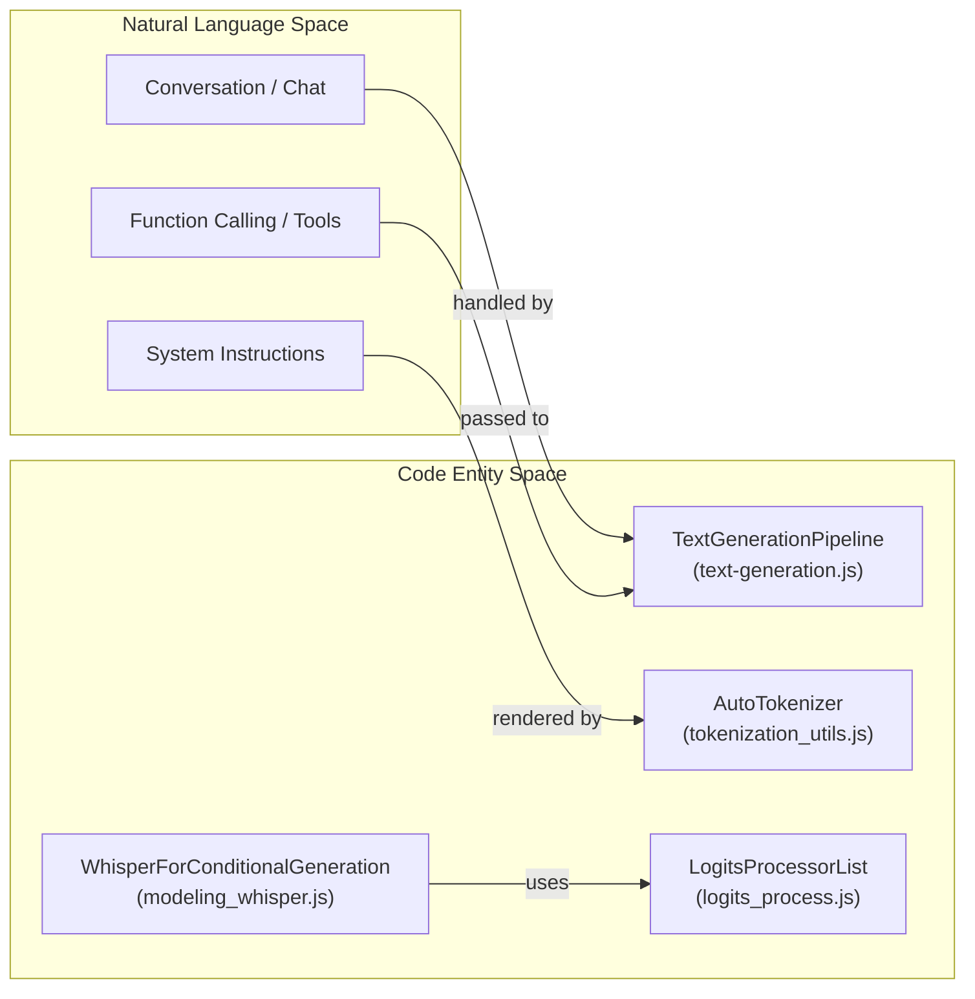

<!-- source: DeepWiki mcp.deepwiki.com · repo huggingface/transformers.js · page 5.2 Chat Templates · fetched 2026-10-26 -->

# Chat Templates

<details>
<summary>Relevant source files</summary>

The following files were used as context for generating this wiki page:

- [packages/transformers/docs/plugins/preprocess.js](packages/transformers/docs/plugins/preprocess.js)
- [packages/transformers/jest.config.mjs](packages/transformers/jest.config.mjs)
- [packages/transformers/src/models/auto/modeling_auto.js](packages/transformers/src/models/auto/modeling_auto.js)
- [packages/transformers/src/models/whisper/modeling_whisper.js](packages/transformers/src/models/whisper/modeling_whisper.js)
- [packages/transformers/src/pipelines/index.js](packages/transformers/src/pipelines/index.js)
- [packages/transformers/src/pipelines/text-generation.js](packages/transformers/src/pipelines/text-generation.js)
- [packages/transformers/src/tokenization_utils.js](packages/transformers/src/tokenization_utils.js)
- [packages/transformers/tests/init.js](packages/transformers/tests/init.js)
- [packages/transformers/tests/pipelines/test_pipelines_text_generation.js](packages/transformers/tests/pipelines/test_pipelines_text_generation.js)

</details>


This document describes the chat template system in Transformers.js, which enables proper formatting of conversational input for chat-based language models. Chat templates use Jinja templating to convert structured conversation messages into the specific text format expected by each model.

For information about the general tokenization process and how text is converted to input IDs, see [Tokenization Pipeline](#5.1). For details about tokenizer output structures, see [Tokenization Data Structures](#5.3).

## Overview

Chat templates are Jinja-based templates that transform structured conversation messages into model-specific formatted strings. Different conversational models expect different input formats (e.g., special tokens, role markers, instruction wrappers), and chat templates abstract away these differences by providing a unified message interface.

The chat template system consists of:
- A message data structure with roles and content [packages/transformers/src/tokenization_utils.js:89-92]().
- Jinja template strings stored in tokenizer configurations.
- Template rendering logic via `@huggingface/jinja` [packages/transformers/src/tokenization_utils.js:8]().
- Integration with the tokenizer's encoding pipeline and `TextGenerationPipeline` [packages/transformers/src/pipelines/text-generation.js:143-161]().

Sources: [packages/transformers/src/tokenization_utils.js:8-92](), [packages/transformers/src/pipelines/text-generation.js:143-161]()

## Message Structure

Conversational inputs are represented as arrays of message objects. Each message contains a role identifier and content, which can be a simple string or an array of content objects for multimodal models [packages/transformers/src/tokenization_utils.js:89-92]().

### Standard Message Roles

| Role | Purpose | Typical Usage |
|------|---------|---------------|
| `system` | System-level instructions or context | Model behavior guidelines, task instructions |
| `user` | User's input or query | Questions, requests, prompts from the user |
| `assistant` | Model's previous responses | Chat history, multi-turn conversations |

### Message Object Format

```javascript
/**
 * @typedef {Object} Message
 * @property {'user' | 'assistant' | 'system' | (string & {})} role The role of the message.
 * @property {string | MessageContent[]} content The content of the message.
 */
```
[packages/transformers/src/tokenization_utils.js:89-92]()

For multimodal models (like SmolVLM), the content can be an array of `MessageContent` objects containing text or image data [packages/transformers/src/tokenization_utils.js:69-86]().

Sources: [packages/transformers/src/tokenization_utils.js:69-92]()

## Template Application Process

The following diagram illustrates how structured messages are transformed into tokenized input through the chat template system, associating natural language concepts with code entities:



**Diagram 1: Chat Template Code Execution Flow**

The process follows these steps:
1. **Input Normalization**: `TextGenerationPipeline` detects if input is a `Chat` or `Chat[]` using `isChat` [packages/transformers/src/pipelines/text-generation.js:12-14, 133-140]().
2. **Template Application**: If it is a chat, the pipeline calls `this.tokenizer.apply_chat_template` [packages/transformers/src/pipelines/text-generation.js:154]().
3. **Jinja Rendering**: The tokenizer uses the Jinja engine to render the template with variables like `messages`, `add_generation_prompt`, `tools`, and `documents` [packages/transformers/src/pipelines/text-generation.js:143-157]().
4. **Tokenization**: The resulting formatted string is then tokenized to produce the final model inputs [packages/transformers/src/pipelines/text-generation.js:167]().

Sources: [packages/transformers/src/pipelines/text-generation.js:12-167](), [packages/transformers/src/tokenization_utils.js:8-14]()

## Tokenizer Integration

### Template Loading
Chat templates are typically retrieved from the `tokenizer_config.json`. The `loadTokenizer` utility fetches these configuration files during initialization [packages/transformers/src/tokenization_utils.js:28-33]().

### Template Variables
During rendering, the template has access to:
- `messages`: The array of `Message` objects.
- `add_generation_prompt`: Boolean indicating if the assistant prefix should be added [packages/transformers/src/pipelines/text-generation.js:145]().
- `tools`: A list of tools for models supporting tool use [packages/transformers/src/pipelines/text-generation.js:31, 108]().
- `documents`: A list of documents for RAG-based templates [packages/transformers/src/pipelines/text-generation.js:32, 109]().

### Special Token Handling
When applying a chat template, `add_special_tokens` is typically set to `false` because the template itself is responsible for inserting the necessary BOS, EOS, and separator tokens [packages/transformers/src/pipelines/text-generation.js:159]().

Sources: [packages/transformers/src/tokenization_utils.js:28-33](), [packages/transformers/src/pipelines/text-generation.js:31-159]()

## Usage Examples

### Chat Completion with Pipeline
The `TextGenerationPipeline` supports passing an array of messages directly.

```javascript
import { pipeline } from '@huggingface/transformers';

const generator = await pipeline('text-generation', 'onnx-community/Qwen3-0.6B-ONNX');

const messages = [
  { role: 'system', content: 'You are a helpful assistant.' },
  { role: 'user', content: 'Write me a poem about Machine Learning.' },
];

const output = await generator(messages, {
  max_new_tokens: 512,
  do_sample: false,
});
console.log(output[0].generated_text.at(-1)?.content);
```
[packages/transformers/src/pipelines/text-generation.js:65-89]()

### Tool Use in Chat Templates
Some templates support structured tool definitions passed via the `tools` parameter.

```javascript
const tools = [
  {
    name: "get_weather",
    description: "Get the weather in a city",
    parameter_definitions: {
      location: { type: "str", required: true },
    },
  },
];

await pipe(chat_input, {
  max_new_tokens: 3,
  tools,
});
```
[packages/transformers/tests/pipelines/test_pipelines_text_generation.js:96-115]()

Sources: [packages/transformers/src/pipelines/text-generation.js:65-89](), [packages/transformers/tests/pipelines/test_pipelines_text_generation.js:96-115]()

## Advanced Model Logic

### Multimodal Chat Templates
Models like `Whisper` or `Qwen3_5 VL` have specific requirements for handling non-text inputs or specialized tokens. For instance, `WhisperForConditionalGeneration` retrieves initial tokens based on language and task, which are then used to seed the generation process [packages/transformers/src/models/whisper/modeling_whisper.js:47-98]().

### Code Mapping Diagram
This diagram maps the high-level task to the specific classes and files involved in the conversational flow:



**Diagram 2: Relationship between Conversation concepts and Code Entities**

Sources: [packages/transformers/src/pipelines/text-generation.js:91-92](), [packages/transformers/src/tokenization_utils.js:7-8](), [packages/transformers/src/models/whisper/modeling_whisper.js:36-47]()

## Implementation Details

### TextGenerationPipeline Specifics
The pipeline handles the logic of whether to return the full text or just the assistant's response. For chat inputs, `return_full_text` defaults to `false` [packages/transformers/src/pipelines/text-generation.js:164](). It also ensures the tokenizer uses `padding_side = 'left'` for efficient causal generation [packages/transformers/src/pipelines/text-generation.js:166]().

### Special Token Attributes
The library tracks common special tokens like `bos_token`, `eos_token`, `unk_token`, `sep_token`, `pad_token`, `cls_token`, and `mask_token` to be injected into templates or used for post-processing [packages/transformers/src/tokenization_utils.js:57-66]().

Sources: [packages/transformers/src/pipelines/text-generation.js:164-166](), [packages/transformers/src/tokenization_utils.js:57-66]()

---

