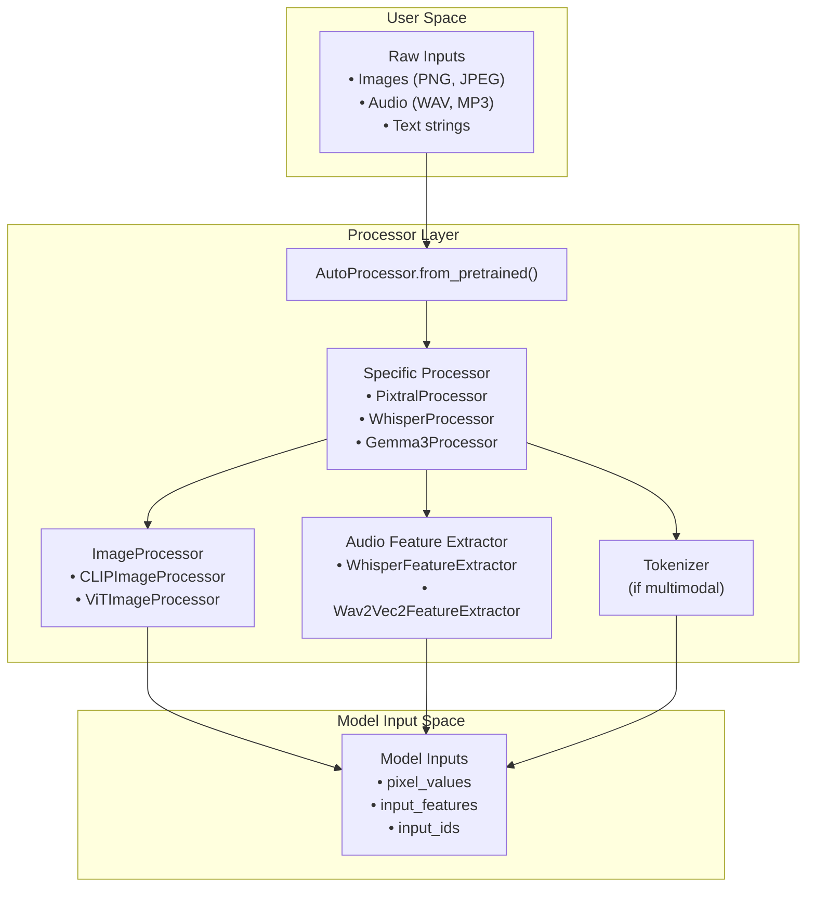
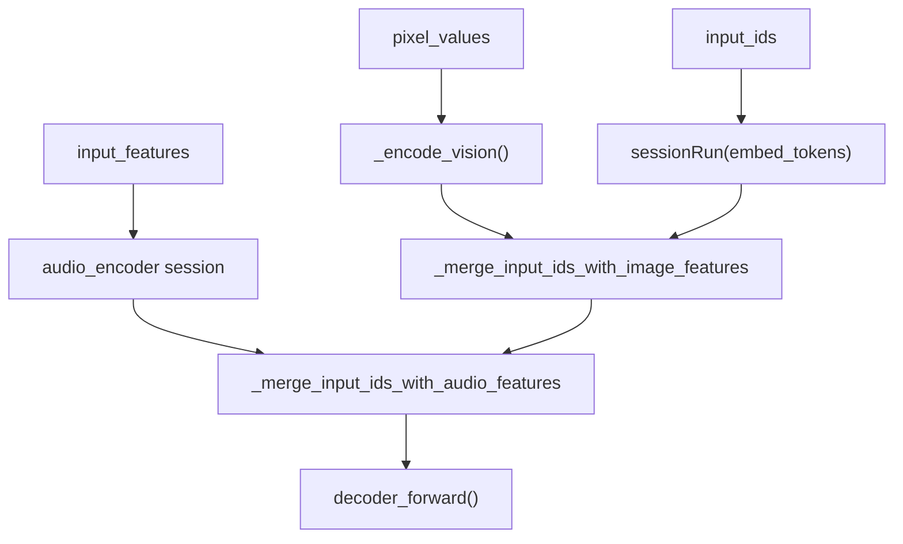

<!-- source: DeepWiki mcp.deepwiki.com · repo huggingface/transformers.js · page 6 Processors and Feature Extraction · fetched 2026-10-26 -->

# Processors and Feature Extraction

<details>
<summary>Relevant source files</summary>

The following files were used as context for generating this wiki page:

- [packages/transformers/src/models/feature_extractors.js](packages/transformers/src/models/feature_extractors.js)
- [packages/transformers/src/models/gemma3n/modeling_gemma3n.js](packages/transformers/src/models/gemma3n/modeling_gemma3n.js)
- [packages/transformers/src/models/image_processors.js](packages/transformers/src/models/image_processors.js)
- [packages/transformers/src/models/processors.js](packages/transformers/src/models/processors.js)

</details>


**Purpose**: This document covers the processor system in Transformers.js, which handles preprocessing for non-text modalities (images, audio) and multimodal inputs. Processors convert raw inputs like images or audio into numerical tensors that models can process.

**Scope**: This page focuses on the processor architecture, `AutoProcessor`, and the base `Processor` and `ImageProcessor` classes. For text preprocessing, see [Tokenizers](#5). For specific image processing details, see [Image Processing](#6.1). For audio preprocessing, see [Audio Processing](#6.2).

## Overview

Processors are responsible for converting raw inputs (images, audio files, or combinations of modalities) into the tensor format required by models. Unlike tokenizers which handle only text, processors handle:

- **Image inputs**: Resizing, normalization, pixel value extraction.
- **Audio inputs**: Waveform resampling, mel-spectrogram computation, feature extraction.
- **Multimodal inputs**: Coordinating text, image, and audio preprocessing for vision-language and speech-language models.

The processor system follows the same "Auto" pattern as tokenizers and models, with `AutoProcessor` automatically selecting the correct processor implementation based on the model configuration.

### Processing Pipeline Architecture



**Sources**: [packages/transformers/src/models/processors.js:36](), [packages/transformers/src/models/image_processors.js:52](), [packages/transformers/src/models/feature_extractors.js:21]()

## Processor Base Classes

The processor system is built on three primary base classes that define the processing interface:

### Processor Class
The `Processor` class is the base for all processors that combine multiple preprocessing components. It typically coordinates a tokenizer and an image/audio processor for multimodal models like `Llava` or `Pixtral`.

**Key characteristics**:
- Combines multiple preprocessors (e.g., tokenizer + image processor).
- Implements the `_call()` method to process inputs.
- Loads processor configuration from `preprocessor_config.json`.

**Sources**: [packages/transformers/src/models/processors.js:36]()

### ImageProcessor Class
The `ImageProcessor` class handles image transformations. It manages tasks like resizing, normalization, and pixel extraction. For legacy support, `ImageFeatureExtractor` is an alias for this class.

**Sources**: [packages/transformers/src/models/image_processors.js:52]()

### FeatureExtractor Class
The `FeatureExtractor` class is primarily used for audio-specific preprocessing, such as computing mel-spectrograms from raw audio waveforms.

**Sources**: [packages/transformers/src/models/feature_extractors.js:21]()

## AutoProcessor

`AutoProcessor` provides automatic processor instantiation. It examines the model's configuration to determine which processor implementation to load from the registry.

**Usage pattern**:
```javascript
// Automatic processor loading
const processor = await AutoProcessor.from_pretrained('model-name');

// Use with multimodal inputs (image + text)
const inputs = await processor(images, text);
```

The `AutoProcessor` class maps processor names to their implementations through a registry system defined in model-specific files.

**Sources**: [packages/transformers/src/models/processors.js:1-34]()

## Processor vs Feature Extractor

While the terms are often used interchangeably, the codebase maintains a distinction:

| Concept | Purpose | Typical Use |
|---------|---------|-------------|
| **Processor** | High-level component combining multiple preprocessors | Multimodal models (e.g., `Pixtral`, `Gemma3`) |
| **Feature Extractor** | Single-modality preprocessing component | Audio processing (e.g., `Whisper`, `Wav2Vec2`) |
| **Image Processor** | Specific type of feature extractor for images | Vision models (e.g., `ViT`, `CLIP`) |

**Sources**: [packages/transformers/src/models/image_processors.js:52](), [packages/transformers/src/models/feature_extractors.js:21]()

## Multimodal Processing Patterns

Multimodal processors coordinate different input types. A common pattern involves encoding vision and audio separately and then merging them with text embeddings.

### Data Flow in Multimodal Models
In models like `Gemma3n`, the `forward` method demonstrates how processed features are merged:



**Sources**: [packages/transformers/src/models/gemma3n/modeling_gemma3n.js:46-93]()

## Registry and Implementations

The library includes dozens of specialized implementations for various architectures. These are organized into central registries:

### Image Processors
The `image_processors.js` registry exports implementations for vision models including `ViT`, `DINOv3`, `SAM2`, and `SigLIP`.
**Sources**: [packages/transformers/src/models/image_processors.js:1-49]()

### Audio Feature Extractors
The `feature_extractors.js` registry exports implementations for audio models including `Whisper`, `Wav2Vec2`, `Moonshine`, and `SpeechT5`.
**Sources**: [packages/transformers/src/models/feature_extractors.js:1-19]()

### Multimodal Processors
The `processors.js` registry exports combined processors for vision-language and speech-language models such as `Llava`, `Idefics3`, `Qwen2_VL`, and `Gemma3`.
**Sources**: [packages/transformers/src/models/processors.js:1-34]()

## Summary

The processor system provides a unified interface for handling non-text data:

- **Image Processing** handles resizing, normalization, and the `RawImage` utility. For details, see [Image Processing](#6.1).
- **Audio Processing** handles feature extraction and spectrogram computation. For details, see [Audio Processing](#6.2).
- **Processor Patterns** coordinate multiple modalities for advanced models. For details, see [Processor Patterns](#6.3).

---

