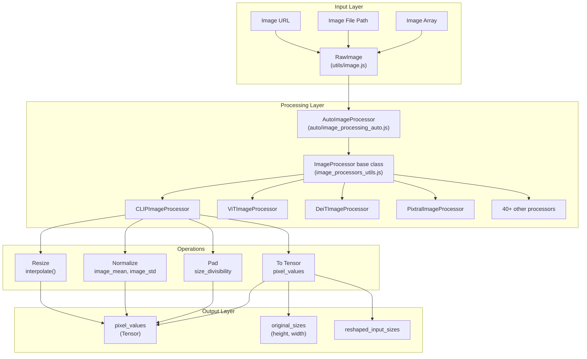
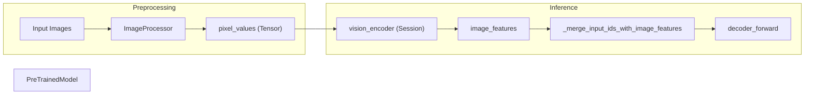

<!-- source: DeepWiki mcp.deepwiki.com · repo huggingface/transformers.js · page 6.1 Image Processing · fetched 2026-10-26 -->

# Image Processing

Relevant source files

The following files were used as context for generating this wiki page:

- [packages/transformers/scripts/build/plugins/ignoreModulesPlugin.mjs](packages/transformers/scripts/build/plugins/ignoreModulesPlugin.mjs)
- [packages/transformers/src/backends/onnx.js](packages/transformers/src/backends/onnx.js)
- [packages/transformers/src/backends/utils/cacheWasm.js](packages/transformers/src/backends/utils/cacheWasm.js)
- [packages/transformers/src/image_processors_utils.js](packages/transformers/src/image_processors_utils.js)
- [packages/transformers/src/models/feature_extractors.js](packages/transformers/src/models/feature_extractors.js)
- [packages/transformers/src/models/gemma3n/modeling_gemma3n.js](packages/transformers/src/models/gemma3n/modeling_gemma3n.js)
- [packages/transformers/src/models/image_processors.js](packages/transformers/src/models/image_processors.js)
- [packages/transformers/src/models/session.js](packages/transformers/src/models/session.js)
- [packages/transformers/src/utils/hub/utils.js](packages/transformers/src/utils/hub/utils.js)
- [packages/transformers/src/utils/image.js](packages/transformers/src/utils/image.js)
- [packages/transformers/tests/utils/custom_cache.test.js](packages/transformers/tests/utils/custom_cache.test.js)

## Purpose and Scope

This document covers the image preprocessing system in Transformers.js, which transforms raw images into tensors suitable for vision model input. Image processing includes operations like resizing, normalization, pixel value extraction, and format conversions. For information about combining image inputs with text in multimodal scenarios, see [Processor Patterns](#6.3). For audio feature extraction, see [Audio Processing](#6.2).

## Overview

Image processing in Transformers.js follows a configuration-driven architecture where each image processor is tailored to specific model requirements. The system handles various input formats (URLs, file paths, `RawImage` objects) and produces standardized tensor outputs with consistent shapes and value ranges.

**Sources:** [packages/transformers/src/models/image_processors.js:1-52](), [packages/transformers/src/image_processors_utils.js:10-21]()

## Core Classes

### RawImage Utility

The `RawImage` class is the primary internal representation for image data before it is converted into a `Tensor`. It supports loading from various sources and handles environment-specific logic (Browser vs. Node.js).

| Feature | Browser Implementation | Node.js Implementation |
|---------|------------------------|------------------------|
| **Loading** | `createImageBitmap` | `sharp` |
| **Canvas** | `OffscreenCanvas` | Not supported |
| **Data Type** | `Uint8ClampedArray` | `Uint8ClampedArray` |

**Key Methods:**
- `RawImage.read(input)`: Static helper to read from URL, Blob, Canvas, or path [packages/transformers/src/utils/image.js:113-128]().
- `RawImage.fromURL(url)`: Fetches and processes an image from a remote or local URL [packages/transformers/src/utils/image.js:152-159]().
- `RawImage.fromTensor(tensor)`: Converts a `Tensor` back into a `RawImage` for visualization or saving [packages/transformers/src/utils/image.js:189-218]().

**Sources:** [packages/transformers/src/utils/image.js:23-52](), [packages/transformers/src/utils/image.js:74-87]()

### ImageProcessor Base Class

The `ImageProcessor` class (aliased as `ImageFeatureExtractor` for legacy support) provides the foundation for all vision preprocessing. It is defined in `image_processors_utils.js` [packages/transformers/src/image_processors_utils.js:52]().

The base class provides:
- Configuration loading from `preprocessor_config.json` via `getModelJSON` [packages/transformers/src/image_processors_utils.js:6-7]().
- Standardized `ImageProcessorResult` structure containing `pixel_values`, `original_sizes`, and `reshaped_input_sizes` [packages/transformers/src/image_processors_utils.js:17-21]().
- Utility functions like `interpolate` for resizing and `stack` for batching [packages/transformers/src/image_processors_utils.js:2]().

**Sources:** [packages/transformers/src/models/image_processors.js:51-52](), [packages/transformers/src/image_processors_utils.js:1-21]()

## Image Preprocessing Operations

### Resizing and Interpolation

Resizing adapts input images to dimensions expected by the model. The library uses the `interpolate` utility to perform these operations [packages/transformers/src/image_processors_utils.js:2]().

Specific processors like `PixtralImageProcessor` implement custom logic for patch-based models:
1. **Longest Edge Scaling**: Resizes so the longest dimension matches `longest_edge` [packages/transformers/src/models/pixtral/image_processing_pixtral.js:7-13]().
2. **Patch Alignment**: Ensures dimensions are multiples of `patch_size * spatial_merge_size` [packages/transformers/src/models/pixtral/image_processing_pixtral.js:16-20]().

**Sources:** [packages/transformers/src/models/pixtral/image_processing_pixtral.js:4-34]()

### Normalization and Rescaling

Normalization standardizes pixel values to match training distributions.
- **Rescaling**: Typically multiplies raw pixel values (0-255) by a `rescale_factor` (usually 1/255) to bring them to a 0-1 range.
- **Normalization**: Subtracts `image_mean` and divides by `image_std` per channel.

**Sources:** [packages/transformers/src/image_processors_utils.js:3-4]()

### Size Divisibility

Some architectures (like SegFormer or ConvNeXt) require input dimensions to be divisible by a specific factor (e.g., 32) to satisfy downsampling requirements. The `enforce_size_divisibility` helper handles this calculation [packages/transformers/src/image_processors_utils.js:53-55]().

## Image Processor Registry

Transformers.js includes 40+ image processor implementations. The `models/image_processors.js` file serves as the central export point for these classes.

| Processor Category | Examples | File Reference |
|-------------------|----------|----------------|
| **Vision Transformers** | `ViTImageProcessor`, `DeiTImageProcessor` | [packages/transformers/src/models/image_processors.js:46,7]() |
| **Multimodal** | `PixtralImageProcessor`, `Gemma3ImageProcessor` | [packages/transformers/src/models/image_processors.js:34,13]() |
| **Detection** | `DetrImageProcessor`, `YolosImageProcessor` | [packages/transformers/src/models/image_processors.js:8,49]() |
| **Segmentation** | `SegformerImageProcessor`, `Mask2FormerImageProcessor` | [packages/transformers/src/models/image_processors.js:42,23]() |
| **Specialized** | `SAMImageProcessor` (Segment Anything), `DonutImageProcessor` | [packages/transformers/src/models/image_processors.js:38,10]() |

**Sources:** [packages/transformers/src/models/image_processors.js:1-49]()

## Post-Processing Utilities

Image processors also provide utilities to convert model outputs back into human-readable formats or coordinate spaces.

### Object Detection Post-Processing
The `post_process_object_detection` function transforms raw model logits and bounding box predictions into scores, class labels, and pixel-coordinate boxes [packages/transformers/src/image_processors_utils.js:79-147]().
- **Format Conversion**: Uses `center_to_corners_format` to convert `[cx, cy, w, h]` to `[x0, y0, x1, y1]` [packages/transformers/src/image_processors_utils.js:65-67]().
- **Scaling**: Maps normalized boxes back to `target_sizes` [packages/transformers/src/image_processors_utils.js:135-137]().

### Semantic Segmentation Post-Processing
The `post_process_semantic_segmentation` function processes class logits into segmentation maps [packages/transformers/src/image_processors_utils.js:156-184]().
- **Interpolation**: Resizes masks to the original `target_sizes` using bilinear interpolation [packages/transformers/src/image_processors_utils.js:171-174]().
- **Argmax**: Computes the most likely class per pixel to generate the final segmentation map.

**Sources:** [packages/transformers/src/image_processors_utils.js:59-184]()

## Integration with Modeling

Image processors produce `pixel_values` which are passed directly to the model's `forward` pass. In multimodal models like `Gemma3nForConditionalGeneration`, these values are used to generate `image_features` via a `vision_encoder` before being merged with text embeddings [packages/transformers/src/models/gemma3n/modeling_gemma3n.js:52-60]().

**Sources:** [packages/transformers/src/models/gemma3n/modeling_gemma3n.js:23-60](), [packages/transformers/src/models/gemma3n/modeling_gemma3n.js:95-108]()

---

