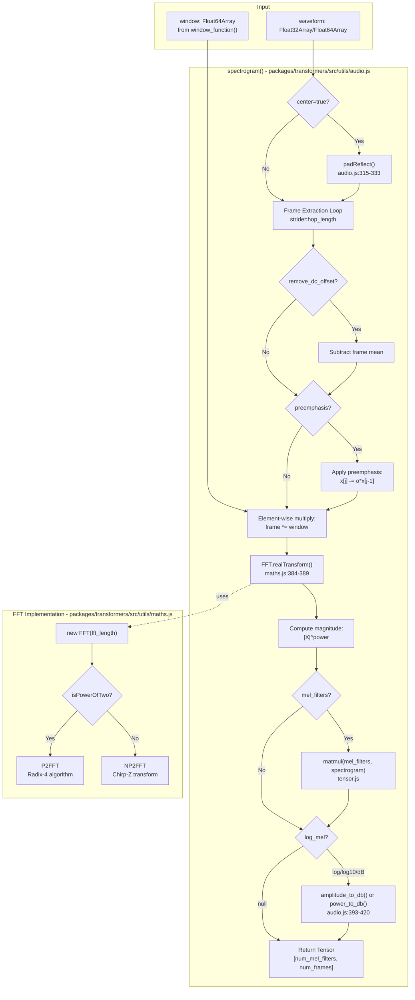
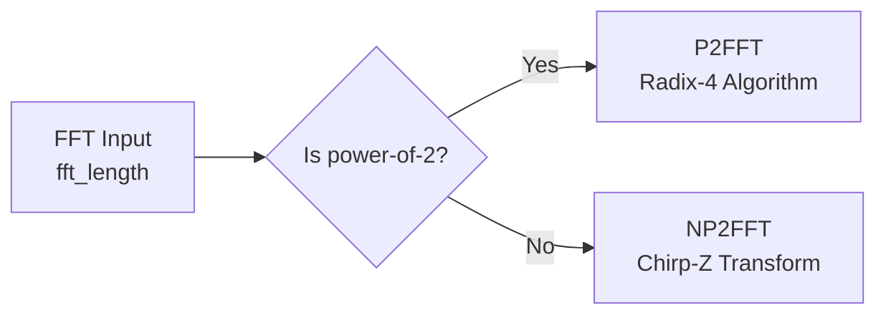
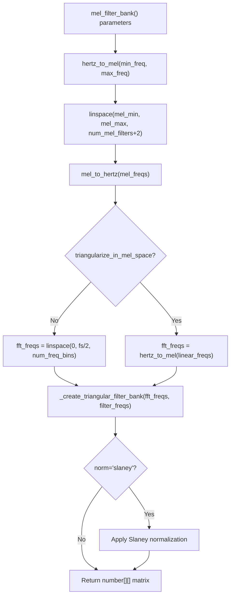
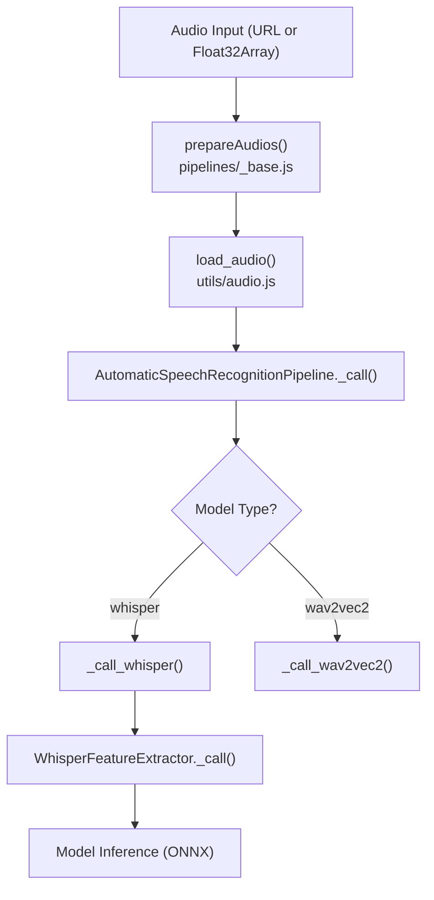

<!-- source: DeepWiki mcp.deepwiki.com · repo huggingface/transformers.js · page 6.2 Audio Processing · fetched 2026-10-26 -->

# Audio Processing

<details>
<summary>Relevant source files</summary>

The following files were used as context for generating this wiki page:

- [packages/transformers/src/models/whisper/feature_extraction_whisper.js](packages/transformers/src/models/whisper/feature_extraction_whisper.js)
- [packages/transformers/src/pipelines/automatic-speech-recognition.js](packages/transformers/src/pipelines/automatic-speech-recognition.js)
- [packages/transformers/src/utils/audio.js](packages/transformers/src/utils/audio.js)

</details>


This document covers the audio processing subsystem of transformers.js, which prepares audio inputs for machine learning models. It describes the signal processing pipeline from raw audio to model-ready features, including time-frequency transforms, mel-scale conversion, and feature extraction.

---

## Audio Input Handling

Transformers.js provides utilities for loading and representing audio data across different environments.

### Reading Audio Files

The `load_audio` function (aliased as `read_audio`) loads audio from URLs or paths and decodes it using the Web Audio API (browser) or equivalent functionality (Node.js):

[packages/transformers/src/utils/audio.js:23-75]()

Key behaviors:
- Uses `AudioContext.decodeAudioData` for decoding [packages/transformers/src/utils/audio.js:38-38]().
- Resamples to the specified `sampling_rate` [packages/transformers/src/utils/audio.js:34-34]().
- Downmixes stereo to mono using FFmpeg-compatible √2 scaling factor (`Math.sqrt(2)`) to prevent clipping [packages/transformers/src/utils/audio.js:60-68]().
- Returns a `Float32Array` of mono audio samples [packages/transformers/src/utils/audio.js:74-74]().
- Throws an error in environments without `AudioContext` (like Node.js without polyfills), directing users to pass audio data directly [packages/transformers/src/utils/audio.js:24-31]().

**Sources:** [packages/transformers/src/utils/audio.js:23-80]()

---

## Signal Processing Pipeline

Audio processing converts time-domain waveforms into frequency-domain features through a multi-stage pipeline implemented primarily in the `spectrogram` function.

### Core Pipeline: spectrogram() Function



**Key Parameters:**
- `frame_length`: FFT frame size in samples.
- `hop_length`: Stride between successive frames.
- `power`: 1.0 for amplitude, 2.0 for power, null for complex.
- `center`: Whether to pad waveform for centered frames [packages/transformers/src/utils/audio.js:529-541]().
- `mel_filters`: Matrix for mel-scale projection (from `mel_filter_bank()`).
- `log_mel`: Conversion mode: `"log"`, `"log10"`, or `"dB"`.

**Sources:** [packages/transformers/src/utils/audio.js:476-690]()

---

## Window Functions

Window functions reduce spectral leakage in the FFT by tapering frame boundaries. The `window_function()` at [packages/transformers/src/utils/audio.js:703-738]() creates windowing arrays for spectral analysis.

### Supported Windows

| Window Type | Implementation | Use Case |
|------------|----------------|----------|
| `boxcar` | `new Float64Array(length).fill(1.0)` | No windowing (rectangular) |
| `hann` / `hann_window` | `hanning(length)` | General-purpose, good frequency resolution |
| `hamming` | `hamming(length)` | Similar to Hann, slightly better sidelobe rejection |
| `povey` | `hanning(length).map(x => x^0.85)` | Kaldi-compatible, used in speech recognition |

Both `hanning()` and `hamming()` use the `generalized_cosine_window` formula at [packages/transformers/src/utils/audio.js:89-105]():
```
window[i] = a_0 - a_1 * cos(2πi / (M-1))
```
where `a_0 = 0.5` for Hann [packages/transformers/src/utils/audio.js:115-115]() and `a_0 = 0.54` for Hamming [packages/transformers/src/utils/audio.js:127-127]().

**Sources:** [packages/transformers/src/utils/audio.js:89-128](), [packages/transformers/src/utils/audio.js:703-738]()

---

## Fast Fourier Transform (FFT)

The FFT implementation automatically selects between two algorithms based on input length.

### Algorithm Selection



**P2FFT (Power-of-Two):** Implements Radix-4 FFT for lengths that are powers of two. It uses bit-reversal permutation and pre-computed twiddle factors.

**NP2FFT (Non-Power-of-Two):** Implements the Chirp-Z transform for arbitrary FFT lengths. It converts the non-power-of-two FFT into a convolution that can be solved using power-of-two FFTs.

**Sources:** [packages/transformers/src/utils/maths.js:279-909]()

---

## Mel-Scale Processing

Mel-scale processing converts linear frequency representations to the mel scale, which approximates human auditory perception.

### Frequency-to-Mel Conversions

Three mel-scale mappings are supported via `HERTZ_TO_MEL_MAPPING` [packages/transformers/src/utils/audio.js:129-134]():

| Scale | Forward Mapping | Usage |
|-------|----------------|--------|
| **HTK** | `2595 * log10(1 + f/700)` | HTK toolkit compatibility |
| **Kaldi** | `1127 * log(1 + f/700)` | Kaldi speech toolkit |
| **Slaney** | Piecewise linear/log | Librosa/torchaudio default |

**Sources:** [packages/transformers/src/utils/audio.js:129-178]()

### Mel Filter Bank Construction

The `mel_filter_bank()` function [packages/transformers/src/utils/audio.js:250-304]() creates triangular filters for mel-scale projection.



**Sources:** [packages/transformers/src/utils/audio.js:189-304]()

---

## Feature Extractors

Feature extractors orchestrate the signal processing pipeline to produce model-ready inputs. They inherit from the `FeatureExtractor` base class [packages/transformers/src/feature_extraction_utils.js:6]().

### Example: WhisperFeatureExtractor

The `WhisperFeatureExtractor` [packages/transformers/src/models/whisper/feature_extraction_whisper.js:6]() is used for Whisper models.

1.  **Initialization**: It computes or loads `mel_filters` and initializes a Hann window [packages/transformers/src/models/whisper/feature_extraction_whisper.js:11-21]().
2.  **Feature Extraction**: The `_extract_fbank_features` method calls `spectrogram` with `power: 2.0` and `log_mel: 'log10_max_norm'` [packages/transformers/src/models/whisper/feature_extraction_whisper.js:30-46]().
3.  **Padding/Clipping**: Waveforms are padded or sliced to a fixed length (e.g., 30 seconds) before processing [packages/transformers/src/models/whisper/feature_extraction_whisper.js:58-72]().

**Sources:** [packages/transformers/src/models/whisper/feature_extraction_whisper.js:1-80]()

---

## Integration with Pipelines

Audio feature extractors are typically used within the `AutomaticSpeechRecognitionPipeline`.

### ASR Pipeline Execution

The `AutomaticSpeechRecognitionPipeline` handles audio input and delegates to model-specific logic (e.g., Whisper or Wav2Vec2) [packages/transformers/src/pipelines/automatic-speech-recognition.js:137-152]().



**Key Features:**
- **Chunking**: Supports long audio by splitting into chunks with overlaps (`chunk_length_s` and `stride_length_s`) [packages/transformers/src/pipelines/automatic-speech-recognition.js:27-28]().
- **Timestamps**: Can return word-level or segment-level timestamps [packages/transformers/src/pipelines/automatic-speech-recognition.js:26]().
- **Task Selection**: Supports both `transcribe` and `translate` tasks for models like Whisper [packages/transformers/src/pipelines/automatic-speech-recognition.js:31]().

**Sources:** [packages/transformers/src/pipelines/automatic-speech-recognition.js:1-152](), [packages/transformers/src/models/whisper/feature_extraction_whisper.js:1-80]()

---

