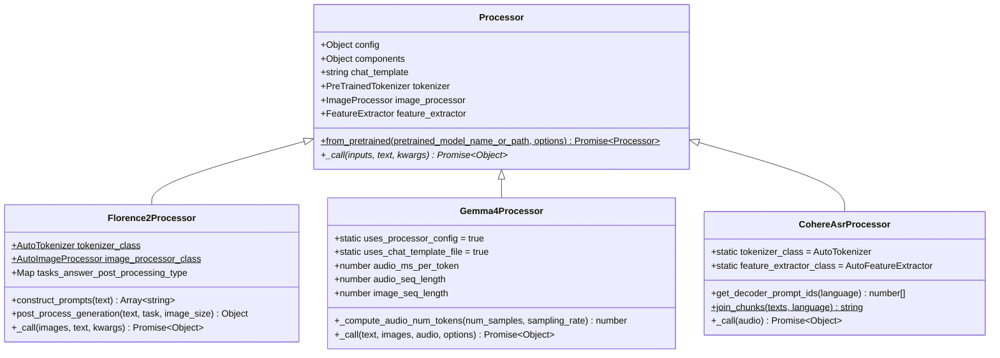
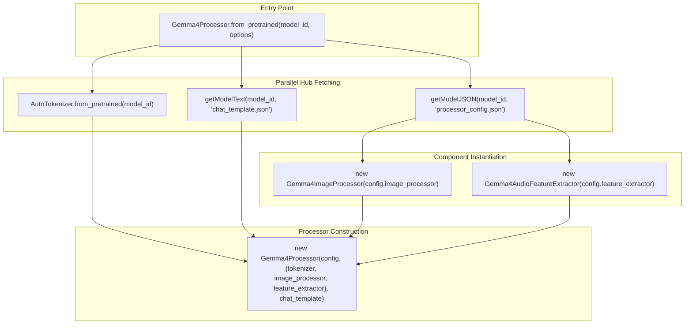
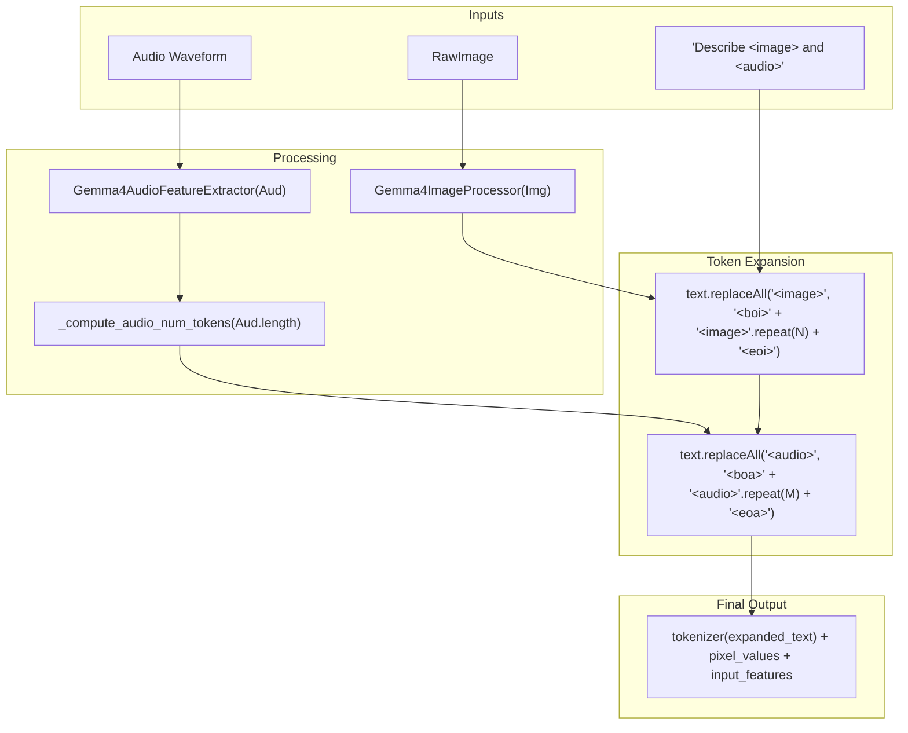

<!-- source: DeepWiki mcp.deepwiki.com · repo huggingface/transformers.js · page 6.3 Processor Patterns · fetched 2026-10-26 -->

# Processor Patterns

Relevant source files

The following files were used as context for generating this wiki page:

- [packages/transformers/src/models/cohere_asr/feature_extraction_cohere_asr.js](packages/transformers/src/models/cohere_asr/feature_extraction_cohere_asr.js)
- [packages/transformers/src/models/cohere_asr/modeling_cohere_asr.js](packages/transformers/src/models/cohere_asr/modeling_cohere_asr.js)
- [packages/transformers/src/models/cohere_asr/processing_cohere_asr.js](packages/transformers/src/models/cohere_asr/processing_cohere_asr.js)
- [packages/transformers/src/models/cohere_asr/tokenization_cohere_asr.js](packages/transformers/src/models/cohere_asr/tokenization_cohere_asr.js)
- [packages/transformers/src/models/gemma3/image_processing_gemma3.js](packages/transformers/src/models/gemma3/image_processing_gemma3.js)
- [packages/transformers/src/models/gemma3/modeling_gemma3.js](packages/transformers/src/models/gemma3/modeling_gemma3.js)
- [packages/transformers/src/models/gemma3/processing_gemma3.js](packages/transformers/src/models/gemma3/processing_gemma3.js)
- [packages/transformers/src/models/gemma4/feature_extraction_gemma4.js](packages/transformers/src/models/gemma4/feature_extraction_gemma4.js)
- [packages/transformers/src/models/gemma4/image_processing_gemma4.js](packages/transformers/src/models/gemma4/image_processing_gemma4.js)
- [packages/transformers/src/models/gemma4/modeling_gemma4.js](packages/transformers/src/models/gemma4/modeling_gemma4.js)
- [packages/transformers/src/models/gemma4/processing_gemma4.js](packages/transformers/src/models/gemma4/processing_gemma4.js)
- [packages/transformers/src/models/processors.js](packages/transformers/src/models/processors.js)
- [packages/transformers/tests/models/gemma3/test_modeling_gemma3.js](packages/transformers/tests/models/gemma3/test_modeling_gemma3.js)

Processors in transformers.js orchestrate multiple preprocessing components (tokenizers, image processors, feature extractors) to prepare inputs for multimodal models. This page documents the common patterns used when implementing processors, including component composition, the standard `_call` interface, and task-specific extensions. For details on underlying operations, see [Image Processing](#6.1) and [Audio Processing](#6.2). For the base classes, see [Processors and Feature Extraction](#6).

## Core Concepts

Processors implement several key patterns:

- **Component Composition**: Processors aggregate multiple preprocessing components (tokenizer, image_processor, feature_extractor) that are automatically loaded via static class properties or manual instantiation.
- **Standard Interface**: The `_call` method provides a unified preprocessing entry point that coordinates component execution.
- **Task-Specific Extensions**: Processors add domain logic like prompt construction (`Florence2Processor`), token replacement (`Gemma4Processor`), and output post-processing.
- **Configuration Management**: Processors load and merge configuration from multiple sources (processor_config.json, component configs).

## Processor Class Hierarchy

Task-specific processors extend the base `Processor` class from [packages/transformers/src/processing_utils.js:36]() and declare component dependencies via static properties. The base class provides the `from_pretrained` factory method that automatically loads components based on these declarations.

**Diagram: Processor Class Hierarchy with Key Methods**

**Sources**: [packages/transformers/src/models/processors.js:36](), [packages/transformers/src/models/florence2/processing_florence2.js:5-132](), [packages/transformers/src/models/gemma4/processing_gemma4.js:8-108](), [packages/transformers/src/models/cohere_asr/processing_cohere_asr.js:7-55]()

## Component Composition and Initialization

The `Processor.from_pretrained` static method coordinates component loading. While many processors use the base implementation, some like `Gemma4Processor` override it to manually manage multimodal components like `Gemma4ImageProcessor` and `Gemma4AudioFeatureExtractor` [packages/transformers/src/models/gemma4/processing_gemma4.js:28-44]().

**Diagram: Gemma4Processor Initialization Flow**

**Sources**: [packages/transformers/src/models/gemma4/processing_gemma4.js:28-44](), [packages/transformers/src/models/gemma4/image_processing_gemma4.js:100-178](), [packages/transformers/src/models/gemma4/feature_extraction_gemma4.js:6-74]()

## Standard Interface: The `_call` Method

The `_call` method is the primary preprocessing interface. It coordinates between the different modalities (text, image, audio) and prepares them for the model's `forward` method.

### Multimodal Token Replacement (Gemma 4 Pattern)

A common pattern in recent vision-language models is replacing a single placeholder token (like `<image>` or `<audio>`) with a sequence of tokens representing the encoded features. `Gemma4Processor` implements this by calculating the number of "soft tokens" for both images and audio [packages/transformers/src/models/gemma4/processing_gemma4.js:68-107]().

**Diagram: Gemma4 Multimodal Token Expansion**

**Sources**: [packages/transformers/src/models/gemma4/processing_gemma4.js:68-107](), [packages/transformers/src/models/gemma4/processing_gemma4.js:54-66]()

### Audio-Specific Patterns (Cohere ASR)

Processors for ASR models like `CohereAsrProcessor` often include logic for handling long audio by splitting it into manageable chunks based on energy levels to find quiet points for splitting [packages/transformers/src/models/cohere_asr/feature_extraction_cohere_asr.js:27-66]().

**Key Cohere ASR Patterns:**
1.  **Dithering**: Applying deterministic Gaussian noise to the waveform to improve robustness [packages/transformers/src/models/cohere_asr/feature_extraction_cohere_asr.js:11-20]().
2.  **Energy-based Splitting**: The `_find_split_point_energy` function identifies the quietest point in an audio segment to perform a clean split [packages/transformers/src/models/cohere_asr/feature_extraction_cohere_asr.js:76-101]().
3.  **Decoder Prompts**: The `get_decoder_prompt_ids` method constructs the initial sequence of special tokens (language, task, timestamps) for the decoder [packages/transformers/src/models/cohere_asr/processing_cohere_asr.js:17-31]().

**Sources**: [packages/transformers/src/models/cohere_asr/feature_extraction_cohere_asr.js:11-101](), [packages/transformers/src/models/cohere_asr/processing_cohere_asr.js:17-31]()

## Task-Specific Extension Patterns

### Image Patchification (Gemma 4)

For models like Gemma 4, the image processor doesn't just resize; it converts images into patches and generates spatial position IDs. The `patchify` function replicates the Python layout by reading HWC data directly into a flattened patch format `(num_patches, patch_dim)` [packages/transformers/src/models/gemma4/image_processing_gemma4.js:60-98]().

**Sources**: [packages/transformers/src/models/gemma4/image_processing_gemma4.js:60-98]()

### Feature-Aware Masking (Gemma 4 Audio)

`Gemma4AudioFeatureExtractor` overrides the base `_call` to implement "frame-aware masking". It creates a boolean `input_features_mask` where a frame is marked as valid only if all samples within that frame's temporal window were part of the original audio (not padding) [packages/transformers/src/models/gemma4/feature_extraction_gemma4.js:41-73]().

**Sources**: [packages/transformers/src/models/gemma4/feature_extraction_gemma4.js:41-73]()

## Processor Registry and Auto Classes

The library provides `AutoProcessor` as the primary entry point for users to load the correct processor implementation for a given model.

| Class | Source | Purpose |
|---|---|---|
| `AutoProcessor` | [packages/transformers/src/models/auto/processing_auto.js]() | Dynamic loading of model-specific processors |
| `AutoTokenizer` | [packages/transformers/src/models/auto/tokenization_auto.js]() | Loading tokenizers |
| `AutoImageProcessor` | [packages/transformers/src/models/auto/image_processing_auto.js]() | Loading image processors |
| `AutoFeatureExtractor` | [packages/transformers/src/models/auto/feature_extraction_auto.js]() | Loading audio/feature extractors |

**Sources**: [packages/transformers/src/models/gemma4/processing_gemma4.js:31](), [packages/transformers/src/models/cohere_asr/processing_cohere_asr.js:1-3](), [packages/transformers/src/models/gemma3/processing_gemma3.js:1-7]()

## Summary of Processor Mappings

The `packages/transformers/src/models/processors.js` file serves as the central export point for all processor implementations, mapping internal model names to their respective processing logic.

**Example Mappings:**
- `Florence2Processor`: [packages/transformers/src/models/florence2/processing_florence2.js]()
- `Gemma4Processor`: [packages/transformers/src/models/gemma4/processing_gemma4.js]()
- `CohereAsrProcessor`: [packages/transformers/src/models/cohere_asr/processing_cohere_asr.js]()
- `WhisperProcessor`: [packages/transformers/src/models/whisper/processing_whisper.js]()

**Sources**: [packages/transformers/src/models/processors.js:1-36]()

---

