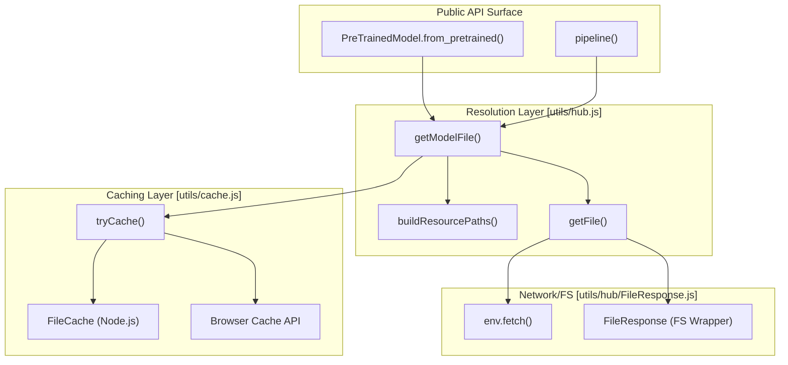
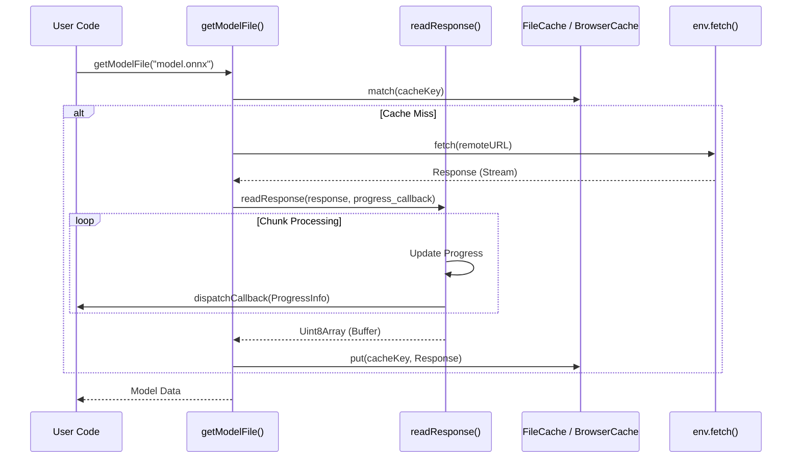

<!-- source: DeepWiki mcp.deepwiki.com · repo huggingface/transformers.js · page 7 Hub Integration and Caching · fetched 2026-10-26 -->

# Hub Integration and Caching

Relevant source files

The following files were used as context for generating this wiki page:

- [packages/transformers/src/utils/core.js](packages/transformers/src/utils/core.js)
- [packages/transformers/src/utils/hub.js](packages/transformers/src/utils/hub.js)

This page documents how Transformers.js interacts with the Hugging Face Hub to fetch model assets and manage them via a multi-tier caching system. The integration ensures that models, configurations, and tokenizers are retrieved efficiently across different environments (Browser, Node.js, Deno, etc.) while providing progress tracking and request deduplication.

For deep technical details on specific subsystems, see the following child pages:
- **[File Loading System](#7.1)** — Details the low-level file fetching mechanism, environment-specific request headers, and progress tracking.
- **[Caching Architecture](#7.2)** — Explains the three caching strategies (Browser Cache API, File System, and Custom) and how the library resolves cache keys.

## Overview

The Hub Integration system acts as the gateway between the high-level `AutoModel` or `pipeline` calls and the physical files stored remotely or locally. It abstracts the complexity of environment detection, authentication, and storage persistence.

### High-Level Flow

The following diagram illustrates how a request for a model file (e.g., `config.json`) flows through the resolution logic to the underlying storage or network.

**Diagram: Hub Resolution and Code Entities**

Sources: [packages/transformers/src/utils/hub.js:67-81](), [packages/transformers/src/utils/hub.js:132-150](), [packages/transformers/src/utils/hub.js:404-450]()

## Core Components

### 1. Resource Resolution
Before fetching, the library must resolve the location of a file. The `buildResourcePaths` function takes a model ID (e.g., `onnx-community/all-MiniLM-L6-v2`) and a filename to generate the `localPath`, `remoteURL`, and a `proposedCacheKey` [packages/transformers/src/utils/hub.js:132-150]().

### 2. File Loading System
The library adapts its fetching strategy based on `env.useFS`. In Node.js, it uses `FileResponse` to read from the disk; in browsers, it defaults to the `fetch` API [packages/transformers/src/utils/hub.js:67-81]().
- **Authentication**: In Node.js, the system automatically attaches `Authorization: Bearer <token>` headers if `HF_TOKEN` or `HF_ACCESS_TOKEN` is found in environment variables [packages/transformers/src/utils/hub.js:95-109]().
- **Progress Tracking**: All downloads are wrapped in a `DefaultProgressCallback` that aggregates progress across multiple files (e.g., weights, tokenizer, and config) to provide a unified percentage to the user [packages/transformers/src/utils/core.js:104-142]().

For details, see **[File Loading System](#7.1)**.

### 3. Caching Architecture
Transformers.js implements a flexible caching layer to avoid redundant network requests. It supports:
- **Browser Cache**: Uses the `CacheStorage` API for persistent web storage.
- **File System Cache**: Uses `FileCache` in Node.js to store models in a local directory (defaulting to `./.cache/huggingface/hub`) [packages/transformers/src/utils/hub.js:10-10]().
- **Custom Cache**: Allows developers to inject their own `CacheInterface` implementation via `env.customCache`.

For details, see **[Caching Architecture](#7.2)**.

## Data Flow: Remote to Local

The following diagram bridges the "Natural Language" concept of downloading a model to the specific "Code Entities" that handle the stream and persistence.

**Diagram: Remote Fetch to Cache Persistence**

Sources: [packages/transformers/src/utils/hub.js:404-560](), [packages/transformers/src/utils/hub.js:726-769](), [packages/transformers/src/utils/core.js:91-93]()

## Summary Table of Hub Options

When calling `from_pretrained` or `pipeline`, the following `PretrainedOptions` control the Hub and Cache behavior:

| Option | Type | Description |
| :--- | :--- | :--- |
| `progress_callback` | `Function` | Receives `ProgressInfo` objects for UI updates [packages/transformers/src/utils/core.js:78-81](). |
| `local_files_only` | `boolean` | If `true`, skips network requests and only checks local cache/path [packages/transformers/src/utils/hub.js:40-40](). |
| `revision` | `string` | The git branch, tag, or commit ID to fetch from (default: `"main"`) [packages/transformers/src/utils/hub.js:41-42](). |
| `cache_dir` | `string` | Overrides the default directory for `FileCache` [packages/transformers/src/utils/hub.js:39-39](). |

Sources: [packages/transformers/src/utils/hub.js:34-44]()

---

