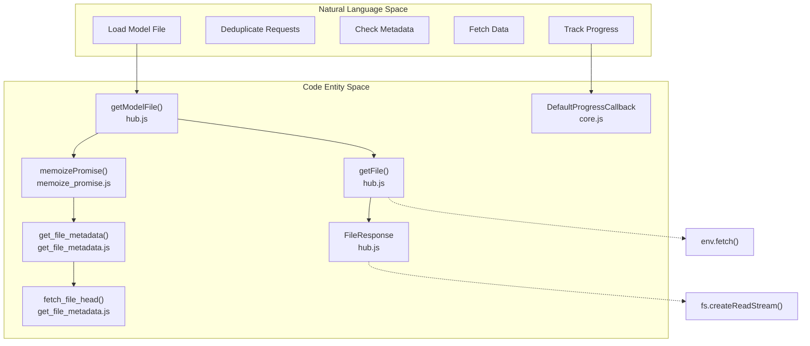
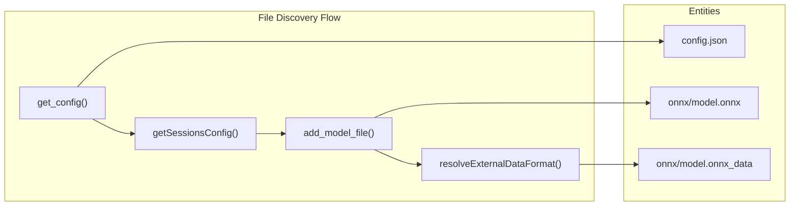

<!-- source: DeepWiki mcp.deepwiki.com · repo huggingface/transformers.js · page 7.1 File Loading System · fetched 2026-10-26 -->

# File Loading System

Relevant source files

The following files were used as context for generating this wiki page:

- [packages/transformers/src/utils/core.js](packages/transformers/src/utils/core.js)
- [packages/transformers/src/utils/hub.js](packages/transformers/src/utils/hub.js)
- [packages/transformers/src/utils/lru_cache.js](packages/transformers/src/utils/lru_cache.js)
- [packages/transformers/src/utils/memoize_promise.js](packages/transformers/src/utils/memoize_promise.js)
- [packages/transformers/src/utils/model_registry/get_file_metadata.js](packages/transformers/src/utils/model_registry/get_file_metadata.js)
- [packages/transformers/src/utils/model_registry/get_model_files.js](packages/transformers/src/utils/model_registry/get_model_files.js)
- [packages/transformers/tests/progress_callbacks.test.js](packages/transformers/tests/progress_callbacks.test.js)
- [packages/transformers/tests/utils/lru_cache.test.js](packages/transformers/tests/utils/lru_cache.test.js)

The file loading system in `transformers.js` provides a unified interface for retrieving model weights, configurations, and tokenizer data from the Hugging Face Hub, local file systems, or arbitrary URLs. It features built-in request deduplication via promise memoization, multi-tier caching, and granular progress tracking.

## Architecture Overview

The system is centered around `packages/transformers/src/utils/hub.js` and `packages/transformers/src/utils/model_registry/get_file_metadata.js`. It abstracts environment-specific APIs (Fetch for browsers, `fs` for Node.js) into a consistent interface.

### Data Flow and Code Entities

The following diagram maps high-level loading concepts to the specific functions and classes in the codebase.

**Sources:** [packages/transformers/src/utils/hub.js:67-81](), [packages/transformers/src/utils/model_registry/get_file_metadata.js:53-56](), [packages/transformers/src/utils/memoize_promise.js:31-45]()

## Request Deduplication

To prevent redundant network requests when multiple components (e.g., a tokenizer and a model) require the same file simultaneously, `transformers.js` uses a promise-based memoization layer.

### Memoization Mechanism
The `memoizePromise` utility ensures that an async operation is only initiated once per unique key. If a second request arrives while the first is in-flight, it receives the same pending promise.

- **Key Generation:** `makePretrainedOptionsKey` generates a stable string based on `modelId`, `revision`, and `cache_dir` [packages/transformers/src/utils/hub/utils.js:16-18]().
- **LRU Cache:** The system maintains an `LRUCache` with a capacity of 100 entries [packages/transformers/src/utils/memoize_promise.js:14-17]().
- **Error Handling:** If a promise rejects, it is evicted from the cache to allow for retries [packages/transformers/src/utils/memoize_promise.js:38-41]().

**Sources:** [packages/transformers/src/utils/memoize_promise.js:1-46](), [packages/transformers/src/utils/lru_cache.js:6-67]()

## Metadata and Progress Tracking

Accurate progress tracking for large model files requires knowing the total file size before the download starts.

### Metadata Resolution (`get_file_metadata`)
The system uses `get_file_metadata` to determine file size and existence without downloading the full content [packages/transformers/src/utils/model_registry/get_file_metadata.js:53-56]().

1. **Cache Check:** It first checks if the file exists in the configured cache [packages/transformers/src/utils/model_registry/get_file_metadata.js:68-79]().
2. **Local FS Check:** If `env.allowLocalModels` is true, it checks the local filesystem [packages/transformers/src/utils/model_registry/get_file_metadata.js:82-102]().
3. **Range Request:** For remote files, it performs a `Range: bytes=0-0` request. This is preferred over `HEAD` because it reliably returns the uncompressed file size in the `content-range` header, avoiding inconsistencies caused by transparent decompression [packages/transformers/src/utils/model_registry/get_file_metadata.js:17-27](), [packages/transformers/src/utils/model_registry/get_file_metadata.js:108-124]().

### Aggregate Progress Tracking
The `DefaultProgressCallback` class wraps individual file progress events to provide a global view of the loading process.

- **`FilesLoadingMap`:** A mutable map tracking `loaded` and `total` bytes for every file involved in a `pipeline()` or `from_pretrained()` call [packages/transformers/src/utils/core.js:43-46]().
- **`progress_total`:** An event emitted whenever any file updates, providing the aggregate percentage across all files [packages/transformers/src/utils/core.js:127-139]().

**Sources:** [packages/transformers/src/utils/model_registry/get_file_metadata.js:1-156](), [packages/transformers/src/utils/core.js:104-142]()

## Implementation Detail: `getFile` and `FileResponse`

The system selects the retrieval method based on the URL scheme and environment settings.

| Logic Path | Condition | Implementation |
| :--- | :--- | :--- |
| **Local File** | `env.useFS` is true and not a remote URL | Returns `FileResponse` wrapping `fs` [packages/transformers/src/utils/hub.js:68-75]() |
| **Remote Fetch** | Otherwise | Returns `env.fetch()` with Hub headers [packages/transformers/src/utils/hub.js:77-80]() |

### Hub Authentication
When running in Node.js, `getFetchHeaders` automatically attaches the Hugging Face token from environment variables (`HF_TOKEN` or `HF_ACCESS_TOKEN`) for requests to `huggingface.co` or `hf.co` [packages/transformers/src/utils/hub.js:100-109]().

### FileResponse Class
`FileResponse` implements the Web `Response` interface for local files, allowing the rest of the library to use standard methods like `.json()`, `.arrayBuffer()`, and `.body.getReader()` regardless of the source [packages/transformers/src/utils/hub/FileResponse.js]().

**Sources:** [packages/transformers/src/utils/hub.js:67-117](), [packages/transformers/src/utils/hub/FileResponse.js:1-120]()

## Model File Discovery

The `get_model_files` function determines exactly which files need to be loaded for a specific model architecture by inspecting its `config.json`.

- **Session Configuration:** It uses `getSessionsConfig` to map model types (e.g., `EncoderDecoder`) to their required ONNX components (e.g., `encoder_model.onnx`, `decoder_model_merged.onnx`) [packages/transformers/src/utils/model_registry/get_model_files.js:99-105]().
- **Dtype Suffixing:** It applies appropriate suffixes (e.g., `_q8`, `_fp16`) based on the selected quantization level [packages/transformers/src/utils/model_registry/get_model_files.js:86-87]().
- **External Data:** It detects if a model uses the ONNX external data format (common for models >2GB) and adds the necessary `.onnx_data` chunks to the download list [packages/transformers/src/utils/model_registry/get_model_files.js:91-96]().

**Sources:** [packages/transformers/src/utils/model_registry/get_model_files.js:60-115](), [packages/transformers/src/utils/model-loader.js:1-100]()

---

