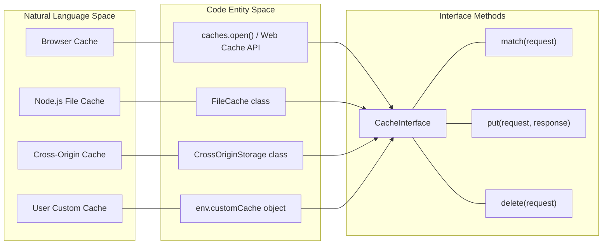
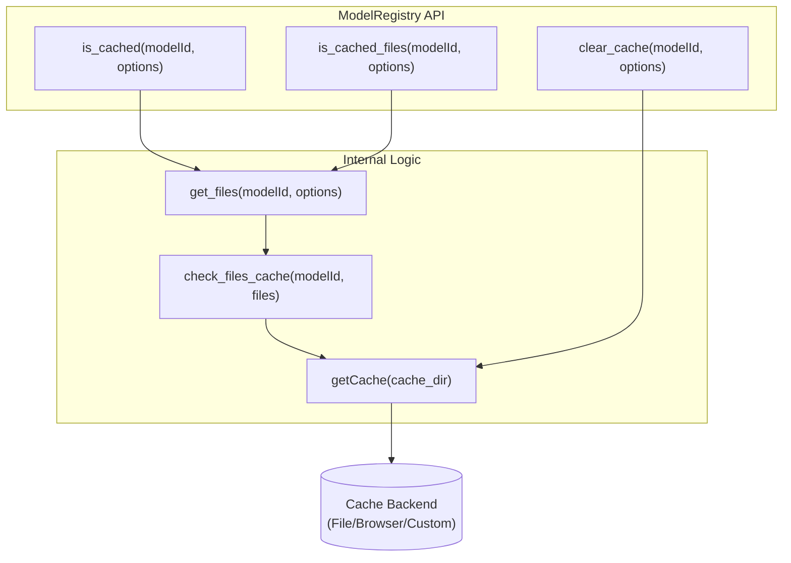

<!-- source: DeepWiki mcp.deepwiki.com · repo huggingface/transformers.js · page 7.2 Caching Architecture · fetched 2026-10-26 -->

# Caching Architecture

Relevant source files

The following files were used as context for generating this wiki page:

- [packages/transformers/docs/source/guides/dtypes.md](packages/transformers/docs/source/guides/dtypes.md)
- [packages/transformers/src/utils/cache.js](packages/transformers/src/utils/cache.js)
- [packages/transformers/src/utils/cache/CrossOriginStorageCache.js](packages/transformers/src/utils/cache/CrossOriginStorageCache.js)
- [packages/transformers/src/utils/cache/FileCache.js](packages/transformers/src/utils/cache/FileCache.js)
- [packages/transformers/src/utils/cache/cross-origin-storage.d.ts](packages/transformers/src/utils/cache/cross-origin-storage.d.ts)
- [packages/transformers/src/utils/hub/FileResponse.js](packages/transformers/src/utils/hub/FileResponse.js)
- [packages/transformers/src/utils/model_registry/ModelRegistry.js](packages/transformers/src/utils/model_registry/ModelRegistry.js)
- [packages/transformers/src/utils/model_registry/is_cached.js](packages/transformers/src/utils/model_registry/is_cached.js)
- [packages/transformers/tests/utils/cache.test.js](packages/transformers/tests/utils/cache.test.js)
- [packages/transformers/tests/utils/model_registry.test.js](packages/transformers/tests/utils/model_registry.test.js)

This page documents the multi-tier caching system that enables `transformers.js` to avoid redundant downloads of model files and assets. The architecture supports multiple storage backends, including the Browser Cache API, local filesystem, and a content-addressable Cross-Origin Storage, with automatic selection based on environment capabilities.

---

## Overview

The caching architecture implements a strategy with the following priority order:

1.  **Custom Cache**: User-defined cache implementing the `CacheInterface` [packages/transformers/src/utils/cache.js:7-14]().
2.  **Cross-Origin Storage (Experimental)**: Shared cache identifying files by content hash across origins [packages/transformers/src/utils/cache/CrossOriginStorageCache.js:26-88]().
3.  **Browser Cache**: Uses the Web Cache API (`caches.open(env.cacheKey)`) in browser environments [packages/transformers/src/utils/cache.js:46-60]().
4.  **Filesystem Cache**: File-based caching in Node.js environments using the `FileCache` class [packages/transformers/src/utils/cache/FileCache.js:15-128]().

The system automatically selects available caches via `getCache()` [packages/transformers/src/utils/cache.js:22-72]().

**Sources:** [packages/transformers/src/utils/cache.js:1-91](), [packages/transformers/src/utils/cache/FileCache.js:15-128]()

---

## Cache Interface and Entities

The system bridges natural language caching concepts to code entities through a standardized interface.

### Code Entity Mapping

**Sources:** [packages/transformers/src/utils/cache.js:7-14](), [packages/transformers/src/utils/cache/FileCache.js:15-128](), [packages/transformers/src/utils/cache/CrossOriginStorageCache.js:26-200]()

---

## Caching Strategies

### 1. Browser Cache API
In browser environments, the library uses the standard Web Cache API. It opens a bucket defined by `env.cacheKey` (defaulting to `'transformers-cache'`) [packages/transformers/src/env.js:154](). This is the preferred method for web applications as it provides persistent storage across sessions.

### 2. File System Cache (`FileCache`)
For Node.js, the `FileCache` class implements the `CacheInterface` by mapping cache keys to the local filesystem.

- **Atomic Writes**: To prevent corruption during concurrent writes, `put()` writes to a temporary file (including PID and random suffix) before performing an atomic `fs.promises.rename()` [packages/transformers/src/utils/cache/FileCache.js:51-96]().
- **Response Emulation**: `match()` returns a `FileResponse` object [packages/transformers/src/utils/hub/FileResponse.js:18-53](), which mimics the Web `Response` API by providing `arrayBuffer()`, `blob()`, `text()`, and `json()` methods [packages/transformers/src/utils/hub/FileResponse.js:85-120]().

### 3. Cross-Origin Storage (Experimental)
The `CrossOriginStorage` class utilizes the `navigator.crossOriginStorage` API to share model files across different domains based on their SHA-256 hash [packages/transformers/src/utils/cache/CrossOriginStorageCache.js:26-70]().

- **LFS Integration**: For Hugging Face Hub files, the hash is often resolved via Git LFS pointers to avoid full-body hashing [packages/transformers/src/utils/cache/CrossOriginStorageCache.js:91-96]().
- **Hash Mapping**: A secondary internal cache (`experimental_transformers-hash-cache`) persists the mapping between URLs and content hashes [packages/transformers/src/utils/cache/CrossOriginStorageCache.js:8-37]().

**Sources:** [packages/transformers/src/utils/cache/FileCache.js:48-104](), [packages/transformers/src/utils/hub/FileResponse.js:18-121](), [packages/transformers/src/utils/cache/CrossOriginStorageCache.js:90-156]()

---

## ModelRegistry: Cache Management API

The `ModelRegistry` class provides a high-level public API for users to manage the cache without interacting with the internal `CacheInterface` directly.

### Cache Inspection and Management Flow

### Key Registry Methods
- **`is_cached(modelId, options)`**: Performs a fast early-exit check for `config.json` before verifying all other required files [packages/transformers/src/utils/model_registry/is_cached.js:75-88]().
- **`is_cached_files(modelId, options)`**: Returns a detailed `CacheCheckResult` containing a boolean `allCached` and a per-file status array [packages/transformers/src/utils/model_registry/is_cached.js:103-110]().
- **`clear_cache(modelId, options)`**: Identifies all files associated with a model (including specific `dtype` variants) and removes them from the active cache backend [packages/transformers/src/utils/model_registry/ModelRegistry.js:220-222]().
- **`get_available_dtypes(modelId, options)`**: Probes the cache or remote Hub to detect which quantization levels (e.g., `fp32`, `q4`, `q8`) are available for the model [packages/transformers/src/utils/model_registry/ModelRegistry.js:239-241]().

**Sources:** [packages/transformers/src/utils/model_registry/ModelRegistry.js:118-242](), [packages/transformers/src/utils/model_registry/is_cached.js:1-110](), [packages/transformers/src/utils/model_registry/clear_cache.js:1-10]()

---

## Data Flow: Model Loading & Caching

When a model is loaded via `from_pretrained()`, the system interacts with the cache layer to resolve files.

| Step | Entity | Action | Citation |
| :--- | :--- | :--- | :--- |
| 1 | `getCache` | Resolves the appropriate `CacheInterface` implementation based on `env` settings. | [packages/transformers/src/utils/cache.js:22-72]() |
| 2 | `tryCache` | Attempts to match the `localPath` or `proposedCacheKey` in the selected cache. | [packages/transformers/src/utils/cache.js:80-90]() |
| 3 | `hub.getFile` | If cache miss, fetches the file from the remote source (Hugging Face Hub). | [packages/transformers/src/utils/hub.js:497-503]() |
| 4 | `Cache.put` | If successfully downloaded, the response is stored in the cache for future use. | [packages/transformers/src/utils/cache/FileCache.js:48-57]() |

**Sources:** [packages/transformers/src/utils/cache.js:22-90](), [packages/transformers/src/utils/cache/FileCache.js:48-104]()

---

