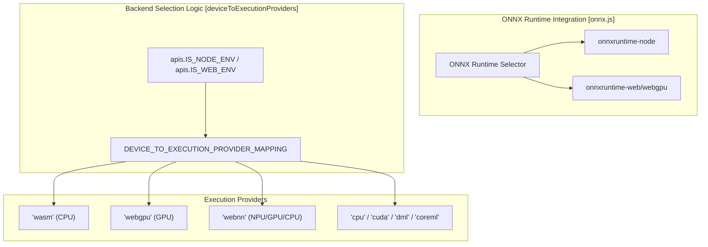
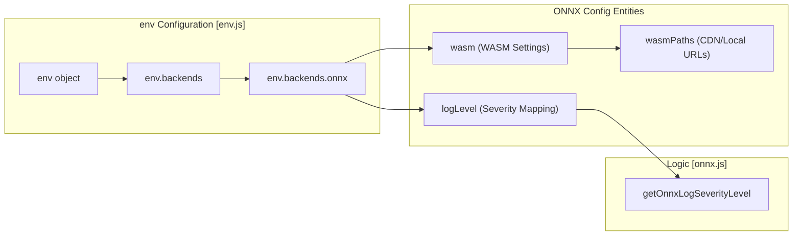

<!-- source: DeepWiki mcp.deepwiki.com · repo huggingface/transformers.js · page 8 ONNX Runtime Backend · fetched 2026-10-26 -->

# ONNX Runtime Backend

Relevant source files

The following files were used as context for generating this wiki page:

- [packages/transformers/scripts/build/plugins/ignoreModulesPlugin.mjs](packages/transformers/scripts/build/plugins/ignoreModulesPlugin.mjs)
- [packages/transformers/src/backends/onnx.js](packages/transformers/src/backends/onnx.js)
- [packages/transformers/src/backends/utils/cacheWasm.js](packages/transformers/src/backends/utils/cacheWasm.js)
- [packages/transformers/src/utils/hub/utils.js](packages/transformers/src/utils/hub/utils.js)
- [packages/transformers/src/utils/image.js](packages/transformers/src/utils/image.js)

## Purpose and Scope

This document describes the ONNX Runtime integration that powers model execution in Transformers.js. ONNX Runtime serves as the inference engine that runs ONNX-format models across multiple execution backends: WebAssembly (WASM) for CPU execution in browsers, WebGPU for GPU acceleration, and native bindings for Node.js environments. The system dynamically selects the appropriate runtime based on the environment and available hardware capabilities [packages/transformers/src/backends/onnx.js:105-151]().

For details about the device and quantization configuration options exposed to users, see [Device and Dtype Selection](#8.1). For details on how the different backends are architected and serialized, see [Backend Architecture](#8.2). For session lifecycle and configuration, see [Session Configuration](#8.3).

**Sources:** [packages/transformers/src/backends/onnx.js:1-28](), [packages/transformers/src/env.js:138-172]()

---

## ONNX Runtime Dependencies

Transformers.js integrates two separate ONNX Runtime packages depending on the execution environment. The library attempts to load the JS runtime's own ONNX implementation if available via `globalThis[Symbol.for('onnxruntime')]` [packages/transformers/src/backends/onnx.js:103-107](). Otherwise, it defaults to environment-specific packages:

| Package | Environment | Purpose |
|---------|-------------|---------|
| `onnxruntime-web` | Browser, Web Workers | Provides WASM and WebGPU backends [packages/transformers/src/backends/onnx.js:24]() |
| `onnxruntime-node` | Node.js | Provides native CPU bindings optimized for server environments [packages/transformers/src/backends/onnx.js:23]() |

The appropriate package is loaded based on runtime detection performed by the environment module. In Node.js environments, the library automatically determines supported hardware accelerators like CUDA (Linux x64), DirectML (Windows), or CoreML (macOS) [packages/transformers/src/backends/onnx.js:120-132]().

**Sources:** [packages/transformers/src/backends/onnx.js:21-28](), [packages/transformers/src/backends/onnx.js:103-151]()

---

## Backend Architecture

**Backend Selection Logic**

The system maps abstract device types to specific ONNX Execution Providers (EPs) using `DEVICE_TO_EXECUTION_PROVIDER_MAPPING` [packages/transformers/src/backends/onnx.js:35-49]().

1. **Environment Type**: Detected via `apis` flags to determine if running in browser, web worker, or Node.js [packages/transformers/src/backends/onnx.js:108-151]().
2. **Device Parameter**: User-specified `device` option in pipeline configuration (e.g., `'webgpu'`, `'wasm'`, `'cuda'`).
3. **Hardware Acceleration**: Automatic detection of WebNN (NPU/GPU/CPU) and WebGPU availability in browsers [packages/transformers/src/backends/onnx.js:140-147]().

**Sources:** [packages/transformers/src/backends/onnx.js:35-49](), [packages/transformers/src/backends/onnx.js:105-151](), [packages/transformers/src/env.js:31-49]()

---

## Backend Configuration System

**Configuration Interface**

The ONNX Runtime backend is configured through the `env.backends.onnx` object. A key feature is the mapping of library log levels to ONNX Runtime severity levels (0-4) via `getOnnxLogSeverityLevel` [packages/transformers/src/backends/onnx.js:58-80]().

**Key Configuration Properties:**

| Property | Description |
|----------|-------------|
| `wasmPaths` | Configures the location of WASM binaries and factories [packages/transformers/src/backends/onnx.js:25]() |
| `logLevel` | Controls ONNX Runtime verbosity (mapped to `ONNX_LOG_LEVEL_NAMES`) [packages/transformers/src/backends/onnx.js:86-92]() |
| `executionProviders` | The list of supported devices, sorted by priority/performance [packages/transformers/src/backends/onnx.js:98-101]() |

**Sources:** [packages/transformers/src/backends/onnx.js:51-92](), [packages/transformers/src/env.js:138-172]()

---

## WASM Backend: Loading and Caching

The library provides specialized utilities for loading and caching WebAssembly components to optimize startup performance in browser environments.

**WASM Loading Components:**

1. **Binary Loading**: `loadWasmBinary` fetches and caches the `.wasm` engine [packages/transformers/src/backends/utils/cacheWasm.js:54-64]().
2. **Factory Loading**: `loadWasmFactory` fetches the `.mjs` factory file. In specific environments like Chrome Extensions or Service Workers, it bypasses caching to avoid security restrictions on blob URLs [packages/transformers/src/backends/utils/cacheWasm.js:72-101]().
3. **Deno Compatibility**: The factory loader includes a patch to disable Node.js detection when running bundled web versions in Deno [packages/transformers/src/backends/utils/cacheWasm.js:94]().

**Caching Mechanism:**

The `loadAndCacheFile` utility attempts to retrieve files from the Browser Cache API first [packages/transformers/src/backends/utils/cacheWasm.js:10-46](). It uses `URL.createObjectURL` to bridge the Cache API with dynamic imports used by ONNX Runtime [packages/transformers/src/backends/utils/cacheWasm.js:68-96]().

**Sources:** [packages/transformers/src/backends/utils/cacheWasm.js:1-101](), [packages/transformers/src/utils/hub/utils.js:163-189]()

---

## Data Types and Tensor Integration

Transformers.js integrates tightly with `onnxruntime-common` for tensor representation.

- **Tensor Class**: The library exports and uses the native `Tensor` class from `onnxruntime-common` [packages/transformers/src/backends/onnx.js:28]().
- **Image Conversion**: The `RawImage` utility provides `fromTensor` and `toTensor` methods to bridge image data with ONNX-compatible formats (supporting `CHW` and `HWC` layouts) [packages/transformers/src/utils/image.js:189-216]().
- **Quantization**: While the backend supports various dtypes, the `RawImage` processing often outputs `Uint8ClampedArray` for pixel data before normalization into float tensors [packages/transformers/src/utils/image.js:74-87]().

For detailed information on supported quantization levels (fp32, fp16, q8, q4), see [Device and Dtype Selection](#8.1).

**Sources:** [packages/transformers/src/backends/onnx.js:28](), [packages/transformers/src/utils/image.js:189-216]()

---

