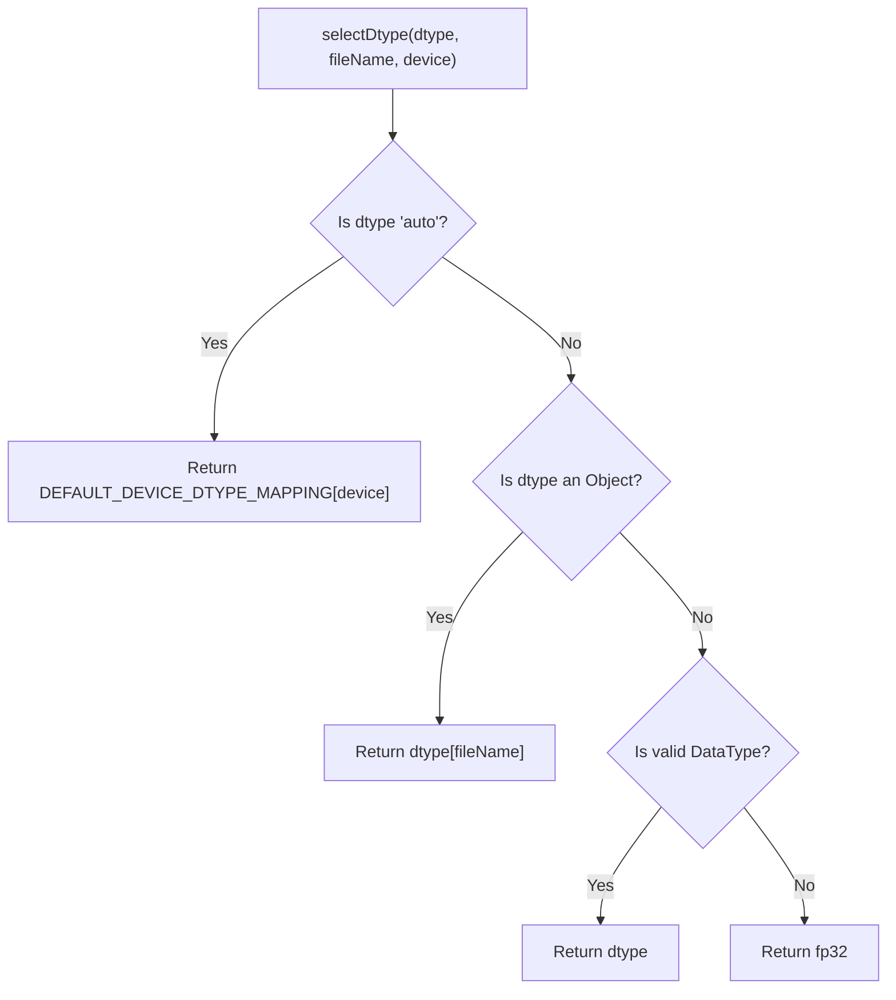

<!-- source: DeepWiki mcp.deepwiki.com · repo huggingface/transformers.js · page 8.1 Device and Dtype Selection · fetched 2026-10-26 -->

# Device and Dtype Selection

<details>
<summary>Relevant source files</summary>

The following files were used as context for generating this wiki page:

- [packages/transformers/scripts/build/plugins/ignoreModulesPlugin.mjs](packages/transformers/scripts/build/plugins/ignoreModulesPlugin.mjs)
- [packages/transformers/src/backends/onnx.js](packages/transformers/src/backends/onnx.js)
- [packages/transformers/src/backends/utils/cacheWasm.js](packages/transformers/src/backends/utils/cacheWasm.js)
- [packages/transformers/src/models/session_config.js](packages/transformers/src/models/session_config.js)
- [packages/transformers/src/utils/dtypes.js](packages/transformers/src/utils/dtypes.js)
- [packages/transformers/src/utils/hub/utils.js](packages/transformers/src/utils/hub/utils.js)
- [packages/transformers/src/utils/image.js](packages/transformers/src/utils/image.js)
- [packages/transformers/src/utils/model_registry/get_available_dtypes.js](packages/transformers/src/utils/model_registry/get_available_dtypes.js)
- [packages/transformers/src/utils/model_registry/resolve_model_type.js](packages/transformers/src/utils/model_registry/resolve_model_type.js)
- [packages/transformers/tests/models/cohere_asr/test_feature_extraction_cohere_asr.js](packages/transformers/tests/models/cohere_asr/test_feature_extraction_cohere_asr.js)
- [packages/transformers/tests/pipelines/test_pipelines_automatic_speech_recognition.js](packages/transformers/tests/pipelines/test_pipelines_automatic_speech_recognition.js)

</details>


This document explains how to configure the device (execution backend) and data type (dtype) for model inference in Transformers.js. Device selection determines whether models run on CPU (via WebAssembly or native bindings), GPU (via WebGPU, CUDA, or DirectML), or NPU (via WebNN). Dtype selection controls the numerical precision and quantization level of model weights.

For information about the underlying backend architecture and how these options are implemented, see [Backend Architecture](#8.2). For session-level configuration details, see [Session Configuration](#8.3).

## Overview

Transformers.js supports two primary axes of configuration for model execution:

| Configuration Axis | Purpose | Default Behavior |
|-------------------|---------|------------------|
| **Device** | Selects execution backend (CPU vs GPU vs NPU) | `'wasm'` (browser), `'cpu'` (Node.js) |
| **Dtype** | Controls numerical precision and quantization | `'q8'` (WASM), `'fp32'` (WebGPU) |

Sources: [packages/transformers/src/backends/onnx.js:35-49](), [packages/transformers/src/utils/dtypes.js:52-56]()

## Device Selection

### Available Devices

Transformers.js maps high-level device strings to specific ONNX Runtime Execution Providers (EPs). The available devices depend on the environment (Browser vs. Node.js).

**Device Resolution Flow**

```mermaid
graph TB
    [DeviceInput] -- "device string" --> [Mapping]
    subgraph "DEVICE_TO_EXECUTION_PROVIDER_MAPPING"
        [Mapping] --> CPU["'cpu' -> 'cpu'"]
        [Mapping] --> WASM["'wasm' -> 'wasm'"]
        [Mapping] --> WebGPU["'webgpu' -> 'webgpu'"]
        [Mapping] --> CUDA["'cuda' -> 'cuda'"]
        [Mapping] --> DML["'dml' -> 'dml'"]
        [Mapping] --> CoreML["'coreml' -> 'coreml'"]
        [Mapping] --> WebNN["'webnn' -> {name: 'webnn', deviceType: 'cpu'|'gpu'|'npu'}"]
    end
    
    CPU --> NodeORT["onnxruntime-node"]
    WASM --> WebORT["onnxruntime-web (WASM)"]
    WebGPU --> WebORTGPU["onnxruntime-web (WebGPU)"]
    CUDA --> NodeORT
    DML --> NodeORT
    CoreML --> NodeORT
    WebNN --> WebORT
```
Sources: [packages/transformers/src/backends/onnx.js:35-49](), [packages/transformers/src/backends/onnx.js:108-151]()

#### Environment-Specific Availability

The library automatically detects the platform and restricts available devices to those supported by the runtime:

| Environment | Supported Devices | Native Backend |
|--------------|-------------------|---------|
| **Browser** | `wasm`, `webgpu`, `webnn`, `webnn-gpu`, `webnn-npu` | `onnxruntime-web` |
| **Node.js (Linux x64)** | `cpu`, `cuda`, `webgpu` | `onnxruntime-node` |
| **Node.js (Windows)** | `cpu`, `dml`, `webgpu` | `onnxruntime-node` |
| **Node.js (macOS)** | `cpu`, `coreml`, `webgpu` | `onnxruntime-node` |

Sources: [packages/transformers/src/backends/onnx.js:120-151]()

### Specifying Device

Device is specified as an option when creating a pipeline or loading a model via `from_pretrained`. Internally, the `deviceToExecutionProviders` function resolves the requested string into an array of ONNX execution provider configurations.

```javascript
import { pipeline } from '@huggingface/transformers';

// Explicitly request WebGPU
const pipe = await pipeline('sentiment-analysis', 'Xenova/distilbert-base-uncased-finetuned-sst-2-english', {
  device: 'webgpu',
});
```
Sources: [packages/transformers/src/backends/onnx.js:161-163]()

## Dtype and Quantization

### Available Dtypes

Dtypes control the precision of the model weights. Transformers.js uses a suffix-based file resolution system to load the appropriate ONNX file from the Hub.

| Dtype String | Precision | File Suffix | Rationale |
|--------------|-----------|-------------|-----------|
| `'fp32'` | 32-bit float | (none) | Full precision, baseline |
| `'fp16'` | 16-bit float | `_fp16` | GPU-friendly, half memory |
| `'q8'` | 8-bit quantized | `_quantized` | Default for CPU, 4x smaller than fp32 |
| `'q4'` | 4-bit quantized | `_q4` | Maximum compression |
| `'q4f16'` | 4-bit weights, fp16 acts | `_q4f16` | Optimized for modern GPUs |

Sources: [packages/transformers/src/utils/dtypes.js:35-49](), [packages/transformers/src/utils/dtypes.js:59-72]()

### Dtype Resolution Logic

The `selectDtype` function resolves the final dtype based on the requested `dtype`, the specific `fileName` (e.g., `encoder_model.onnx`), and the `selectedDevice`.

**Dtype Selection Decision Tree**


Sources: [packages/transformers/src/utils/dtypes.js:85-126]()

### Default Dtype Behavior

If no dtype is specified (or `dtype: 'auto'` is used), the library selects a default based on the device:
- **WASM**: Defaults to `'q8'` to minimize browser download size.
- **WebGPU/CPU**: Defaults to `'fp32'` for maximum compatibility.

Sources: [packages/transformers/src/utils/dtypes.js:52-56]()

## Dtype Discovery

The `get_available_dtypes` utility allows developers to programmatically check which quantization levels are available for a specific model on the Hugging Face Hub.

**Dtype Discovery Process**

```mermaid
graph LR
    [get_available_dtypes] --> [getSessionsConfig]
    [getSessionsConfig] --> [Resolve File Names]
    [Resolve File Names] --> [Probe Hub/Cache]
    [Probe Hub/Cache] --> [Check Existence for All Sessions]
    [Check Existence for All Sessions] --> [Return Valid Dtypes]
```

This function ensures that for multi-file models (like Seq2Seq models with separate encoder and decoder files), a dtype is only reported as available if **all** required files exist for that specific quantization level.

Sources: [packages/transformers/src/utils/model_registry/get_available_dtypes.js:34-67]()

## Implementation Details

### WASM Backend Specifics
When using the `wasm` device, the library manages the loading of the ONNX Runtime WASM binary and its factory `.mjs` file. The `loadWasmFactory` function handles environment-specific constraints, such as patching Node.js detection for Deno environments and bypassing blob URL creation in Chrome Extensions or Service Workers where security policies might block them.

Sources: [packages/transformers/src/backends/utils/cacheWasm.js:72-101]()

### Device-Dtype Compatibility
While most combinations work, performance varies:
1. **WebGPU + fp16**: The library provides `isWebGpuFp16Supported()` to check if the `shader-f16` feature is available on the GPU adapter before requesting `fp16`.
2. **WASM + q8**: Highly optimized via ONNX Runtime's quantized kernels for CPU.
3. **WebGPU + Quantization**: Modern WebGPU backends support `q4f16` and similar hybrid formats for reduced VRAM usage without the full performance penalty of CPU-style quantization.

Sources: [packages/transformers/src/utils/dtypes.js:14-33](), [packages/transformers/src/utils/dtypes.js:68-70]()

---

