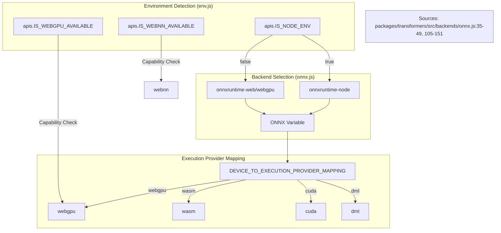
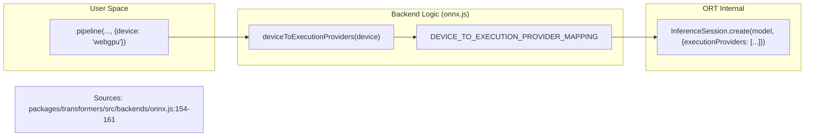

<!-- source: DeepWiki mcp.deepwiki.com · repo huggingface/transformers.js · page 8.2 Backend Architecture · fetched 2026-10-26 -->

# Backend Architecture

Relevant source files

The following files were used as context for generating this wiki page:

- [packages/transformers/docs/source/guides/webgpu.md](packages/transformers/docs/source/guides/webgpu.md)
- [packages/transformers/scripts/build/plugins/ignoreModulesPlugin.mjs](packages/transformers/scripts/build/plugins/ignoreModulesPlugin.mjs)
- [packages/transformers/src/backends/onnx.js](packages/transformers/src/backends/onnx.js)
- [packages/transformers/src/backends/utils/cacheWasm.js](packages/transformers/src/backends/utils/cacheWasm.js)
- [packages/transformers/src/utils/hub/utils.js](packages/transformers/src/utils/hub/utils.js)
- [packages/transformers/src/utils/image.js](packages/transformers/src/utils/image.js)

This document details the technical architecture of the execution backends in Transformers.js. The library leverages [ONNX Runtime](https://onnxruntime.ai/) to provide high-performance inference across three primary environments: WebAssembly (WASM) for CPU-based browser execution, WebGPU for hardware-accelerated browser execution, and Node.js native bindings for server-side performance.

**Sources:** [README.md:34-34](), [packages/transformers/src/backends/onnx.js:1-17]()

## Architecture Overview

Transformers.js acts as a high-level wrapper around environment-specific ONNX Runtime (ORT) distributions. The selection of the backend is determined at runtime based on the detected environment and user configuration.

| Environment | Backend Implementation | Execution Provider (EP) |
| :--- | :--- | :--- |
| **Browser / Web Worker** | `onnxruntime-web` | `wasm`, `webgpu`, `webnn` |
| **Node.js / Deno / Bun** | `onnxruntime-node` | `cpu`, `cuda`, `dml`, `coreml` |

### Code Entity Mapping: Environment to Backend

The following diagram illustrates how the `onnx.js` module resolves the environment to a specific ORT package and available execution providers.

**Diagram: Backend Resolution Logic**

**Sources:** [packages/transformers/src/backends/onnx.js:35-49](), [packages/transformers/src/backends/onnx.js:105-151]()

---

## 1. WebAssembly (WASM) Backend

The WASM backend is the default fallback for browser environments. It executes models on the CPU by compiling C++ kernels into WebAssembly.

### Serialization and Loading
WASM execution requires two external assets: the WASM binary (`.wasm`) and the WASM factory/glue code (`.mjs`). Transformers.js manages these via `cacheWasm.js` to ensure efficient loading and caching using the Browser Cache API.

- **WASM Binary**: Loaded as an `ArrayBuffer` via `loadWasmBinary` [packages/transformers/src/backends/utils/cacheWasm.js:54-64]().
- **WASM Factory**: Loaded via `loadWasmFactory`. In most environments, it creates a **Blob URL** from the cached script to bridge the Cache API with ORT's dynamic imports [packages/transformers/src/backends/utils/cacheWasm.js:72-101]().
- **Deno Patching**: When running the web-bundled version in Deno, the library automatically patches the WASM factory to disable Node.js detection, preventing Deno from attempting to use non-existent Node.js APIs like `worker_threads` [packages/transformers/src/backends/utils/cacheWasm.js:87-94]().

**Sources:** [packages/transformers/src/backends/utils/cacheWasm.js:10-46](), [packages/transformers/src/backends/utils/cacheWasm.js:72-101]()

---

## 2. WebGPU Backend

WebGPU is the high-performance backend for browsers, allowing direct access to the system's GPU for compute shaders.

### Key Characteristics
- **Activation**: Enabled by setting `{ device: 'webgpu' }` in the pipeline or model constructor [packages/transformers/docs/source/guides/webgpu.md:20-28]().
- **Data Flow**: Tensors are uploaded to GPU buffers. ONNX Runtime Web handles the orchestration of compute shaders for model operations.
- **Compatibility**: The library checks `apis.IS_WEBGPU_AVAILABLE` before attempting to use this backend [packages/transformers/src/backends/onnx.js:145-147]().

**Sources:** [packages/transformers/docs/source/guides/webgpu.md:1-16](), [packages/transformers/src/backends/onnx.js:40-40]()

---

## 3. Node.js Native Backend

In server-side environments (Node.js, Bun, Deno), the library uses `onnxruntime-node`, which links to pre-compiled native binaries.

### Platform-Specific Device Support
The backend automatically detects the operating system to prioritize high-performance Execution Providers (EPs):

| Platform | Supported Native Devices | Code Reference |
| :--- | :--- | :--- |
| **Windows** | DirectML (`dml`) | [packages/transformers/src/backends/onnx.js:121-123]() |
| **Linux** | CUDA (`cuda`) (x64 only) | [packages/transformers/src/backends/onnx.js:124-128]() |
| **macOS** | CoreML (`coreml`) | [packages/transformers/src/backends/onnx.js:129-131]() |
| **Universal** | WebGPU, CPU | [packages/transformers/src/backends/onnx.js:134-135]() |

**Sources:** [packages/transformers/src/backends/onnx.js:108-136]()

---

## Implementation Details

### Device to Execution Provider Mapping
The `deviceToExecutionProviders` function converts user-friendly device strings into ORT-compatible configuration objects.

**Diagram: Data Flow from User API to ORT Session**

### Logging and Severity
The library synchronizes its internal `LogLevel` with ONNX Runtime's severity levels (0-4) via `getOnnxLogSeverityLevel` [packages/transformers/src/backends/onnx.js:58-80](). This prevents verbose session creation logs from overwhelming the console unless `LogLevel.DEBUG` is explicitly set.

**Sources:** [packages/transformers/src/backends/onnx.js:58-92]()

### Image Processing Backend Integration
The `RawImage` class abstracts environment differences for vision tasks. In browsers, it uses `OffscreenCanvas` and `createImageBitmap`. In Node.js, it falls back to the `sharp` library for high-performance native image manipulation [packages/transformers/src/utils/image.js:23-52]().

**Sources:** [packages/transformers/src/utils/image.js:74-112](), [packages/transformers/src/utils/image.js:166-183]()

---

